# 有哪些好用的AI工具或者工具集网站？

> 来源：[https://agijuejin.feishu.cn/docx/KpSmdo29gor5kQxARGhcEXjbnwb](https://agijuejin.feishu.cn/docx/KpSmdo29gor5kQxARGhcEXjbnwb)

> 作者：德里克文

> 原文： [https://www.zhihu.](https://www.zhihu.com/question/592101575/answer/3206590319)com/question/5921...

**作为人工智能的爱好者，我收集了很多好用的AI**工具及工具集网站，我这里来分享给大家吧！

全文干货不废话，介绍我自己常用的AI工具，如果觉得有用的可以收藏备用，无论是职场上的文案写作，图像处理，PPT汇报，还是设计、视频、音频等等工具，我都会做一个简单的介绍和推荐。

下面是我自己用过的国内可直接登陆使用的一些AI工具及简要介绍，每一类型推荐3种我自己常用的工具。

## **一.AI写作类工具**

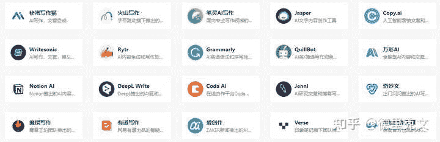

### 1. 迅捷AI写作

作为一名长期与图片和文字打交道的创作者[，我想先推荐一款可](https://www.zhihu.com/search?q=%E8%87%AA%E5%8A%A8%E5%8C%96%E6%96%87%E7%AB%A0%E7%94%9F%E6%88%90%E5%99%A8&search_source=Entity&hybrid_search_source=Entity&hybrid_search_extra=%7B%22sourceType%22%3A%22answer%22%2C%22sourceId%22%3A3206590319%7D)以说是专为写作而生的 自动化文章生成器 。

在使用过程中，我深感其强大的功能和广泛[的适用性。](https://www.zhihu.com/search?q=%E4%BC%91%E9%97%B2%E6%97%B6%E5%85%89&search_source=Entity&hybrid_search_source=Entity&hybrid_search_extra=%7B%22sourceType%22%3A%22answer%22%2C%22sourceId%22%3A3206590319%7D)无论是为工作准备报告，还是为 休闲时光 创作小说，它都能迅速满足我的需求。它能生成小说、会议纪要、广告文案，甚至还可以生成代码，功能多，用途广！

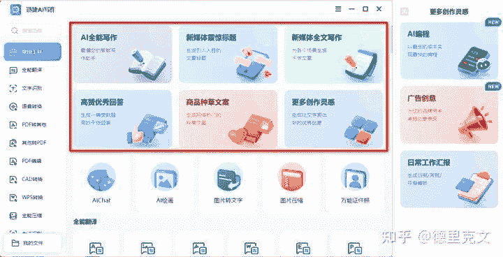

尤其是【AI [全能写作 ](https://www.zhihu.com/search?q=%E5%85%A8%E8%83%BD%E5%86%99%E4%BD%9C&search_source=Entity&hybrid_search_source=Entity&hybrid_search_extra=%7B%22sourceType%22%3A%22answer%22%2C%22sourceId%22%3A3206590319%7D)】功能，真的让我十分满意，不同的文体需求的润色，都能得到高效且高质量的满足。当我想要尝试新的写作风格或主题时，它总能为我提供源源不断的灵感。

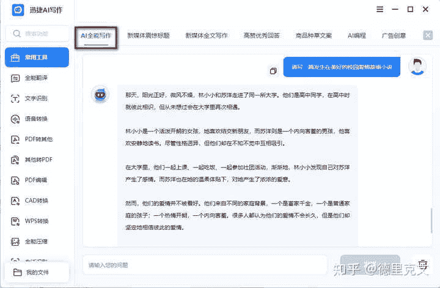

在[现今快节奏的生活中](https://www.zhihu.com/search?q=%E5%A6%82%E6%9E%9C%E4%BD%A0%E4%B9%9F%E5%83%8F%E6%88%91%E4%B8%80%E6%A0%B7&search_source=Entity&hybrid_search_source=Entity&hybrid_search_extra=%7B%22sourceType%22%3A%22answer%22%2C%22sourceId%22%3A3206590319%7D)，能让我们更高效地处理写作任务，同时又能激发我们的创意和灵感，这样的工具实属难得。 如果你也像我一样 ，时常与文字为伴，或是经常面临各种写作任务，不妨试试这款自动化文章生成器。

### 2. 有道写作

有道写作是 [网易有道 ](https://www.zhihu.com/search?q=%E7%BD%91%E6%98%93%E6%9C%89%E9%81%93&search_source=Entity&hybrid_search_source=Entity&hybrid_search_extra=%7B%22sourceType%22%3A%22answer%22%2C%22sourceId%22%3A3206590319%7D)推出的智能英文写作修改和润色工具，该神器可以智能识别1[00多种错误](https://www.zhihu.com/search?q=%E4%B8%BB%E8%B0%93%E5%AE%BE%E6%90%AD%E9%85%8D&search_source=Entity&hybrid_search_source=Entity&hybrid_search_extra=%7B%22sourceType%22%3A%22answer%22%2C%22sourceId%22%3A3206590319%7D)类型，包括词组搭[配、时态](https://www.zhihu.com/search?q=Web&search_source=Entity&hybrid_search_source=Entity&hybrid_search_extra=%7B%22sourceType%22%3A%22answer%22%2C%22sourceId%22%3A3206590319%7D)、 主谓宾搭配 等。用户可以[在 We](https://www.zhihu.com/search?q=%E5%AE%A2%E6%88%B7%E7%AB%AF&search_source=Entity&hybrid_search_source=Entity&hybrid_search_extra=%7B%22sourceType%22%3A%22answer%22%2C%22sourceId%22%3A3206590319%7D)b 端、移动端、Windows 客户端 以及Word中使用有道写作产品。

有道写作的产品亮点：

1.权威的批改体系，以确保语法的准确性、语言风格的得体性、造句的多样性和句意的清晰度

2.基于国人的英语写作习惯，面向国人的母语级润色，支持中英双语写作，助力文章一气呵成

[3.支持手写文章](https://www.zhihu.com/search?q=%E6%9C%89%E9%81%93%E8%AF%8D%E5%85%B8APP&search_source=Entity&hybrid_search_source=Entity&hybrid_search_extra=%7B%22sourceType%22%3A%22answer%22%2C%22sourceId%22%3A3206590319%7D)，拍照上传。有道写作结合 [有道词典AP](https://www.zhihu.com/search?q=%E5%9B%BE%E7%89%87%E8%BD%AC%E6%96%87%E5%AD%97&search_source=Entity&hybrid_search_source=Entity&hybrid_search_extra=%7B%22sourceType%22%3A%22answer%22%2C%22sourceId%22%3A3206590319%7D)P ，手写英文习作拍照上传， 图片转文字 ，快速批改支持多场景写作。批改体系覆盖小初高、四六级、考研、雅思、托福、学术论文等多种写作类型，为你提供全面指导.

### 3. 百度 [度加](https://www.zhihu.com/search?q=%E5%BA%A6%E5%8A%A0&search_source=Entity&hybrid_search_source=Entity&hybrid_search_extra=%7B%22sourceType%22%3A%22answer%22%2C%22sourceId%22%3A3206590319%7D)

[度加创作工具 ](https://www.zhihu.com/search?q=%E5%BA%A6%E5%8A%A0%E5%88%9B%E4%BD%9C%E5%B7%A5%E5%85%B7&search_source=Entity&hybrid_search_source=Entity&hybrid_search_extra=%7B%22sourceType%22%3A%22answer%22%2C%22sourceId%22%3A3206590319%7D)是由百度出品的、人人可用的 [AIGC ](https://www.zhihu.com/search?q=AIGC&search_source=Entity&hybrid_search_source=Entity&hybrid_search_extra=%7B%22sourceType%22%3A%22answer%22%2C%22sourceId%22%3A3206590319%7D)创作工具网站，度加致力于通过AI能力降低内容生产门槛，提升创作效率，一站式聚合百度AIGC能力，引领跨时代的内容生产方式。

创作者输入文本，AI 可以对已有文章进行润色、提练与改写，为用户制作文案，包括标题和正文，满足日常分享、营销推广、博主种草、知识输出等各类创作需求。

### 4. [**ChatGpt类语言大模型 **](https://www.zhihu.com/search?q=ChatGpt%E7%B1%BB%E8%AF%AD%E8%A8%80%E5%A4%A7%E6%A8%A1%E5%9E%8B&search_source=Entity&hybrid_search_source=Entity&hybrid_search_extra=%7B%22sourceType%22%3A%22answer%22%2C%22sourceId%22%3A3206590319%7D)**的学习**

除了上面这些好用的写作工具自己的整合外，怎么样[学会自己使用提示词是非](https://www.zhihu.com/search?q=%E6%8E%88%E4%BA%BA%E4%BB%A5%E9%B1%BC%E4%B8%8D%E5%A6%82%E6%8E%88%E4%BA%BA%E4%BB%A5%E6%B8%94&search_source=Entity&hybrid_search_source=Entity&hybrid_search_extra=%7B%22sourceType%22%3A%22answer%22%2C%22sourceId%22%3A3206590319%7D)[常重要的，俗话](https://www.zhihu.com/search?q=%E4%BA%BA%E5%B7%A5%E6%99%BA%E8%83%BDAI&search_source=Entity&hybrid_search_source=Entity&hybrid_search_extra=%7B%22sourceType%22%3A%22answer%22%2C%22sourceId%22%3A3206590319%7D)说 授人以鱼不如授人以渔 ，我这里也建议没有学习过人工智能的知友先进行一些 人工智能AI 基础的知识了解。这样无论是什么工具，都能够得心应手。

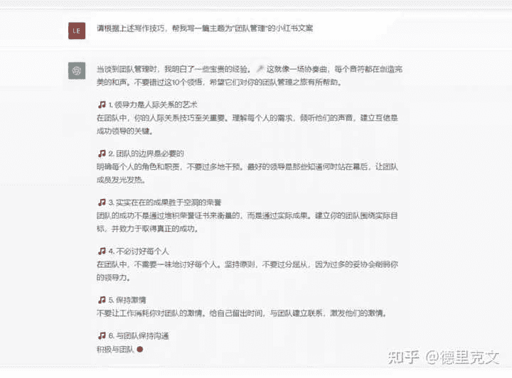

在这里我也推荐一个能够迅速学会如何掌握这些[AI写作工具](https://www.zhihu.com/search?q=%E7%9F%A5%E4%B9%8E%E7%9F%A5%E5%AD%A6%E5%A0%82&search_source=Entity&hybrid_search_source=Entity&hybrid_search_extra=%7B%22sourceType%22%3A%22answer%22%2C%22sourceId%22%3A3206590319%7D)，最适合初学者学习的课程，[ 知乎知学堂 最近推](https://www.zhihu.com/search?q=%E4%BA%92%E5%8A%A8%E6%99%BA%E8%83%BD%E5%8A%9E%E5%85%AC%E8%AE%AD%E7%BB%83%E8%90%A5&search_source=Entity&hybrid_search_source=Entity&hybrid_search_extra=%7B%22sourceType%22%3A%22answer%22%2C%22sourceId%22%3A3206590319%7D)出了一门名为“AI 互动智能办公训练营 ”的直播课，该课程共计2小时，主要介绍了AI对各行各业工作模式的潜在影响，以及对职场人的新能力要求。

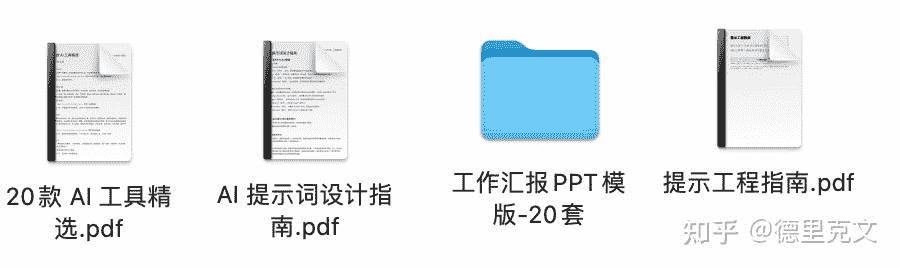

这一门课详细介绍了各种有用的AI工具及工具集网站，我建议你能花时间去听一下，只要听完免费的课程就可以从知乎领取上图的那些资料，帮助自己更好地迎合AI时代的到来，规划自己的职业生涯，以应对AI带来的巨变时代。

如果对于人工智能有兴趣的初学者可以去试着听下这门课程，里面的视频课件介绍能够让你更好的了解AI工具的应用

AI工具训练🔥零基础上手20+主流AI工具 仅需0.1元

立即领取

### 二、图像处理

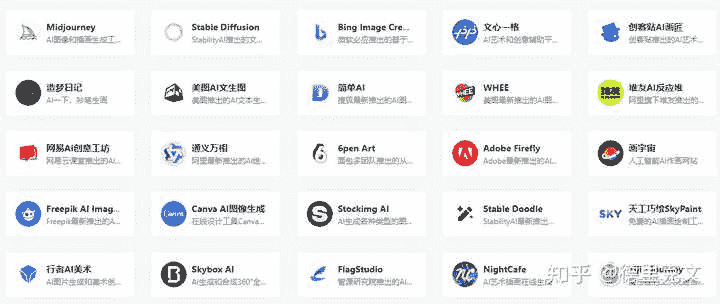

### 1.美图WHEE

[WHEE是美图基于其视觉大模](https://www.zhihu.com/search?q=MiracleVision&search_source=Entity&hybrid_search_source=Entity&hybrid_search_extra=%7B%22sourceType%22%3A%22answer%22%2C%22sourceId%22%3A3206590319%7D)型 MiracleVision 最新推出的AI图片和绘画作平台，该AI图片生成工具支持多种模式的图片创作，包括文生图、图生图、风格模型训练和创作提示词库。

### 2.文心一格

文心一格是由百度推出的依托其 [文心大模型 ](https://www.zhihu.com/search?q=%E6%96%87%E5%BF%83%E5%A4%A7%E6%A8%A1%E5%9E%8B&search_source=Entity&hybrid_search_source=Entity&hybrid_search_extra=%7B%22sourceType%22%3A%22answer%22%2C%22sourceId%22%3A3206590319%7D)和飞案技术的文本生成图片的 AI 艺术和创意辅助平台，于2022年8月正式发布。

作为国内第一梯队的AI图片生成的工具和平台，文心一格可以进行国风、油画、水彩、水粉、动漫、写实等十余种不同风格高清画作的生成。

文心一格面向的用户人群非常广泛，既能启发画师、设计师、艺术家等专业视觉内容创作者的灵感，辅助其进行艺术创作，还能为媒体、作者等文字内容创作者提供高质量、高效率的配图。

### 3. [搜狐简单AI](https://www.zhihu.com/search?q=%E6%90%9C%E7%8B%90%E7%AE%80%E5%8D%95AI&search_source=Entity&hybrid_search_source=Entity&hybrid_search_extra=%7B%22sourceType%22%3A%22answer%22%2C%22sourceId%22%3A3206590319%7D)

简单Al是搜狐最新推出的 [智能图片 ](https://www.zhihu.com/search?q=%E6%99%BA%E8%83%BD%E5%9B%BE%E7%89%87&search_source=Entity&hybrid_search_source=Entity&hybrid_search_extra=%7B%22sourceType%22%3A%22answer%22%2C%22sourceId%22%3A3206590319%7D)生成平台和社区，是一个适合小白直接上手的AI图片生成工具，提供文生图和图生图两种模式，上手简单，且生成质量较好。

目前，用户可以通过简单AI每日免费生成 10张图片。同时，该平台还提供用户作品分享社区、创作同款、提示词参考等功能。

## 三. PPT制作

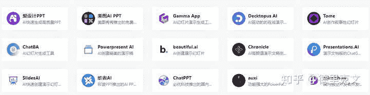

### 1. [Chatppt](https://www.zhihu.com/search?q=Chatppt&search_source=Entity&hybrid_search_source=Entity&hybrid_search_extra=%7B%22sourceType%22%3A%22answer%22%2C%22sourceId%22%3A3206590319%7D)

ChatPPT是必优科技旗下面向PPT[使用者提供的A生](https://www.zhihu.com/search?q=ChatGPT&search_source=Entity&hybrid_search_source=Entity&hybrid_search_extra=%7B%22sourceType%22%3A%22answer%22%2C%22sourceId%22%3A3206590319%7D)成PPT软件，产品基于 ChatGPT 与韦尼克模型，面向PPT用户提供可通过自然语言指令与Chat模式进行PPT文档创作的AI创作服务。

### 2.美图PPT

[美图AI ](https://www.zhihu.com/search?q=%E7%BE%8E%E5%9B%BEAI&search_source=Entity&hybrid_search_source=Entity&hybrid_search_extra=%7B%22sourceType%22%3A%22answer%22%2C%22sourceId%22%3A3206590319%7D)PPT是国内知名P图软件美图秀]旗下的[美图设计室推出的免费在线AI生成PPT设计工具，用户只需输入一句话，便可以轻松打造精美PPT。无论是什么类型风格的PPT，美图AI都可以帮你打造，如行业分析、工作汇报、创意设计方案、企业团建策划、部门工作总结等

### 3.MindShow

MindShow是国内独立开发者开发的输入内容自动生成演示工具，帮你省去排版的烦恼，让想法快速展示

## 四. 设计类

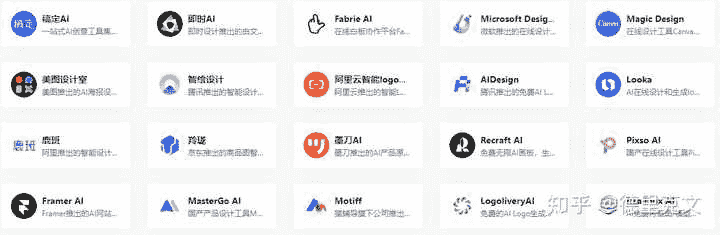

### 1.美图设计室

美[图设计室](https://www.zhihu.com/search?q=%E9%82%80%E6%83%85%E5%87%BD&search_source=Entity&hybrid_search_source=Entity&hybrid_search_extra=%7B%22sourceType%22%3A%22answer%22%2C%22sourceId%22%3A3206590319%7D)最新推出AI海报生成工具，用户只需输入一句话，AI便能生成各种风格的海报，包括日常问候、节日祝福、电商主图、生日视福、 邀情函 等各种模板品类。

除开AI海报外，美图设计室还可以AI生成Logo、Al生成PPT、AI生成绘画、图片抠图等。

### 2.智绘设计

智绘设计是腾讯推出的多场景智能设计平台，提供特有的A创意创作功能，包括智能人像与商品报图、风格动漫化、智能消除笔、智能多尺寸、智能配色等。

### 3. Fabrie

Fabrie是一个面向全球设计团队打造的白板协作平台，该产品已推出AI设计助手Fabrie Al，可帮助设计师在白板上更捷地获取灵感、快速渲染、迭代设计方。只需选择预设场景模板，补充颜色、材质、背景细节即可生成不错的设计效果图。

## 五.视频制作

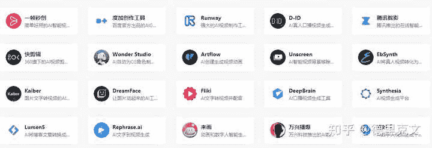

### 1.一帧秒创

一帧秒创是基于秒创AIGC引擎的智能AI内容生成平台，为创作[者和机构提供](https://www.zhihu.com/search?q=%E6%96%87%E5%AD%97%E8%BD%AC%E8%AF%AD%E9%9F%B3&search_source=Entity&hybrid_search_source=Entity&hybrid_search_extra=%7B%22sourceType%22%3A%22answer%22%2C%22sourceId%22%3A3206590319%7D)A生成服务，包括文字续写、 文字转语音 、文生图、图文转视频等创作服务，通过对文案、素材、AI语音、字幕等进行智能分析，快速成片，零门槛创作视频。

### 2.腾讯智影

腾讯智影是由腾讯推出的一款AI智能创作工具，融合了AI数字人、AI文字配音TTS、文章转视频等多项AIGC能力。

### 3.百度度加

度加创作工具是由百度出品的、人人可用的AIGC创作工具网站，度加致力于通过A能力降低内容生产门槛，提升创作效率，一站式聚合百度AIGC能力，引领跨时代的内容生产方式。

[Al 成](https://www.zhihu.com/search?q=%E7%99%BE%E5%AE%B6%E5%8F%B7&search_source=Entity&hybrid_search_source=Entity&hybrid_search_extra=%7B%22sourceType%22%3A%22answer%22%2C%22sourceId%22%3A3206590319%7D)片。创作者输入文本或者选择 百家号 的图文，即可由 A 自动一键制作视频。在娱乐、科技、社会、资讯等领域，文字成片的效果几乎不逊于剪辑师创作，而且速度更快，产量更高，质量更稳定。

## 六.音频制作

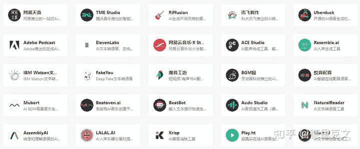

### 1.网易天音

是网易云音乐推出的一站式AI音乐作工具，无需乐理知识，一键上手。音乐爱好者或者歌手只需输入灵感，AI便可以辅助完成洞、曲、编、唱，生成AI初稿后，支持词曲协同调整。

### 2. [TME Studio](https://www.zhihu.com/search?q=TME%20Studio&search_source=Entity&hybrid_search_source=Entity&hybrid_search_extra=%7B%22sourceType%22%3A%22answer%22%2C%22sourceId%22%3A3206590319%7D)

TME Studio是由 [腾讯音乐娱乐公司 ](https://www.zhihu.com/search?q=%E8%85%BE%E8%AE%AF%E9%9F%B3%E4%B9%90%E5%A8%B1%E4%B9%90%E5%85%AC%E5%8F%B8&search_source=Entity&hybrid_search_source=Entity&hybrid_search_extra=%7B%22sourceType%22%3A%22answer%22%2C%22sourceId%22%3A3206590319%7D)推出的一款A音乐生成工具，由旗下银河音效、MUSE、天琴实验室、Tencent A Lab共同打造，助力音乐爱好者，让创作更简单。

### 3.魔音工坊

魔音工坊是由出门问问推出的一款先进的配音工具和高效多人音频协同创作工具，可以智能将文字转换成语音，支持多种语言和语音风格，包括中文、英文、日语、韩语等。

该工具集成了先进的深度学习技术，可以根据不同的文本内容和语境，生成自然流畅的语音。用户可以在魔音工坊的官方网站上输入需要转换的文字内容，选择喜欢的语音风格和声音类型，点击”朗读”按钮，即可快速将文字转换成语音.

## 七.AI工具集类网站

说到工具集，知乎知学堂的正式课程有对各个AI工具进行了介绍，下面图片就是正式课会教学的工具内容。

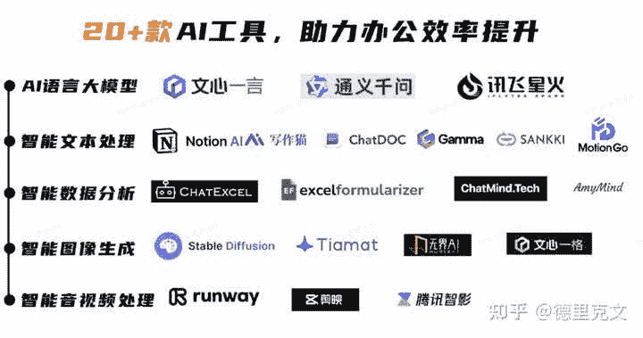

不过正式课是需要进行知识付费的，个人建议对于基础课程学有余力，并且在体验后，感觉AI确实对工作有效率的小伙伴再考虑正式课。知识付费是最有效率的学习方式之一，对于想要亲身入局，有一定经济基础的职场人士是非常有效率的，请各位小伙伴结合自己的实际经济情况考虑。

AI工具训练🔥零基础上手20+主流AI工具 仅需0.1元

立即领取

接下来我再来介绍一个非常全的AI工具集网站：这个网站有这[500+A](https://www.zhihu.com/search?q=%E6%AF%8F%E6%97%A5%E8%B5%84%E8%AE%AF&search_source=Entity&hybrid_search_source=Entity&hybrid_search_extra=%7B%22sourceType%22%3A%22answer%22%2C%22sourceId%22%3A3206590319%7D)I工具导航大全，同时还有AI 每日资讯 等内容，对AI工具学习非常感兴趣的朋友们可以看看。

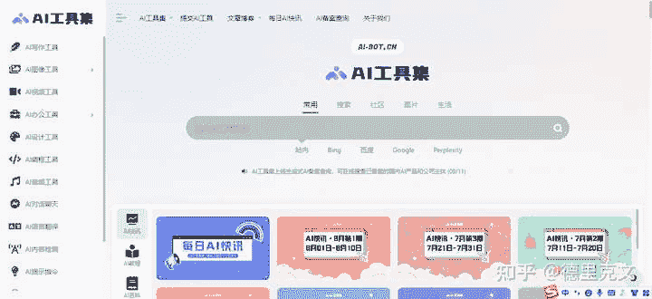

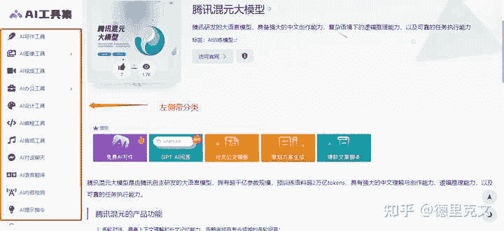

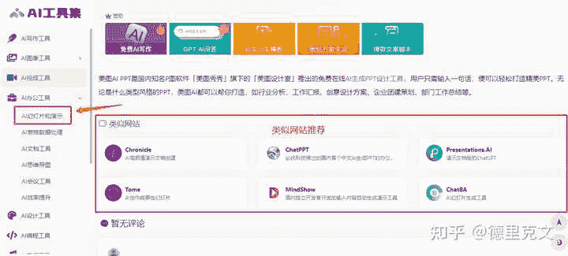

网站链接：

---

我是 [德里克文 ](https://www.zhihu.com/search?q=%E5%BE%B7%E9%87%8C%E5%85%8B%E6%96%87&search_source=Entity&hybrid_search_source=Entity&hybrid_search_extra=%7B%22sourceType%22%3A%22answer%22%2C%22sourceId%22%3A3162454823%7D)[，一个对AI](https://www.zhihu.com/search?q=%E5%AE%A4%E5%86%85%E8%AE%BE%E8%AE%A1%E5%B8%88&search_source=Entity&hybrid_search_source=Entity&hybrid_search_extra=%7B%22sourceType%22%3A%22answer%22%2C%22sourceId%22%3A3161270553%7D)绘画，人工智能有强烈兴趣，从业多年的 室内设计师 ！如果对我的文章内容感兴趣，请帮忙关注点赞收藏，谢谢！