# 有哪些日常实用的 AI 工具、AI 插件、AI 软件或应用推荐？

> 来源：[https://agijuejin.feishu.cn/docx/X9XBdVxpHonymvxIFTBcFiDOnad](https://agijuejin.feishu.cn/docx/X9XBdVxpHonymvxIFTBcFiDOnad)

> 作者：德里克文

> 原文：[https://www.zhihu.com/question/590449168/answer/3186388670](https://www.zhihu.com/question/590449168/answer/3186388670)

以下推荐均为国内可用的，日常实用的AI工具，AI插件和应用，我也附上我自己亲测的截图测试内容，建议收藏备用。

## 一、AI视频

### 1. 万兴播爆

这款是一个国内数字人软件，上手快速方便，它可以帮助你快速生成200多个不同国家和地区的数字人视频，也可以定制自己的数字人。用它可以省掉很多找外国模特的费用。

如果你是做电商或推广的，你可以将已有素材直接套用软件内的模板，并选择合适的数字人和配音，一条产品介绍视频就做好了；

[如果你不懂](https://www.zhihu.com/search?q=%E6%99%BA%E8%83%BD%E7%BF%BB%E8%AF%91&search_source=Entity&hybrid_search_source=Entity&hybrid_search_extra=%7B%22sourceType%22%3A%22answer%22%2C%22sourceId%22%3A3186388670%7D)外语，也可以使用它的AI智能翻译功能，直接翻译对应语言。关键是这些模板都是根据爆款视频的风格、画面、节奏去制作，比较匹配海外用户的审美，所以更容易吸引到客户。

[万兴播爆官网](https://link.zhihu.com/?target=https%3A//virbo.wondershare.cn/)

具体操作，我来简单介绍下：

#### 使用模板创作视频

1. 点击首页的左侧菜单-视频模板。这里提供多种类型视频模板。

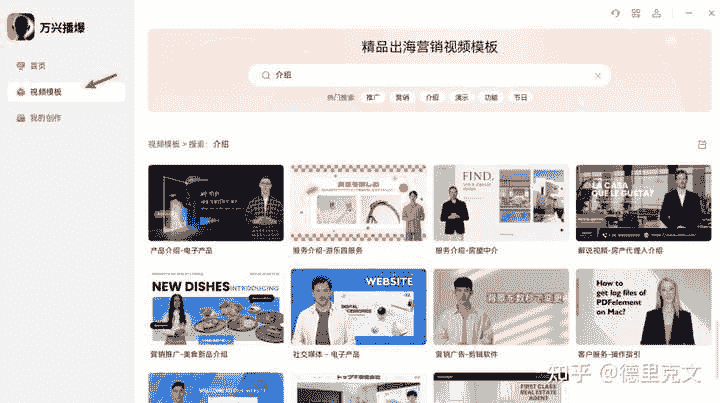

2. 选择你要使用的模板，点击“创作视频”，开启视频制作。

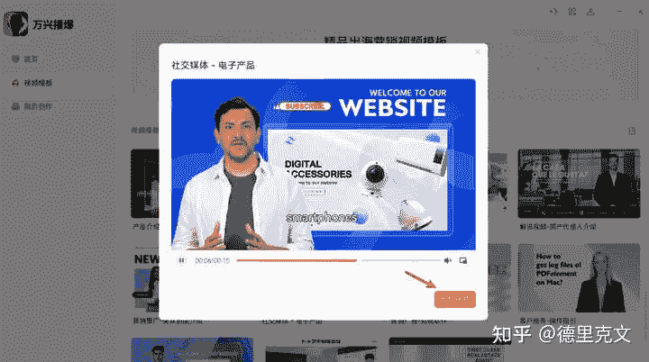

3. 在这里，可以将模板的数字人替换成你更喜欢的类型，拖拽即可调整人物大小以匹配界面。

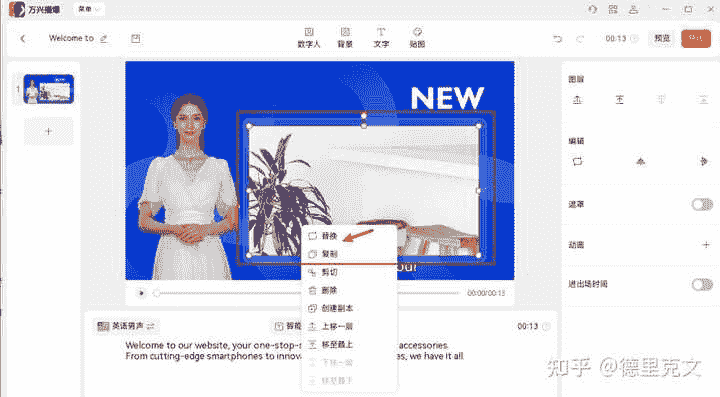

将展示素材替换成之前拍摄好的产品图片/视频素材，还可以进行图层调整、播放模式等设定。

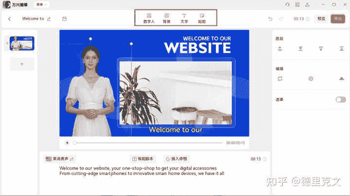

4. 在[口播文案](https://www.zhihu.com/search?q=%E5%8F%A3%E6%92%AD%E6%96%87%E6%A1%88&search_source=Entity&hybrid_search_source=Entity&hybrid_search_extra=%7B%22sourceType%22%3A%22answer%22%2C%22sourceId%22%3A3186388670%7D)处粘贴文案。可以先听一遍文案播报，如需停顿的地方，点击“插入停顿”并调整停顿时长即可。

5. 为了提升视频文案吸引力、促进用户转化，可以通过软件自带的“智能脚本”进行文案优化。提供文案“精简”“扩写”“专业”等各种风格的智能优化操作。

[智能脚本](https://www.zhihu.com/search?q=%E6%99%BA%E8%83%BD%E8%84%9A%E6%9C%AC&search_source=Entity&hybrid_search_source=Entity&hybrid_search_extra=%7B%22sourceType%22%3A%22answer%22%2C%22sourceId%22%3A3186388670%7D)

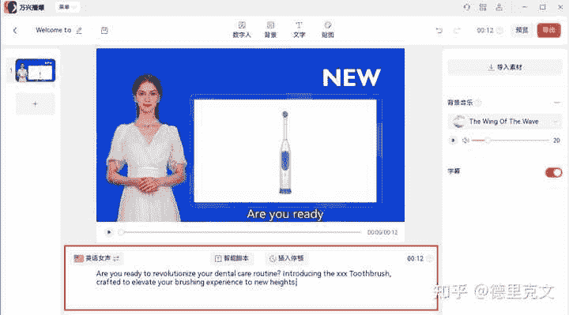

精简前后文案对比：

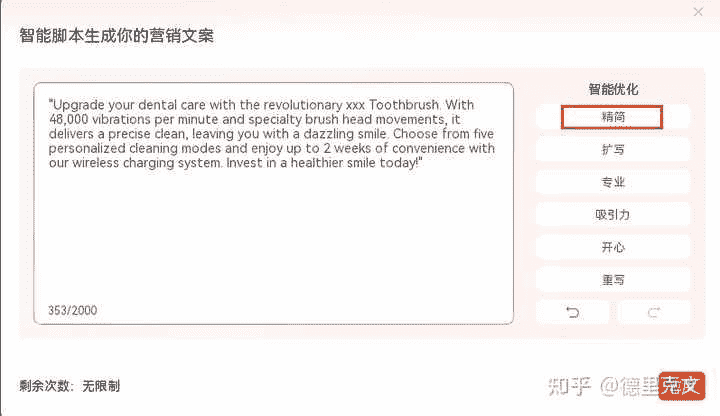

简单几步操作后，点击界面右上角的“导出”即可。

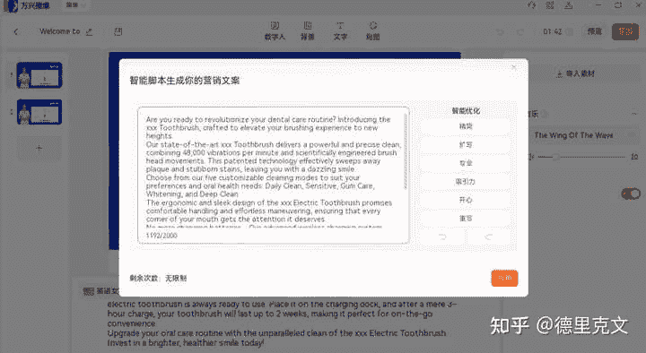

它还支持AI视频翻译，把视频导入，可以翻译成对应语言视频。

### 2. DID数字人

随着人工智能和3D技术的不断发展，数字人的概念逐渐走进人们的视野。

数字人是指通过计算机程序和3D技术创建的虚拟人物，其外貌、语言、行为等都可以根据设计者的要求进行定制。

我推荐一个可以生成数字人的网站：DID，他可以帮助用户快速、便捷地创建自己的数字人。

这是一个免费的国外网站，只需要采用邮箱注册就可以了。

但是需要注意的是每个DID账号只能生成5分钟的视频，如果你还想免费试用，后期需多注册账号

[DID官网](https://link.zhihu.com/?target=https%3A//studio.d-id.com/)

完成的视频效果可以看我制作的视频内容：

[视频演示](https://www.zhihu.com/zvideo/1694029915765305344)

具体要怎么操作呢？我这里简单介绍下：

1. 注册好账号后，点击 Create Video

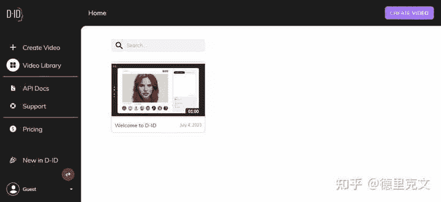

2. 分别有视频创作主播（Chioose a Presenter）和 AI数字人（Generate AI presenter）两个选项，根据需要选择

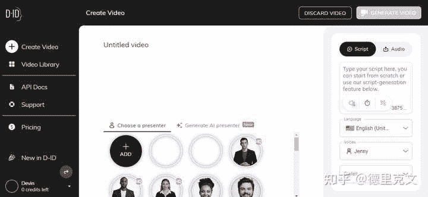

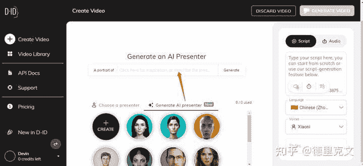

3. 可以选择系统已经设置好的人员，或者也可以点击 ADD 自己上传图片上传，下图展示的是我自己用 [AI绘画](https://www.zhihu.com/search?q=AI%E7%BB%98%E7%94%BB&search_source=Entity&hybrid_search_source=Entity&hybrid_search_extra=%7B%22sourceType%22%3A%22answer%22%2C%22sourceId%22%3A3186388670%7D) 生成的形象

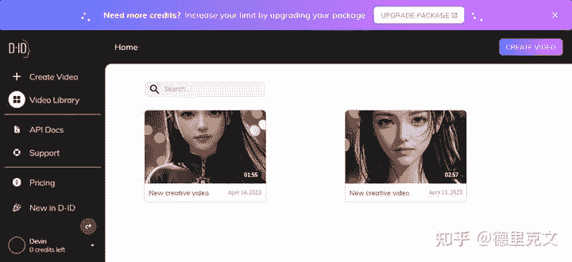

4. 可以选择用AI机器人说话，在右侧的 `Script` 下自己输入文字，还可以增加语气停顿等要求，`Language` 选择 `Chinese`，就可以选择中文啦，然后在 `Voices` 选择男女不同的 播影员 名称。

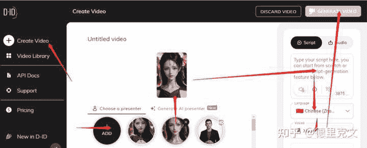

5. 也可以直接上传你自己的 [音频文件](https://www.zhihu.com/search?q=%E9%9F%B3%E9%A2%91%E6%96%87%E4%BB%B6&search_source=Entity&hybrid_search_source=Entity&hybrid_search_extra=%7B%22sourceType%22%3A%22answer%22%2C%22sourceId%22%3A3186388670%7D)，点击 `Audio` 上传

6. 最后选择 `GENERATE VIDEO` 合成最终视频。可以下载。

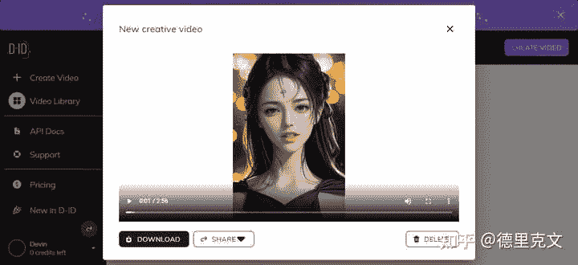

想要自媒体 [轻创业](https://www.zhihu.com/search?q=%E8%BD%BB%E5%88%9B%E4%B8%9A&search_source=Entity&hybrid_search_source=Entity&hybrid_search_extra=%7B%22sourceType%22%3A%22answer%22%2C%22sourceId%22%3A3186388670%7D) 变现多些思路，快速学会怎么用AI工具进行数字人制作，助力自媒体运营，但文案不会写、图片视频不会做、运营不会搞怎么办？

知乎 [知学堂](https://www.zhihu.com/search?q=%E7%9F%A5%E5%AD%A6%E5%A0%82&search_source=Entity&hybrid_search_source=Entity&hybrid_search_extra=%7B%22sourceType%22%3A%22answer%22%2C%22sourceId%22%3A3186388670%7D) 最近推出了一门名为【AI 提效神器】的直播课，帮你打开思路，在这个工作方式大变革的时代，提升变现效率，减少 信息差 ，该课程共计2小时，主要介绍了AI对各行各业工作模式的潜在影响，会教你怎么学会制作AI视频。

建议对自媒体和人工智能感兴趣的初学者可以去试着听下这门课程，里面的视频课件介绍能够让你更好的了解各种AI工具的应用

AI工具训练🔥零基础上手20+主流AI工具 仅需0.1元

立即领取

## 二、AI写作

### 1. 迅捷AI写作

[迅捷AI写作](https://link.zhihu.com/?target=https%3A//www.xunjiepdf.com/xunjieaixiezuo%3Fstzhcjl20231205-3186388670)

迅捷AI写作是一个快捷专注的AI工具，分享给所有被每天写文任务困扰的朋友们，这款AI写作工具，分分钟解放你的双手！

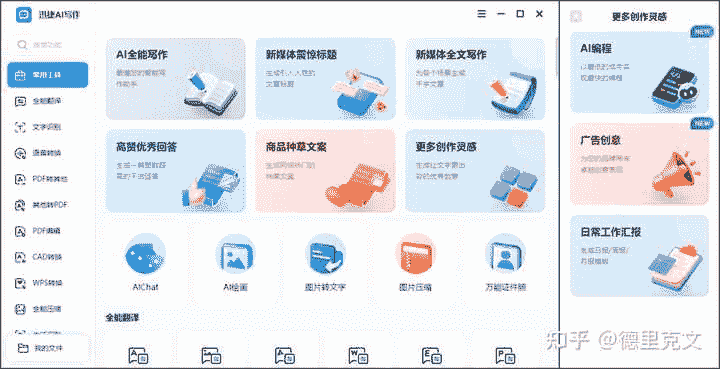

软件提供有全能写作、种草文案、震惊标题、AI编程、工作汇报等多个内容创作模块，几乎覆盖了所有的行业领域，使用范围非常广！

【小说桥段】

【创意标题】

【程序代码】

【种草文案】

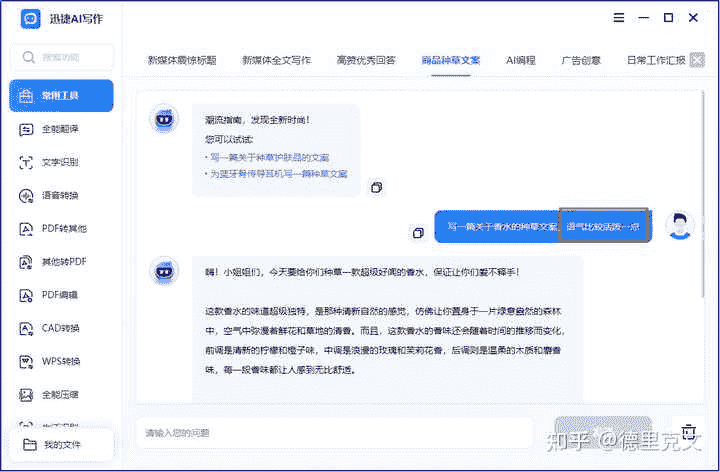

文章的篇幅、语气、措辞等都可以根据我们的需求生成，相当方便。软件的功能远远不止展示如此，还附有AI绘画的功能，效果也是杠杠的！

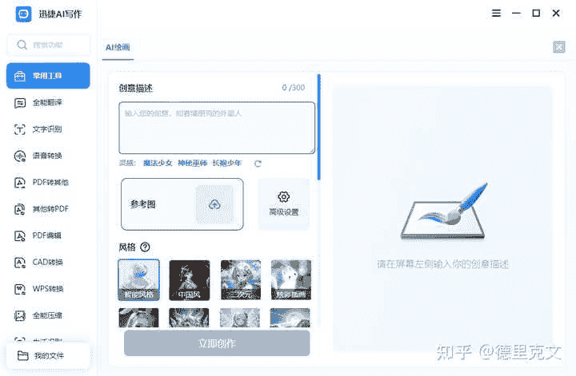

只需要简单输入我们想要的画面描述，选择一个我们喜欢的风格后即可生成，作为自媒体配图再合适不过了

### 2. 火山写作

火山写作是一款由 [字节跳动](https://www.zhihu.com/search?q=%E5%AD%97%E8%8A%82%E8%B7%B3%E5%8A%A8&search_source=Entity&hybrid_search_source=Entity&hybrid_search_extra=%7B%22sourceType%22%3A%22answer%22%2C%22sourceId%22%3A3186388670%7D) 推出的免费AI智能写作助手，针对职场人士、科研人员、学生等常用英语写作的用户群体。

它提供语法拼写纠错、表达润色、智能改写等功能，解决非英语母语用户在英语写作中词汇量不足、表达不熟练、不地道等问题，帮助用户更好地与世界沟通。

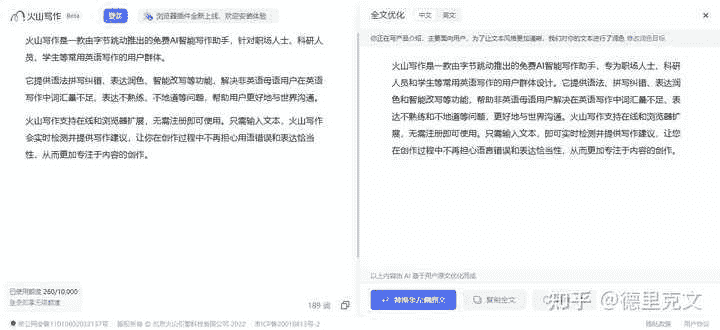

火山写作支持在线和 [浏览器扩展](https://www.zhihu.com/search?q=%E6%B5%8F%E8%A7%88%E5%99%A8%E6%89%A9%E5%B1%95&search_source=Entity&hybrid_search_source=Entity&hybrid_search_extra=%7B%22sourceType%22%3A%22answer%22%2C%22sourceId%22%3A3186388670%7D)，无需注册即可使用。只需 [输入文本](https://www.zhihu.com/search?q=%E8%BE%93%E5%85%A5%E6%96%87%E6%9C%AC&search_source=Entity&hybrid_search_source=Entity&hybrid_search_extra=%7B%22sourceType%22%3A%22answer%22%2C%22sourceId%22%3A3186388670%7D)，火山写作会实时检测并提供写作建议，让你在创作过程中不再担心用语错误和表达恰当性，从而更加专注于内容的创作。

这款工具的链接：

[火山写作官网](https://link.zhihu.com/?target=https%3A//www.writingo.net/home)

### 3. AI生成 童话绘本

[童话绘本工具](https://www.zhihu.com/search?q=%E7%AB%A5%E8%AF%9D%E7%BB%98%E6%9C%AC&search_source=Entity&hybrid_search_source=Entity&hybrid_search_extra=%7B%22sourceType%22%3A%22answer%22%2C%22sourceId%22%3A3186388670%7D)

今天我要推荐的这个AI工具虽然是国外网站，但是国内可以直接登陆，非常高效而且可以变现。

你只需要输入20-200个单词提示语句，它就能给你生成一本完整的带有精美插图的故事书，无论是英文还是其他语言都可以。而且还能将成果在该网站和 亚马逊 售卖。

如果你生成的是中文，利用ChatGPT进行翻译就能生成英文的通话故事绘本。

接下来我将无偿分享这个网站和信息给到大家，含金量很高。

如果觉得好用请务必收藏关注点赞。

## 一、AI 绘本故事生成

这个网站的地址是：

[storybird.ai](https://link.zhihu.com/?target=http%3A//storybird.ai/)

具体操作步骤如下:

- 登陆网站，输入 [你要的](https://www.zhihu.com/search?q=%E4%BD%A0%E8%A6%81%E7%9A%84&search_source=Entity&hybrid_search_source=Entity&hybrid_search_extra=%7B%22sourceType%22%3A%22answer%22%2C%22sourceId%22%3A3186388670%7D) 故事：

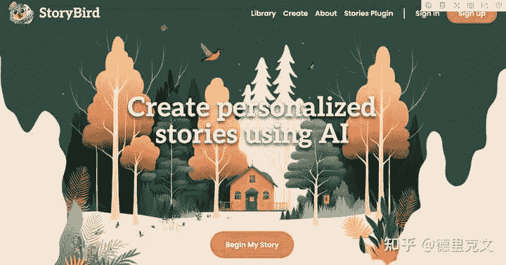

- 点击 Begin My Stroy，进入下一个页面，在 Story Prompt 的方框下输入故事内容，再点击 Submit

- 等待片刻便可得到一个完整的绘本故事书，这个网站会同时为你的故事配上精美的插图，插图生成的时间要稍慢一些

- 然后你点击打开生成的故事，网站会把你制作成一本书的模样

- 这样就可以查看故事的内容了，你还可以对生成的故事进行编辑文本并重新生成插画

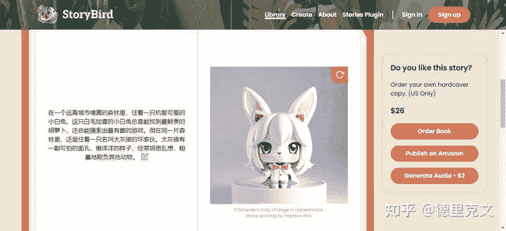

## 二、AI 图片编辑

今天来给大家推荐一款方便小巧的 AI 图片编辑器，主打一个简单易用，每天有固定的免费次数，不过对于处理证件照来说，次数刚好足够。

这是一个 AI 改图神器，支持多种格式编辑、智能抠图去水印、在线图片加水印、在线制作证件照等多种图片处理功能。

传送门：

[img.logosc.cn](https://link.zhihu.com/?target=https%3A//img.logosc.cn/)

如果你需要经常处理图片，那么你一定不要错过它，更多实用功能快去探索吧！

我这里演示了一个制作证件照的示意。

1. 首先我上传了我用 AI 画的帅哥做底图示意

2. 选择照片尺寸

3. 可以智能换背景及底色

4. 可以通过 AI 快速提高分辨率

一张一寸的证件照马上就生成了，是不是非常方便快捷呢。

## 三、AI 绘画

我用 AI 绘画来生成人像摄影作品，你喜欢这种风格吗？无论是用于日常职场的写作配图，还是用于海报画面生成，实在是太方便了。

这几张作品我是采用之前推荐的 [美图公司](https://www.zhihu.com/search?q=%E7%BE%8E%E5%9B%BE%E5%85%AC%E5%8F%B8&search_source=Entity&hybrid_search_source=Entity&hybrid_search_extra=%7B%22sourceType%22%3A%22answer%22%2C%22sourceId%22%3A3186388670%7D) 的产品 WHEE 免费出图的，我这里也对这个 AI 绘画模型进行了评测，真的挺好用的。

今天在这里教大家怎么用 Whee 这个网站做出上面的人像摄影作品。网站链接如下：

[whee.com](https://link.zhihu.com/?target=https%3A//www.whee.com/)

1. 在页面选择 [文生图](https://www.zhihu.com/search?q=%E6%96%87%E7%94%9F%E5%9B%BE&search_source=Entity&hybrid_search_source=Entity&hybrid_search_extra=%7B%22sourceType%22%3A%22answer%22%2C%22sourceId%22%3A3186388670%7D)

2. 如果是新手选择推荐创作，进阶使用点击高级设定。在这里我就以推荐创作为例。风格模型保持默认的模型就可以

3. 在创意描述中输入提示词：“大师画作，最高质量，精致细节，美女近景，花朵，中心构图，侧颜，照片真实，EOS 35mm，景深，自然光线，戏剧性视角，丁达尔效应”，这些提示词是我自己调整测试出来的，中间的主体词语自己调整。

4. 点击生成，你可以看到可以生成类似我想法图片的高质量作品，是不是很棒呢？一天现在可以最多生成 100 张，简直是大福利。

如此优秀而免费的网站，简单容易就可以出图，推荐给各位希望了解 AI 绘画确对 Stable Diffuison 复杂的入门教程和硬件要求有担忧的朋友！

## 四、AI 搜索工具

[昆仑万维](https://www.zhihu.com/search?q=%E6%98%86%E4%BB%91%E4%B8%87%E7%BB%B4&search_source=Entity&hybrid_search_source=Entity&hybrid_search_extra=%7B%22sourceType%22%3A%22answer%22%2C%22sourceId%22%3A3186388670%7D) 宣布正式推出了名为 天工 AI 搜索 的自研大型模型。链接如下：

现在虽然出于内测阶段，但是只要注册申请就可以直接使用。

我经过测试，对 天工 AI 搜索的 自然语言 交流功能感到非常惊叹。它能够通过流畅的对话式交互准确地理解用户的搜索意图。对比传统的搜索， 天工 AI 搜索 具备传统搜索引擎所不具备的整合信息和提炼资料的能力。

一般来说，传统搜索引擎只提供大量信息，而 AI 搜索通过 大型语言模型 的支持，能够整合、提炼和连接信息，更好地应对开放性问题，尤其是有关知识和创意的问题，因此在表现上远远超过传统搜索引擎。

作为一个连接到互联网的 AI 搜索引擎，它会将回答时引用的资料整理在回答顶部的参考栏中，每一句回答后都会标注来源小标，以方便查阅和跳转到各种来源。用户可以点击这些来源直接跳转到相关页面。

这样详细的来源标注可以提高 [信息获取](https://www.zhihu.com/search?q=%E4%BF%A1%E6%81%AF%E8%8E%B7%E5%8F%96&search_source=Entity&hybrid_search_source=Entity&hybrid_search_extra=%7B%22sourceType%22%3A%22answer%22%2C%22sourceId%22%3A3186388670%7D) 效率，也方便核对回答准确性。

这就意味着他的回复可信了很多，有来源，不会随口乱扯，而这正是大部分语言模型的通病。

这个搜索还具备连续对话的能力。如果对给出的回答不满意，我们还可以继续追问。它会记录所有的对话历史，并将其整理进 【我的历史】，以便方便随时寻找。

我试着举例目前我正在了解的关于汽车行业的消息，他给了我很多来源并且整合成了有效的内容，并且还给出了追问推荐，有点类似微软 NEW BING 的功能，对于想要针对一个问题深究的话，是一个很好的方案。

我在测评中测试问了他关于许多关于汽车供应链的问题，可以看到哪怕总结的深度不足，但是我们依然可以通过他给出的链接再次进行人工核实和提取关键资料，我觉得这对于一个人工智能搜索来说非常重要。

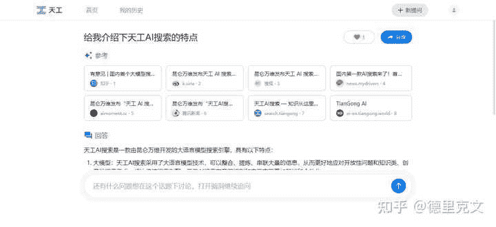

非常好用，可以助力职场的人工智能搜索工具，推荐给大家。

## 五、更多 AI 工具

还可以查看我的下列文章，我会不断更新推荐好用免费的 AI 工具软件：

[更多 AI 工具](https://www.zhihu.com/question/588712985/answer/3178336845)

---

我是 [德里克文](https://www.zhihu.com/search?q=%E5%BE%B7%E9%87%8C%E5%85%8B%E6%96%87&search_source=Entity&hybrid_search_source=Entity&hybrid_search_extra=%7B%22sourceType%22%3A%22answer%22%2C%22sourceId%22%3A3052677444%7D)，一个对 AI 绘画，人工智能有强烈兴趣，从业多年的 室内设计师！如果对我的文章内容感兴趣，请帮忙关注点赞收藏，谢谢！
