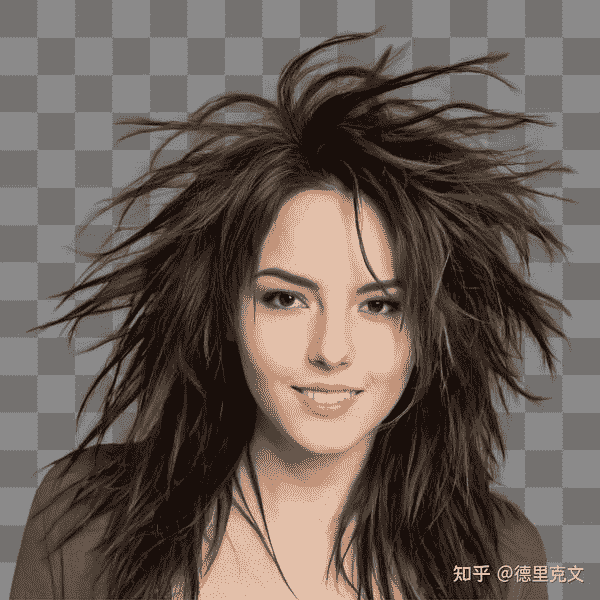
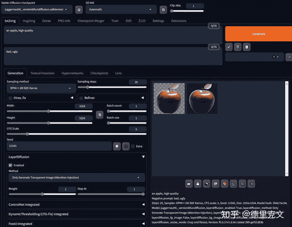
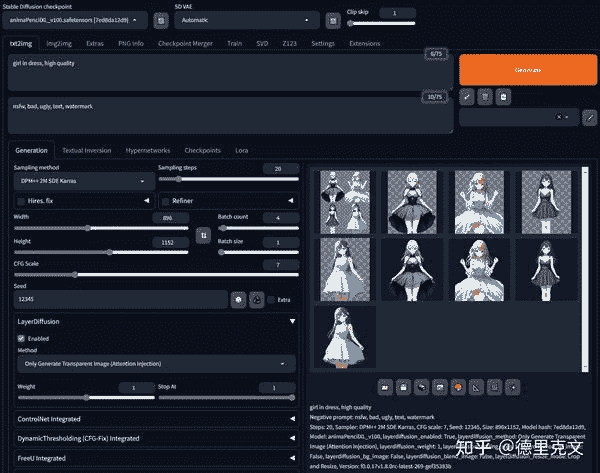
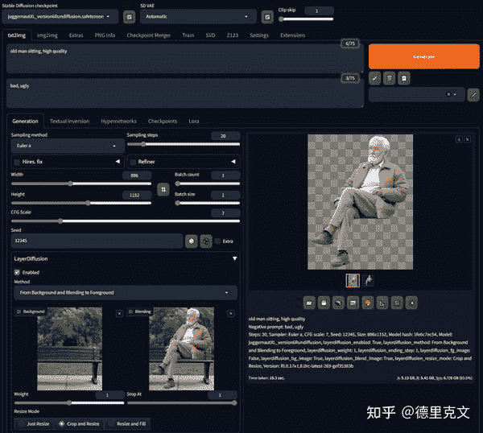
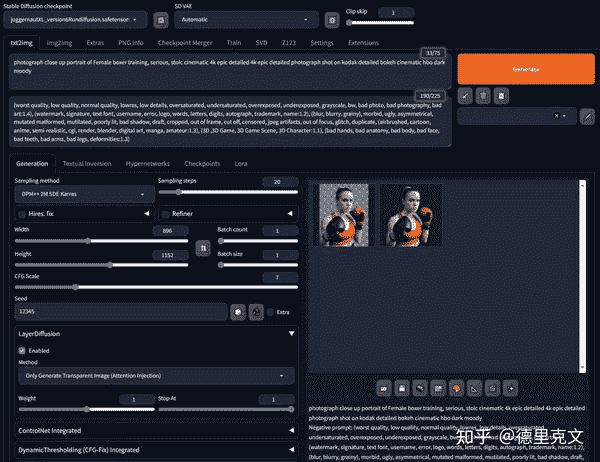
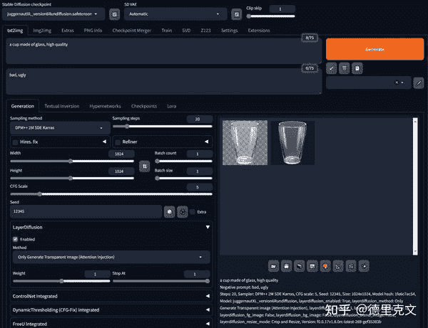
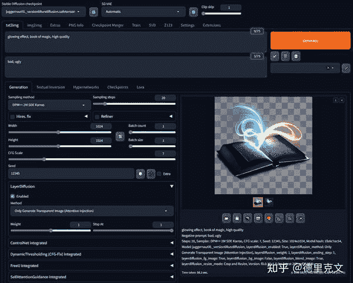

# LayerDiffusion——AI绘画的新工具

> 来源：[https://agijuejin.feishu.cn/docx/L9n2dtDbhosX6nx854ncYaTInyf](https://agijuejin.feishu.cn/docx/L9n2dtDbhosX6nx854ncYaTInyf)

> 作者：德里克文

> 原文： [https://zhuanlan.z](https://zhuanlan.zhihu.com/p/684977096)hihu.com/p/684977...

对于使用AI绘画的设计师而言，你是否希望在AI绘画生成的图像中，能够自动区分图层，而不需要再利用Photoshop进行繁琐的P图工作？

最新的LayerDiffusion技术带来了这一神奇的可能！

他是[由来自斯坦](https://zhida.zhihu.com/search?q=%E6%89%A9%E6%95%A3%E6%A8%A1%E5%9E%8B&zhida_source=entity&is_preview=1)福大学研究人员Lvmin Zhang（即ControlNet和Fooocus的作者张吕敏）和Maneesh Agrawala的全新技术，是基于大规模预训练的潜在 扩散模型 （如Stable Diffusion）创造的。

题外话说一句，张吕敏实在太牛了，在AI绘画应用层面给大家带来了这么多实用的工具。

## 工具介绍

那么LayerDiffusion有什么用呢？

这个工具还没有正式开放，是一个正在进行中的项目，全名叫"Layer Diffusion for WebUI (via Forge)"，看起来应该是SD WebUI的一个插件。从张吕敏发布的README说明来看，LayerDiffusion能够帮助我们在用SD这款AI绘画工具生成图片的时候，生成单个或多个透明图层。

LayerDiffusion的重要核心在于它创新地引入了“潜在透明度”的概念，这将图像中的alpha通道的透明度信息编码到潜在空间中。因此，原本只能生成非透明图像的模型现在有了生成透明度图像的能力。

项目地址：

## 内容简介

对于这篇文章的整体内容，我这里也做了下一个整理和简介。

作者在文章中确认这个 [代码库 ](https://zhida.zhihu.com/search?q=%E4%BB%A3%E7%A0%81%E5%BA%93&zhida_source=entity&is_preview=1)目前仍在积极开发中，因此可能在下一个月会有很多改变。

他们在文章中解释这个程序的工作的原理：

它将生成图像并提供基本的图层功能，但透明的图像到图像功能还没有完成（预计在一周内完成）。

[他们还发布](https://zhida.zhihu.com/search?q=%E6%89%A9%E6%95%A3%E8%BF%87%E7%A8%8B&zhida_source=entity&is_preview=1)了一个视频，展示了在透明 扩散过程 中潜在预览的效果。

接着，他们详细介绍了一系列的模型，解释了每个模型的功能和它们的应用情况。

所有这些模型都用于负责生成图像的不同环节，包括生成透明图像、生成图层、对图层进行融合等等。

作者还特别提到，所有目前发布的模型都适用于SDXL，如果需要的话，他们可能会稍后提供适用于SD1.5的模型。

除了介绍模型，他们还做了一些实测来验证程序的效果，并通过一些实例说明，如何通过设置扩展来得到想要的结果。

## 应用解读

简单来说，就是这个工具可以创建出原本透明或半透明的图片，而不再仅限于之前的完全不透明的图像。

这就像拿着一个纸片，你可以看到它的颜色和形状，但也可以看到纸片背后的东西。有了这项技术，人们现在可以更轻松地创造出这样的图像。

从下面这张图片来看，甚至透明度都可以继承。

LayerDiffusion技术的工作方式如同一位设计师在制作不同图层的内容，只是用它自己独特的方式。

从发布的文章内容来看，它会使用预先训练好的一个模型，这一模型拥有大量的图像信息，帮助它理解颜色、形状和纹理。

但LayerDiffusion并没有停止在生成不透明图像，它在这个模型的基础上，加入了一个新的信息，那就是透明度。这样，这个模型就可以理解并生成透明的图像了。

在生成透明图像的过程中，LayerDiffusion还采用了很多独特方法。

它可以创建多个透明的图层，这些图层可以独立生成，也可以相互影响。

你可以选择让其仅生成一层透明的前景，也可以指定生成多层透明层以形成更多样化的图片。

## 结语

这个工具对于未来形成完整的工作流是非常有意义的做法，也许在这个工具发布后，对于平面设计领域，AI绘画将得到更好的应用推广。

让我们期待更多开源的优秀的应用工具的出现

---

我是 [德里克文 ](https://www.zhihu.com/search?q=%E5%BE%B7%E9%87%8C%E5%85%8B%E6%96%87&search_source=Entity&hybrid_search_source=Entity&hybrid_search_extra=%7B%22sourceType%22%3A%22answer%22%2C%22sourceId%22%3A3098715893%7D)，一个对AI绘画，人工智能有强烈兴趣，从业多年的室内设计师！如果对我的文章内容感兴趣，请帮忙关注点赞收藏，谢谢！