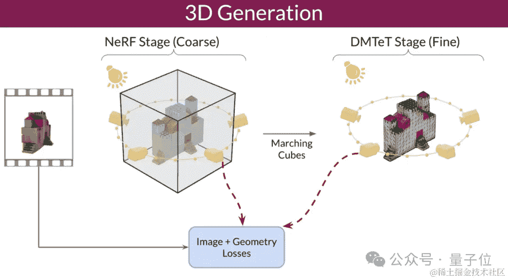
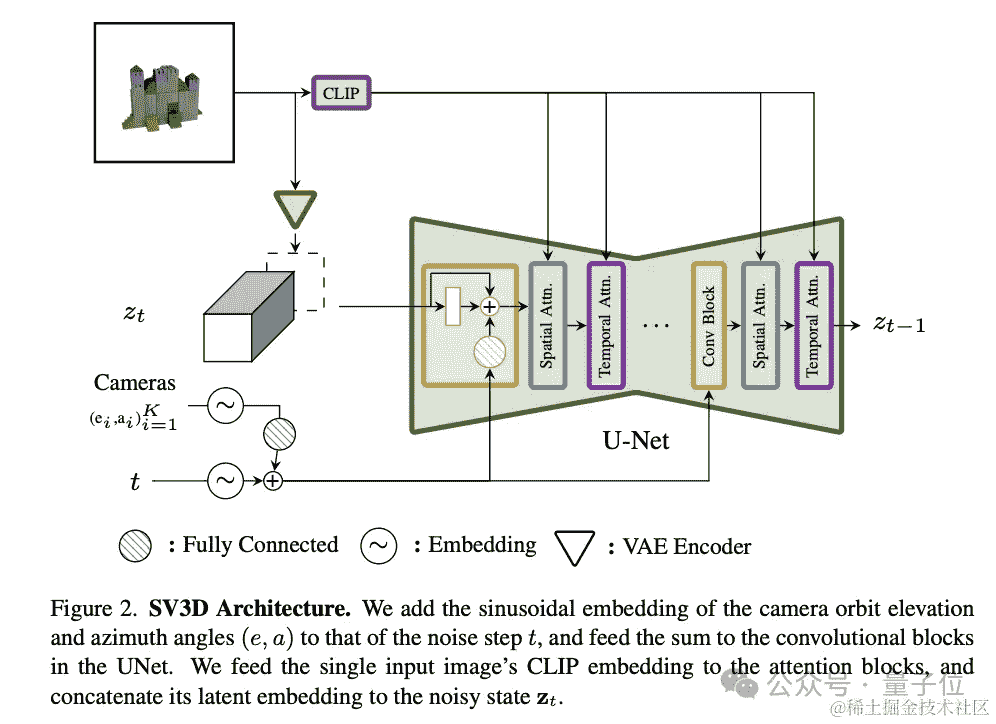
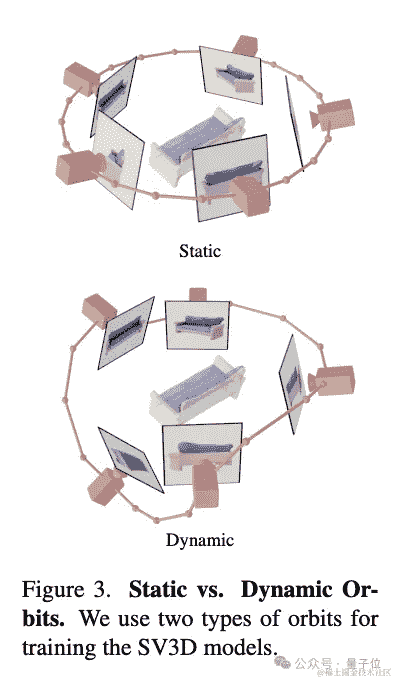
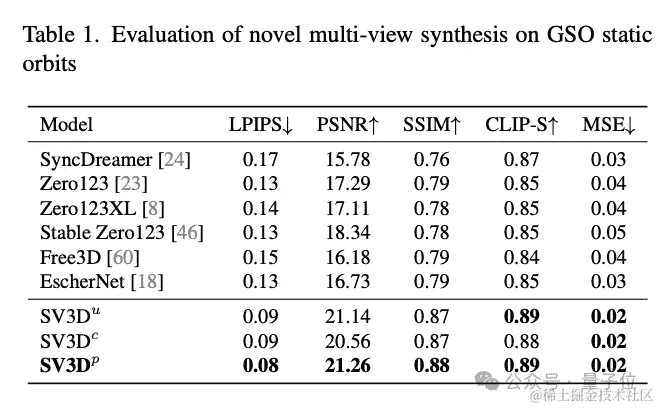
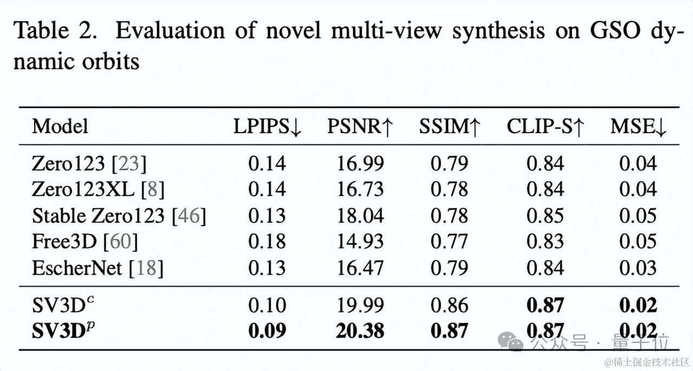
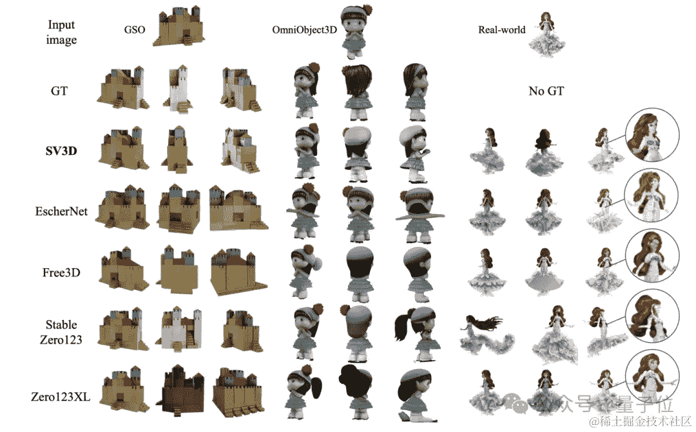
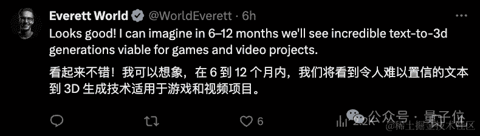
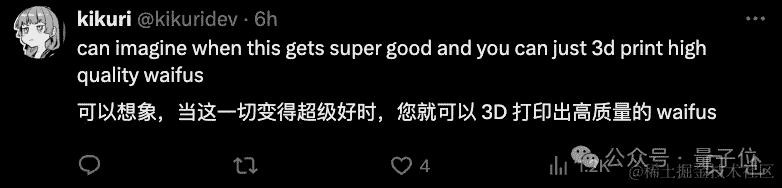

# Stability AI开源上新：3D生成引入视频扩散模型，质量一致性up，4090可玩

> 来源：[https://agijuejin.feishu.cn/docx/DNbndmcllodF1kxctfFcvFuGnFR](https://agijuejin.feishu.cn/docx/DNbndmcllodF1kxctfFcvFuGnFR)

> 网友：梦一个手办自由

[202](https://link.juejin.cn/?target=http%3A%2F%2Fwww.qbitai.com%2F)4-03-19 15:59:31 来源：量子位

网友：梦一个手办自由

> 鱼羊 发自 凹非寺

> 量子位 | 公众号 QbitAI

Stable Diffusion 背后公司 Stability AI 又上新了。

这次带来的是**图生 3D** 方面的新进展：

**基于 Stable Video** Diffusion 的 Stable Video 3D（SV3D），只用一张图片就能生成高质量 3D 网格。

Stable Video Diffusion（SVD）是 Stability AI 此前推出的高分辨率视频生成模型。也就是说，此番登场的 SV3D 首次将视频扩散模型应用到了 3D 生成领域。

官方表示，基于此，SV3D 大大提高了 3D 生成的质量和视图一致性。

模型权重依然开源，不过仅可用于非商业用途，想要商用的话还得买个 Stability AI 会员~

话不多说，还是来扒一扒论文细节。

引入潜在视频扩散模型，SV3D 的核心目的是利用视频模型的时间一致性来提高 3D 生成的一致性。

并且视频数据本身也比 3D 数据更容易获得。

Stability AI 这次提供两个版本的 SV3D：

+   SV3D_u：基于单张图像生成轨道视频。

+   SV3D_p：扩展了 SV3D_u 的功能，可以根据指定的相机路径创建 3D 模型视频。

研究人员还改进了 3D 优化技术：采用由粗到细的训练策略，优化 NeRF 和 DMTet 网格来生成 3D 对象。

他们还设计了一种名为掩码得分蒸馏采样（SDS）的特殊损失函数，通过优化在训练数据中不直接可见的区域，来提高生成 3D 模型的质量和一致性。

同时，SV3D 引入了一个基于球面高斯的照明模型，用于分离光照效果和纹理，在保持纹理清晰度的同时有效减少了内置照明问题。

具体到架构方面，SV3D 包含以下关键组成部分：

+   UNet：SV3D 是在 SVD 的基础上构建的，包含一个多层 UNet，其中每一层都有一系列残差块（包括 3D 卷积层）和两个分别处理空间和时间信息的 Transformer 模块。

+   条件输入：输入图像通过 VAE 编码器嵌入到潜在空间中，会和噪声潜在状态合并，一起输入到 UNet 中；输入图像的 CLIP 嵌入矩阵则被用作每个 Transformer 模块交叉注意力层的键值对。

+   相机轨迹编码：SV3D 设计了静态和动态两种类型的轨道来研究相机姿态条件的影响。静态轨道中，相机以规律间隔的方位角围绕对象；动态轨道则允许不规则间隔的方位角和不同的仰角。

相机的运动轨迹信息和扩散噪声的时间信息会一起输入到残差模块中，转换为正弦位置嵌入，然后这些嵌入信息会被整合并进行线性变换，加入到噪声时间步长嵌入中。

这样的设计旨在通过精细控制相机轨迹和噪声输入，提升模型处理图像的能力。

此外，SV3D 在生成过程中采用 CFG（无分类器引导）来控制生成的清晰度，特别是在生成轨道的最后几帧时，采用三角形 CFG 缩放来避免过度锐化。

研究人员在 Objaverse 数据集上训练 SV3D，图像分辨率为 575×576，视场角为 33.8 度。论文透露，所有三种模型（SV3D_u，SV3D_c，SV3D_p）在 4 个节点上训练了 6 天左右，每个节点配备 8 个 80GB 的 A100 GPU。

在新视角合成（NVS）和 3D 重建方面，SV3D 超过了现有其他方法，达到 SOTA。

从定性比较的结果来看，SV3D 生成的多视角试图，细节更丰富，更接近与原始输入图像。也就是说，SV3D 在理解和重构物体的 3D 结构方面，能够更准确地捕捉到细节，并保持视角变换时的一致性。

这样的成果，引发了不少网友的感慨：

> 可以想象，在未来 6-12 个月内，3D 生成技术将会被用到游戏和视频项目中。

评论区也总少不了一些大胆的想法……

并且项目开源嘛，已经有第一波小伙伴玩上了，在 4090 上就能跑起来。

如果你也有第一手实测体会，欢迎在评论区分享~

参考链接：

[1]twitter.com/StabilityAI…

[2]stability.ai/news/introd…

[3]sv3d.github.io/index.html