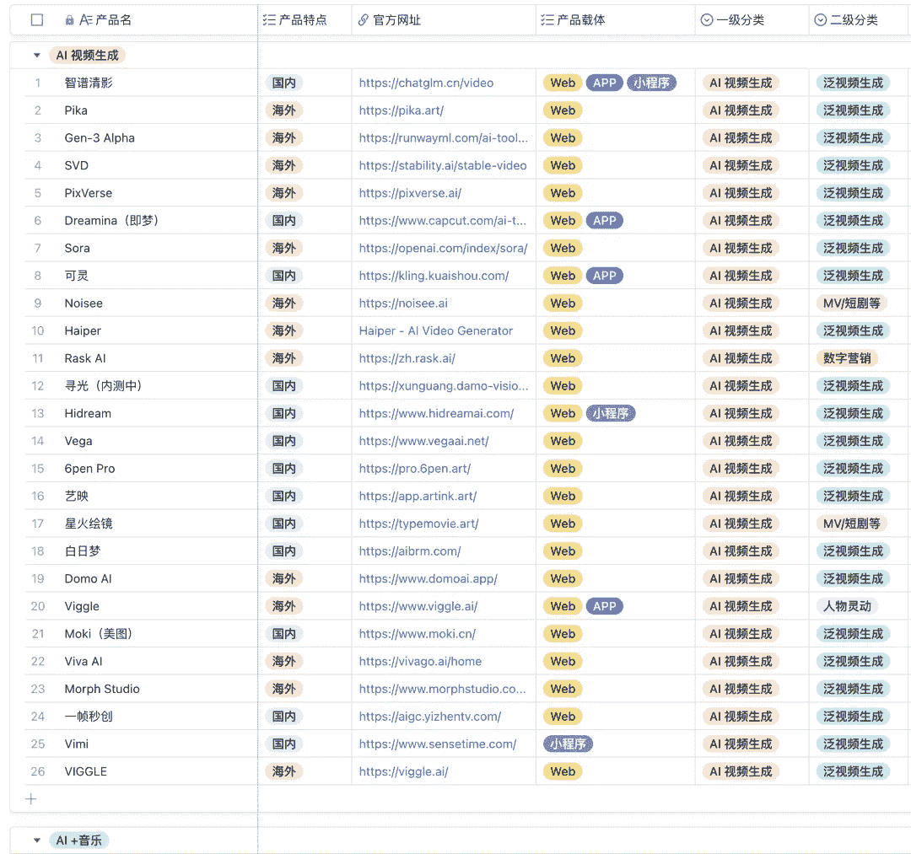
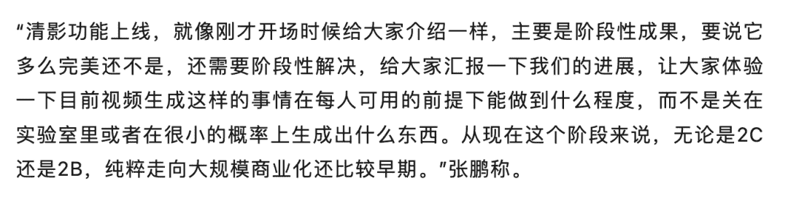

# 起舞弄「清影」，智谱的 AI 视频生成之战

> 来源：[https://agijuejin.feishu.cn/docx/CILoduAxkoDgZJxPaaYcAheHnsb](https://agijuejin.feishu.cn/docx/CILoduAxkoDgZJxPaaYcAheHnsb)

> 作者：特工小宝

> 编辑：特工少女 | 特工宇宙

> 原文：[https://mp.weixin.](https://mp.weixin.qq.com/s/OZfR99H9Yq1YZTR02qOM2g)qq.com/s/OZfR99H9...

全面对标 OpenAI 的智谱， 这一次在发布上遥遥领先。

是的， **没有预告，没有期货 **， 智谱上线 AI 生成视频功能 了 。

在这个神仙打架，“险象丛生”的 2024 年，各路诸侯你方唱罢我登场，简直就是“诸神黎明”，而 AI 生成视频赛道，早已成为兵家必争之地。

在“大模型七雄”之中， **率先亮剑的，就是智谱。 **

在 7 月 25 日上午，智谱带着它的「清影」“杀”了进来。

国内外当前 AI 工具一览表

由特工宇宙自研 Arsenal-Agent 工具整理

智谱清影，这个名字就深得我心，与清言对仗，又有电影之意。

让人不禁想起《水调歌头》中的名句——“起舞弄清影，何似在人间”，既平添了一份诗情画意，又让人有一种“脱离人世 间”的超然感。

关闭

**观看更多**

更多

退出全屏

切换到横屏模式

[🎦 点击观看视频](https://mpvideo.qpic.cn/0b2esaaacaaaluaf6lvdlftfbegdagiaaaia.f10002.mp4?dis_k=2c0150b49946a770a2d41f166155bf3a&dis_t=1724210960&play_scene=10120&auth_info=ALrm1rExUw5p3sX0zF9LQEsUbFB3MD5LQDA1TjwzMU0yPBpvSxpIQx4bGS55MEZgVxA=&auth_key=5f421d15c3f40cb93e02c83035ac9765&vid=wxv_3563319584209813504&format_id=10002&support_redirect=0&mmversion=false)

> 无法获取音频链接

视频详情

清影没有 Waitlist，也无需下载新的 APP，还是在那个熟悉的智谱清言内，你就能找到它。

地址：https://chatglm.cn/video

清影目前有文生视频和图生视频两大功能，并支持用户定义视频风格、情感氛围、运镜方式。

其 中视频生成时长为 6s，分辨率为 1440x960（3：2）。

等待大约 30s，即可得到生成结果。

如果等不及，也可以选 择付费获得“高速权益”。

不得不说，在各大 AI 视频生成工具都在收费之时，「清影」已经很良心了。

慢点就慢点，又不是不能白嫖

不过氪佬还能多解锁一个权益，可以设置 BGM！没关系，白嫖党可以下载了之后自己编辑添加

BTW，看到了这个配音，我似乎闻到了智谱要做 AI 音乐的味道...

看 Demo 演示非常牛逼，一上手就废怎么办？

没关系，贴心的官方准备了一套小白手册，内有书写 Prompt 的技巧和丰富的案例。

甚至还做了个 Agent，辅助你书写提示词。

🔗 知识库：https://zhipu-ai.feishu.cn/wiki/MFxywuqcbiKmOrkXwJzcEuqwnJd?from=from_copylink

🔗 清影提示词智能体：https://chatglm.cn/main/gdetail/669fb16ffdf0683c86f7d903

以下是用清影制作的部分视频，来看看清影都能实现怎么样的效果吧～

1. 土拨鼠在唱歌

[0bc3t4aaaaaa2eafszfdnjtfbh6dacpqaaaa.f10004.mp4](https://internal-api-drive-stream.feishu.cn/space/api/box/stream/download/all/A92lbJl4lo9g38xsAincdwQCnrh)

2. 爱因斯坦变出鲜花

[0b2eaiaacaaa3eaft7fdnftfaawdaebaaaia.f10004.mp4](https://internal-api-drive-stream.feishu.cn/space/api/box/stream/download/all/SnzYb1fBOoVTD9xXVMDcO4n1n6e)

3. 猫猫疑惑脸

[0b2eheaaaaaadqaftqvdqftfaoodaa4qaaaa.f10004.mp4](https://internal-api-drive-stream.feishu.cn/space/api/box/stream/download/all/XJ3jbhAxbo4XsoxRcCAcUArRn5e)

4. 黄毛浮绿水，黄掌拨清波

[0b2ejaaacaaajeahg3fdmvtfasgdafeaaaia.f10002.mp4](https://internal-api-drive-stream.feishu.cn/space/api/box/stream/download/all/XbaKbDLp3oBuoSx4GHPcXCCDnTb)

5. 小王子手捧毛线鲜花

[0bc3xeaaiaaam4ahkcndeztfboodas4qabaa.f10002.mp4](https://internal-api-drive-stream.feishu.cn/space/api/box/stream/download/all/AWoWbvH5joLwXtxlELGciYLOnzb)

6. 外国美女回眸一笑

[0bc3xuaaaaaakmahn6vdoftfbpodac6qaaaa.f10002.mp4](https://internal-api-drive-stream.feishu.cn/space/api/box/stream/download/all/KwEdbNkWzodT9Zx6pMico32gnXb)

智谱可以算是这波 AI 初创公司中最卷的一个，一以贯之地全方位布局大模型系列产品，不断完善自身的产品矩阵，如今清影的上线，就是一个很好的证明。

多模态大模型技术底座的支撑，让智谱发布“清影”，成为积淀已久的使然。2021 年，智谱正式发布文生图大模型 CogView，次年迭代至 CogView2，并在今年发布 CogView. 而实际上，早在 2022 年，基于CogView，智谱团队便已正式推出了文生视频大模型 CogVideo.

智谱在模型可控性方面下了大功夫，并初步验证了 Scaling law 在视频生成算法方面的有效性。

智谱 CEO 张鹏表示：“ **目前清影只是阶段性成果 **。”

相信在不远的将来，清影会带给我们新的惊喜～

期待“但愿‘影’长久，千里共婵娟”的一天。

