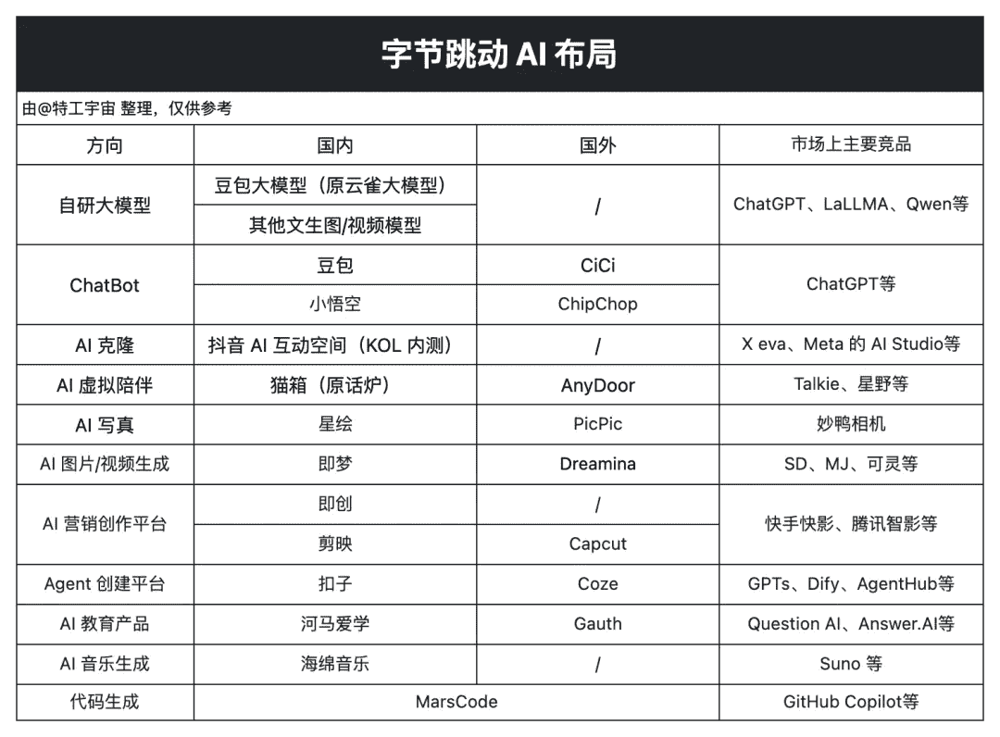
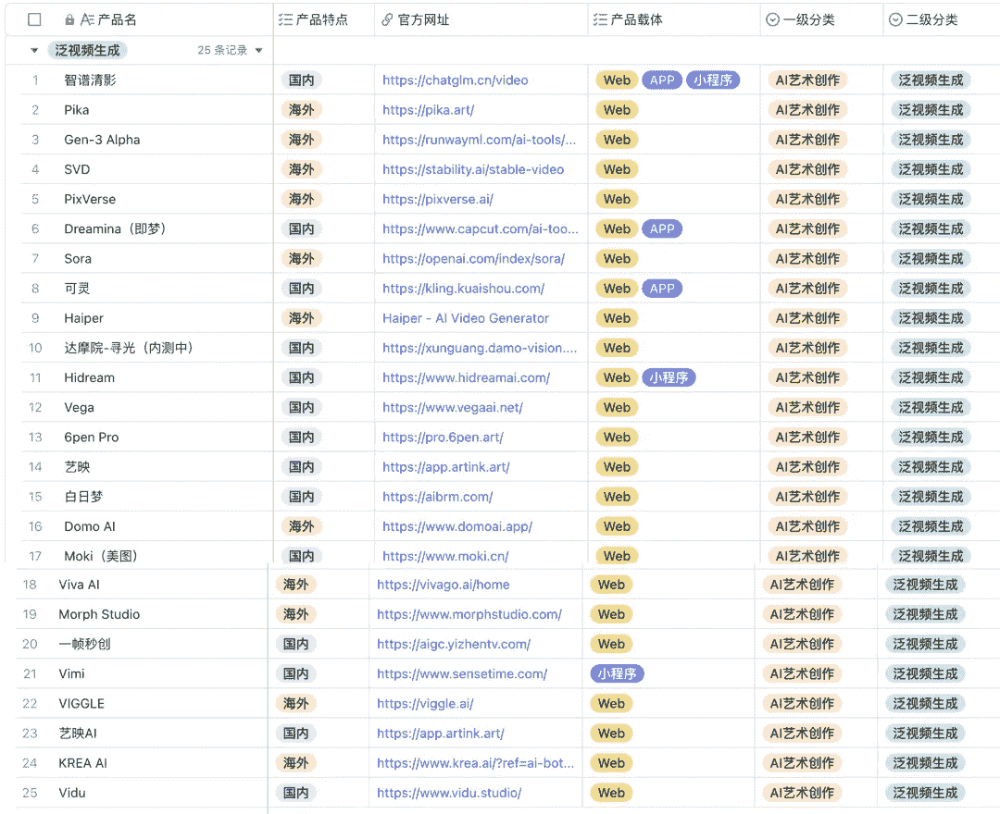

# 属于快手的「豆包」，已悄然上线

> 来源：[https://agijuejin.feishu.cn/docx/BDemd5jbKoKVJExEovgcCcaRnSb](https://agijuejin.feishu.cn/docx/BDemd5jbKoKVJExEovgcCcaRnSb)

> 作者：特工小天

> 编辑：特工少女 | 特工宇宙

> 原文：[https://mp.weixin.](https://mp.weixin.qq.com/s/slPUG5FXwzf-HOdLIUCtHA)qq.com/s/slPUG5FX...

作为中国短视频行业的两大巨头， 抖音和快手相爱相杀近十年。

这十年，见证了国内移动互联网的崛起，也见证了两大巨头的恩爱情仇。

潮起潮落，你追我赶， 针尖对麦芒。

随着技术的进步，双方的竞争也持续加码，从短视频赛道扩展到更广阔的领域。

而他们之间的 较量，终 来到了 AI 战场。

# **- 如果巅峰留不住 -**

“始终创业，逃逸平庸的重力 ”，这是年初梁汝波定下的 字节年度关键词。

不能承受「平庸」之轻的字节，于 2024 年开足马力。

——如果巅峰留不住，那就重走来时路。

素有「APP 工厂」美称的字节，又将这一特长发挥到了极致。

自去年发布「豆包」到现在，字节不遗余力的 All in AI，在 Infra 建设、人才招聘等各方面都持续发力。

字节几乎没有放过任何一个 AI 赛道，截止目前，字节共上线了全新的 10 余款 AI 产品，以此期望创造下一个时代的「抖音」。

字节拥有抖音这个天然的分发渠道优势，「出口转内销」式让平台 KOL 种草「豆包」等自家产品，诸如李宗恒、池野林等百万粉丝的大博主均有接单。

基于 全新升级后的「豆包大模型」， 加之字节做 toC 的产品体验确实有独到之处，高效的回复速率，逼真的声音克隆，多样的智能体体验...

得益于以上优势，「豆包」的下载量已超过 1 亿，月活也是一骑绝尘。

就在野心十足的字节“大杀特杀”之时，低调的快手，却打出了一张王牌。

# **- 风起于青萍之末 -**

给你三秒钟时间，你能想到快手的大模型叫什么名字吗？

是的，快手在这场大模型浪潮中，其实并不算是站在潮头之上的。

在“隔壁家的孩子”纷纷备案通过，纷纷打榜，价格战打的正酣，“飞入寻常百姓家”之时。

江湖上似乎没有流传关于快手的传说 。

事实上，快手的首个自研大模型「快意」，直到 2023 年底，才加入到第三批网信办大模型备案。

再说到快手最擅长的视频领域，自 Sora 爆火之后，涌现出了一大批优秀的创业者，各个 AI 公司的追赶速度也令人咋舌。

基于「特工宇宙」自研的 Arsenal-Agent 整理。

在 AI 视频生成赛道，快手也是个慢性子，但也 并非风平浪静。

风起于青萍之末。2024 年 5 月初，快手 AI 高级研究王鑫涛，在一次学术会议中做过关于《视频生成的初探及可控性研究》的分享，其中就提到了快手的视频生成方案 Tune-A-Video。

其 中王鑫涛为港大博士，师从汤晓鸥，曾 担任腾讯 ARC 实验室和腾讯 AI 实验室的高级研究员。

快手，就是这样一个在大模型班级里没有太多存在感的同学，于今年 6 月，“垂死病中”惊四座，放出一 张王牌——「可灵」。

6 月 21 日，在 CVPR2024 上，快手「可灵大模型」正式推出图生视频功能，支持将任意静态图像转化为 5 秒动态视频。

7 月 6 日，在上海世界人工智能大会期间，快手宣布「可灵 AI」上线 Web 端，圈内掀起轩然大波。

猎豹移动董事长傅盛曾在个人账号表示，「这可能是今天在全世界范围内，你能够使用到的最好的文生视频人工智能产品」， 各路 AI 创作者也纷纷 涌入可灵，给予了高度评价。

一时间，各种 AI 复活老照片、AI 整活影视剧兴起，其中用户使用最多的就是「可灵」，「可灵」再次火爆出圈。

7 月 24 日，快手向海外市场投放了「Kling」这一深水炸弹，再次震惊了海外网友，好评如潮，一号难求。

这一次，快手靠「可灵」挤上了生成式 AI 的牌桌。

但刚崭露头角的快手，它的野心不止于此。

# **- 反击：涅槃的飞船 -**

快手靠「可灵」“上大分”之余，也在加紧布局其他 AI 领域。

对行业关注比较密切的朋友，可能会记得，在 WAIC 快手的展台上，有一小块区域，是属于「飞船」的，当时的它还在内测。

「飞船」这个名字其实并不陌生，早在 2021 年，快手就上线了一版「飞船」，当时的它还是类「ClubHouse」的语音聊天产品。

而如今，「飞船」“ 秽土转生”，是 AIGC 给了它二次生命。

「飞船」已于最近正式上线，产品形态酷似「豆包」。

用户在 AI 宇宙中扮演“船长”一职，有一个名为快快的少女领航员，引导用户驾驶飞船 APP.

相比于既主打效率工具，又主打闲聊陪伴的「豆包」，「飞船」会更侧重于 AI 虚拟陪伴，平台上已经有很多 OC 人物。

实测下来，「飞船」上的 ChatBots 的回复速度很快，OOC 情况较少，语音也较为逼真，虚拟角色还会回复语音和照片，甚至是人像的 gif 动画。

整体体验下来，效果并不逊于「豆包」，可以预计的是，未来会有许多语聊玩家，将自己的 OC 角色搬运到「飞船」上。

不过，相比于「豆包」，快手并没有足够的生态优势，「飞船」也没有非常核心的差异化优势，目前来看，很难再续「可灵」的辉煌。

但这，却迈出了快手进军 AI 坚实的一步。

在这场关于 AI 的群雄争霸中，有的明修栈道，有的暗度陈仓； 有的 披荆斩棘 ，有的 折戟沉沙。

究竟是时代的眼泪，还是下一个 Killer APP？

抖音与快手的角逐仍在继续。

不知道，坐在「飞船」上的快手，又能在 AI 宇宙中驶向多远？

这两大巨头，又将如何继续书写属于它们的传奇？

让我们，与「特工宇宙」一起见证。

