# AI视频短片工作流分享

> 来源：[https://agijuejin.feishu.cn/docx/LpwHdlYhWo7e7ZxMI1lcWzWrn8f](https://agijuejin.feishu.cn/docx/LpwHdlYhWo7e7ZxMI1lcWzWrn8f)

> 作者：德里克文

> 原文：[https://zhuanlan.z](https://zhuanlan.zhihu.com/p/694158919)hihu.com/p/694158...

需要采用多种AI软件共同协作，才可以做成一个完整的有效果AI视频短片。

先来看下我和伙伴们用全国产AI工具制作的AI视频短片效果吧！

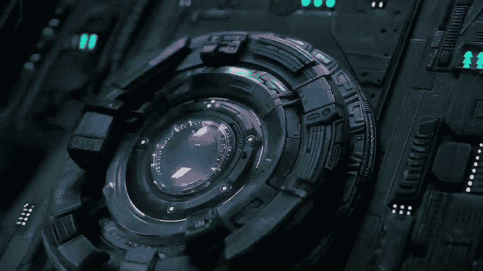

[9c4b5dfe-0089-11ef-9560-965723eb0b8c-v8_f2_t1_xKNzBnn3.mp4](https://internal-api-drive-stream.feishu.cn/space/api/box/stream/download/all/GXANbqDWZoXeamxMDo6cCPSbnbb)

《破壁》是我们（AINEXT+三体迷）采[用国内的A](https://www.zhihu.com/search?q=%E5%9B%BE%E7%89%87%E7%94%9F%E6%88%90&search_source=Entity&hybrid_search_source=Entity&hybrid_search_extra=%7B%22sourceType%22%3A%22article%22%2C%22sourceId%22%3A694158919%7D)I工具，从AI分镜脚本、AI 图片生成 、AI视频生成等一系列工具，进行制作完成的AI视频短片。

“破壁”既是《三体》内“破壁人”的称呼，同时也意味着AIGC正在突破传统内容创作之壁，国内AI工具未来的发展能够突破国外科技封锁之壁的含义。

我们希望以此来致敬《三体》这一部伟大的科幻作品。

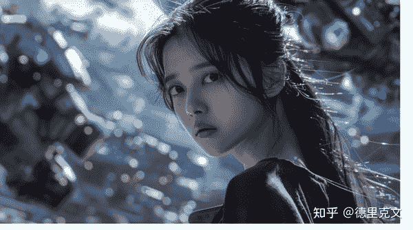

下面我来简述下如何通过不同的AI工具来制作一个完整的AI视频的工作流程，抛砖迎玉供大家参考。

## 一、 [项目总表](https://www.zhihu.com/search?q=%E9%A1%B9%E7%9B%AE%E6%80%BB%E8%A1%A8&search_source=Entity&hybrid_search_source=Entity&hybrid_search_extra=%7B%22sourceType%22%3A%22article%22%2C%22sourceId%22%3A694158919%7D)

[在这个项目](https://www.zhihu.com/search?q=%E5%88%86%E5%B7%A5%E5%90%88%E4%BD%9C&search_source=Entity&hybrid_search_source=Entity&hybrid_search_extra=%7B%22sourceType%22%3A%22article%22%2C%22sourceId%22%3A694158919%7D)的开始，我们团队内部就进行了 分工合作 。

第一件事情就是确认视频的主要内容和主要文案，[这部分是](https://www.zhihu.com/search?q=%E6%96%B9%E5%90%91%E6%80%A7&search_source=Entity&hybrid_search_source=Entity&hybrid_search_extra=%7B%22sourceType%22%3A%22article%22%2C%22sourceId%22%3A694158919%7D)需要花时间去构思和讨论的，确保 方向性 上达成统一意见，并且形成剧本故事。

本次由于我们的主题是致敬三体的闪回内容，因此直接采用了经典金句，节约了这部分时间。

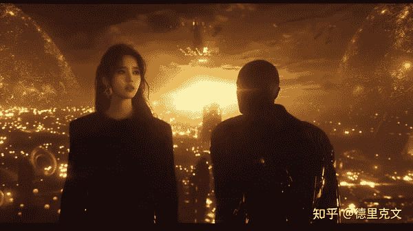

[在明确了](https://www.zhihu.com/search?q=%E5%B7%A5%E4%BD%9C%E8%A1%A8&search_source=Entity&hybrid_search_source=Entity&hybrid_search_extra=%7B%22sourceType%22%3A%22article%22%2C%22sourceId%22%3A694158919%7D)[内容的主要](https://www.zhihu.com/search?q=%E8%BF%9B%E5%BA%A6%E5%AE%89%E6%8E%92&search_source=Entity&hybrid_search_source=Entity&hybrid_search_extra=%7B%22sourceType%22%3A%22article%22%2C%22sourceId%22%3A694158919%7D)方向后，我们建立了一个 工作表 ，将视频内容进行拆分，确定每个人的时间 进度安排 ，明确具体工作内容。

这一阶段的内容主要是列出项目大纲，明确视频主体，讨论构思整体需求，并将一个项目进行分解细化，明确阶段目标。

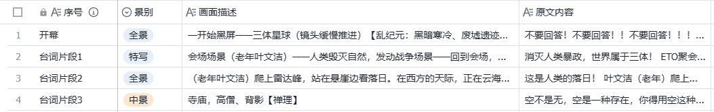

详细展开有很多内容，还需要进行多次协同合作。

## 二、 [分镜表](https://www.zhihu.com/search?q=%E5%88%86%E9%95%9C%E8%A1%A8&search_source=Entity&hybrid_search_source=Entity&hybrid_search_extra=%7B%22sourceType%22%3A%22article%22%2C%22sourceId%22%3A694158919%7D)

在明确项目构建之后，我们需要将画面描述的内容进行一些细化，确认分镜的内容，在这个阶段我们就可以采用AI工具来帮我们进行辅助。

[我们将讨论好](https://www.zhihu.com/search?q=%E5%A4%A7%E8%AF%AD%E8%A8%80%E6%A8%A1%E5%9E%8B&search_source=Entity&hybrid_search_source=Entity&hybrid_search_extra=%7B%22sourceType%22%3A%22article%22%2C%22sourceId%22%3A694158919%7D)的画面内容，通过提示词丢给 大语言模型 ，让他帮我根据内容进行详细分镜文字内容的生成。

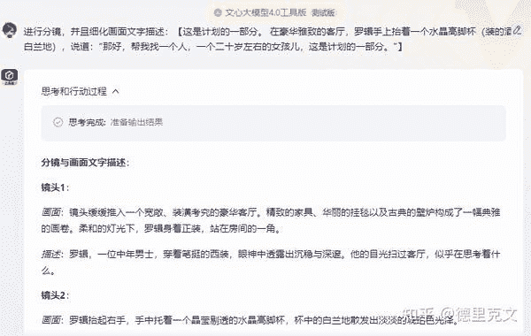

然后将相应的内容经过我们自己的思考改写，放置到我们创建的表格中。

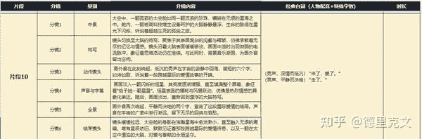

在确认了分镜后，我们就可以进行相应的图像生成。

## 三、画面生成

在画面生成这一块，我会借助我创建的提示词来帮我生成更加精准有趣的提示词，例如我采用字节的扣子生成的AI绘画提示词智能体，我输入我想要的画面，由AI辅助我生成更加详细的描绘。

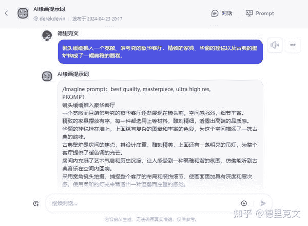

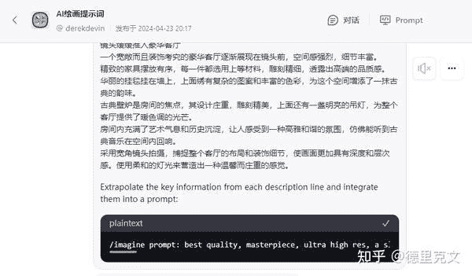

然后我有了这些详细的画面描述后，将这些描述输入到AI绘画软件中，让它协助我生成画面。

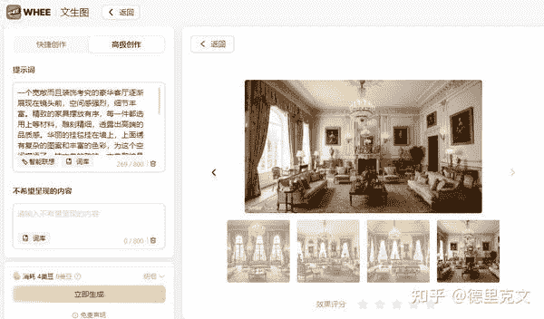

经[过对画](https://www.zhihu.com/search?q=%E8%A7%86%E9%A2%91&search_source=Entity&hybrid_search_source=Entity&hybrid_search_extra=%7B%22sourceType%22%3A%22article%22%2C%22sourceId%22%3A694158919%7D)面风格效果的调整，选择我想要的画面后，根据分镜内容出图，每个镜头出几十张图，从几十张当中挑选3~5张进入后续的 视频 生成步骤。

## 四、视频生成

而在视频生成这个领域，我采用的是Dreamina，它的视频动态效果出众。

我将之前生成的画面内容放入视频进行生成，得到3秒钟的视频

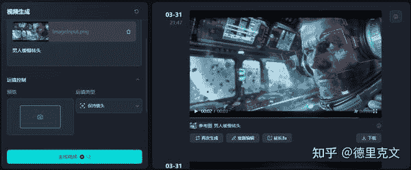

在这个过程中，需要通过不断的筛选，储备众多镜头，我们看到的最后一分钟，实际准备的内容远超这些，删掉不合适的镜头非常多。

## 五、剪辑

最后的剪辑环节我采用简单上手的剪映，只需要将之前所有的资料进行一个汇总，根据配音节奏进行卡点就行。

这一点由于比较复杂，是没有办法自动生成的，需要花费时间和精力进行一步步的操作。

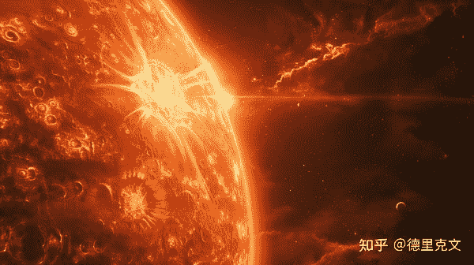

在进行了最后的剪辑完成后，我们就可以生成一段完整的纯AI制作的视频了。

## 六、AI工具一览

本视频用到的相关AI工具

### 1. 文案、分镜 **：**

[关于剧本的](https://www.zhihu.com/search?q=%E9%80%9A%E4%B9%89%E5%8D%83%E9%97%AE&search_source=Entity&hybrid_search_source=Entity&hybrid_search_extra=%7B%22sourceType%22%3A%22article%22%2C%22sourceId%22%3A694158919%7D)文案和分镜内容，可采用自行创作，也可以采用文心一言、 通义千问 等综合语言类大模型,进行内容的辅助创作。

**文心一言：**

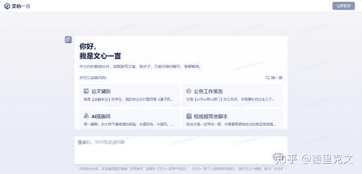

**通义千问：**

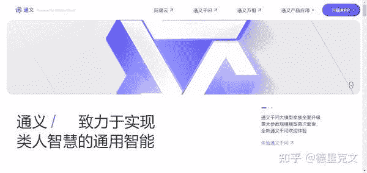

### 2. 画面生成

采[用AI](https://www.zhihu.com/search?q=%E6%82%A0%E8%88%B9&search_source=Entity&hybrid_search_source=Entity&hybrid_search_extra=%7B%22sourceType%22%3A%22article%22%2C%22sourceId%22%3A694158919%7D)工具进行图片处理生成，生成接近分镜表里面画面的描述内容。在这个视频中我分别采用了美图WHEE和 悠船 进行了图片创作。

美图WHEE：

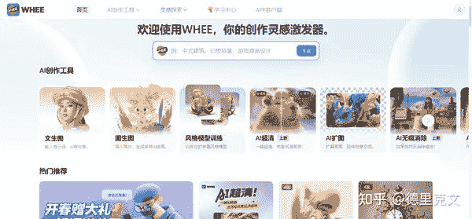

**悠船：**

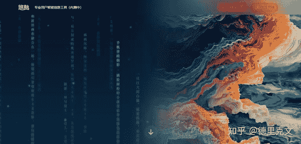

### 3. 视频生成

**剪映Dreamina:**

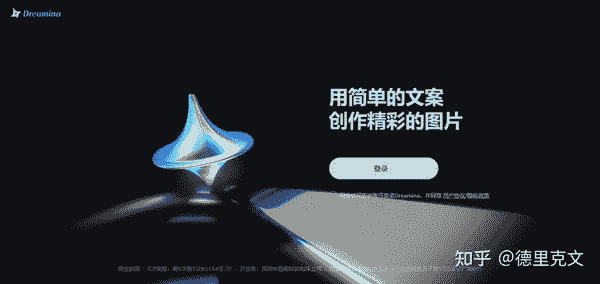

### 4. 剪辑 **制作：**

[**剪映 **](https://www.zhihu.com/search?q=%E5%89%AA%E6%98%A0&search_source=Entity&hybrid_search_source=Entity&hybrid_search_extra=%7B%22sourceType%22%3A%22article%22%2C%22sourceId%22%3A694158919%7D)**：**

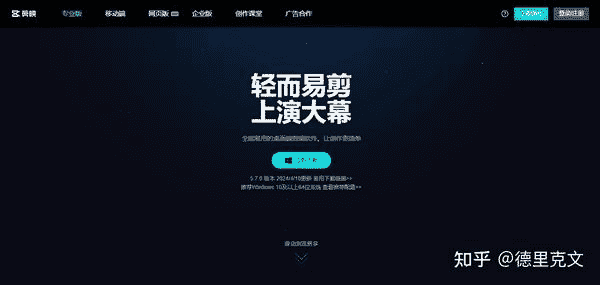

## 结语

好了，大体的工作流就介绍到这里。

如果要细细展开其实工作量不小，从中我们可以看出，AI工具可以有效辅助这一部分的内容，但是以目前AI工具的能力，还不能完全做到全自动，不过从另外一个角度来看，也给了创作者更多的灵活性和上限去调整生成的内容。

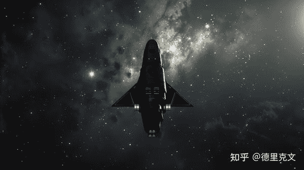

AI只是工具和合作者，不能取代创作者。

---

我是 [德里克文 ](https://www.zhihu.com/search?q=%E5%BE%B7%E9%87%8C%E5%85%8B%E6%96%87&search_source=Entity&hybrid_search_source=Entity&hybrid_search_extra=%7B%22sourceType%22%3A%22answer%22%2C%22sourceId%22%3A3162454823%7D)[，一个对AI](https://www.zhihu.com/search?q=%E5%AE%A4%E5%86%85%E8%AE%BE%E8%AE%A1%E5%B8%88&search_source=Entity&hybrid_search_source=Entity&hybrid_search_extra=%7B%22sourceType%22%3A%22answer%22%2C%22sourceId%22%3A3161270553%7D)绘画，人工智能有强烈兴趣，从业多年的 室内设计师 ！如果对我的文章内容感兴趣，请帮忙关注点赞收藏，谢谢！