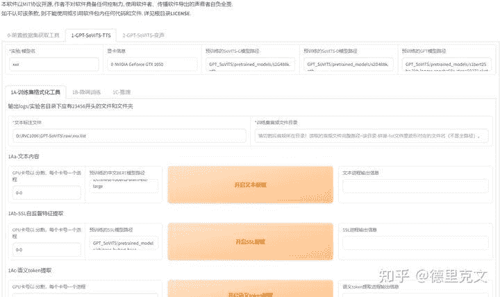

# AI工具——免费的克隆声音的工具推荐（GPT-SoVITS、飞浆PP【有手就行】）

> 来源：[https://agijuejin.feishu.cn/docx/GUhbdyowvo95Sqx93Voc8LCRnHh](https://agijuejin.feishu.cn/docx/GUhbdyowvo95Sqx93Voc8LCRnHh)

> 作者：德里克文

> 原文：[https://zhuanlan.zhihu.com/p/684154569](https://zhuanlan.zhihu.com/p/684154569)

想把自己的声音克隆，便于直接用文字生成语音吗，这里我推荐下两个免费开源的 AI 人工智能工具，可以用来克隆自己的声音，文章内容比较长，我建议你可以先收藏备看。

只需要几分钟的声音数据，就可以自己训练一个声音的克隆，这一功能在个性化语音助手、虚拟角色配音、自媒体创作等领域具有广泛的应用前景，下面我来分享下相关的免费软件。

## 一、`GPT-SoVITS`

`GPT-SoVITS`，是一个由 `RVC` 变声器创始人“花儿不哭”推出的免费开源项目。

它通过巧妙融合了 `GPT`（Generative Pre-trained Transformer）模型与 `SoVITS`（Speech-to-Video Voice Transformation System）变声器技术，使得用户仅需少量样本数据，即可实现高质量的语音克隆和文本到语音转换（`TTS`）。

### 1. 软件简介

`GPT-SoVITS` 项目提供了零样本和少样本的 `TTS` 功能。

零样本 `TTS` 允许用户仅凭一个 5 秒的声音样本，即可实现即时的文本到语音转换。

而少样本 `TTS` 则通过 1 分钟的训练数据，对模型进行微调，以提升声音的相似度和真实感。

而通过模型训练，该工具能够学习并复制特定说话人的声音特征，包括情感、音色和语速，从而生成与原声音极为相似的合成语音。

同时这个工具支持多种语言的语音合成，目前包括英语、日语和中文。

### 2. 配置要求

#### Windows

+ 支持 `CUDA` 的 `NVIDIA` 显卡，每张拥有至少 6G 以上显存

+ 常见的不能使用的显卡：10 系以前的所有卡、1060 以下、1660 以下、2060 以下、3050 4G

+ Windows 10/11 系统

#### MAC

+ 搭载 Apple 芯片（M 系列芯片）或 `AMD GPU` 的 Mac（如 2019 款 Mac Pro）

+ macOS 12.3 或更高版本

+ 已通过运行 `xcode-select --install` 安装 Xcode command-line tools

### 3. 操作界面

为了降低使用门槛，`GPT-SoVITS` 提供了集成了声音伴奏分离、自动训练集分割、中文 `ASR`（自动语音识别）和文本标注等工具的 `WebUI`。

这些工具可以帮助初学者轻松创建训练数据集和 `GPT`/`SoVITS` 模型，使得声音克隆技术更加亲民。

### 4. 下载与使用

先放上网盘下载分享链接：

[https://pan.baidu.com/s/1h3VC9Bg3ijrCNqbtc9eQHw?pwd=ugc7](https://pan.baidu.com/s/1h3VC9Bg3ijrCNqbtc9eQHw?pwd=ugc7)

提取码：`ugc7`

下载后，运行 `VisualStudioSetup.exe` 进行安装，并选择使用 C++ 的桌面开发组件。

安装完成后，运行 `更新到项目最新版.bat` 和 `更新后运行我更新依赖.bat` 文件，以确保整合包是最新版本。

使用 `7-Zip` 进行解压，避免使用其他可能吞文件的解压工具。解压后，双击 `go-webui.bat` 文件打开 `WebUI` 界面。确保不要以管理员身份运行。

正常打开后，稍加等待就会弹出网页。如果没有弹出网页可以复制 `http://0.0.0.0:9874` 到浏览器打开。

打开后的界面是这样：

特别注意：打开的 `bat` 不可以关闭！这个黑色的 `bat` 框就是控制台，所有的日志都会在这上面呈现，所有的信息以控制台为准。

### 5. 数据处理

准备高质量的数据是成功训练模型的关键。数据集处理是让 AI 学习模仿声音的重要一步。就像老师在上课前要准备好教案一样，我们需要给 AI 准备一套完整的“学习材料”。

这些材料就是数据集，它们包含了 AI 需要学习的声音样本。

下面是数据集处理的详细步骤，我会尽量用简单的话来解释。

#### 收集音频

首先，你需要找到一些音频文件，这些文件里的声音是你希望 AI 学会模仿的。比如，如果你想让 AI 模仿自己的声音，你就需要收集自己一些的讲话录音。

#### 清理音频

有时候，音频文件里可能有一些不需要的声音，比如背景音乐、噪音或者回声。我们需要用一些工具来清理这些音频，只留下清晰的人声。这个过程就像是给音频“洗澡”，让它变得干净、清爽。

我们可以点击开启下载文件中的 `UVR5-WebUI`，稍加等待就会网页，如果没有弹出，可以复制 `http://0.0.0.0:9873` 到浏览器打开。

输入音频文件夹后，我们用 `HP2` 模型来把人的声音从一首歌或者一段对话中单独拿出来。这个过程就像是把歌声从背景音乐里分离出来。分离出来的这个声音，我们叫它“干声”。

然后，我们要把这个干声再处理一下，让声音听起来更干净。

先用 `onnx_dereverb`，最后用 `DeEcho-Aggressive` 来去掉回声。处理完的声音，我们保存成 `wav` 格式。

这些处理后的声音文件会自动保存在一个文件夹里，这个文件夹的路径很长，叫做 `GPT-SoVITS-beta\GPT-SoVITS-beta\output\uvr5_opt`。

记得，不要自己改这个保存的位置，不然你可能会找不到文件。

在这个文件夹里，你会看到几种不同的声音文件。

有的标记为 `vocal`，这个是人声；有的标记为 `instrument`，这个是乐器声；还有的标记为 `No Reverb` 和 `Reverb`，分别表示没有回声和有回声的声音。

我们只需要用到标记为 `vocal` 和 `No Reverb` 这两个文件，其他的可以不用管。

最后，当你都处理完了，别忘了在 `WebUI` 界面把 `UVR5` 这个工具关掉。

#### 切分音频

接下来，我们需要把长音频切成一小段一小段的。这样做是因为 AI 更容易学习短小的音频片段。可以类比人类的记忆，如果让你一次性记住一篇长文章，可能会很困难，但如果分成几个小段落，就更容易记住了。

这一部分操作不复杂，多试几次就知道了。

#### 给音频打标签

为了让 AI 知道每段音频在说什么，我们需要给它们打上标签。

这就像是给每个音频片段写上标题，告诉 AI 这段音频的内容。这个步骤很重要，因为 AI 需要通过这些标签来学习如何发音。

这步很简单，只要把刚才的切分文件夹输入就行。

接下来，你得决定用哪个模型来把你说的内容转成文字。

1. 达摩 `ASR`：这个工具专门用来识别中文，而且做得非常好。如果你的音频是中文的，就用这个。

1. `fast whisper`：这个工具更全能，能识别很多种语言，总共有 99 种。它在识别英语和日语方面特别棒。如果你的音频是这两种语言之一，就选这个。

### 数据集准备与模型选择

1. 在选择模型的时候，挑一个叫做“large V3”的选项，这样它就能更好地工作。至于语言，你不用操心，选“auto”让它自己判断就行。

选好工具后，就点击“开启离线批量ASR”就好了。

#### 检查和校对

最后，我们需要检查一下这些音频片段和标签是否都正确。如果发现有错误，就需要及时更正。

数据集处理可能听起来有点复杂，但其实只要跟着步骤一步一步来，就没那么难。好的数据集是AI学习成功的关键，所以这个过程一定要认真对待。

### 6. 训练

训练就像是在教AI如何克隆你的声音。你提供了音频文件后，AI会通过一系列的计算过程，学习这些声音的特点，比如音调、节奏和发音方式。

我们切换到第二界面，先设置实验名也就是模型名，特别注意不要输入中文。

[然后第一](https://www.zhihu.com/search?q=%E6%89%A9%E5%B1%95%E5%90%8D&search_source=Entity&hybrid_search_source=Entity&hybrid_search_extra=%7B%22sourceType%22%3A%22article%22%2C%22sourceId%22%3A684154569%7D)个输入的是标注文件路径，需要注意的是文件的全名必须要输进去，扩展名是`.list`的后缀。

第二个输入的是切分音频文件夹路径，然后分别点击上面三个按钮进行训练。

在微调训练中，首先设置 [`batch_size`](https://www.zhihu.com/search?q=batch_size&search_source=Entity&hybrid_search_source=Entity&hybrid_search_extra=%7B%22sourceType%22%3A%22article%22%2C%22sourceId%22%3A684154569%7D)，建议设置为显存的一半，比如6g显存建议设置为1。

接着设置轮数，SoVITS模型轮数可以设置的高一点，训练的比较快。

但是需要注意的是，GPT [`模型轮数`](https://www.zhihu.com/search?q=%E6%A8%A1%E5%9E%8B%E8%BD%AE%E6%95%B0&search_source=Entity&hybrid_search_source=Entity&hybrid_search_extra=%7B%22sourceType%22%3A%22article%22%2C%22sourceId%22%3A684154569%7D)不要太高，建议设置为10。

然后先点开启SoVITS训练，训练完后再点开启GPT训练，不要一起训练。如果中途中断了，直接再点开始训练就好了，会从最近的保存点开始训练。

最后关于训练轮数，不是越高越好,正常选默认的十几轮就可以。

如果要训练高轮数,请先保证数据集质量极好，标注全都经过手动校对，时长至少超过1小时才有必要拉高轮数。

### 7. 推理

首先，你得让系统知道你想用哪个模型来推理。

点击刷新，然后从 [`下拉菜单`](https://www.zhihu.com/search?q=%E4%B8%8B%E6%8B%89%E8%8F%9C%E5%8D%95&search_source=Entity&hybrid_search_source=Entity&hybrid_search_extra=%7B%22sourceType%22%3A%22article%22%2C%22sourceId%22%3A684154569%7D)里挑一个。这里的“e”代表训练的次数，“s”代表训练的步数。但并不是次数越多越好。

选好后，点击“开启TTS推理”，系统就会自动打开一[个新界面](https://www.zhihu.com/search?q=%E5%9C%B0%E5%9D%80%E6%A0%8F&search_source=Entity&hybrid_search_source=Entity&hybrid_search_extra=%7B%22sourceType%22%3A%22article%22%2C%22sourceId%22%3A684154569%7D)。如果界面没弹出来，就在浏览器地址栏输入`http://0.0.0.0:9872`打开。

记住，[`训练次数`](https://www.zhihu.com/search?q=%E8%AE%AD%E7%BB%83%E6%AC%A1%E6%95%B0&search_source=Entity&hybrid_search_source=Entity&hybrid_search_extra=%7B%22sourceType%22%3A%22article%22%2C%22sourceId%22%3A684154569%7D)（Epoch）和步数（Step）是两码事。一个Epoch就是所有数据都学习过一次，而一个Step就是学习过程中的一小步。

接下来我们来开始推理，在界面最上面，你可以切换不同的模型。

刚训练完模型时，这个步骤很关键。

然后，你需要上传一段音频作为参考。最好是你之前训练时用的那种音频，大概5秒钟长。这段音频很重要，因为它会帮助AI学习说话的速度和语气。

上传音频时，也要输入音频里说的话，确保语言一致。

虽然有个选项可以不用[`输入文本`](https://www.zhihu.com/search?q=%E8%BE%93%E5%85%A5%E6%96%87%E6%9C%AC&search_source=Entity&hybrid_search_source=Entity&hybrid_search_extra=%7B%22sourceType%22%3A%22article%22%2C%22sourceId%22%3A684154569%7D)，但效果不好，所以为了更好的效果还是勤快点输入文本吧。

接下来，输入你想合成的文字。

注意，文字的语言要和参考音频的语言一样。

建议每50个字切分一次，如果字数少于50个字，系统可能不会切分。

如果你的电脑显存不够大，可能需要按句号来切分。不过，即使显存很大，也不建议一次性合成太长的文本，否则AI可能会说胡话。

其他设置保持默认就好。

这样完整的流程就好了，快来试试吧！

## 二、百度PP飞浆

### 1. 启动准备

#### 登陆界面

注册[`百度账号`](https://www.zhihu.com/search?q=%E7%99%BE%E5%BA%A6%E8%B4%A6%E5%8F%B7&search_source=Entity&hybrid_search_source=Entity&hybrid_search_extra=%7B%22sourceType%22%3A%22article%22%2C%22sourceId%22%3A684154569%7D)，登陆百度飞浆，附上相关网址：

搜索内容：有手就行

添加图片注释，不超过 140 字（可选）

#### 点击进入项目

找到 [【有手就行](https://www.zhihu.com/search?q=%E8%AF%AD%E9%9F%B3%E5%90%88%E6%88%90&search_source=Entity&hybrid_search_source=Entity&hybrid_search_extra=%7B%22sourceType%22%3A%22article%22%2C%22sourceId%22%3A684154569%7D)】使用你自己的声音做 语音合成 这个项目，点击进入

#### 运行项目

在操作界面点击"运行一下"

#### 选择运行环境

有不同的选项，根据时间的要求进行挑选，我个人建议常规情况下可以选择V100 32GB运行，每小时只耗费1点算力，每日登陆赠送8点算力，足够完成一个项目了，当然也可以根据自己的时间情况进行调整。

### 2. [`程序界面`](https://www.zhihu.com/search?q=%E7%A8%8B%E5%BA%8F%E7%95%8C%E9%9D%A2&search_source=Entity&hybrid_search_source=Entity&hybrid_search_extra=%7B%22sourceType%22%3A%22article%22%2C%22sourceId%22%3A684154569%7D)

在程序界面点击全部运行，运行需要一定的安装时间，静静等待就好。

运行完成后，会显示运行时长和结束时间，这样代表已经预运行完成，可以开展下一步

#### 网页界面UI运行

首先找到左侧任务栏，最后一个文件，双击运行

点击在浏览器打开这个按钮，等运行完成后就会进入网页UI界面

添加图片注释，不超过 140 字（可选）

### 3. 实际操作

#### 注意事项

上传的文件音频格式最好是`WAV`, `MP3`格式也可以，建议单独再下载音频软件进行降噪处理（自己网上找音频软件的处理软件）

添加图片注释，不超过 140 字（可选）

#### 音频文件上传

上传音频文件，注意尽量用`WAV`文件

添加图片注释，不超过 140 字（可选）

#### 数据检验

点击检验，然后确认有效音频数量是否足够

#### 导出训练模型

需要注意的是模型不是越多越好,根据实际情况进行选择，训练好后最后点击导出

添加图片注释，不超过 140 字（可选）

添加图片注释，不超过 140 字（可选）

### 4. [`音频合成`](https://www.zhihu.com/search?q=%E9%9F%B3%E9%A2%91%E5%90%88%E6%88%90&search_source=Entity&hybrid_search_source=Entity&hybrid_search_extra=%7B%22sourceType%22%3A%22article%22%2C%22sourceId%22%3A684154569%7D)

[`声码器`](https://www.zhihu.com/search?q=%E5%A3%B0%E7%A0%81%E5%99%A8&search_source=Entity&hybrid_search_source=Entity&hybrid_search_extra=%7B%22sourceType%22%3A%22article%22%2C%22sourceId%22%3A684154569%7D)建议选择`PWGan`就可以，根据实际需求调整。

实验模型一定要注意选对，下拉箭头选择自己刚刚训练好的模型名称。

语速根据要求自己调节，常规情况下选择1.0既可

最后点击合成。

#### 下载合成的语音

合成成功后可以自己试听一遍效果，是否和自己的声线吻合。没有问题的话点击喇叭右侧的三点，选择下载

#### 退出

最后，不要忘记完成后点击停止运行，否则会一直扣算力哦，切记

通[过以上的分](https://www.zhihu.com/search?q=%E8%A7%86%E9%A2%91%E8%BD%AF%E4%BB%B6&search_source=Entity&hybrid_search_source=Entity&hybrid_search_extra=%7B%22sourceType%22%3A%22article%22%2C%22sourceId%22%3A684154569%7D)享，你是否了解如何训练自己的声音进行文本朗读了呢，只需要输入文字，就可以让电脑来帮你朗读长段的文字啦！结合照片以及数字人视频软件，就可以轻松打造属于自己的数字人IP！

## 结语

通过上面的分享，你是否学会了怎么克隆自己的声音了呢？希望我的回答对你有帮助！

---

我是 [`德里克文`](https://www.zhihu.com/search?q=%E5%BE%B7%E9%87%8C%E5%85%8B%E6%96%87&search_source=Entity&hybrid_search_source=Entity&hybrid_search_extra=%7B%22sourceType%22%3A%22article%22%2C%22sourceId%22%3A684154569%7D)，一个对AI绘画，人工智能有强烈兴趣，从业多年的室内设计师！如果对我的文章内容感兴趣，请帮忙关注点赞收藏，谢谢！
