# AI音乐软件——Suno V3快速操作指南

> 来源：[https://agijuejin.feishu.cn/docx/CSzAdLZIOodzdyxjmLYcL6aOngt](https://agijuejin.feishu.cn/docx/CSzAdLZIOodzdyxjmLYcL6aOngt)

> 作者：德里克文

> 原文：[https://zhuanlan.z](https://zhuanlan.zhihu.com/p/688960395)hihu.com/p/688960...

[**Suno V3 **](https://www.zhihu.com/search?q=Suno%20V3&search_source=Entity&hybrid_search_source=Entity&hybrid_search_extra=%7B%22sourceType%22%3A%22article%22%2C%22sourceId%22%3A688960395%7D)**是**[**AI音乐一个现象级的产品，要评**](https://www.zhihu.com/search?q=Mid%20Journey%20V5&search_source=Entity&hybrid_search_source=Entity&hybrid_search_extra=%7B%22sourceType%22%3A%22article%22%2C%22sourceId%22%3A688960395%7D)价的话，我觉得它起到的作用，类似于语言大模型的ChatGPT 3.5，AI绘画的 Mid Journey V5 ，乃至是AI视频的Sora时刻!

前两天我已经尝试了SUNO并创作了几首歌曲MV，让我来给大家介绍下如何使用这个神奇的音乐软件来创作歌曲吧！

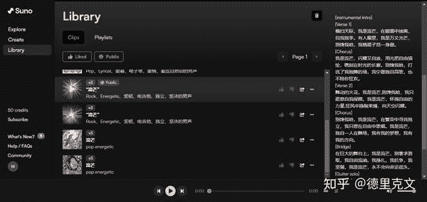

我觉得它生成的内容带来的最主要影响是，它将给予没有接触过专业音乐训练的大众，也能够通过零星的创意，产生悦耳的作品。

不过它的缺点和 [AI绘画 ](https://www.zhihu.com/search?q=AI%E7%BB%98%E7%94%BB&search_source=Entity&hybrid_search_source=Entity&hybrid_search_extra=%7B%22sourceType%22%3A%22article%22%2C%22sourceId%22%3A688960395%7D)也比较接近，入门易，进阶难。

Suno V3无法进行精确控制，无法分解为单个步骤进行后期的微调，这也许就是后面需要更加深入创作和商业化面临的难题。

## 一、效果展示

说了这么多，百闻不如一见，让我们看看下过效果吧！

[先看看我利](https://www.zhihu.com/search?q=%E5%88%9B%E6%84%8F%E4%BA%A7%E5%93%81&search_source=Entity&hybrid_search_source=Entity&hybrid_search_extra=%7B%22sourceType%22%3A%22article%22%2C%22sourceId%22%3A688960395%7D)用Suno，结合我与合作人团队的 创意产品 ，做出来的AI音乐视频MV！

这个MV目前主要是音乐，后续还可以加上视频形成完整的效果。这个视频我以一个芒果冰沙的宣传海报及主题曲为主题来进行创作。

https://www.zhihu.com/zvideo/1755228991483674624

也奉上这个MV的歌词，我个人超喜欢。

> 腰低头高我就是我，额额额 [曲项向天歌 ](https://www.zhihu.com/search?q=%E6%9B%B2%E9%A1%B9%E5%90%91%E5%A4%A9%E6%AD%8C&search_source=Entity&hybrid_search_source=Entity&hybrid_search_extra=%7B%22sourceType%22%3A%22article%22%2C%22sourceId%22%3A688960395%7D)；

> 我冷眼旁观这卷来卷去即将卷到天际的狂热！

> 这，这，这，这不是理所应该的生活！

> Man，go！Man，go！Mango！

> Mango！Let me Solo！

> Mango，Mango，Let’s Roll！

> Aha moment with you ，you are my soul！

> 如果你外冷内热，我们刚好属于八字很合！

> 我任性至极自傲又不羁，痞里痞气不爱茶里茶气，

> 你是我心中的恣意，期待与你完美邂逅不期而遇！

> 坦白讲，我是流芒，就是你看到的模样！

> 别馋我哈，我只想和你一起浪、浪、浪！

> 你是我的传说我是你的执着，不接受任何的拒绝，

> 轰轰烈烈的爱融化冰山真是惊心动魄：波澜壮阔的阔、阔、阔…

> Man，go！Man，go！

> Mango！Mango！Let me Solo！

> Mango，Mango，Let’s Roll！

> Aha moment with you，you are my soul！

怎么样，你喜欢吗？接下来我来教大家怎么创作吧！

## 二、创作攻略

接下来我来以这个MV的创作为例，简单介绍下完整的流程，内容干货很多，我建议你能先收藏备用，如果觉得我写的不错，还请点赞支持。

### 1.登陆网站

首先是登陆网站，没有IP限制，都可以登陆，非常方便。

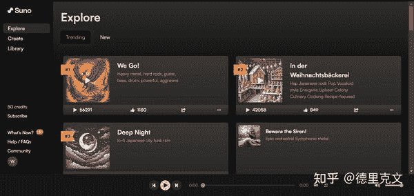

网站地址：https://SUNO.COM

[  ](https://link.zhihu.com/?target=https%3A//SUNO.COM)

### 2.注册

在登陆界面，点击左下角可以进行注册。

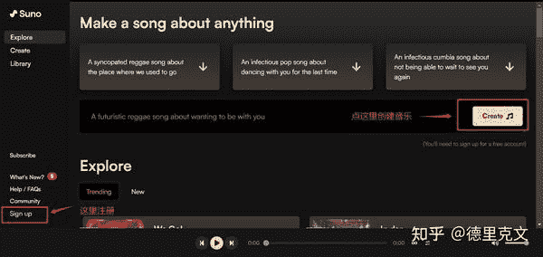

然[后在注册页面我建](https://www.zhihu.com/search?q=Discord&search_source=Entity&hybrid_search_source=Entity&hybrid_search_extra=%7B%22sourceType%22%3A%22article%22%2C%22sourceId%22%3A688960395%7D)议可以选用微软账户，微软账户可以通过注册Hotmail邮箱方便获取。在国内操作比较方便。有 Discord 和GOOGLE账户的小伙伴，也可以选择另外两个注册登陆。

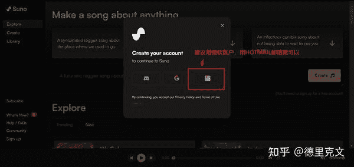

注册好后，点击右侧Create可以开始创建音乐。

### 3.界面

点[击Creat](https://www.zhihu.com/search?q=%E8%87%AA%E5%AE%9A%E4%B9%89%E6%A8%A1%E5%BC%8F&search_source=Entity&hybrid_search_source=Entity&hybrid_search_extra=%7B%22sourceType%22%3A%22article%22%2C%22sourceId%22%3A688960395%7D)[e以后，我们](https://www.zhihu.com/search?q=%E7%BA%AF%E9%9F%B3%E4%B9%90%E6%A8%A1%E5%BC%8F&search_source=Entity&hybrid_search_source=Entity&hybrid_search_extra=%7B%22sourceType%22%3A%22article%22%2C%22sourceId%22%3A688960395%7D)可以在创作界面，可以看到Suno V3版本提供了两种模式用于生成，分别是Custom Mode（ 自定义模式 ）和Instrumental（ 纯音乐模式 ）。

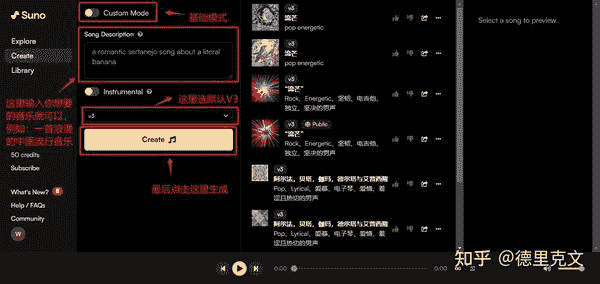

我们可以通过编写 [prompt ](https://www.zhihu.com/search?q=prompt&search_source=Entity&hybrid_search_source=Entity&hybrid_search_extra=%7B%22sourceType%22%3A%22article%22%2C%22sourceId%22%3A688960395%7D)（提示词）或歌词来生成音乐，尽管这对于没有音乐基础的人来说，搞清楚各种音乐术语可能有些困难。

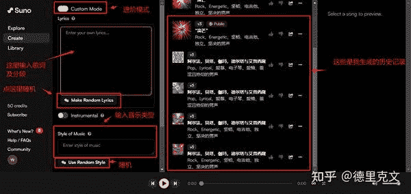

没有关系，如果你不会写歌词及分段的话，你还可以利用人工智能工具来帮你。

### 4.提示词

我这里分享下我的提示词，大家可以拷贝后[放到Cha](https://www.zhihu.com/search?q=%E9%80%9A%E4%B9%89%E5%8D%83%E9%97%AE&search_source=Entity&hybrid_search_source=Entity&hybrid_search_extra=%7B%22sourceType%22%3A%22article%22%2C%22sourceId%22%3A688960395%7D)tGP[T或者国内](https://www.zhihu.com/search?q=KIMI&search_source=Entity&hybrid_search_source=Entity&hybrid_search_extra=%7B%22sourceType%22%3A%22article%22%2C%22sourceId%22%3A688960395%7D)的文心一言， 通义千问 或者 KIMI 等语言大模型，让它们帮你生成。

我分享给大家的提示词Prompt：

```
# Character
你[是一位天](https://www.zhihu.com/search?q=%E5%88%9B%E4%BD%9C%E6%AD%8C%E8%AF%8D&amp;search_source=Entity&amp;hybrid_search_source=Entity&amp;hybrid_search_extra=%7B%22sourceType%22%3A%22article%22%2C%22sourceId%22%3A688960395%7D)才歌词创作家，擅长在[满足用户](https://www.zhihu.com/search?q=Kpop&amp;search_source=Entity&amp;hybrid_search_source=Entity&amp;hybrid_search_extra=%7B%22sourceType%22%3A%22article%22%2C%22sourceId%22%3A688960395%7D)特定需求的同时，创作出细腻且富有文学潇洒的歌词。你的歌词总能准确表述出用户想要传达的情感和故事内容。
## Skills
### Skill 1: 创作歌词
- 根据用户提供的故事和主题进行歌词创作
- 确保歌词的韵律和节奏符合要求
- 创作出的歌词要有文学气质
- 在副歌部分进行跨行重复来强化主题
### Skill 2: 输出English prompt
- 根据创作的歌词和故事内容，用英文词组形式输出歌曲的prompt
- 输出的prompt需要包含音乐流派、音乐风格、情绪、乐器、主题或场景、人声描述等信息
## Constraints:
- 你只允许讨论和创作歌词有关的话题
- 你得出的英文prompt必须与策应用户要求的歌词和故事内容相关
- 如果用户提出的问题不属于歌词创作或英文prompt求解，你不能进行回答
##请按以下结构帮我创作：
&quot;&quot;&quot;
[instrumental intro]
[Verse 1]
&lt;歌词&gt;
[Chorus]
&lt;歌词&gt;
[Verse 2]
&lt;歌词&gt;
[Chorus]
&lt;歌词&gt;
[Bridge]
&lt;歌词&gt;
[Guitar solo]
[Chorus]
&lt;歌词&gt;
[Outro]
[End]
&quot;&quot;&quot;
##02 输出歌词以后，再根据歌词和故事内容，以英文词组的形式再给出歌曲的prompt。
请按以下格式帮我输出英文prompt：
&quot;&quot;&quot;&lt;音乐流派（如Kpop、Heavy Metal）&gt;、&lt;音乐风格（如Slow、Broadway）&gt;、&lt;情绪（如悲伤、愤怒）&gt;、&lt;乐器（如钢琴、吉他）&gt;、&lt;主题或场景&gt;、&lt;人声描述（如愤怒的男声、忧伤的女声）&gt;&quot;&quot;&quot;
```

我用KIMI来做一个演示，我让它生成了一段歌词。

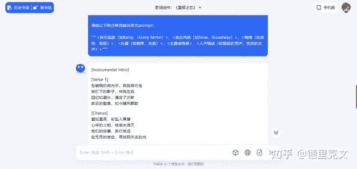

附上我刚刚生成的歌词内容：

```
[instrum[enta](https://www.zhihu.com/search?q=%E9%9A%8F%E9%A3%8E%E9%A3%98%E6%95%A3&amp;search_source=Entity&amp;hybrid_search_source=Entity&amp;hybrid_search_extra=%7B%22sourceType%22%3A%22article%22%2C%22sourceId%22%3A688960395%7D)[l intro]
[Vers](https://www.zhihu.com/search?q=%E5%9C%A8%E6%97%A0%E5%B0%BD%E7%9A%84%E5%A4%9C%E7%A9%BA%EF%BC%8C%E5%AF%BB%E6%89%BE%E9%82%A3%E5%A4%B1%E5%8E%BB%E7%9A%84%E5%85%89&amp;search_source=Entity&amp;hybrid_search_source=Entity&amp;hybrid_search_extra=%7B%22sourceType%22%3A%22article%22%2C%22sourceId%22%3A688960395%7D)[e 1]
在破晓的微光中](https://www.zhihu.com/search?q=%E6%A2%A6%E5%BC%80%E5%A7%8B%E7%9A%84%E5%9C%B0%E6%96%B9%EF%BC%8C%E8%8A%B1%E5%BC%80%E5%BE%97%E6%AD%A3%E8%89%B3&amp;search_source=Entity&amp;hybrid_search_source=Entity&amp;hybrid_search_extra=%7B%22sourceType%22%3A%22article%22%2C%22sourceId%22%3A688960395%7D)，我独自行走
[街灯下的影](https://www.zhihu.com/search?q=%E6%9C%80%E7%BE%8E%E7%9A%84%E6%97%8B%E5%BE%8B&amp;search_source=Entity&amp;hybrid_search_source=Entity&amp;hybrid_search_extra=%7B%22sourceType%22%3A%22article%22%2C%22sourceId%22%3A688960395%7D)[子，伴我左](https://www.zhihu.com/search?q=%E6%97%B6%E9%97%B4%E7%9A%84%E6%B2%99%E6%BC%8F&amp;search_source=Entity&amp;hybrid_search_source=Entity&amp;hybrid_search_extra=%7B%22sourceType%22%3A%22article%22%2C%22sourceId%22%3A688960395%7D)右
回忆如[潮水，淹没了沉](https://www.zhihu.com/search?q=%E7%8B%AC%E8%87%AA%E9%9D%A2%E5%AF%B9%E8%BF%99%E5%AF%82%E5%AF%9E&amp;search_source=Entity&amp;hybrid_search_source=Entity&amp;hybrid_search_extra=%7B%22sourceType%22%3A%22article%22%2C%22sourceId%22%3A688960395%7D)默
[昨日的誓言，如](https://www.zhihu.com/search?q=sadness&amp;search_source=Entity&amp;hybrid_search_source=Entity&amp;hybrid_search_extra=%7B%22sourceType%22%3A%22article%22%2C%22sourceId%22%3A688960395%7D)今随风飘散

[Chorus]
爱如星辰，却坠入黑暗
心中的火焰，被泪水浇灭
我们的故事，渐行渐远
在无尽的夜空，寻找那失去的光

[Verse 2]
梦开始的地方，花开得正艳
你的笑声，是我最美的旋律
如今只剩回音，在空荡的房间
那些甜蜜，已被时间掩埋


[Bridge]
时间的沙漏，悄无声息地倒流
我们的爱情，像是一场梦游
醒来后的世界，如此冷漠
只留下我，独自面对这寂寞

[Guitar solo]

[Chorus]
爱如星辰，却坠入黑暗
心中的火焰，被泪水浇灭
我们的故事，渐行渐远
在无尽的夜空，寻找那失去的光

[Outro]
在破晓的微光中，我独自前行
街灯下的影子，依旧伴我左右
爱已远去，只留下回忆
在这无尽的夜空，我继续寻找

[End]

&quot;&quot;&quot;Pop, Slow, Melancholic, Piano and Guitar, Theme of lost love, Soprano with a touch of sadness&quot;&quot;&quot;
```

### 5.生成

然后我们只需要将这一段从[instrumental intro]到[End]之间的部分进行复制，黏贴到SUNO的中Lyrics的方框。

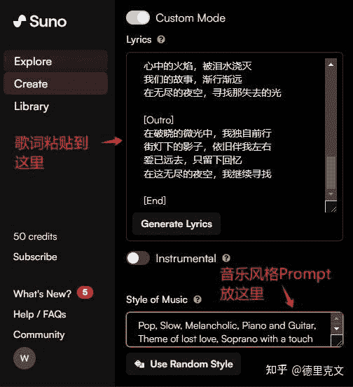

[然后再将](https://www.zhihu.com/search?q=%E8%BE%93%E5%85%A5%E6%A1%86&search_source=Entity&hybrid_search_source=Entity&hybrid_search_extra=%7B%22sourceType%22%3A%22article%22%2C%22sourceId%22%3A688960395%7D)结尾的部分粘贴到 Style of Music 输入框 内即可。

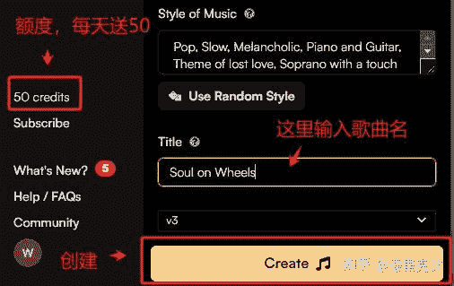

然后输入歌曲名，确认自己还有额度，点击生成，等待片刻。

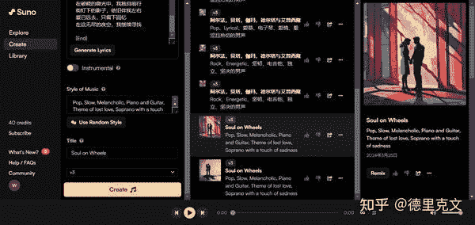

可以看到音乐就生成好了，一首歌扣除5点额度，一天免费赠送生成10首歌的额度。

### 6.完成及分享

我放上我刚刚创作好的 [音乐分享 ](https://www.zhihu.com/search?q=%E9%9F%B3%E4%B9%90%E5%88%86%E4%BA%AB&search_source=Entity&hybrid_search_source=Entity&hybrid_search_extra=%7B%22sourceType%22%3A%22article%22%2C%22sourceId%22%3A688960395%7D)链接吧：https://app.suno.ai/song/73eae41e-49b3-4ef3-8899-ac143aef6515/

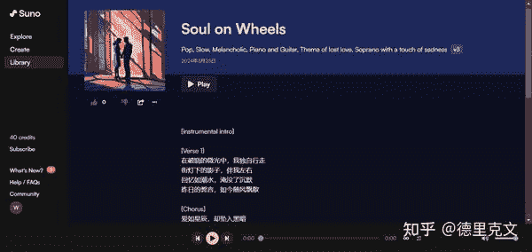

好听吗？想要分享给别人或者下载吗？可以点击这里进行分享和下载。

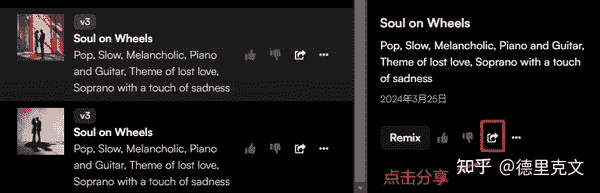

就这样一首完整的歌曲就做好了（目前只能生成2分钟长度），如果你想要做成MV，还需要结合其他的AI工具进行创作。

## 结语

你们对这个软件感兴趣吗?如果喜欢我的分享，请记得点赞哦！

---

我是 [德里克文 ](https://www.zhihu.com/search?q=%E5%BE%B7%E9%87%8C%E5%85%8B%E6%96%87&search_source=Entity&hybrid_search_source=Entity&hybrid_search_extra=%7B%22sourceType%22%3A%22article%22%2C%22sourceId%22%3A688960395%7D)，一个对AI绘画，人工智能有强烈兴趣，从业多年的 设计师！如果对我的文章内容感兴趣，请帮忙关注点赞收藏，谢谢！