# RTX AI——AIGC生成生产力革命！

> 来源：[https://agijuejin.feishu.cn/docx/OXv2d2Gq2oAnGrxQrPicpXainLd](https://agijuejin.feishu.cn/docx/OXv2d2Gq2oAnGrxQrPicpXainLd)

> 作者：德里克文

> 原文：[https://zhuanlan.z](https://zhuanlan.zhihu.com/p/694862788)hihu.com/p/694862...

英伟达（ [NVIDIA ](https://www.zhihu.com/search?q=NVIDIA&search_source=Entity&hybrid_search_source=Entity&hybrid_search_extra=%7B%22sourceType%22%3A%22article%22%2C%22sourceId%22%3A694862788%7D)）最新推出的 [RTX ](https://www.zhihu.com/search?q=RTX&search_source=Entity&hybrid_search_source=Entity&hybrid_search_extra=%7B%22sourceType%22%3A%22article%22%2C%22sourceId%22%3A694862788%7D)AI的功能，我认为是 [AIGC ](https://www.zhihu.com/search?q=AIGC&search_source=Entity&hybrid_search_source=Entity&hybrid_search_extra=%7B%22sourceType%22%3A%22article%22%2C%22sourceId%22%3A694862788%7D)生成创作的生产力革命，将引领 [AIPC ](https://www.zhihu.com/search?q=AIPC&search_source=Entity&hybrid_search_source=Entity&hybrid_search_extra=%7B%22sourceType%22%3A%22article%22%2C%22sourceId%22%3A694862788%7D)这个概念成为未来的刚需。

为什么我这么认为？AI到底对现有我们的未来的工作生活，有什么实质的提高？

我想通过前几天我去英伟达（NVIDIA）参加的技术分享会，了解到前沿的信息，和各位分享我的观点。

[AI PC ](https://www.zhihu.com/search?q=AI%20PC&search_source=Entity&hybrid_search_source=Entity&hybrid_search_extra=%7B%22sourceType%22%3A%22article%22%2C%22sourceId%22%3A694862788%7D)是搭载专用AI加速硬件的计算机。在未来的电脑上对于AI加速性能的需求，大体上会分为以下三类。

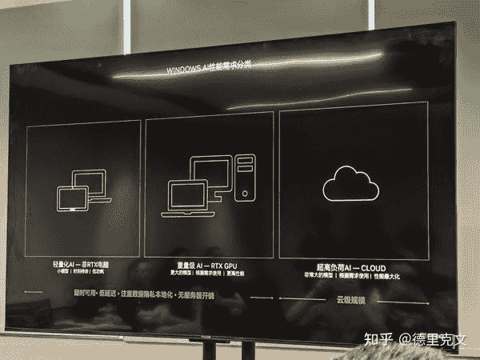

第一种是轻量化的AIPC，这种电脑的特点就是常用于个人的工作生活需求，并不需要太多的AI硬件运算能力加成，在这台电脑上能运行的就是本地化的小型微调模型，性能要求较低。

第二种是重量级的AIPC，这种电脑往往会作为个人工作站的形式，能够根据需求进行使用。具备运行更大的本地模型的能力，拥有比第一类更强大的性能，拥有这种电脑，可以充分发挥AI对个体的辅助能力，实现将一人即团队的关键提升。

以上两种最大的特点就是可以用作个人消费级电脑，做到在本地电脑运行大模型，没有服务器的开销，数据本地化隐私有保障，也不会受到网络环境的影响，响应迅速。

第三种则是企业级别的云应用，通过AI实现超高的运算能力，这种适合有一定规模的企业。

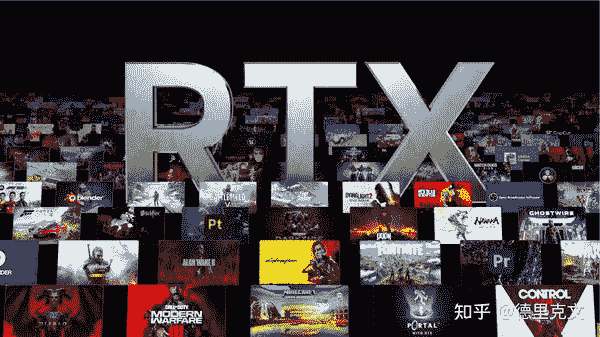

下面我就前两者说下我的看法吧！

## 一、AI能给PC带来什么？

天下武功，唯快不破。

在电脑的核心硬件上，更快的运算速度就意味着更加强大的性能，AI无疑更好加速了这个能力。

[而在英伟](https://www.zhihu.com/search?q=GPU&search_source=Entity&hybrid_search_source=Entity&hybrid_search_extra=%7B%22sourceType%22%3A%22article%22%2C%22sourceId%22%3A694862788%7D)达（NVIDIA）的 RTX GPU 上，这些专用的 AI 加速器被称为 Tensor Core 。

在运行要求极为严苛的工作和娱乐应用时，Tensor Core 能够显著加速 AI 性能，并为 PC 用户引入了以前在云端才能运行的新功能。

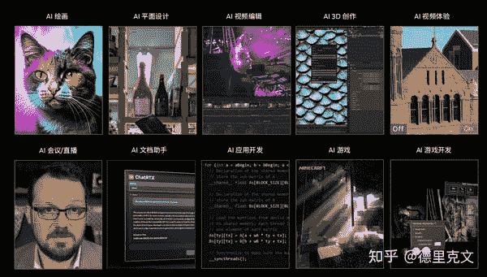

在AI目前的具体应用上，速度快都对这些应用有着非常强大的效率提升。

无论是用AI进行绘画、设计、 [视频编辑 ](https://www.zhihu.com/search?q=%E8%A7%86%E9%A2%91%E7%BC%96%E8%BE%91&search_source=Entity&hybrid_search_source=Entity&hybrid_search_extra=%7B%22sourceType%22%3A%22article%22%2C%22sourceId%22%3A694862788%7D)，应用开发还是游戏开发，电脑性能都是直接影响工作效率的重要指标。

### 1. 加速个人工作站

有了AI的加持，一个人可以完成以往一个团队的工作，形成超级个体。

这时候，一个具备超强性能的个人电脑是不必可少的工具。

以我擅长的关注AI绘画领域为例，从会上英伟达分享[的资料来看，在个人可以](https://www.zhihu.com/search?q=RTX%204090%20D&search_source=Entity&hybrid_search_source=Entity&hybrid_search_extra=%7B%22sourceType%22%3A%22article%22%2C%22sourceId%22%3A694862788%7D)采用的消费级显卡 RTX 4090 D 上， Stable Diffusion 可以达到一秒出8张图的效果。

而使用 [TensorRT ](https://www.zhihu.com/search?q=TensorRT&search_source=Entity&hybrid_search_source=Entity&hybrid_search_extra=%7B%22sourceType%22%3A%22article%22%2C%22sourceId%22%3A694862788%7D)配合开发者进一步的性能优化，目前RTX 4090 D GPU最高能实现每秒超过100张图的生成速度。

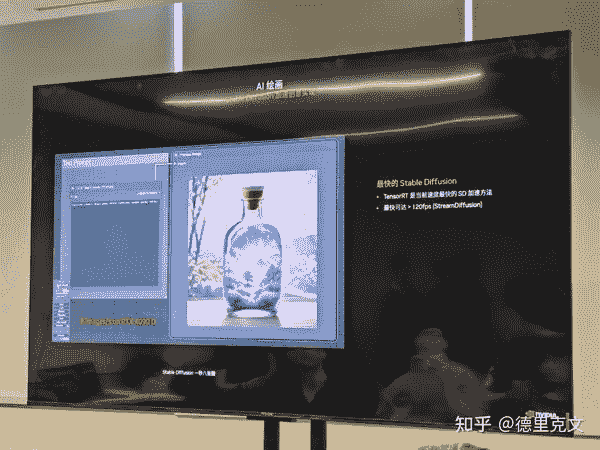

速度极快，这对于AI绘画艺术家来说是一个不可比拟的优势。

例如我在进行AI绘画或者是AI视频分镜创作的时候，都会采用同一个提示词，生成巨量的图片进行选择和调整，这样才能确保AI绘画生成和我脑袋中想要的内容。

一秒出8张图和8秒出一张图，这个体验感简直是天翻地覆的变化。

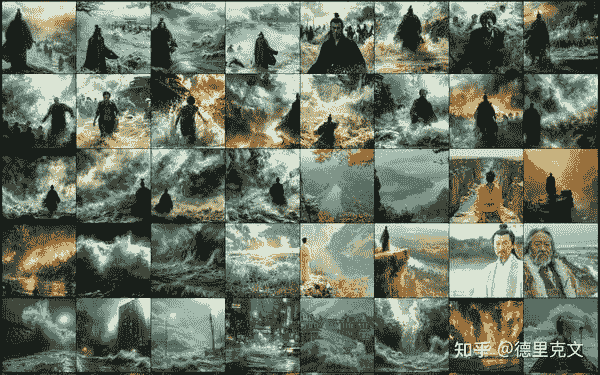

**并且TensorRT兼容性极高，**[**支持市面上所有常**](https://www.zhihu.com/search?q=ComfyUI&search_source=Entity&hybrid_search_source=Entity&hybrid_search_extra=%7B%22sourceType%22%3A%22article%22%2C%22sourceId%22%3A694862788%7D)**见**的SD WebUI, ComfyUI , SD-Forge等SD操作界面，支持包括Lora、ControlNet深度控制，各种视频转绘、换脸等等各种工作流。

请注意，这是真正的高效工具，不是玩具！

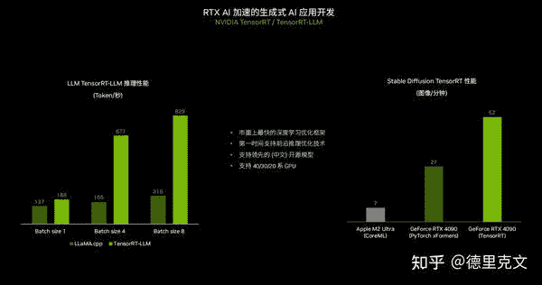

所有玩AI绘画的小伙伴应该理解我说的，这种工具带来的意义。

[现在有了Comf](https://www.zhihu.com/search?q=JASON%E6%96%87%E4%BB%B6&search_source=Entity&hybrid_search_source=Entity&hybrid_search_extra=%7B%22sourceType%22%3A%22article%22%2C%22sourceId%22%3A694862788%7D)yUI的工作流，在足够的硬件支持下，我们甚至只需要有 JASON文件 就能实现一键完成各种操作步骤。

同理在其他相关设计领域，包括平面设计，原画设计乃至视频创作，这种速度的高效及兼容的广泛性对于应用的意义，是无比震撼的。

这意味着创作者能够一个人在短时间内，用Ai工具提速完成在以往需要一个团队的工作量。

这就是个人工作站！

### 2.更好的团队组成

不仅是个人，拥有了英伟达（NVIDIA）RTX GPU加持的多台电脑，有了强劲的性能和无延时的运算，团队配合能够更加得心应手。

[以下图是采用TensorRT进](https://www.zhihu.com/search?q=STEAMDIFFUSION&search_source=Entity&hybrid_search_source=Entity&hybrid_search_extra=%7B%22sourceType%22%3A%22article%22%2C%22sourceId%22%3A694862788%7D)行SD加速，用 STEAMDIFFUSION 这个软件，采用RTX 4090 D硬件的情况下，可以实现一秒内生成120张图片。

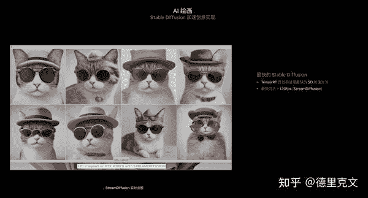

这意味着什么，意味着图片生成也能够实时无延时的生成，图片生成也可以用帧率来体现，意味着我们未来玩游戏的时候，甚至可以采用AI绘画工具进行实时的场景渲染，实现个性化的游戏画面定制。

[而在建筑和室内](https://www.zhihu.com/search?q=%E4%B8%89%E7%BB%B4SU%E7%B4%A0%E6%A8%A1&search_source=Entity&hybrid_search_source=Entity&hybrid_search_extra=%7B%22sourceType%22%3A%22article%22%2C%22sourceId%22%3A694862788%7D)设计领域，通过毛坯房照片， 三维SU素模 ，或者是手绘草稿来进行Ai实时生成，迅速生成可视化的效果图，这个就更加王炸了。

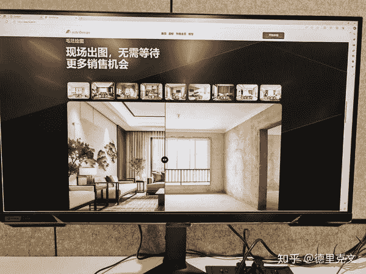

不再需要 [三维建模 ](https://www.zhihu.com/search?q=%E4%B8%89%E7%BB%B4%E5%BB%BA%E6%A8%A1&search_source=Entity&hybrid_search_source=Entity&hybrid_search_extra=%7B%22sourceType%22%3A%22article%22%2C%22sourceId%22%3A694862788%7D)，只要概念线条勾勒，色块涂抹，就能够实现概念设计到效果图设计的阶段。

来看看下面的视频，体会下有多快吧！

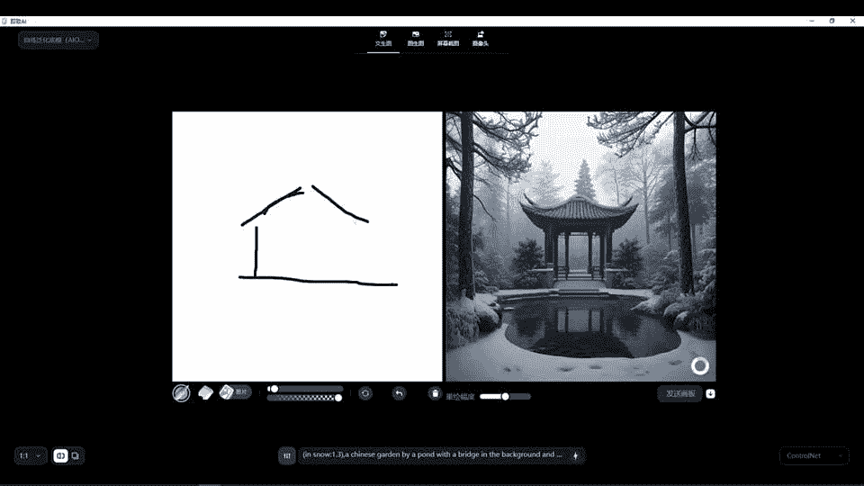

[587e75d4-044e-11ef-bb36-324c0420ce21-v8_f2_t1_79b59vUE.mp4](https://internal-api-drive-stream.feishu.cn/space/api/box/stream/download/all/DHR6bQse2oPkzpxO1fBcf9GWnzb)

[在以往设计项](https://www.zhihu.com/search?q=%E4%B8%89%E7%BB%B4%E6%95%88%E6%9E%9C%E5%9B%BE&search_source=Entity&hybrid_search_source=Entity&hybrid_search_extra=%7B%22sourceType%22%3A%22article%22%2C%22sourceId%22%3A694862788%7D)[目中，大型设计项](https://www.zhihu.com/search?q=%E6%95%88%E6%9E%9C%E5%9B%BE%E5%88%B6%E4%BD%9C%E5%85%AC%E5%8F%B8&search_source=Entity&hybrid_search_source=Entity&hybrid_search_extra=%7B%22sourceType%22%3A%22article%22%2C%22sourceId%22%3A694862788%7D)目的 三维效果图 ，由于设计空间众多，往往需要众多方案设计师和 效果图制作公司 共同制作完成，并且由于个人能力的不同，往往各个空间呈现的风格或品质感不统一。

此外甲方对于设计方案的众多修改意见，是需要设计院投入足够的时间和精力去处理的。这往往也会严重影响项目的工作时长和人力成本。

这是以往设计项目的痛点，但是现在如果有了AI的加持，只要计算机运算速度够快，优秀设计师的能力可以被成倍释放出来。

只需要动动几笔，就能够快速生成修改后的效果，优秀的主创设计师也可以一个人完成所有空间的设计，整个设计项目就可以精简人员，只需2~3个不同专业的人员，组成一个团队就能全程完成。

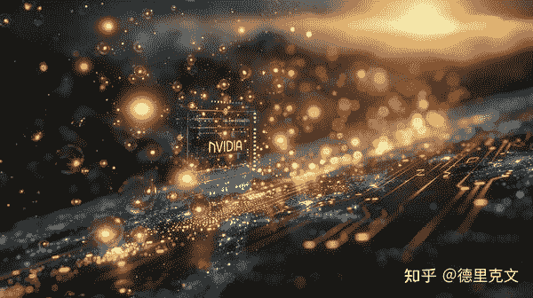

往往优秀的团队，靠的不是人多，而是团队中精英的贡献，AI无疑放大了这一影响因素。

这是实实在在的 [效率生产力 ](https://www.zhihu.com/search?q=%E6%95%88%E7%8E%87%E7%94%9F%E4%BA%A7%E5%8A%9B&search_source=Entity&hybrid_search_source=Entity&hybrid_search_extra=%7B%22sourceType%22%3A%22article%22%2C%22sourceId%22%3A694862788%7D)提升和应用场景。

## 二、AIPC未来的应用

除了上述我熟悉的专业场景外，在本次分享会中，我还了解到了很多很有趣的信息。

我也将我的思考和见解带给大家。

### 1.超强的娱乐终端

作为热爱游戏的玩家，我对于AI在游戏娱乐的应用非常感兴趣。

要知道游戏领域中的 [AI技术 ](https://www.zhihu.com/search?q=AI%E6%8A%80%E6%9C%AF&search_source=Entity&hybrid_search_source=Entity&hybrid_search_extra=%7B%22sourceType%22%3A%22article%22%2C%22sourceId%22%3A694862788%7D)，正以前所未有的方式革新着我们的游戏体验，在未来，有一台AIPC，就能够有效提升个人终端的沉浸式体验。

而在其中英伟达（NVIDIA）的各项创新扮演着核心角色，推动游戏迈向新高度。

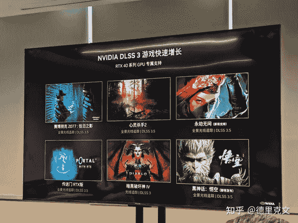

[对于我最关心即将在](https://www.zhihu.com/search?q=%E3%80%8A%E9%BB%91%E7%A5%9E%E8%AF%9D%EF%BC%9A%E6%82%9F%E7%A9%BA%E3%80%8B&search_source=Entity&hybrid_search_source=Entity&hybrid_search_extra=%7B%22sourceType%22%3A%22article%22%2C%22sourceId%22%3A694862788%7D)8月份推出的国产游戏 《黑神话：悟空》 这一款游戏大作中，GeForce RTX系列GPU运用AI的力量，可以在不牺牲画面质量的前提下，显著提升游戏帧率。

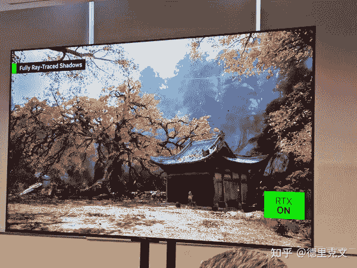

NVIDIA DLSS 3.5采用的光线重建技术和全面升级的光线追踪功能，确保了游戏在保有惊人画质的同时，性能也得到巨大飞跃。

快来看看我现场拍摄的效果吧!

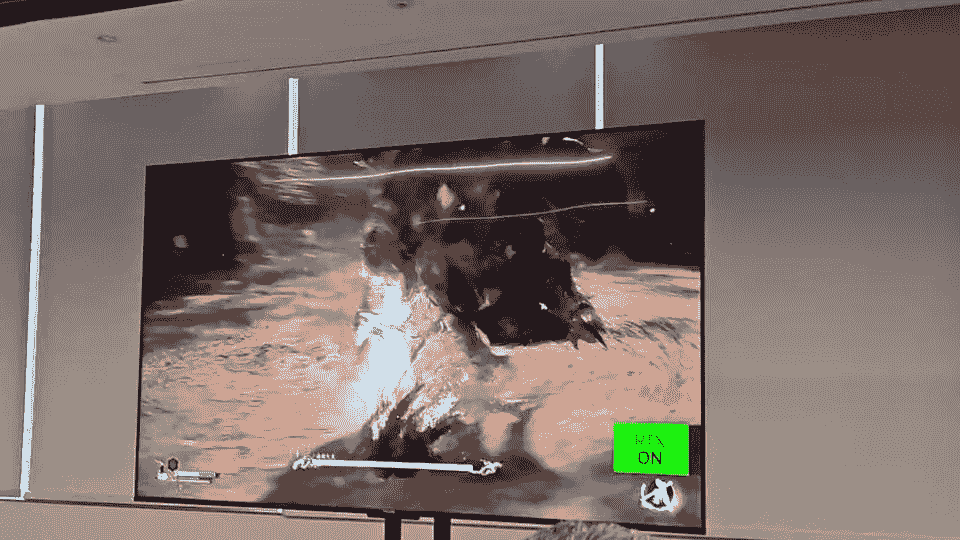

[61bb439a-0451-11ef-ab15-22058d3541c2-v8_f2_t1_whbshatW.mp4](https://internal-api-drive-stream.feishu.cn/space/api/box/stream/download/all/HWYgbFTp4oUD4lxz5Cicr6i5n0b)

而除了传统的游戏画面提升，AI还带给游戏体验更多可能性。

NVIDIA ACE技术专注于提升游戏中NPC的真实感[与互动深度。在英伟达（](https://www.zhihu.com/search?q=Inworld%20AI&search_source=Entity&hybrid_search_source=Entity&hybrid_search_extra=%7B%22sourceType%22%3A%22article%22%2C%22sourceId%22%3A694862788%7D)NVIDIA）与 Inworld AI 合作推出的Covert Protocol技术Demo中，展示了采用AI进行实时角色互动的新境界。

Inworld AI引擎采用多模态策略，融合认知、感知与行为系统，创造出能在细致入微的RTX环境里自如互动的角色，可以给玩家带来沉浸式的故事情节体验。

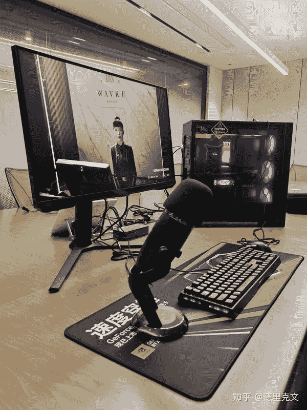

在上面这个视频中，通过整合 [NVIDIA Riva ](https://www.zhihu.com/search?q=NVIDIA%20Riva&search_source=Entity&hybrid_search_source=Entity&hybrid_search_extra=%7B%22sourceType%22%3A%22article%22%2C%22sourceId%22%3A694862788%7D)的高精度 [语音识别技术 ](https://www.zhihu.com/search?q=%E8%AF%AD%E9%9F%B3%E8%AF%86%E5%88%AB%E6%8A%80%E6%9C%AF&search_source=Entity&hybrid_search_source=Entity&hybrid_search_extra=%7B%22sourceType%22%3A%22article%22%2C%22sourceId%22%3A694862788%7D)和 NVIDIA[ Audi](https://www.zhihu.com/search?q=%E9%9D%A2%E9%83%A8%E5%8A%A8%E7%94%BB&search_source=Entity&hybrid_search_source=Entity&hybrid_search_extra=%7B%22sourceType%22%3A%22article%22%2C%22sourceId%22%3A694862788%7D)o2Face 驱动的生动 面部动画 ，游戏世界中的NPC展现出了惊人的真实感。

有看到那个麦克风吗？与游戏中的NPC互动，采用的是玩家实时的语音输入，这种自由感是真实世界才有的体验感。

下面的视频展示的就是通过我们现场进行测试，有一个玩家通[过现场的麦克风进](https://www.zhihu.com/search?q=AI%E8%AF%AD%E8%A8%80%E5%A4%A7%E6%A8%A1%E5%9E%8B&search_source=Entity&hybrid_search_source=Entity&hybrid_search_extra=%7B%22sourceType%22%3A%22article%22%2C%22sourceId%22%3A694862788%7D)行语言对话，NPC通过 AI语言大模型 进行实时的逻辑思考回复，并且进行同步的3D视觉和语音回复。

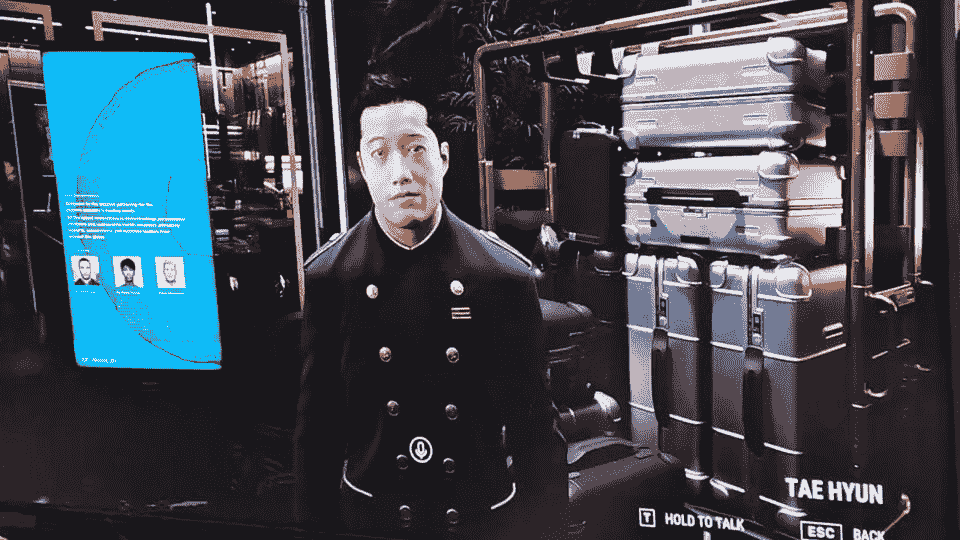

[ca1c4bb4-0451-11ef-9de3-267adcf24f07-v8_f2_t1_DreKre28.mp4](https://internal-api-drive-stream.feishu.cn/space/api/box/stream/download/all/BAXfboYdVoobvyxy60UcrVpfn2d)

[这让我看到](https://www.zhihu.com/search?q=%E5%AF%86%E5%AE%A4%E9%80%83%E8%84%B1&search_source=Entity&hybrid_search_source=Entity&hybrid_search_extra=%7B%22sourceType%22%3A%22article%22%2C%22sourceId%22%3A694862788%7D)了现在大火的剧本杀、 密室逃脱 类游戏，在未来，通过AIPC实现个性化实施运算游戏体验的可能性。

### 2.强大的个人助理

而在未来的AIPC上，我觉得个人助理也是一个非常实用的应用。

[在这一次分享会上](https://www.zhihu.com/search?q=ChatRTX&search_source=Entity&hybrid_search_source=Entity&hybrid_search_extra=%7B%22sourceType%22%3A%22article%22%2C%22sourceId%22%3A694862788%7D)，英伟达（NVIDIA）展示的 ChatRTX 也让我印象深刻。

ChatRTX是一个在本地运行的应用，内置开源大模型，在采用ChatGLM/Baichuan/Qwen等中文大模型的情况下，支持中文对话模型和本地的文档检索。

而在实际演示的效果上，可以实现对本地文件的迅速检索和回复。

[026c9d86-045a-11ef-83f9-ca02b3401955-v8_f2_t1_BnimlO8p.mp4](https://internal-api-drive-stream.feishu.cn/space/api/box/stream/download/all/VZKMb3up7om92ixIE3Sc117qnvc)

我认[为在未来，AI](https://www.zhihu.com/search?q=%E6%B7%B7%E5%90%88%E6%99%BA%E8%83%BD%E6%A8%A1%E5%BC%8F&search_source=Entity&hybrid_search_source=Entity&hybrid_search_extra=%7B%22sourceType%22%3A%22article%22%2C%22sourceId%22%3A694862788%7D)赋能的个人电脑可能会引起一场场生产效率的大变革，让每个人都能够享受到AI带来的生产力飞跃。随着计算能力和大型模型技术的不断进步，理想的AI PC解决方案应当是‘端云一体化’的 混合智能模式 。

在云端的大型模型，能够与本地设备端的小型模型进行紧密协作，确保使用者能够在各种网络环境下，都能享受到反应迅速、安全可靠，具备个性隐私化的AIPC体验。

在未来，强大的 [个人助理 ](https://www.zhihu.com/search?q=%E4%B8%AA%E4%BA%BA%E5%8A%A9%E7%90%86&search_source=Entity&hybrid_search_source=Entity&hybrid_search_extra=%7B%22sourceType%22%3A%22article%22%2C%22sourceId%22%3A694862788%7D)必将作为AIPC的重要应用场景。

### 3.专业的工作赋能

而在各种实用的专业工作应用软件方面，如同我在上面对于设计行业的举例一样，Ai对于电脑的性能算力提升，可以让各种专业软件展现更强的能力。

[更快的AI绘画](https://www.zhihu.com/search?q=%E6%96%87%E5%8C%96%E5%88%9B%E6%84%8F%E4%BA%A7%E4%B8%9A&search_source=Entity&hybrid_search_source=Entity&hybrid_search_extra=%7B%22sourceType%22%3A%22article%22%2C%22sourceId%22%3A694862788%7D)、实时设计效果渲染、AI视频影视创作，这对于 文化创意产业 都将是新一轮的工业革命。

在未来的专业化应用中，没有AI赋能的PC在效率上会被AIPC远远抛在身后。

## 三、未来畅想

[AI对硬件的性](https://www.zhihu.com/search?q=%E3%80%8A%E5%A4%B4%E5%8F%B7%E7%8E%A9%E5%AE%B6%E3%80%8B&search_source=Entity&hybrid_search_source=Entity&hybrid_search_extra=%7B%22sourceType%22%3A%22article%22%2C%22sourceId%22%3A694862788%7D)能提升，将加速虚拟世界的建设， 《头号玩家》 里的场景在未来可能的实现。

[也许在可以](https://www.zhihu.com/search?q=%E7%AE%97%E5%8A%9B%E5%AE%87%E5%AE%99&search_source=Entity&hybrid_search_source=Entity&hybrid_search_extra=%7B%22sourceType%22%3A%22article%22%2C%22sourceId%22%3A694862788%7D)[预见的未来](https://www.zhihu.com/search?q=%E9%87%8D%E8%A7%81%E5%A4%A9%E6%97%A5&search_source=Entity&hybrid_search_source=Entity&hybrid_search_extra=%7B%22sourceType%22%3A%22article%22%2C%22sourceId%22%3A694862788%7D)，我们可以用AI对硬件的提升，构建庞大的 算力宇宙 ，推动虚拟世界的建设，让现在已经慢慢没人提起的的“元宇宙”概念有 重见天日 的可能性。

同时，得益于众多AI加持的硬件产品对算力硬件基础的提升，或许人类可以在更加具备现实意义的航天航空、生物科技等科学领域继续探索，推动人类整体的科技水平。

## 结语

AIPC并不是伪概念，人工智能对于生产力的提高是实打实的，在未来，会有更多的行业和生活方式被人工智能改变。

我期待科技的发展，期待改变的发生。

---

我是 [德里克文 ](https://www.zhihu.com/search?q=%E5%BE%B7%E9%87%8C%E5%85%8B%E6%96%87&search_source=Entity&hybrid_search_source=Entity&hybrid_search_extra=%7B%22sourceType%22%3A%22article%22%2C%22sourceId%22%3A694862788%7D)，一个对AI绘画，人工智能有强烈兴趣，从业多年的室内设计师！如果对我的文章内容感兴趣，请帮忙关注点赞收藏，谢谢！