# 如何利用AI工具训练自己的声音进行文本朗读

> 来源：[https://agijuejin.feishu.cn/docx/UUWbdWlzBornydxwdjycZc7InEb](https://agijuejin.feishu.cn/docx/UUWbdWlzBornydxwdjycZc7InEb)

> 作者：德里克文

> 原文：[https://zhuanlan.z](https://zhuanlan.zhihu.com/p/644059173)hihu.com/p/644059...

有没有一款免费的AI工具，可以用来训练自己的声音进行文本朗读以作为音频或视频节目节目制作呢？

[答案是有的](https://www.zhihu.com/search?q=pp%E9%A3%9E%E6%B5%86&search_source=Entity&hybrid_search_source=Entity&hybrid_search_extra=%7B%22sourceType%22%3A%22article%22%2C%22sourceId%22%3A644059173%7D)，而且是开源免费项目。在百度 pp飞浆 上就有一个项目自己的声音进行文本朗读以作为音频或视频节目节目制作，让我来介绍下吧：

## 一、登陆界面

注册 [百度账号 ](https://www.zhihu.com/search?q=%E7%99%BE%E5%BA%A6%E8%B4%A6%E5%8F%B7&search_source=Entity&hybrid_search_source=Entity&hybrid_search_extra=%7B%22sourceType%22%3A%22article%22%2C%22sourceId%22%3A644059173%7D)，登陆百度飞浆，附上相关网址：https://aistudio.baidu.com/

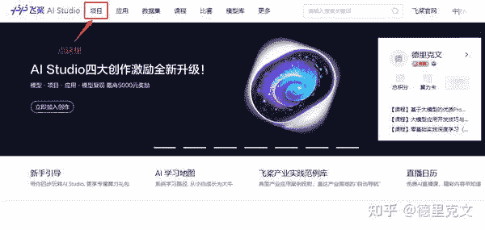

## 二、项目界面运行

### 1、 在搜索框点击

搜索内容： [有手就行](https://www.zhihu.com/search?q=%E6%9C%89%E6%89%8B%E5%B0%B1%E8%A1%8C&search_source=Entity&hybrid_search_source=Entity&hybrid_search_extra=%7B%22sourceType%22%3A%22article%22%2C%22sourceId%22%3A644059173%7D)

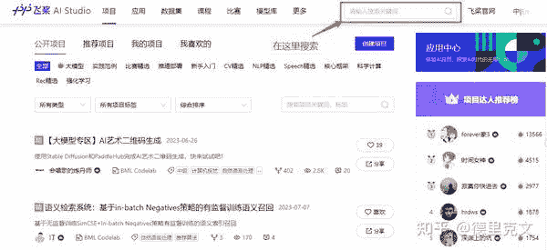

### 2、点击进入项目

找到 [**【有手就行**](https://www.zhihu.com/search?q=%E8%AF%AD%E9%9F%B3%E5%90%88%E6%88%90&search_source=Entity&hybrid_search_source=Entity&hybrid_search_extra=%7B%22sourceType%22%3A%22article%22%2C%22sourceId%22%3A644059173%7D)】使用你自己的声音做 语音合成 这个项目，点击进入

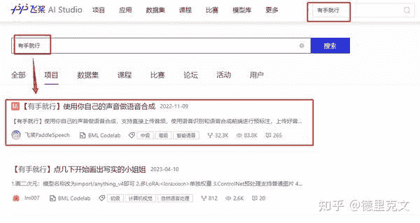

### 3、运行项目

在操作界面点击"运行一下"

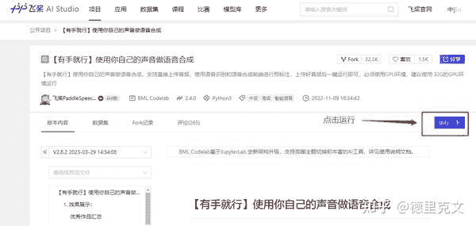

### 4、选择 [运行环境](https://www.zhihu.com/search?q=%E8%BF%90%E8%A1%8C%E7%8E%AF%E5%A2%83&search_source=Entity&hybrid_search_source=Entity&hybrid_search_extra=%7B%22sourceType%22%3A%22article%22%2C%22sourceId%22%3A644059173%7D)

有不同的选项，根据时间的要求进行挑选，我个人建议常规情况下可以选择V100 32GB运行，每小时只耗费1点算力，每日登陆赠送8点算力，足够完成一个项目了，当然也可以根据自己的时间情况进行调整。

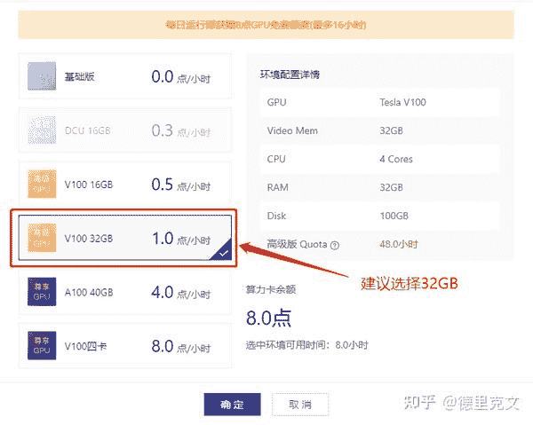

### 5、 [程序界面](https://www.zhihu.com/search?q=%E7%A8%8B%E5%BA%8F%E7%95%8C%E9%9D%A2&search_source=Entity&hybrid_search_source=Entity&hybrid_search_extra=%7B%22sourceType%22%3A%22article%22%2C%22sourceId%22%3A644059173%7D)

在程序界面点击全部运行，运行需要一定的安装时间，静静等待就好。

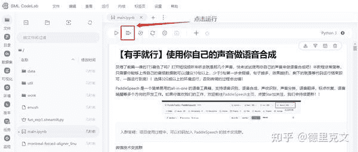

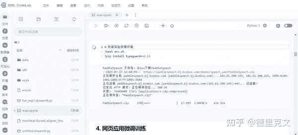

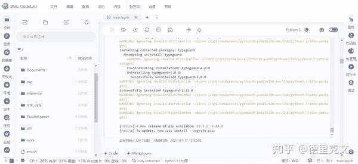

运行完成后，会显示运行时长和结束时间，这样代表已经预运行完成，可以开展下一步

### 6、网页界面UI运行

首先找到左侧任务栏，最后一个文件，双击运行

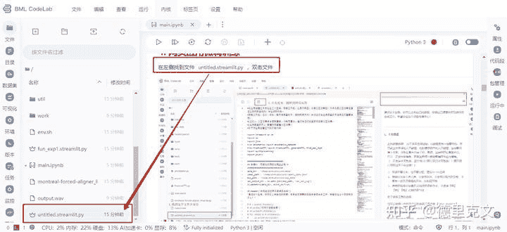

点击在浏览器打开这个按钮，等运行完成后就会进入网页UI界面

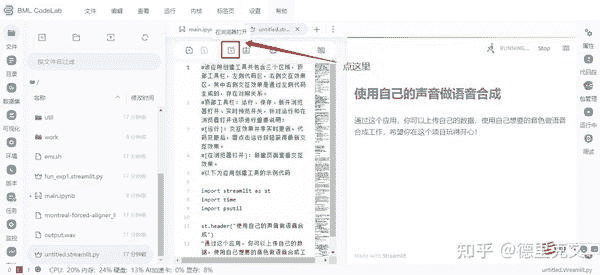

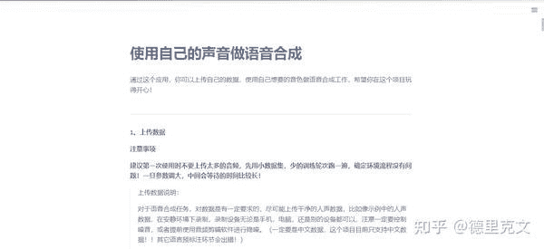

## 三、语音合成

### 1、注意事项

上传的文件 [音频格式 ](https://www.zhihu.com/search?q=%E9%9F%B3%E9%A2%91%E6%A0%BC%E5%BC%8F&search_source=Entity&hybrid_search_source=Entity&hybrid_search_extra=%7B%22sourceType%22%3A%22article%22%2C%22sourceId%22%3A644059173%7D)最好是WAV, MP3格式也可以，建议单独再下载音频软件进行降噪处理（自己网上找音频软件的处理软件）

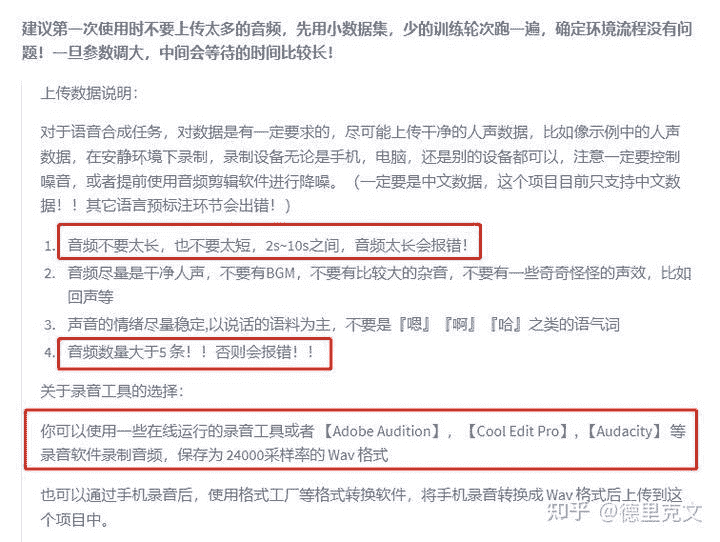

### 2、 [音频文件 ](https://www.zhihu.com/search?q=%E9%9F%B3%E9%A2%91%E6%96%87%E4%BB%B6&search_source=Entity&hybrid_search_source=Entity&hybrid_search_extra=%7B%22sourceType%22%3A%22article%22%2C%22sourceId%22%3A644059173%7D)上传

上传音频文件，注意尽量用WAV文件

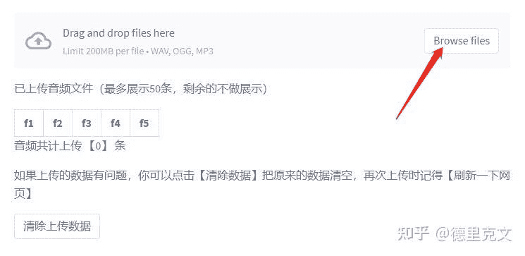

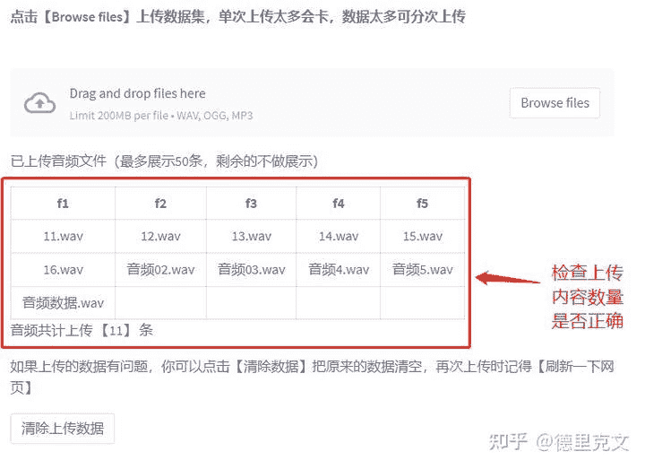

### 3、 [数据检验](https://www.zhihu.com/search?q=%E6%95%B0%E6%8D%AE%E6%A3%80%E9%AA%8C&search_source=Entity&hybrid_search_source=Entity&hybrid_search_extra=%7B%22sourceType%22%3A%22article%22%2C%22sourceId%22%3A644059173%7D)

点击检验，然后确认有效音频数量是否足够

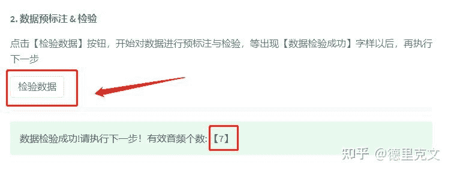

### 4、导出训练模型

需要注意的是模型不是越多越好,根据实际情况进行选择，训练好后最后点击导出

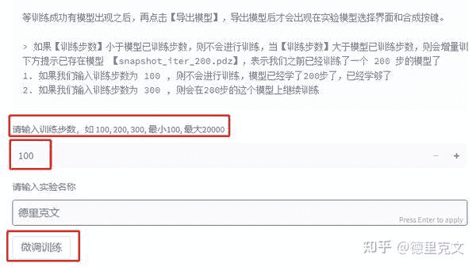

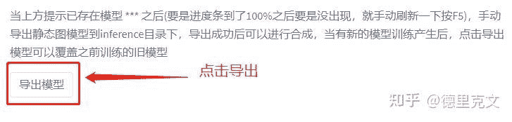

### 5、音频合成

[声码器 ](https://www.zhihu.com/search?q=%E5%A3%B0%E7%A0%81%E5%99%A8&search_source=Entity&hybrid_search_source=Entity&hybrid_search_extra=%7B%22sourceType%22%3A%22article%22%2C%22sourceId%22%3A644059173%7D)建议选择PWGan就可以，根据实际需求调整。

实验模型一定要注意选对，下拉箭头选择自己刚刚训练好的模型名称。

语速根据要求自己调节，常规情况下选择1.0既可

最后点击合成。

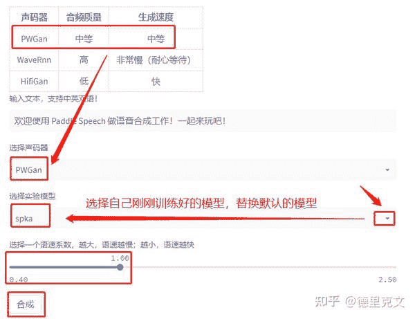

### 6、下载合成的语音

合成成功后可以自己试听一遍效果，是否和自己的声线吻合。没有问题的话点击喇叭右侧的三点，选择下载

### 7、退出

最后，不要忘记完成后点击停止运行，否则会一直扣算力哦，切记

通[过以上的分](https://www.zhihu.com/search?q=%E8%A7%86%E9%A2%91%E8%BD%AF%E4%BB%B6&search_source=Entity&hybrid_search_source=Entity&hybrid_search_extra=%7B%22sourceType%22%3A%22article%22%2C%22sourceId%22%3A644059173%7D)享，你是否了解如何训练自己的声音进行文本朗读了呢，只需要输入文字，就可以让电脑来帮你朗读长段的文字啦！结合照片以及数字人 视频软件 ，就可以轻松打造属于自己的数字人IP！

是不是很有用的工具呢？希望我的回答对你有帮助！

---

我是 [德里克文 ](https://www.zhihu.com/search?q=%E5%BE%B7%E9%87%8C%E5%85%8B%E6%96%87&search_source=Entity&hybrid_search_source=Entity&hybrid_search_extra=%7B%22sourceType%22%3A%22answer%22%2C%22sourceId%22%3A3114940634%7D)[，一个对AI](https://www.zhihu.com/search?q=%E5%AE%A4%E5%86%85%E8%AE%BE%E8%AE%A1%E5%B8%88&search_source=Entity&hybrid_search_source=Entity&hybrid_search_extra=%7B%22sourceType%22%3A%22answer%22%2C%22sourceId%22%3A3114940634%7D)绘画，人工智能有强烈兴趣，从业多年的 室内设计师 ！如果对我的文章内容感兴趣，请帮忙关注点赞收藏，谢谢！