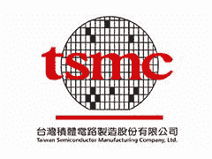
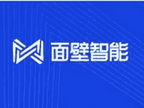
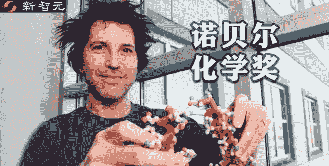
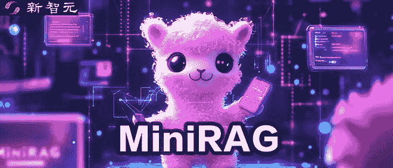
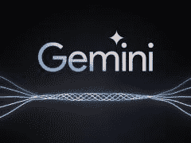
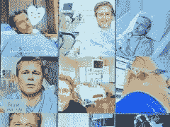
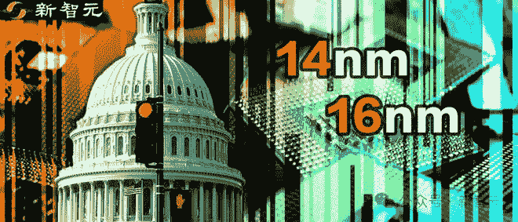

# 01.17-魏哲家：AI 成台积电最大“聚宝盆”，驱动未来五年收入复合增长率超 20%

> 来源：[https://agijuejin.feishu.cn/docx/MC5zd4OM7oikkHxLeDpcIH36nZe](https://agijuejin.feishu.cn/docx/MC5zd4OM7oikkHxLeDpcIH36nZe)

# AGI 掘金日报 - AI 新闻推送 (2025 年 01 月 17 日)

> [欢迎加入 AGI 掘金社群](https://sourl.co/miZUyT)

## ⭐ 今日热点

### 💡 魏哲家：AI 成台积电最大“聚宝盆”，驱动未来五年收入复合增长率超 20%

IT之家 | [阅读原文](https://www.ithome.com/0/825/243.htm)

2025 年，台积电董事长兼首席执行官魏哲家表示人工智能需求持续增长，将成未来几年收入主要驱动力。2024 年台积电晶圆代工 2.0 产业整体增长 6%低于预期，台积电逆势增长 30%远超行业平均，AI 加速器营收占比达 15 - 17%，增长三倍。2025 年预计半导体产业增长约 10%，台积电增长预期高达 25%，AI 加速器营收五年复合增长率预计达 45%，公司整体营收五年复合增长率预计 20%，台积电将持续扩张先进制程等满足 AI 需求。

## 🌟 技术突破

### 💡 面壁智能发布 MiniCPM-o 2.6 全模态模型，号称“端侧 GPT-4o”

IT之家 | [阅读原文](https://www.ithome.com/0/825/166.htm)

2025 年 1 月 16 日，面壁智能发布 MiniCPM-o 2.6 全模态模型，参数 8B。它采用端到端多模态架构，能处理多种数据类型，号称性能比肩 GPT-4o 等。支持中英双语语音对话及多种进阶能力，还是首个在 iPad 等端侧设备进行多模态实时流式交互的模型。在 OpenCompass 榜单平均得分 70.2，单图理解超越 GPT-4o 等主流模型。开源地址为 GitHub 和 huggingface。关键词：面壁智能、人工智能、MiniCPMo 2.6。

### 💡 国产AI视频爆火全球，歪果仁集体起立！快到震撼，惊爆价低至4分

新智元 | [阅读原文](https://www.163.com/dy/article/JM1HUI9T0511ABV6.html?spss=dy_author)

2025 年国产 AI 视频工具 Vidu 2.0 爆火全球。速度快，10 秒生成视频；成本低，1 秒最低只需 4 分钱；效果好，质量高风格稳。上线仅 20 天用户数突破百万，100 天突破千万，累计生成视频突破 1 亿条。获得个人创作者和企业级客户认可，展现中国技术创新硬实力，推动 AI 视频进入‘秒级时代’。

### 💡 2024诺贝尔化学奖得主：「模型幻觉」给我无限创造力

新智元 | [阅读原文](https://www.163.com/dy/article/JM1HIL130511ABV6.html?spss=dy_author)

2024 年诺贝尔化学奖得主 David Baker 利用 AI‘幻觉’进行蛋白质研究，获约 100 项专利，设计了一千万种全新蛋白质。AI‘幻觉’激发科学创造力，加速科学方法进程，还带来了蛋白质催化剂等突破。但也有科学家认为‘幻觉’一词具有误导性且易与迷幻药联想，AI 靠‘幻觉’设计的新事物需验证。有科学家认为 AI‘幻觉’更适合称为‘概率分布’。

### 💡 终于等到你！港大首发「轻量级RAG神器」MiniRAG，1.5B手机端可用

新智元 | [阅读原文](https://www.163.com/dy/article/JM1HID4G0511ABV6.html?spss=dy_author)

2025 年港大黄超教授团队推出轻量级 MiniRAG 框架。该框架针对小型语言模型的局限，重新设计信息检索和生成流程，提出异构图索引和轻量级知识检索两个核心创新组件。相比其他框架，MiniRAG 在性能降幅、存储优化等方面表现出色，为端侧 AI 部署提供更多可能。

## 💫 企业动态

### 💡 谷歌 CEO 皮查伊认为 Gemini 能力“市面最强”，已超越竞争对手

IT之家 | [阅读原文](https://www.ithome.com/0/825/184.htm)

2025 年，谷歌 CEO 皮查伊认为 Gemini 能力‘市面最强’已超越竞争对手，希望其聊天机器人 2025 年底前吸引 5 亿用户。目前 Gemini 未带来显著收入，但对谷歌保持 AI 技术前沿至关重要。皮查伊称 2025 年‘风险高、赌注大’，是关键一年，需加快步伐应对竞争等。关键词：谷歌，Gemini。

### 💡 📕为何让歪果仁上头？推荐算法超牛，2篇核心论文揭秘

新智元 | [阅读原文](https://www.163.com/dy/article/JM1OT9J30511ABV6.html?spss=dy_author)

2025 年，越来越多歪果仁入驻📕。其推荐算法超牛，两篇核心论文揭秘其机制。NoteLLM 用于 I2I 笔记推荐，点击率提升 16.20%，新笔记评论数显著增加。它由笔记压缩提示构建、生成对比学习和协作监督微调组成。SSD 方法解决多样化信息流推荐问题，结合 CB2CF 策略计算嵌入向量，能给用户更多类别的个性化推荐内容。

### 💡 法国女子被 AI 版布拉德・皮特骗走 83 万欧元：失去毕生积蓄

IT之家 | [阅读原文](https://www.ithome.com/0/825/121.htm)

2025 年，法国一 53 岁女子被 AI 版布拉德·皮特骗走 83 万欧元。骗子冒充皮特及皮特母亲联系女子，以离婚账户被冻结、患肾癌等理由诈骗。女子离婚获财产后全被骗走，最终报警。此事引发网友嘲笑和网络骚扰，节目后女子称自己非‘疯子或傻瓜’，呼吁找到骗子。有评论称她是‘吹哨人’，警告 AI 进步会让网络陷阱更糟。

### 💡 美荷联动制裁！封杀14/16nm、超300亿晶体管芯片

新智元 | [阅读原文](https://www.163.com/dy/article/JM19DH460511ABV6.html?spss=dy_author)

2025 年美国计划推出更严格出口管控，限制台积电、三星、英特尔等向中国出口超 300 亿晶体管且 14/16nm 及更先进节点芯片，除非获美国商务部出口许可。荷兰也收紧 ASML 高端光刻机出口许可。新规主要针对中国公司设计的 AI 加速芯片，虽与多数客户端设备芯片关系不大，但迫使部分企业销售主流 GPU 需申请出口许可。荷兰紧跟美国，4 月 1 日生效新规，ASML 出口特定设备需申请许可。

## ✨ 行业观点

### 💡 阿尔特曼：通用人工智能由 OpenAI 率先实现，人类将不再是地球上最聪明的

IT之家 | [阅读原文](https://www.ithome.com/0/825/128.htm)

2025 年 1 月 16 日，OpenAI 首席执行官阿尔特曼在播客节目中称 OpenAI 将率先实现通用人工智能（AGI）。他认为 AGI 短期**影响不**大，但长期会改变一切。人类将从地球上最聪明的生物转变，这引发思考。短期内 AI 模型影响不显著，长期会使经济转型，虽一些工作会消失，但人类总能找到新工作。关键词：AI、阿尔特曼、OpenAI。