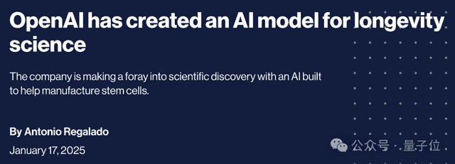
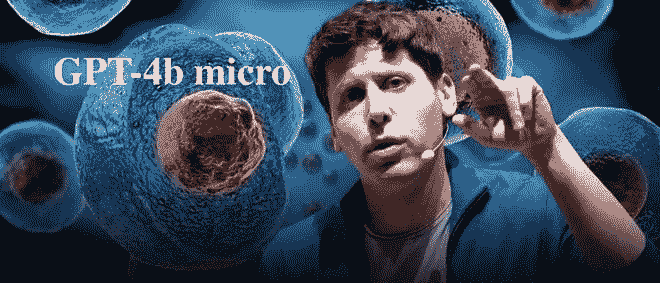

# 01.20-OpenAI为研究长寿推出GPT-4b，联手清华大牛丁胜搞“细胞重编程”，奥特曼本人投资

> 来源：[https://agijuejin.feishu.cn/docx/AmZXdmSRvof1wTx1Il5ctyzrnPc](https://agijuejin.feishu.cn/docx/AmZXdmSRvof1wTx1Il5ctyzrnPc)

# AGI 掘金日报 - AI 新闻推送 (2025 年 01 月 20 日)

> [欢迎加入 AGI 掘金社群](https://sourl.co/miZUyT)

## ⭐ 今日热点

### 💡 OpenAI为研究长寿推出GPT-4b，联手清华大牛丁胜搞“细胞重编程”，奥特曼本人投资

量子位 | [阅读原文](https://www.qbitai.com/2025/01/245908.html)

2025 年 OpenAI 推出 GPT-4b micro，专注生物数据。联手清华大牛丁胜搞‘细胞重编程’，与 Retro Biosciences 合作，研究山中因子。该模型能生成改进蛋白质因子功能的方法，效果提升 50 倍以上。目前未对外开放，未来走向不确定。奥特曼虽投资 Retro 但未直接参与该工作。

## 🌟 技术突破

### 💡 AI 造梦师：香港大学携手快手科技推出 GameFactory 框架，突破游戏场景泛化难题

IT之家 | [阅读原文](https://www.ithome.com/0/825/782.htm)

2025 年 1 月 20 日，香港大学携手快手科技推出 GameFactory 框架。该框架利用预训练视频扩散模型，解决游戏视频生成中场景泛化难题。采用三阶段训练策略，还评估不同控制机制有效性，并发布了数据集 GF-Minecraft。

### 💡 目标让人类多活 10 年，OpenAI 为研究长寿推出 GPT-4b

IT之家 | [阅读原文](https://www.ithome.com/0/825/767.htm)

2025 年 OpenAI 推出新模型 GPT-4b micro，首个专注生物数据，可设计将普通细胞转化为干细胞的蛋白质。与 Retro Biosciences 合作，研究山中因子，提升细胞重编程效率超 50 倍。模型生成的设计建议常含显著改动，三分之一氨基酸被改变。但结果未发表，外界无法验证，且模型未对外开放，未来走向不确定。OpenAI CEO 奥特曼未直接参与，公司决策不受其其他投资影响。

### 💡 DeepSeek R1 Preview 模型亮相，代码能力与 OpenAI o1 相当且确认开源

IT之家 | [阅读原文](https://www.ithome.com/0/825/765.htm)

2025 年，DeepSeek R1 Preview 模型亮相，代码能力与 OpenAI o1 相当且确认开源。该模型在代码基准测试 LiveCodeBench 霸榜前三，其轻量版在某些情况下能自我纠正，类似原生‘自我反思’。LiveCodeBench 由多所大学团队推出，对大模型代码能力全面评估。同时，OpenAI 的 o3-mini 完成外部合作测试，几周内推出，2025 年计划合并 GPT 系列和 o 系列。

### 💡 全球首个亿级参数量地震波大模型今年对外开放

IT之家 | [阅读原文](https://www.ithome.com/0/825/695.htm)

2025 年 1 月 17 日，全球首个亿级参数量地震波大模型‘谛听’第三阶段测试版本在国家超级计算机成都中心发布。该模型已用于西藏定日 6.8 级地震数据处理，自动识别震前事件 452 个，震后 27 小时余震事件 429 个。‘谛听’由国家超级计算成都中心、中国地震局地球物理研究所以及清华大学联合开发，2025 年将开放微调等框架，短期应用于地震信号识别等领域。

### 💡 返老还童，OpenAI做到了？首个逆龄AI将登场，人类寿命可延长10年

新智元 | [阅读原文](https://www.163.com/dy/article/JM929NBD0511ABV6.html?spss=dy_author)

OpenAI 与 Retro Biosciences 合作推出新模型 GPT-4b micro，通过蛋白质重编程技术有望将人类寿命延长十年。该模型能精准预测蛋白质互动方式，设计关键蛋白质，提高干细胞生产效率达 50 倍，为治疗多种疾病开辟新可能。虽前景广阔，但也面临伦理担忧，其引发公众不同反应，同时 AI 在长寿科学领域正推动技术发展，监管框架和伦理标准讨论日益重要。

## 💫 企业动态

### 💡 AI 变革音乐创作：未来体验更像游戏，更具互动性

IT之家 | [阅读原文](https://www.ithome.com/0/825/789.htm)

2025 年，AI 正在变革音乐创作。AI 音乐平台 Suno 首席执行官 Mikey Shulman 称音乐创作方式因 AI 经历前所未有的变革，未来音乐会更像电子游戏，更具互动性。许多艺术家已开始拥抱 AI，如 Paul McCartney。但也有不少艺术家反对未经授权使用音乐训练 AI，Suno 因用受版权保护音乐训练模型遭起诉。关键词：AI、音乐。

### 💡 OpenAI o3 碾压式 AI 数学成绩遭质疑：既当选手又是裁判，翻版 Theranos 世纪骗局

IT之家 | [阅读原文](https://www.ithome.com/0/825/786.htm)

OpenAI 的 o3 模型在 FrontierMath 基准测试中以 25%准确率碾压其他模型，但因 OpenAI 资助 Epoch AI 且可访问基准测试问题和答案引发质疑。一位承包商称沟通不透明，六位数学家表示若早知可能不参与。AI 专家 Gary Marcus 将此与 Theranos 丑闻相提并论，Epoch AI 副主任 Besiroglu 承认未更透明是错误，虽有保留数据集用于验证，但表示应争取尽快对贡献者透明。关键词：o3、OpenAI、AI。

### 💡 我国将建立基于大数据和 AI 支持的教育评价和科学决策制度，建立全国学生心理健康监测预警系统

IT之家 | [阅读原文](https://www.ithome.com/0/825/755.htm)

2025 年我国印发《教育强国建设规划纲要（2024—2035 年）》。将建立基于大数据和 AI 支持的教育评价和科学决策制度，以及全国学生心理健康监测预警系统。明确了到 2027 年和 2035 年目标，部署了 9 方面重点任务，包括促进人工智能助力教育变革、实施国家教育数字化战略、普及心理健康教育等。

### 💡 北京打响AI+新材料第一枪！三年行动计划剑指全球创新高地

新智元 | [阅读原文](https://www.163.com/dy/article/JM9MFK1S0511ABV6.html?spss=dy_author)

2025 年，北京市发布《北京市加快推动“人工智能+新材料”创新发展行动计划（2025 - 2027 年）（征求意见稿）》，向社会公开征求意见，时间为 1 月 14 日至 1 月 20 日，意见反馈渠道多样。该计划旨在打造国际领先的新材料创新策源与人工智能应用高地。

### 💡 微软科学家自述确诊「AI疲劳症」！如何在快速发展的AI浪潮中保持清醒？

新智元 | [阅读原文](https://www.163.com/dy/article/JM928S0E0511ABV6.html?spss=dy_author)

2025 年，AI 发展迅猛但也催生‘AI 疲劳症’。新模型频繁发布，论文数量井喷式增长致认知过载。研究人员在快节奏中易迷失，不少初创公司盲目跟风陷入误区。对此提出五大应对策略：正视疲劳、聚焦实际问题、不盲目追技术、设定合理目标、建立拥抱变革文化，以驯服 AI，应对其带来的冲击。