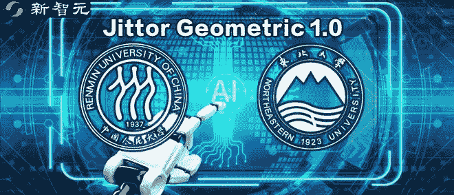
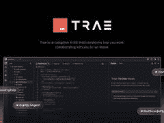

# 01.21-DeepSeek-R1 模型发布，性能对标 OpenAI o1 正式版

> 来源：[https://agijuejin.feishu.cn/docx/HnB0dU3yHo8Y2WxzTl7c4dFEnKg](https://agijuejin.feishu.cn/docx/HnB0dU3yHo8Y2WxzTl7c4dFEnKg)

# AGI 掘金日报 - AI 新闻推送 (2025 年 01 月 21 日)

> [欢迎加入 AGI 掘金社群](https://sourl.co/miZUyT)

## ⭐ 今日热点

### 💡 DeepSeek-R1 模型发布，性能对标 OpenAI o1 正式版

IT之家 | [阅读原文](https://www.ithome.com/0/826/014.htm)

2025 年 1 月 20 日，幻方量化旗下 DeepSeek 发布 DeepSeek-R1 模型并同步开源模型权重。该模型后训练阶段大规模使用强化学习技术，在数学、代码等任务上性能比肩 OpenAI o1 正式版。还蒸馏出 6 个小模型，部分对标 OpenAI o1-mini。其 API 服务定价明确，训练技术全部公开，开源 License 统一使用 MIT，产品协议明确可‘模型蒸馏’。关键词：DeepSeek、OpenAI o1、AI。

## 🌟 技术突破

### 💡 不到4小时，谷歌Gemini写完10万字商业战略书籍！人类全程没碰一个字

新智元 | [阅读原文](https://www.163.com/dy/article/JMCOGM9T0511ABV6.html?spss=dy_author)

2025 年，AI 初创公司 DeepWriter 宣布全球第一部由 AI 写作的 203 页商业战略主题书籍诞生，全程无人类参与，约 10 万单词，使用谷歌的 Gemini Flash 2.0-exp 模型，总耗时 3.9 小时。提示词较粗糙，内容检测系统给出 AI 生成概率为 9.78%。DeepWriter 用 LaTeX 完成写作，可生成详细步骤总结，现可免费体验 Beta 版，基础套餐将扩展功能，正式 1.0 版本将添加更多支持。有人猜测 LLM 模型已比 99%的人写得更好，但人类作家仍有独特价值。

### 💡 Kimi硬刚多模态满血版o1，首曝训练细节！强化学习scaling新范式诞生

新智元 | [阅读原文](https://www.163.com/dy/article/JMCOHJOM0511ABV6.html?spss=dy_author)

2025 年，Kimi 发布 k1.5 多模态思考模型，性能全面追上 OpenAI o1 满血版。该模型在数学、代码、多模态推理能力方面达到长思考 SOTA 水平，短 CoT 模式下大幅领先 GPT-4o 和 Claude 3.5。Kimi 团队创新扩展强化学习应用，公开训练技术细节，包括长上下文扩展等四大关键要素，以及部分回滚技术、混合部署策略等，在多个基准测试中取得显著突破，未来将继续迭代多模态模型。

### 💡 人大、东北大学联合开发「图机器学习库」Jittor Geometric！性能超越PYG、DGL

新智元 | [阅读原文](https://www.163.com/dy/article/JMCOGCA30511ABV6.html?spss=dy_author)

2025 年，中国人民大学与东北大学联合开发图机器学习库 Jittor Geometric 1.0。基于国产 Jittor 框架，性能优于同类型框架，如在多种图学习任务上较 Pytorch Geometric（PyG）、Deep Graph Library（DGL）等提升 10% - 50%。具有高效性与灵活性，支持海量图数据集和多领域图机器学习模型，多个数据集上性能超过现有主流框架，已用于研究生课程教学并得到良好反馈，未来将持续迭代完善。

### 💡 跨维科技发布 DexForce W1 具身机器人：34 个动力单元，可感知真实世界

IT之家 | [阅读原文](https://www.ithome.com/0/826/024.htm)

2025 年 1 月 20 日，跨维科技发布 DexForce W1 具身机器人。它有 34 个动力单元，通信带宽高达 100Mbps，能实时流畅交换信息。搭载 7 自由度仿人机械臂和 6 自由度灵巧手。配备纯视觉空间智能传感器，可应对复杂光照，利用深度学习技术准确识别目标物体，能感知真实世界。跨维 DexVerse 具身智能引擎基于 Sim2Real 核心技术，为机器人定制专属训练场。

### 💡 月之暗面发布 Kimi k1.5 多模态思考模型，实现 SOTA 级多模态推理能力

IT之家 | [阅读原文](https://www.ithome.com/0/826/021.htm)

2025 年 1 月 20 日，月之暗面发布 Kimi k1.5 多模态思考模型，实现 SOTA 级多模态推理能力。在 short-CoT 模式下，其数学、代码、视觉多模态和通用能力大幅超越全球短思考 SOTA 模型，领先达 550%。在 long-CoT 模式下，数学、代码、多模态推理能力达长思考 SOTA 模型水平。该模型擅长深度推理，预览版将陆续在 Kimi.com 和智能助手 App 上线。

### 💡 谷歌公布 Titans 系列 AI 模型架构：融合长短期记忆与注意力机制、突破 200 万上下文 Token

IT之家 | [阅读原文](https://www.ithome.com/0/825/997.htm)

2025 年 1 月 20 日，谷歌公布 Titans 系列 AI 模型架构，融合长短期记忆与注意力机制，突破 200 万上下文 Token。该架构解决了 Transformer 模型上下文窗口长度限制问题，有三种架构变体。谷歌声称其在长序列处理任务中表现优于现有模型，甚至超越 GPT-4 等。关键词：谷歌、Titans、AI。

### 💡 OpenAI博士级「超级智能体」即将登场？与ChatGPT深度集成，可操控计算机

新智元 | [阅读原文](https://www.163.com/dy/article/JMBU793B0511ABV6.html?spss=dy_author)

OpenAI 正在内部测试全新‘Operator’功能，有望使 AI 从被动助手变为主动解决问题的超级智能体，可完成从软件开发到复杂财务分析等任务。预计 1 月 30 日闭门会上，OpenAI 首席执行官 Sam Altman 将向美国政府官员介绍相关突破进展。超级智能体可能给医疗、科研和教育带来革命性影响，但也面临可靠性与幻觉问题，多位 OpenAI 员工对此既兴奋又担忧。

## 💫 企业动态

### 💡 特朗普时代再临：科学界喜忧参半，AI与太空探索或成最大赢家

新智元 | [阅读原文](https://www.163.com/dy/article/JMCOG5KA0511ABV6.html?spss=dy_author)

2025 年特朗普开启第二任期，科学界喜忧参半。预计他将放弃对环境和传染病等基础研究支持，推动 AI、量子研究和太空探索。AI 与量子科学可能更进一步，政策研究人员预计特朗普将加强政府在国家安全和军事用途上对 AI 的应用。太空探索方面，特朗普政府可能采用 SpaceX 运载火箭，NASA 火星计划或加速。气候与环境科学难获关注，特朗普可能撤销或放宽污染监管，再次退出《巴黎气候协定》。

### 💡 AI 分析了 14500 多场财报电话会议，发现大部分 CEO 患有抑郁症

IT之家 | [阅读原文](https://www.ithome.com/0/826/017.htm)

2025 年一项研究利用 AI 分析了 14500 多场财报电话会议，发现大部分 CEO 患有抑郁症。研究显示，抑郁 CEO 面临更多职场挑战，如公司风险增加等，且可能获得更高薪酬。AI 驱动的心理健康评估发现 CEO 抑郁与商业风险相关。尽管高管重视心理健康，但因污名化，讨论和求助受抑制。如 Toms 创始人因抑郁售股。

### 💡 阿尔特曼澄清 OpenAI 尚未研发出 AGI，呼吁外界降低预期

IT之家 | [阅读原文](https://www.ithome.com/0/825/982.htm)

2025 年 1 月 20 日，OpenAI 首席执行官阿尔特曼澄清公司尚未研发出 AGI，呼吁外界降低预期。他曾在 1 月 6 日表示今年内推出 AGI 并计划让首批 AI 代理在 2025 年加入劳动力队伍。OpenAI 目标是构建造福人类的 AGI，但也承认存在巨大风险。多位知名人士对当前 AI 研究方向和潜在风险表示担忧。关键词：OpenAI、人工智能、AGI。

### 💡 欧莱雅业内首创化妆品 AI 基础模型，与 IBM 合作开发

IT之家 | [阅读原文](https://www.ithome.com/0/825/979.htm)

2025 年 1 月 20 日，IBM 与欧莱雅宣布合作开发业内首创化妆品 AI 基础模型。该模型将基于大量配方和成分数据点创建，辅助欧莱雅全球 4000 多位研究人员，有助于实现欧莱雅‘2030 承诺’。此外，IBM Consulting 还将帮助重塑配方研发流程，为全球消费者打造可持续产品。

### 💡 行业首个：“中国石化 AI 数字员工”上岗，指导车主自助加油付款

IT之家 | [阅读原文](https://www.ithome.com/0/825/966.htm)

2025 年 1 月 18 日，中国石化推出行业首位‘AI 数字员工’，并在全国 40 余座加能站同步试点上岗。该数字员工可报油价、解答疑问、引导操作，还能为客户规划旅游景点。数字虚拟人可在网页端访问，由科大讯飞星火大模型提供支持。关键词：中国石化、AI 员工、数字人、加油站。

### 💡 字节跳动发布 AI 中文 IDE“Trae”：内置 GPT-4o，可帮助自动化开发

IT之家 | [阅读原文](https://www.ithome.com/0/825/963.htm)

2025 年 1 月 19 日，字节跳动发布全新 AI Coding 产品 Trae，由新加坡公司提供服务。支持 AI 问答、代码自动补全等功能，面向专业开发者，可提升编程效率。目前仅支持 Mac 版本，Windows 版本即将上线，可选择简体中文或英文，内置 GPT-4o、Claude-3.5-Sonnet 模型供免费使用。

### 💡 豆包推出实时语音大模型：号称中文对话断崖式领先、情商智商均在线

IT之家 | [阅读原文](https://www.ithome.com/0/825/942.htm)

2025 年 1 月 20 日，豆包推出实时语音大模型，在豆包 App（7.2.0 新春版）全量开放。该模型实现语音理解和生成一体化，端到端语音对话，中文对话领先，情商智商在线。同时更新实时语音通话功能，交互效果‘人机难辨’，能精准把控细节，掌握方言、英语对话等能力，基于端到端框架研发，统一建模实现多模态输出。关键词：豆包、大模型。

### 💡 AI“短板”暴露：研究发现 GPT-4 Turbo 回答高级历史题准确率仅 46%

IT之家 | [阅读原文](https://www.ithome.com/0/825/941.htm)

2025 年一项研究发现 GPT-4 Turbo 回答高级历史题准确率仅 46%。该研究由奥地利复杂科学研究所团队主导，测试了三大语言模型在历史问题上的表现。研究表明语言模型虽令人印象深刻，但缺乏对高级历史知识的深度理解，在处理技术性历史问题时表现不佳，且在某些地区表现更差，显示训练数据可能存在偏见。不过研究人员对其未来辅助历史研究前景持乐观态度。

### 💡 国家 AI 产业投资基金成立，出资额 600.6 亿元

IT之家 | [阅读原文](https://www.ithome.com/0/825/937.htm)

2025 年 1 月国家 AI 产业投资基金成立，出资额 600.6 亿元。截至 2023 年底，我国人工智能核心产业规模接近 6000 亿元，企业数量超 4500 家。2024 年我国生成式人工智能产品用户规模达 2.3 亿人，占整体人口 16.4%。截至 2024 年 7 月，生成式人工智能服务大模型达 190 多个。生成式人工智能与各行业加速融合，提高生活质量和工作效率。

### 💡 小红书 AI 翻译加急上线：网友评论区玩起 Prompt，背后大模型被扒出

IT之家 | [阅读原文](https://www.ithome.com/0/825/908.htm)

2025 年 1 月，小红书 AI 翻译功能加急上线，受到网友盛赞。该功能不仅能翻译多种语言，还能翻译网络热梗、颜文字、化学式、摩斯电码等，甚至可以根据 Prompt 输出结果。网友猜测背后大模型可能是智谱清言或 GPT-4。目前该功能只支持单一语言输入，部分翻译需求功能不稳定。

### 💡 商汤科技「日日新融合大模型交互版」开放商用，限时免费

IT之家 | [阅读原文](https://www.ithome.com/0/825/894.htm)

2025 年 1 月 20 日，商汤科技旗下‘日日新融合大模型交互版’（SenseNova-5o）开放商用且限时免费。该模型支持实时交互、视觉识别等能力，交互延迟缩短至 2 秒以内，支持超长多模态交互记忆不少于 5 分钟等功能，还能帮助用户稳定、实时、流畅地进行音视频对话和沟通，并支持个性化设置和辅导孩子作业。

### 💡 人类工作面临替代威胁：OpenAI 被曝本月将发“博士级”超级 AI 智能体

IT之家 | [阅读原文](https://www.ithome.com/0/825/861.htm)

2025 年 1 月，OpenAI 被曝本月将发布‘博士级’超级 AI 智能体。OpenAI CEO 山姆·阿尔特曼将于 1 月 30 日在华盛顿与美国政府官员会面展示重大进展。超级智能体可能成为人类劳动替代者，能处理大量数据等，同时阿尔特曼将讨论 AI 对经济增长的潜在影响。有猜测称 OpenAI 将推出‘Operator’智能体，但业内人士对其可靠性存疑。

### 💡 o3被曝成绩「造假」，60多位数学泰斗集体被耍！OpenAI暗中操控，考卷提前看光

新智元 | [阅读原文](https://www.163.com/dy/article/JMBH4N530511ABV6.html?spss=dy_author)

OpenAI 资助 Epoch AI，其模型 o3 在 FrontierMath 上准确率相比 o1 翻 12 倍被质疑。消息称 o3 因提前获得大部分试题访问权，数学家被蒙在鼓里。Epoch AI 回应有保留集可验证模型能力，有口头协议材料不用于训练。多位大佬谴责 OpenAI 行为，目前对 OpenAI 行为有不同解释，有人建议看 o3 在实际应用和其他评测中的表现。