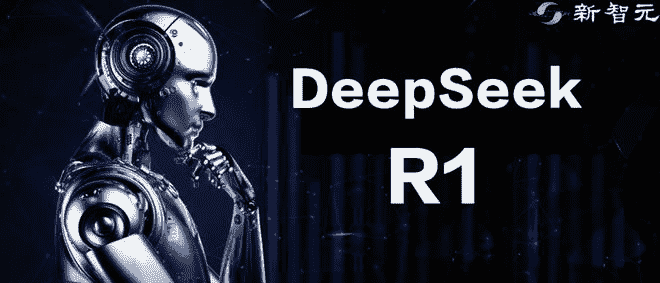
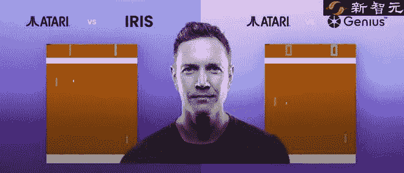
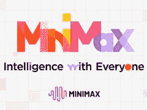

# 01.22-DeepSeek开源o1击毙OpenAI，强化学习惊现「啊哈」时刻！网友：AGI来了

> 来源：[https://agijuejin.feishu.cn/docx/YWSNdcDpNoVJ7XxF5gNckLWBnzT](https://agijuejin.feishu.cn/docx/YWSNdcDpNoVJ7XxF5gNckLWBnzT)

# AGI 掘金日报 - AI 新闻推送 (2025 年 01 月 22 日)

> [欢迎加入 AGI 掘金社群](https://sourl.co/miZUyT)

## ⭐ 今日热点

### 💡 DeepSeek开源o1击毙OpenAI，强化学习惊现「啊哈」时刻！网友：AGI来了

新智元 | [阅读原文](https://www.163.com/dy/article/JME6IR6D0511ABV6.html?spss=dy_author)

2025 年，DeepSeek 推出开源推理模型 DeepSeek-R1，性能与 OpenAI o1 打平手且关键是开源版。R1 在强化学习阶段前未进行微调 SFT 便刷新 SOTA，还出现‘啊哈’时刻。在多项测试中表现出色，如在 AIME2024 测试中取得 79.8%成绩，在 MATH-500 测试获 97.3%成绩，在代码竞赛中超越 96.3%人类参赛者。同时开源了 DeepSeek-R1-Zero 和多个提炼模型，证明仅靠大规模强化学习能提升模型推理能力，未来将从提升通用能力、解决语言混合等方向继续研究。

### 💡 微软解绑：OpenAI 获更大 AI 算力自主权，携手软银、甲骨文等启动 5000 亿美元“星际之门”项目

IT之家 | [阅读原文](https://www.ithome.com/0/826/333.htm)

2025 年 1 月 21 日微软调整与 OpenAI 合作关系，允许 OpenAI 使用竞争对手计算资源。此前 OpenAI 算力依赖微软 Azure，现双方调整算力排他性，微软有优先购买权。OpenAI 可自主构建算力，用于模型研究训练。同时，OpenAI 携手软银、甲骨文启动 5000 亿美元‘星际之门’项目，微软将提供技术支持但不投入资金。关键词：OpenAI、微软、甲骨文、软银、AI。

## 🌟 技术突破

### 💡 腾讯混元 3D 生成大模型 2.0 开源发布，同步上线“业界首个一站式 3D 内容 AI 创作平台”

IT之家 | [阅读原文](https://www.ithome.com/0/826/197.htm)

2025 年 1 月 21 日，腾讯混元 3D 生成大模型 2.0 开源发布，同步上线业界首个一站式 3D 内容 AI 创作平台。该技术可通过一句话、一张图甚至草图生成 3D 模型，还能加动作、换纹理等。其对几何和纹理大模型进行升级，采用新技术让生成效果‘堪比设计师手工建模’，并通过‘解耦生成’实现‘1+1＞2’效果。目前已应用于多个场景，开发者可在技术社区下载，用户可在官网申请体验。

### 💡 AI智能体2小时击败人类，引爆贝叶斯推理革命！仅用10%数据训练秒杀大模型

新智元 | [阅读原文](https://www.163.com/dy/article/JME8OP4O0511ABV6.html?spss=dy_author)

2025 年，Verses 团队研发的 Genius 智能体在 Pong 等游戏中超越人类顶尖玩家和其他顶级 AI 模型。它仅用 10%数据训练 2 小时，规模为 SOTA 模型 IRIS 的 4%，可在 MacBook 上运行。Genius 智能体应用贝叶斯推理架构，结合自由能原理和主动推断框架，代表了新的 AI 架构方向，具有高效、可解释等优势，可能标志着贝叶斯革命和机器智能发展新方向。

### 💡 人大清华提出自主搜索版「Search-o1」！解决知识困境，大幅提升推理模型可靠性

新智元 | [阅读原文](https://www.163.com/dy/article/JME8K8SU0511ABV6.html?spss=dy_author)

2025 年人大清华提出 Search-o1 框架，解决大型推理模型知识不足问题。该框架集成自主检索增强生成机制和文档内推理模块，在科学、数学等复杂推理任务及开放域问答基准上优于现有方法，特定领域达人类专家水平。实验表明其能高效利用检索文档，性能随文档数量增加显著提升，在整体性能及部分学科优于人类专家。

## 💫 企业动态

### 💡 刚刚，特朗普与奥特曼惊天启动星际之门！4年狂砸5000亿美金，孙正义任董事长

新智元 | [阅读原文](https://www.163.com/dy/article/JMGD8RPG0511ABV6.html?spss=dy_author)

2025 年，特朗普宣布启动‘星际之门计划’，4 年投入 5000 亿美金。该计划由 OpenAI、软银、甲骨文牵头，首期部署 1000 亿美元，首批 10 座数据中心在得克萨斯州开建。软银负责财务，OpenAI 负责运营，孙正义任董事长。微软更新与 OpenAI 算力独占协议，拥有优先购买权等。特朗普此举旨在重塑美国在 AI 界领导地位，与中国等竞争。

### 💡 消息称蔚来已组建 20 人左右团队，调研机器狗项目

IT之家 | [阅读原文](https://www.ithome.com/0/826/306.htm)

2025 年消息称蔚来已组建约 20 人团队调研机器狗项目，前 Momenta 算法专家徐抗任负责人，标志着蔚来在具身智能领域探索。四足机器狗适用于复杂地形，应用前景广，潜在市场规模达数千亿元。具身智能发展初期，难度高。特斯拉、小鹏已涉足，理想持谨慎态度。传统主机厂也积极布局，过去一年具身智能领域融资超 50 亿元。关键词：机器狗，蔚来。

### 💡 蓝思科技向智元批量交付灵犀 X1 人形机器人产品

IT之家 | [阅读原文](https://www.ithome.com/0/826/298.htm)

2025 年 1 月 21 日，蓝思科技向智元批量交付灵犀 X1 人形机器人产品。蓝思科技深度参与该机器人核心部件生产，灵犀 X1 是具身智能机器人，搭载开源操作系统，采用独特设计实现全身三十多个自由度精准操控，2024 年 10 月面向全球正式开源，提供软硬件技术资源。

### 💡 中科院北大等揭示「蒸馏真相」：除Claude豆包Gemini，其他很多模型都「蒸」过头

新智元 | [阅读原文](https://www.163.com/dy/article/JMF5EAL30511ABV6.html?spss=dy_author)

2025 年，中科院、北大等机构提出评估和量化模型蒸馏的框架。发现除豆包、Claude、Gemini 外，大部分开/闭源 LLM 蒸馏程度过高。该框架定义了 RSE 和 ICE 两个指标，揭示基础大语言模型比对齐后的模型蒸馏程度高，呼吁大语言模型独立透明开发。

### 💡 OpenAI CFO 回应马斯克诉讼：这是竞争手段，AI 太烧钱非营利模式难以为继

IT之家 | [阅读原文](https://www.ithome.com/0/826/282.htm)

OpenAI CFO 回应马斯克诉讼，称其是竞争手段。开发人工智能很烧钱，OpenAI 需新资金来源和收入模式。下一代 GPT 模型开发成本或高达数十亿美元。OpenAI 去年获 66 亿美元融资，估值 1570 亿美元。正进入‘智能代理’领域，企业市场是重要增长领域，如摩根士丹利已采用其技术。

### 💡 MiniMax 海螺语音 AI 产品上线：支持 17 种语言生成，最长可输入多达 10000 字符

IT之家 | [阅读原文](https://www.ithome.com/0/826/255.htm)

2025 年 1 月 21 日，MiniMax 宣布上线海螺语音 AI 产品。依托 T2A-01 系列语音模型，可输入多达 10000 字符，支持 17 种语言生成，包括中文、英语等。能自由配置语音情绪等，有情感理解能力，预置 300+音色。关键词：MiniMax，海螺语音。

### 💡 1 句话做中文海报，美图 WHEE“AI 海报”功能即将上线

IT之家 | [阅读原文](https://www.ithome.com/0/826/227.htm)

2025 年 1 月 21 日，美图 WHEE 宣布即将上线‘AI 海报’功能，用户仅用一句话就能生成中文海报，支持自定义排版，覆盖电影、电商等 4 大核心场景。美图秀秀于 2023 年 6 月发布七款 AI 工具，其中包括 WHEE，它是面向大众及专业创作者的在线 AI 视觉创作工具，提供多种 AIGC 图像服务。

### 💡 大模型帮你写小说，阶跃星辰推出 Step-2“高性价比版”及“文学大师版”

IT之家 | [阅读原文](https://www.ithome.com/0/826/190.htm)

2025 年 1 月 21 日，阶跃星辰推出 Step-2 系列语言模型两款新品，Step-2 mini 参数量小、性价比高，以 3%左右参数量保有 80%以上性能，首字时延仅 0.17 秒，采用新型注意力机制架构 MFA 及其变体，节省 94%的 KV 缓存开销。Step-2 文学大师版专为文字内容创作研发，解决内容‘假大空’问题。关键词：阶跃星辰。

### 💡 特朗普一上台，拜登AI禁令被秒撤！硅谷科技「壕客」齐聚就职典礼现场

新智元 | [阅读原文](https://www.163.com/dy/article/JME8HEME0511ABV6.html?spss=dy_author)

2025 年特朗普上任，撤销拜登的 AI 行政禁令。马斯克、小扎等科技大佬出席就职典礼。特朗普可能减少对美国 AI 企业监管，加大基础设施建设。其内阁多为亿万富翁，被指可能是美国历史上‘最富有’内阁。同时也引发网友和媒体不满。

### 💡 生成更可控：智谱清影 AI 生视频工具获 2.0 更新，支持画面主体进行大幅度运动

IT之家 | [阅读原文](https://www.ithome.com/0/826/124.htm)

2025 年 1 月 21 日，智谱华章旗下清影 AI 生视频工具获 2.0 更新并全量上线，模型能力提升 38%，生成更可控，支持画面主体大幅运动且保持稳定性，指令遵从能力领先，能驾驭各种艺术风格。即日起至 2 月 5 日智谱清言开启春节活动，普通用户可免费试用，会员有快速通道和无限模式。去年 7 月智谱 AI 曾对视频生成模型升级并推出 CogVideoX，其模型在多端上线，用户可免费体验 AI 文本和图像生成视频服务。

## ✨ 行业观点

### 💡 AI盈利难、机器人泡沫多！马库斯25年AI预测，隔空喊话马斯克

新智元 | [阅读原文](https://www.163.com/dy/article/JME8KM3J0511ABV6.html?spss=dy_author)

2025 年 AI 专家 Gary Marcus 发布对 AI 发展的 25 项预测，包括反对马斯克预言不会出现强人工智能、GenAI 问题持续、智能体和机器人应用有限、AI 模型盈利难及 OpenAI 表现不佳等。2024 年对 OpenAI 估值预测出错，其 2024 年核心预测基本得到验证，如 GPT-4 阶段无重大突破、幻觉问题未解决、企业采用不广泛、利润增长中等偏下等。