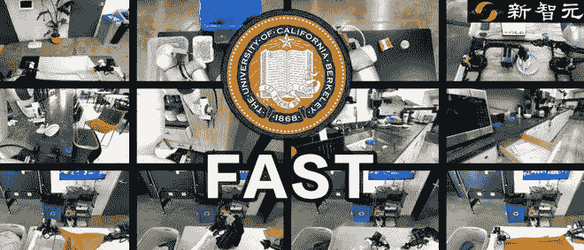
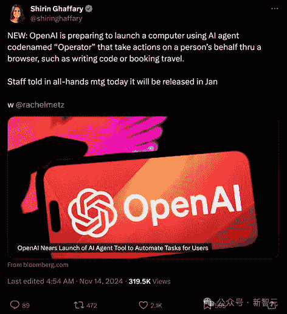
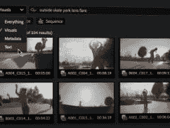

# 01.23-刚刚，豆包1.5模型家族硬核登场！「深度思考」秘笈曝光，多模态冲爆榜单

> 来源：[https://agijuejin.feishu.cn/docx/RmHmdhrUpoj7mfx3Fj5cFlgcnGe](https://agijuejin.feishu.cn/docx/RmHmdhrUpoj7mfx3Fj5cFlgcnGe)

# AGI 掘金日报 - AI 新闻推送 (2025 年 01 月 23 日)

> [欢迎加入 AGI 掘金社群](https://sourl.co/miZUyT)

## ⭐ 今日热点

### 💡 刚刚，豆包1.5模型家族硬核登场！「深度思考」秘笈曝光，多模态冲爆榜单

新智元 | [阅读原文](https://www.163.com/dy/article/JMHIC6T10511ABV6.html?spss=dy_author)

2025 年 1 月 22 日，字节跳动发布豆包大模型 1.5。该模型多模态能力全面提升，在视觉理解、语音多模态和推理能力方面均有重大突破。视觉理解能力增强，能识别不同分辨率图片；语音多模态实现端到端对话，表现力和控制力强；采用大规模强化学习提升推理能力，还在训练和推理一体设计上实现性能与效率平衡。

## 🌟 技术突破

### 💡 UC伯克利等提出具身智能「动作Tokenizer」，效率飙升5倍！

新智元 | [阅读原文](https://www.163.com/dy/article/JMH180QH0511ABV6.html?spss=dy_author)

2025 年，来自伯克利、斯坦福等的研究者提出高效动作 Tokenizer FAST。FAST 结合离散余弦变换和字节对编码，将动作像语言一样用离散 Token 表示，能提升训练和推理效率，最多缩短训练时间 5 倍。基于 FAST 训练出首个自回归通用策略π0-FAST，在复杂任务上表现与扩散π0 模型相当，且计算量显著减少，但推理速度较慢。

### 💡 截胡OpenAI！清华复旦等抢先开源智能体框架Eko，一句话打造「虚拟员工」

新智元 | [阅读原文](https://www.163.com/dy/article/JMH11J020511ABV6.html?spss=dy_author)

2025 年清华、复旦和斯坦福研究者联合抢先开源智能体框架 Eko。Eko 能通过自然语言和简单代码快速构建‘虚拟员工’，完成复杂任务。其核心技术包括混合智能体表示、跨平台架构和生产级干预机制等。如环境感知架构可同时支持浏览器、电脑等多平台使用，VIEP 技术提升网页自动化效率，还有层次化规划和多步合并优化等功能。开发者可通过钩子实时优化工作流。作者包括清华博士生陆逸文等。

### 💡 网易有道推出国内首个输出分步式讲解的推理模型“子曰-o1”

IT之家 | [阅读原文](https://www.ithome.com/0/826/403.htm)

2025 年 1 月 22 日，网易有道推出国内首个输出分步式讲解的推理模型‘子曰-o1’并正式开源。这是一个 14B 轻量级单模型，支持在消费级显卡上部署，采用思维链技术，有强逻辑和推理能力，能提供细致解题过程和中文逻辑推理，且在参数规模较小情况下实现了轻量化，能在消费级显卡上运行并提供高质量模型。

## 💫 企业动态

### 💡 Adobe Premiere Pro 新增 AI 视觉识别搜索功能：一句话快速找到视频片段

IT之家 | [阅读原文](https://www.ithome.com/0/826/577.htm)

2025 年 1 月 22 日，Adobe 为 Premiere Pro 引入 AI 视觉识别搜索功能，用户可通过描述视频内容快速找片段。该功能能识别物体、场景等，在设备本地运行，不联网且内容不用于训练 AI 模型。同时推出支持 17 种语言的视频字幕翻译功能。After Effects 新增对 HDR 监视支持和升级缓存系统。Frame.io 平台支持佳能相机集成功能，已于去年 12 月通过佳能固件更新推出。

### 💡 英国零售业拥抱自动化以降本增效，机器人包装工、AI 摄像头等逐渐普及

IT之家 | [阅读原文](https://www.ithome.com/0/826/569.htm)

2025 年英国零售业为降本增效拥抱自动化，普及机器人包装工、AI 摄像头等。如电器连锁店 Currys 推广电子标签，Primark 和 Next 增加自助结账，不少零售商投放自动退货机。仓储自动化加速，亚马逊等用机器人运输商品，Ocado 用于包装和送货。AI 优化供应链、改善体验，还被列为关键技术可检测缺货和分析顾客交互，处理数据减少浪费优化营销。关键词：人工智能、零售业、机器人。

### 💡 ChatGPT 每月产生 260 吨二氧化碳，与 260 趟纽约至伦敦航班碳排放相当

IT之家 | [阅读原文](https://www.ithome.com/0/826/555.htm)

2025 年，ChatGPT 每月产生 260 吨二氧化碳，与 260 趟纽约至伦敦航班碳排放相当。AI 写作工具 Rytr 和合同起草工具 Spellbook 单次页面访问碳排放量高于 ChatGPT，但用户规模远小于 ChatGPT。数据中心能源需求攀升，美国 2017 至 2023 年数据中心能源消耗增长逾两倍。国际能源署报告称数据中心等技术用电量明年可能翻倍。KnownHost 首席执行官强调提升 AI 基础设施能效的重要性。

### 💡 百万 tokens 降至 0.8 元后，消息称字节跳动豆包大模型毛利率达 50%

IT之家 | [阅读原文](https://www.ithome.com/0/826/527.htm)

2025 年，字节跳动豆包大模型百万 tokens 降至 0.8 元后，毛利率仍能达 50%。Doubao-1.5-pro-32k 和 Doubao-1.5-lite-32k 价格在业界同级别最低。尽管目前有可观毛利率，但因研发投入大，大模型业务仍亏损，需扩大应用侧调用规模摊销成本。去年 5 月，豆包主力模型在企业市场定价仅 0.0008 元/千 Tokens，比行业便宜 99.3%。关键词：字节跳动，豆包大模型。

### 💡 Anthropic CEO惊人预警：27年AI超越人类！Claude今年更新全剧透

新智元 | [阅读原文](https://www.163.com/dy/article/JMH6N88G0511ABV6.html?spss=dy_author)

Anthropic 首席执行官 Dario Amodei 认为 2027 年之前 AI 可能超越人类智能，Claude 将上线‘双语音’模式且有更好记忆，2025 年打造‘AI 同事’，到 2026 年将运行超 100 万个 GPU。他还谈到大模型走向、Claude 的功能规划、推理模型及对行业的态度等，同时给职场年轻人提出掌握 AI 技术和培养批判性思维的建议。

### 💡 41%博士后逃生学术界，顶刊PNAS揭残酷真相！名校光环背后曝职业危机

新智元 | [阅读原文](https://www.163.com/dy/article/JMH10H150511ABV6.html?spss=dy_author)

2025 年 1 月 20 日 PNAS 论文揭示博士后生存现状，41%博士后最终离开学术界。论文从科学学角度分析，发现发表率与教职强相关，博士后出国易获教职，适度改变研究主题、发表高影响力论文与职业成功正相关等。澳大利亚学者指出该研究有局限，如未考虑教学经验且样本有限。论文作者为中国地质大学（北京）和阿尔托大学的 Yueran Duan 及中国地质大学（北京）副教授 Qing Guan。

### 💡 字节跳动豆包大模型 1.5 Pro 发布，综合得分优于 GPT-4o、Claude 3.5 Sonnet

IT之家 | [阅读原文](https://www.ithome.com/0/826/419.htm)

2025 年 1 月 22 日，字节跳动发布豆包大模型 1.5 Pro，在多个测评基准上综合得分优于 GPT-4o、Claude 3.5 Sonnet 等模型。采用大规模稀疏 MoE 架构，等效 7 倍激活参数的 Dense 模型性能。还发布了新版视觉理解模型和实时语音模型，实现端到端语音对话，具备低时延等特性。所有模型训练未用其他模型生成数据，且全产品加量不加价。

## ✨ 行业观点

### 💡 谷歌母公司 Alphabet 总裁：美国 AI 技术未必会永远领先中国

IT之家 | [阅读原文](https://www.ithome.com/0/826/534.htm)

2025 年，谷歌母公司 Alphabet 总裁波拉特在达沃斯世界经济论坛表示，美国在 AI 发展竞赛中未必能永远领先中国。美国在 AI 模型和芯片领域暂时领先，但中国在基础能力普及和应用方面已与之持平甚至可能略胜一筹。她呼吁特朗普政府制定‘大胆且负责任’的 AI 发展规则，强调监管需全球一致，否则会阻碍投资。