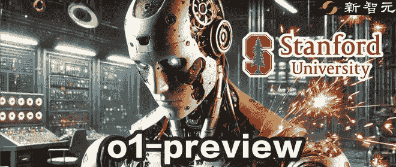
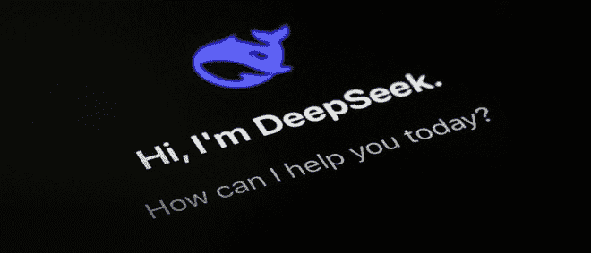
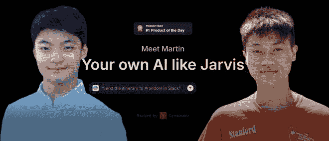

# 02.01-OpenAI 小钢炮 o3-mini 推理模型登场：性能提升 24%，首次向免费 ChatGPT AI 用户开放

> 来源：[https://agijuejin.feishu.cn/docx/JQGnd4RuJoJx33xQ5j6cNc09n1c](https://agijuejin.feishu.cn/docx/JQGnd4RuJoJx33xQ5j6cNc09n1c)

# AGI 掘金日报 - AI 新闻推送 (2025 年 02 月 01 日)

> [欢迎加入 AGI 掘金社群](https://sourl.co/miZUyT)

## ⭐ 今日热点

### 💡 OpenAI 小钢炮 o3-mini 推理模型登场：性能提升 24%，首次向免费 ChatGPT AI 用户开放

IT之家 | [阅读原文](https://www.ithome.com/0/828/132.htm)

2月1日，OpenAI首席执行官预告后正式推出o3-mini AI推理模型。其性能比o1-mini提升24%，答案准确性提高，还会展示推理过程。开发者可通过API服务使用。ChatGPT中o3-mini默认中等推理强度，付费用户可选o3-mini-high。Plus、Team和Pro用户均可使用，Plus和Teams用户每日消息限制提至150条，Pro用户无限使用。免费用户在聊天栏选Reason功能可体验，速率限制与GPT-4o类似 。

## 🌟 技术突破

### 💡 牛津哥大联手破解两千年素数谜题！受陶哲轩启发，意外解法打破千年僵局

新智元 | [阅读原文](https://www.163.com/dy/article/JN9QL6A90511ABV6.html?spss=dy_author)

牛津大学的本·格林和哥伦比亚大学的梅塔布·索尼在素数问题上取得新进展。素数分布规律研究已久，此次他们针对 Friedlander 和 Iwaniec 提出的「是否存在无限多个 p^2 + 4q^2 形式的素数（p、q 为素数）」猜想展开研究。通过先证明两个“近似素数”平方和可得无限多个素数，借助 Gowers 范数等工具，最终证明了该猜想，并进行推广，此成果是素数研究领域重要突破 。

### 💡 斯坦福揭秘 o1-preview 软肋：数学竞赛题稍作修改，准确率骤降 30%

IT之家 | [阅读原文](https://www.ithome.com/0/828/081.htm)

斯坦福大学研究发现，o1-preview虽在多领域表现出色，如编程、数学、医学诊断等，但面对普特南数学竞赛变体题时，准确率从41.95%骤降约30%至11.95%。原因是其训练可能多针对常见模式，缺对变体题应对经验。研究团队打造Putnam-AXIOM Original基准测试AI数学能力，测试发现多数模型面对变体题准确率滑坡，Gemma等部分型号不降反升，这反映当前AI模型适应性差，也为其训练提升指明方向。

### 💡 突破瓶颈，百度 EICopilot AI 提升企业知识图谱利用率

IT之家 | [阅读原文](https://www.ithome.com/0/828/057.htm)

2025年1月23日百度公布成果EICopilot。知识图谱在企业应用广泛，但因文本查询和手动探索复杂阻碍信息提取。EICopilot由百度研究院开发，基于AI智能体，处理大规模企业数据集，创新数据预处理优化查询，有强大推理能力。性能评估显示，其优于基线方法，Full Mask版本语法错误率低至10.00%，执行正确率高达82.14%，为企业知识图谱探索提供高效方案 。

### 💡 斯坦福揭秘o1-preview软肋！数学竞赛题稍作修改，准确率骤降30%

新智元 | [阅读原文](https://www.163.com/dy/article/JN81HH8V0511ABV6.html?spss=dy_author)

斯坦福大学研究发现，o1-preview模型虽在多领域表现出色，如编程Elo评分1807超93%对手，2024年AIME正确率83% ，医学诊断超人类医生。但面对普特南数学竞赛变体题，准确率从41.95%降至11.95%，降30%。研究团队打造Putnam-AXIOM Original基准测试AI数学能力，发现多数模型面对变体题准确率滑坡，Gemma等部分型号不降反升，反映出当前AI模型适应性差，也指明提升方向。

## 💫 企业动态

### 💡 DeepSeek-R1 模型全面上线亚马逊云科技

IT之家 | [阅读原文](https://www.ithome.com/0/828/120.htm)

1月31日消息，DeepSeek-R1模型全面上线亚马逊云科技，用户可在Amazon Bedrock和Amazon SageMaker AI中部署。前者适合想通过API快速集成预训练模型的团队，后者适合进行高级定制等的团队。还能用更具性价比方式部署DeepSeek-R1-Distill 。DeepSeek此前推出多个模型，已向公众开放，成本比同类低90%到95% 。

### 💡 一夜之间，微软、英伟达、亚马逊全部接入DeepSeek！吴恩达：中国AI正在崛起

新智元 | [阅读原文](https://www.163.com/dy/article/JN894MJG0511ABV6.html?spss=dy_author)

1 月 31 日，微软、英伟达、亚马逊等美国云计算平台接入 DeepSeek R1。吴恩达认为中国在 GenAI 领域正赶上美国，开放权重模型推动基础模型层商品化，扩大规模非 AI 进步唯一途径。DeepSeek 训练成本低，其 R1 开源权重和技术报告。英特尔前 CEO Pat Gelsinger 称计算如气体、工程要应对约束、开放终将胜利。DeepSeek 推动 AI 应用发展 ，重塑行业对开放创新看法。

### 💡 英特尔 Falcon Shores GPU 止步，战略转向 AI 系统级解决方案

IT之家 | [阅读原文](https://www.ithome.com/0/828/066.htm)

1月30日科技媒体报道，英特尔不会向市场推出下一代高性能计算和人工智能GPU——Falcon Shores。联席CEO Michelle Johnston Holthaus称，将其用作内部测试芯片，取消发布是为简化产品路线图、优化资源配置。英特尔今后将专注于Jaguar Shores，提供更全面的机架规模系统级方案，因为仅高性能芯片无法满足客户需求。

### 💡 19岁华人辍学创业，刚刚拿下百万美金融资！All in智能体，誓要实现Siri初心

新智元 | [阅读原文](https://www.163.com/dy/article/JN81QNUB0511ABV6.html?spss=dy_author)

19岁的Dawson Chen和Ethan Hou分别从耶鲁、伯克利退学创业，创办Martin AI并获200万美元种子轮融资。Martin采用“自定义记忆架构”，能理解用户偏好和上下文，可通过多平台帮用户处理日程、邮件等事务。首席执行官Dawson Chen认为专注用户体验和快速迭代是关键，预计五年内每人有五到十个AI智能体，团队致力于让Martin贴近日常生活，虽面临挑战仍坚持。

### 💡 消息称 OpenAI 新一轮融资至多 400 亿美元，估值将达到 3000 亿美元

IT之家 | [阅读原文](https://www.ithome.com/0/828/047.htm)

1 月 31 日消息，据华尔街日报报道，OpenAI 正就新一轮融资谈判，拟筹资至多 400 亿美元，估值达 3000 亿美元。日本软银集团可能领投，最高投 250 亿美元 。OpenAI 去年 10 月 3 日融资 66 亿美元，估值 1570 亿美元，9 个月估值接近翻倍，此次新一轮融资金额大幅提升，有望使市值再翻倍。

### 💡 剑指 OpenAI 和谷歌，马斯克的 Grok 3 AI 模型即将登场

IT之家 | [阅读原文](https://www.ithome.com/0/828/045.htm)

1月30日，科技媒体testingcatalog称，马斯克旗下xAI将推Grok 3模型，预估引入“思维链”推理能力，像人类一样处理复杂任务。xAI定位为行业领导者竞争对手，投入巨资，用约10万张Nvidia H100 GPU训练。Grok或推Pro模式但细节不明。Grok独立应用程序2月28日将在欧洲推出，尚不清楚与Grok 3发布日期是否一致 。

## ✨ 行业观点

### 💡 o1开启LLM新范式，Ai2科学家解析背后秘籍：推理和强化学习是关键

新智元 | [阅读原文](https://www.163.com/dy/article/JN9QKQMH0511ABV6.html?spss=dy_author)

Ai2研究科学家Nathan Lambert在NeurIPS的Latent Space非官方Industry Track上演讲，探讨语言推理现状等。他认为2025年推理语言模型将取代后训练，语言模型有新推理形式。还介绍了o1模型，其训练计算量大，本质是大规模预训练强化学习，只需少量样本。此外，提到强化学习微调、评分器模型等，并分享开源代码，鼓励探索语言模型推理能力及应用。

### 💡 前 OpenAI 安全研究员 Steven Adler 示警：整个行业正在进行极其危险的赌博

IT之家 | [阅读原文](https://www.ithome.com/0/828/106.htm)

前 OpenAI 安全研究员 Steven Adler 对 AI 发展速度“非常恐惧”，称行业在进行“极其危险的赌博”。他担忧各大公司争分夺秒开发人工通用智能（AGI），还指出目前没实验室能有效解决 AI 对齐问题，行业快速发展或错失解决方案。此外，“AI 教父”杰弗里・辛顿担心 AI 失控，杨立昆则淡化其生存威胁。Adler 呼吁引入安全监管 。

### 💡 郭明錤：DeepSeek 加速生成式 AI 产业迈入新阶段

IT之家 | [阅读原文](https://www.ithome.com/0/828/084.htm)

天风国际证券分析师郭明錤指出，DeepSeek - R1发布后加速AI产业迈入新阶段，有两个新趋势：一是Scaling law边际效益放缓时，可通过优化训练方式提升AI算力并挖掘新应用；二是API / Token价格下滑，利于AI软件/服务与设备端AI，加速应用多元化。此外还提及Scaling law与投资、英伟达等相关情况及产业未来走向。