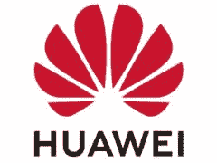

# AGI 掘金日报 - AI 新闻推送 (2025 年 02 月 07 日)

> 来源：[https://agijuejin.feishu.cn/docx/SEFRdmHV2o7cG1xldVScAV6Jn3c](https://agijuejin.feishu.cn/docx/SEFRdmHV2o7cG1xldVScAV6Jn3c)
> [欢迎加入 AGI 掘金社群](https://sourl.co/miZUyT)

## ⭐ 今日热点

### 💡 OpenAI 升级 `o3-mini` 模型思维链，提高 AI 推理透明度

IT之家 | [阅读原文](https://www.ithome.com/0/829/056.htm)

2月7日，OpenAI在`X`平台宣布，面向免费和付费用户更新`o3-mini`的思维链，为付费用户更新`o3-mini-high`的思维链。通过更新“思维链”展示方式，让用户更易理解模型思考过程。推理模型会做事实核查，但耗时较长。OpenAI称已找到平衡，让模型“自由思考”并处理内容，还支持非英语用户用母语接收思维链，带来更好体验。

## 🌟 技术突破

### 💡 阿里云确认：李飞飞团队 `s1` 模型基于 `Qwen2.5-32B-Instruct` 模型训练

IT之家 | [阅读原文](https://www.ithome.com/0/829/032.htm)

2月6日消息，李飞飞研究团队以不到50美元云计算费用训练出`s1`人工智能推理模型，性能与尖端模型类似。后被指非从零训练，基座模型为阿里通义千问`Qwen2.5-32B-Instruct`。阿里云确认，该团队在16块`H100` GPU上监督微调26分钟得`s1-32B`，在竞赛数学问题上比`o1-preview`高出27%。`s1`用“蒸馏”技术，基于小型免费模型，用含1000个问题的数据集训练，`SFT`方法比DeepSeek的方法更具成本效益。

### 💡 字节跳动展示 `OmniHuman` 多模态框架：图片 + 音频 = 逼真动画，半身全身均可生成

IT之家 | [阅读原文](https://www.ithome.com/0/828/935.htm)

2月6日消息，字节跳动研究人员展示AI模型`OmniHuman-1`，能通过一张图片和一段音频生成半身、全身视频。与一些深度伪造技术不同，它能生成逼真全身动画，精准同步手势表情与语音音乐。该模型基于约19000小时人类运动数据训练，支持不同体型、画面比例，在真实性和准确性上超越同类。目前暂不提供下载或服务。

### 💡 16张 `H100` 训26分钟，超越 `o1-preview`！李飞飞等用1K样本，揭秘测试时Scaling

新智元 | [阅读原文](https://www.163.com/dy/article/JNNEHRCT0511ABV6.html?spss=dy_author)

李飞飞等研究人员发表论文，用1000个样本微调模型并提出预算强制技术。构建`s1K`数据集，仅用16张`H100` GPU训练26分钟，得到`s1-32B`模型。该模型有测试时扩展能力，样本效率高，推理能力超`o1-preview`。实验验证了数据选择标准及预算强制的优越性，还探讨了未来方向，如改进预算强制、应用于强化学习模型等。

### 💡 百度首个自研万卡集群点亮，上架DeepSeek直降3折全网最低！降低AI算力门槛

新智元 | [阅读原文](https://www.163.com/dy/article/JNNEFCBK0511ABV6.html?spss=dy_author)

百度智能云成功点亮首个自研万卡集群，由昆仑芯三代组成。它提升训练效率、支持更大模型等。百度计划扩大规模到3万卡集群。集群组建不易，百舸AI异构计算平台4.0解决诸多难题，提升多项性能指标。基于此，它已在多行业应用，还降低了AI成本，为国产AI发展注入活力。

## 💫 企业动态

### 💡 诚迈信创电脑实现 `DeepSeek` 本地部署：龙芯 `3A6000` 处理器、预装统信 `UOS`

IT之家 | [阅读原文](https://www.ithome.com/0/829/043.htm)

2月6日消息，热门AI应用`DeepSeek`实现本地部署。诚迈科技宣布诚迈信创电脑和望龙电脑已完成该部署。这两款电脑搭载龙芯`3A6000`处理器、预装统信`UOS`操作系统，具备安全可控等特点，能满足信创办公需求。本地部署无需依赖云端服务器，可避免服务中断，保障信息安全，用户能用其完成文档处理等多项工作。

### 💡 深度求索：除官方账号外，其他任何以 `DeepSeek` 或相关负责人名义对外发布公司相关信息的均为仿冒账号

IT之家 | [阅读原文](https://www.ithome.com/0/829/010.htm)

2月6日，杭州深度求索人工智能基础技术研究有限公司发布说明。称近期有仿冒账号和不实信息误导公众。明确`DeepSeek`仅在🛰️👸号、📕、`X（Twitter）`有唯一官方账号；获取模型服务认准官网`www.deepseek.com`及官方`App`，且官方网页端与`App`无广告和付费项目；除官方用户交流🛰️群外，国内其他平台无官方群组，谨防假冒收费造成财产损失。

### 💡 网易有道宣布拥抱 `DeepSeek` 大模型，智能硬件新品不久后推出

IT之家 | [阅读原文](https://www.ithome.com/0/829/003.htm)

2月6日，网易有道宣布全面拥抱`DeepSeek-R1`。AI学习助手“有道小P”结合其超长思维链优化个性化答疑功能，提供更优质解题思路。`Hi Echo`等产品将接入其推理能力并陆续升级，融合新能力的智能硬件新品及“有道小P”2.0不久后推出。2023年有道推出`子曰`大模型，此次拥抱`DeepSeek-R1`，旨在模型和技术侧升级，增强用户体验。

### 💡 钉钉专属 AI 一体机全面支持 `DeepSeek R1` & `V3 671B` 模型以及蒸馏系列模型

IT之家 | [阅读原文](https://www.ithome.com/0/829/002.htm)

2月6日，钉钉科技有限公司宣布，钉钉专属AI一体机全面支持`DeepSeek R1` & `V3 671B`模型以及蒸馏系列模型。经实测，在知识检索等多个场景体验有提升，可推动企业落地AI战略。该一体机是一站式一体化落地解决方案，应用场景涵盖销售知识助理、智能审批等。

### 💡 奇安信：发现 2650 个仿冒 `DeepSeek` 的网站，60% 域名解析 `IP` 位于美国

IT之家 | [阅读原文](https://www.ithome.com/0/828/992.htm)

2月6日奇安信`XLab`实验室报告，仿冒`DeepSeek`的网站超2千个且在增加。统计2024年12月1日至2025年2月3日，共出现2650个仿冒网站，1月26日开始大规模注册，28日达高峰后仍在增加。仿冒域名用于钓鱼欺诈等，60% 解析`IP`位于美国，其余分布在多国。仿冒网站会传播恶意软件、骗钱，用户面临复杂多样网络攻击。

### 💡 中国移动启明星辰集团全面对接 `DeepSeek` 大模型，宣称“全场景智能化安全再升级”

IT之家 | [阅读原文](https://www.ithome.com/0/828/972.htm)

2月6日，中国移动网信安全子公司启明星辰集团宣布，“`安星`”智能体已全面对接`DeepSeek`大模型，并应用于全业务场景，实现安全智能化能力升级。优势有：支持多模型底座，适配更多用户场景；借助`DeepSeek`强推理能力，提升复杂场景自主分析能力；结合技术降低训练推理成本，减轻用户部署成本。

### 💡 高通 CEO 安蒙称 `DeepSeek R1` 模型对高通有利，能直接在本地设备上运行

IT之家 | [阅读原文](https://www.ithome.com/0/828/970.htm)

2月6日高通发布2025财年第一财季财报。高通CEO安蒙称，爆火的`DeepSeek R1`模型对高通有利，因高通芯片能在本地高效运行。财报显示，该财季高通营收116.69亿美元，净利润31.80亿美元，调整后净利润38.30亿美元，均有增长且超华尔街分析师预期，对二财季展望也超预期，但盘后股价仍跌超3%。

### 💡 华为 `ModelEngine` AI 平台支持 `DeepSeek` 全系列本地部署

IT之家 | [阅读原文](https://www.ithome.com/0/828/965.htm)

2月6日华为宣布，旗下`ModelEngine` AI平台全面支持`DeepSeek`大模型`R1` & `V3`和蒸馏系列模型本地部署与优化。该平台基于昇腾AI芯片，有灵活部署、企业级稳定性等特性，可`一键部署`，降低企业AI应用门槛，还能在大规模生产环境稳定运行，某证券公司引入相关方案后运维成本降低42%。此外，`DCS AI`全栈解决方案近期将上线`DeepSeek`体验环境。

### 💡 汽车行业首个，吉利星睿大模型与 `DeepSeek` 深度融合

IT之家 | [阅读原文](https://www.ithome.com/0/828/962.htm)

2月6日，吉利汽车官宣其自研大模型与`DeepSeek`完成深度融合。吉利将融合`DeepSeek R1`大模型顶尖认知能力与自身智能汽车全域AI技术体系，重新定义智能汽车人机交互及智能驾驶。还将对`星睿车控`等大模型进行蒸馏训练。吉利智能汽车AI能精准理解用户意图，调用约2000个车载接口，主动分析需求并提供服务，提升智能交互体验，推动AI在智能汽车领域普及。

### 💡 外交部回应部分国家传出禁止或限制使用 `DeepSeek`

IT之家 | [阅读原文](https://www.ithome.com/0/828/956.htm)

2月6日外交部发言人郭嘉昆主持例行记者会，回应多国禁止或限制使用`DeepSeek`一事。中方称重视数据隐私安全，反对泛化国家安全概念、将经贸科技问题政治化，会维护中国企业合法权益。此外，网友就此事展开讨论，观点多样，有人认为应对等制裁，有人觉得不必理会。

### 💡 OpenAI联创John Schulman，被曝火速离职Anthropic！刚刚入职6个月

新智元 | [阅读原文](https://www.163.com/dy/article/JNNNM45C0511ABV6.html?spss=dy_author)

OpenAI联合创始人John Schulman去年8月离开OpenAI加入Anthropic，如今仅半年又离职。他是强化学习先驱、`ChatGPT`核心架构师，其离职对Anthropic或有影响。Schulman在OpenAI供职9年，参与多项关键工作，如提出近端策略优化（`PPO`）算法。Anthropic首席科学官对其离开表示遗憾并祝福。他的离职曾在当时引起震动，因其是OpenAI技术领袖且离职时间敏感。

### 💡 特斯拉弗里蒙特工厂招兵买马，全力推进 `Optimus` 人形机器人量产

IT之家 | [阅读原文](https://www.ithome.com/0/828/914.htm)

2月6日，特斯拉在美国弗里蒙特工厂发布多个工程岗位招聘信息，加速人形机器人`Optimus`量产进程，官网显示至少12个相关职位空缺。马斯克曾称，`Optimus`有望创造高额收入，计划2025年生产1万台，2026年下半年商业交付，年产量达100万台时单价或降至2万美元。开发该机器人是特斯拉多元化战略一部分，此次招聘凸显其在机器人和人工智能领域的决心，其规划备受关注。

### 💡 欧洲人工智能初创企业去年融资近 80 亿美元，日益受到风投公司青睐

IT之家 | [阅读原文](https://www.ithome.com/0/828/912.htm)

尽管美中人工智能行业受大量关注，但欧洲 AI 初创企业正快速崛起。2024 年，AI 领域占欧洲风险投资资金约 20%，欧洲 AI 初创企业获近 80 亿美元资金，70% 用于种子轮到 B 轮融资。英国、法国、德国等成为 AI 主要投资中心，后期投资中美国投资者约占 50%。法国有超 750 家相关初创公司，创造 35000 个岗位，有众多研究人员。

### 💡 微软 AI 首席执行官集结 `DeepMind` 旧部共筑 AI 新未来

IT之家 | [阅读原文](https://www.ithome.com/0/828/909.htm)

2月5日消息，微软AI首席执行官穆斯塔法・苏莱曼从`DeepMind`聘请了Marco Tagliasacchi、Zalán Borsos和Matthias Minderer三位人才，他们是微软苏黎世新AI办公室创始成员，前两位专注音频功能开发，后者专注视觉功能研发。苏莱曼曾是`DeepMind`联合创始人。此次延续微软招揽`DeepMind`人才趋势，显示其在AI领域竞争决心，新办公室成立也标志其扩展AI研发布局。

### 💡 消息称 OpenAI 将首次亮相美国超级碗广告，已任命首位 `CMO` 发力营销

IT之家 | [阅读原文](https://www.ithome.com/0/828/905.htm)

2月6日消息，据华尔街日报援引知情人士消息，`ChatGPT` 开发商 OpenAI 预计将在周日美国超级碗比赛期间播出首个电视广告。OpenAI 在无付费广告宣传下因 `ChatGPT` 声名鹊起。超级碗关注度高，30 秒广告超 800 万美元。OpenAI 去年 12 月任命首位 `CMO`，此次涉足商业广告，而谷歌等对手去年已在超级碗投放 AI 广告。

### 💡 今天起，`ChatGPT`搜索人人可用！OpenAI疯狂砸钱，雇300+博士为AI打工

新智元 | [阅读原文](https://www.163.com/dy/article/JNNCSI8R0511ABV6.html?spss=dy_author)

`OpenAI` 将 `ChatGPT Search` 全面开放，无需注册登录，用法似传统搜索引擎，这或使访客量大增，且正蚕食传统搜索引擎市场。同时，`OpenAI` 雇 300+ 博士，100 美金/小时提升模型推理质量。此外，`DeepSeek` 能用 AI 生成数据训练其他 AI，引发后训练产业变革，如 `Labelbox` 思考商业模式变革，`Scale` 测试「专家匹配」系统等。

### 💡 `Gemini` 回复存虚假信息，谷歌超级碗广告“翻车”

IT之家 | [阅读原文](https://www.ithome.com/0/828/876.htm)

超级碗 `LIX` 即将举行，谷歌上周在 `X` 平台预览超级碗广告，展示各地使用 `Gemini` AI 工具的小微企业。其中威斯康星州广告中，`Gemini` 生成文案称“全球超一半奶酪消费是高达奶酪”，被指虚假。谷歌广告副总裁称回应“基于网络信息”，但调查发现相关网站内容质量低。最终谷歌与企业主协商后修改广告，删除具体数据，称高达奶酪是“世界上最受欢迎的奶酪之一”。

## ✨ 行业观点

### 💡 亚马逊 CEO：AI 成本将因 `DeepSeek` 等模型的出现而降低

IT之家 | [阅读原文](https://www.ithome.com/0/829/070.htm)

2月7日，亚马逊首席执行官安迪・贾西在电话会议称，预计人工智能推理成本将大幅下降，这会推动AI整体需求增长。亚马逊对`DeepSeek`印象深刻，已将其在`Bedrock`和`SageMaker`中推出。贾西还提出，技术成本下降会让企业开发更多创新项目，加大整体技术支出。此前，1月30日起用户可在相关平台部署`DeepSeek-R1`模型，也能用性价比高的方式部署`DeepSeek-R1-Distill`。

### 💡 IBM CEO：`DeepSeek` 证明我们是正确的，小型且高效的模型同样能有实际成果

IT之家 | [阅读原文](https://www.ithome.com/0/829/064.htm)

当地时间2月4日，IBM首席执行官Arvind Krishna发表长文谈对`DeepSeek`及AI行业看法。`DeepSeek`以约2000枚英伟达芯片、600万美元成本训练新模型，颠覆传统认知，证明小型高效模型也有成果。他认为AI发展不能被少数公司垄断，要推动广泛合作。2025年AI应从封闭体系解放，2026年各界应投身研发，开源小模型是关键，AGI不会很快实现，AI成本可降，其发展将如计算机普及一样改变世界。

### 💡 逾百名专家联合呼吁优先研究 AI 意识，确保人工智能不会“受虐”

IT之家 | [阅读原文](https://www.ithome.com/0/828/903.htm)

# 💡 百位专家联名警告：AI或将体验痛苦！Hinton、Bengio掀AI意识大论战

当地时间2月3日，逾百名专家联合签署公开信，呼吁优先研究AI意识，提出五项原则以指导研究。相关论文指出，具备意识的AI系统可能不久后被开发，即便无意为之公司也应制定指南。论文还探讨了AI作为“道德病人”等问题，并警告错误认知会浪费资源。此外，有学者预测2035年部分AI系统可能有意识，谷歌德米斯・哈萨比斯称目前AI无感知但未来可能有。

新智元 | [阅读原文](https://www.163.com/dy/article/JNNEE66L0511ABV6.html?spss=dy_author)

百位来自顶尖学府的专家联名发出公开信，呼吁对AI意识进行负责任研究，提出防止AI受「虐待和痛苦」的五项原则。有论文称人类不久后或构建出有意识AI系统。Hinton称AI已发展出意识且未来会接管世界，Bengio则认为AI有无意识不重要，重要的是其目标、规划等情况，网友对此也展开讨论，凸显AI意识研究的伦理考量及潜在复杂性。
