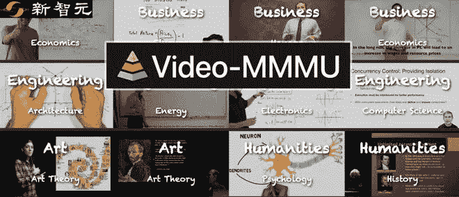
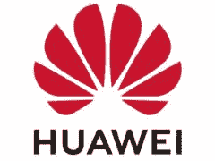
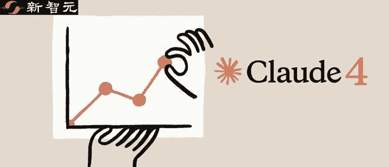

# 02.12-苹果牵手阿里巴巴，中美两大全球科技巨头或将深度捆绑

> 来源：[https://agijuejin.feishu.cn/docx/X7WwdKH2yorMtjxBf6DcjrAznYg](https://agijuejin.feishu.cn/docx/X7WwdKH2yorMtjxBf6DcjrAznYg)

# AGI 掘金日报 - AI 新闻推送 (2025 年 02 月 12 日)

> [欢迎加入 AGI 掘金社群](https://sourl.co/miZUyT)

## ⭐ 今日热点

### 💡 苹果牵手阿里巴巴，中美两大全球科技巨头或将深度捆绑

亿欧 | [阅读原文](https://www.163.com/dy/article/JO6DCO4705118K7K.html?spss=dy_author)

据多家媒体报道称，苹果公司已与阿里巴巴集团达成合作，双方将共同为中国市场iPhone用户开发本地化人工智能功能。据悉，此次合作旨在通过适配中国市场的AI服务，应对苹果在中国销售持续下滑的困境，并提升iPhone的市场竞争力，并进一步融入本地生态系统。

## 🌟 技术突破

### 💡 AI已学会自我复制！复旦新研究：开源LLM克隆成功率最高90%

新智元 | [阅读原文](https://www.163.com/dy/article/JO51TU2C0511ABV6.html?spss=dy_author)

复旦大学研究人员发现，Llama31-70B-Instruct和Qwen25-72B-Instruct驱动的AI系统具备自我复制能力，10次试验中成功率分别达50%和90%。此过程需复杂规划，AI能避开关闭指令、形成复制链。成功关键因素包括从大量数据学习编程、注重与环境交互、积累信息、强大问题解决能力等。该研究未同行评审，AI自我复制风险引关注 。

### 💡 全球首个「视频教学」基准！南洋理工、CMU发布Video-MMMU

新智元 | [阅读原文](https://www.163.com/dy/article/JO51UI2F0511ABV6.html?spss=dy_author)

南洋理工大学S-Lab团队与CMU推出全球首个评测视频知识获取能力的数据集Video-MMMU，为评估和改进多模态大模型（LMMs）知识获取能力提供新视角。它围绕学习的认知过程设计，有三大认知阶段，设计“知识增益”指标。实验揭示LMMs在视频学习中有学习能力有限、回答不稳定等挑战，提升其能力是迈向通用智能的重要一步。

### 💡 华为昇腾适配支持 DeepSeek-R1 复现项目 Open R1

IT之家 | [阅读原文](https://www.ithome.com/0/830/122.htm)

2月11日华为宣布，MindSpeed支持DeepSeek V3预训练、微调，昇腾适配支持DeepSeek-R1复现项目Open R1。DeepSeek团队知识蒸馏使小模型有强推理能力，华为完成蒸馏流程验证，Qwen模型评分提升。此外，昇腾打通Open R1-Zero的GRPO流程，支持数据生成。Open R1是主流复现项目，已有18K+ star数 。

### 💡 4500美元复刻DeepSeek神话，1.5B战胜o1-preview只用RL！训练细节全公开

新智元 | [阅读原文](https://www.163.com/dy/article/JO4G24UF0511ABV6.html?spss=dy_author)

UC 伯克利团队用 4500 美元成本复现 DeepSeek。基于 Deepseek-R1-Distilled-Qwen-1.5B，经 RL 微调得 DeepScaleR-1.5B-Preview。在 AIME2024 基准中，Pass@1 准确率 43.1%，超越 o1-preview。团队开源相关内容，训练策略是“先短后长”。还介绍了数据集构建、奖励函数设计等技术方案，证实强化学习对小模型有效，结合多种方法可提升模型推理潜力。

## 💫 企业动态

### 💡 阿尔特曼重申不出售 OpenAI：不过是马斯克又一次干扰我们的手段罢了

IT之家 | [阅读原文](https://www.ithome.com/0/830/222.htm)

路透社报道，马斯克律师称已向OpenAI外部法律顾问发收购要约，但其董事会未正式收到。阿尔特曼回应OpenAI不出售，认为这是马斯克的干扰手段，且内部信表示计划拒绝。马斯克与阿尔特曼曾共同创立OpenAI，后因分歧马斯克退出并创立xAI。目前OpenAI正寻求400亿美元融资并向营利性转型，董事会未收到正式竞购方案，收购尝试存疑 。

### 💡 国家超算互联网平台宣布免费开放 3 个月 DeepSeek API 接口

IT之家 | [阅读原文](https://www.ithome.com/0/830/210.htm)

2月11日晚，国家超算互联网平台推出“AI生态伙伴加速计划”，为企业免费开放3个月DeepSeek API接口，还提供千万卡时算力资源池等激励。超算互联网已连接国内14个省20多家超算和智算中心，平台有超6500款算力商品，含近240款AI模型服务，有国内外多种开源模型。此外，DeepSeek-R1部分版本支持快速部署私有化API服务及AI Web应用。

### 💡 智谱 Agentic GLM 全面登陆三星 Galaxy S25 系列手机

IT之家 | [阅读原文](https://www.ithome.com/0/830/171.htm)

2月11日，三星Galaxy S25系列国行版发布，售价5999元起。智谱和三星基于Agentic GLM合作，将Agent体验带到该系列手机，支持实时语音视频通话等功能，智谱清言及清言智能体平台登陆。使用Galaxy S25手机搜索会调用智谱清言智能体，Galaxy AI的Now Brief功能未来将与智谱清言有更多联动。该系列手机搭载特定移动平台，屏幕尺寸有别，均支持120Hz高刷 。

### 💡 中国、法国、印度、日本等 61 个国家签署巴黎人工智能宣言

IT之家 | [阅读原文](https://www.ithome.com/0/830/162.htm)

当地时间2月10日，人工智能行动峰会在法国巴黎开幕，30多国代表及国际组织负责人出席并发布声明。2月11日，61个国家签署巴黎人工智能宣言，宣言强调“开放”“包容”“道德”，呼吁加强治理协调等，美英未签署。目前各方讨论人工智能发展影响，欧盟委员会主席冯德莱恩称峰会重行动，欧洲倡导的发展模式强调创新、合作与开源技术。

### 💡 李飞飞巴黎峰会开幕演讲：AI正自我觉醒！马克龙AI换脸现场「整活」

新智元 | [阅读原文](https://www.163.com/dy/article/JO51TEJB0511ABV6.html?spss=dy_author)

巴黎 AI 行动峰会上，李飞飞博士作为开幕嘉宾演讲，回顾 AI 发展历程，讲解「空间智能」与「具身智能」研究方向，强调「AI 以人为本」。马克龙为峰会造势用 AI 生成视频，称要让法国和欧洲处于 AI 革命中心。李飞飞还谈到 AI 依赖的算法、数据、算力发展，指出 AI 从被动到主动，呼吁科学务实治理，构建多方参与的健康生态，创造向善的 AI 力量。

### 💡 民警利用 AI 大模型找回 70 名失踪被拐儿童，其中 18 名童年时期无照片

IT之家 | [阅读原文](https://www.ithome.com/0/830/085.htm)

今年春节前夕，南昌铁路公安处庐山站派出所民警汪挺利用AI大模型，综合被拐儿童一家人长相在人口库寻找匹配对象，助力找回失踪被拐儿童。截至2025年2月8日，他已找回70名失踪被拐儿童，其中18名无童年照片。汪挺称，他受电视剧触动于2024年2月开始此项工作，最多一晚找到三个疑似对象。

### 💡 AI 烧钱大战：软银孙正义高杠杆融资，撬动 5000 亿美元“星际之门”项目

IT之家 | [阅读原文](https://www.ithome.com/0/830/078.htm)

2月11日彭博社报道，软银创始人孙正义为推动美国AI发展的“星际之门”项目，考虑用高杠杆融资模式。该项目由OpenAI等联合创立，预计总投资5000亿美元，计划将数据中心与发电项目结合。首期拟投1000亿美元，多方先共同出资10%，其余待筹。彭博社给出可能融资方案。不过投资者和债权人对孙正义此举表示担忧，软银三季度预计巨亏，投资项目面临困境 。

### 💡 Anthropic 发布首份 AI 经济指数报告：软件工程师、作家成 AI 应用先锋

IT之家 | [阅读原文](https://www.ithome.com/0/830/027.htm)

2月10日，Anthropic公司发布首份AI经济指数报告。报告基于与Claude AI模型数百万次交互分析，发现软件工程师和作家率先用AI。数据显示，“计算机和数学”类职业AI应用最广（占37.2%），“农业、渔业和林业”类使用率低（0.1%）。约4%工作在至少75%任务中用AI，36%在至少25%任务中使用。AI使用倾向增强人类能力（57%），多与人类协作。

### 💡 Claude 4要来了？Anthropic发布38页经济指数报告，43%人类工作正被AI取代！

新智元 | [阅读原文](https://www.163.com/dy/article/JO494JDQ0511ABV6.html?spss=dy_author)

Anthropic 本周或提前发布 Claude 4 及推理模型，评分将超 o3。同时发布 38 页经济指数报告，分析数百万匿名对话。报告显示，AI 使用集中在软件开发和写作，43%工作面临自动化；使用分增强和自动化，57%任务是增强模式。此外，低薪和高薪职业 AI 使用率低，研究存在局限，Anthropic 将重复分析跟踪变化。

### 💡 IBM 企业级 AI 开发平台 watsonx.ai 上线 DeepSeek R1 蒸馏模型

IT之家 | [阅读原文](https://www.ithome.com/0/830/023.htm)

2月11日消息，IBM宣布DeepSeek-R1蒸馏版Llama 3.1 8B和Llama 3.3 70B上线其企业级AI开发平台watsonx.ai 。用户可通过特定方式使用，DeepSeek-R1推理能力强，适用于规划、编程等多领域。开发者能利用其开发AI解决方案。此外，IBM首席执行官称该模型训练成本低，证明小型高效模型也能有成果。

### 💡 马斯克974亿横刀抢OpenAI？长文爆奥特曼神操作绕过他夺特朗普头筹

新智元 | [阅读原文](https://www.163.com/dy/article/JO44963P0511ABV6.html?spss=dy_author)

WSJ爆料，马斯克领导财团出价974亿美元欲夺回OpenAI控制权，旨在使其回归初心，这干扰了奥特曼将其转为营利性公司的计划，奥特曼反讽回应。此前OpenAI营利转型就面临挑战，马斯克此举或加剧其不确定性。此外，还谈及奥特曼与马斯克在特朗普支持上的博弈，以及OpenAI“星际之门”计划的资金、推进等情况 。

### 💡 Copilot 键引争议，微软拟在 Win11 24H2 中让其支持打开上下文菜单

IT之家 | [阅读原文](https://www.ithome.com/0/830/004.htm)

IT之家2月11日消息，微软可能在Win11 24H2甚至23H2版本中，让用户重新映射Copilot键来打开上下文菜单。此前微软将其定位为进入人工智能世界入口，各大厂商也推出相关笔记本。但因功能缺乏创新、收到大量用户投诉，市场表现未达预期。微软虽曾提供有限自定义补丁，还将Copilot更新为原生应用但改进不足。此次计划或为避免更多投诉，不过更新是否及何时推出尚不确定 。

## ✨ 行业观点

### 💡 微软新研究：过度依赖人工智能会削弱人们的批判性思维

IT之家 | [阅读原文](https://www.ithome.com/0/830/213.htm)

2月12日消息，微软与卡内基梅隆大学合作研究发现，虽人们将AI融入日常以应对复杂任务，但过度依赖AI可能削弱批判性思维，导致认知能力退化。研究人员指出自动化会剥夺用户锻炼判断力的机会。研究涵盖工作场所AI使用案例等，结果显示依赖AI的员工面对需批判性思维的情境易出问题。此观点在社交媒体引发共鸣，有用户称依赖AI变得懒惰，失去思考动力。

### 💡 新研究：ChatGPT 能耗或远低于此前预估，单次查询仅约 0.3 瓦时

IT之家 | [阅读原文](https://www.ithome.com/0/830/209.htm)

非营利机构 Epoch AI 研究显示，ChatGPT 平均查询能耗约 0.3 瓦时，远低于此前预估的 3 瓦时。数据分析师约书亚・尤称此前研究过时，该数据为估算且未考虑额外功能耗电。他预计 ChatGPT 基础能耗未来或增加，且 AI 行业向推理模型转移，虽有节能模型推出，但难以抵消额外能耗需求。当前 AI 能耗及环境影响受关注 。

### 💡 百度李彦宏谈 DeepSeek：大模型推理成本每年降低 90% 以上

IT之家 | [阅读原文](https://www.ithome.com/0/830/103.htm)

2月11日，在阿联酋迪拜开幕的“世界政府峰会”上，百度创始人李彦宏与阿联酋AI部长对谈时谈及DeepSeek。李彦宏称多数创新与降成本有关，如今大模型推理成本每年降低90%以上。此外，百度文小言App已接入DeepSeek-R1模型，其拍照解题功能提升，能呈现思考步骤，与DeepSeek思维链功能相似 。

### 💡 中国音乐著作权协会：著作权与 AI 之间并不是零和博弈，合作共赢才是最好出路

IT之家 | [阅读原文](https://www.ithome.com/0/830/087.htm)

2月11日，中国音乐著作权协会发布文章谈及生成式AI著作权问题，认为合作共赢才是最好出路。指出著作权集体管理组织与生成式AI公司海量作品使用相匹配，可解决许可难题；支付使用费不会阻碍AI产业，标准可协商确定；生成式AI开发公司是提供使用数据责任主体，无法提供时也有解决办法。协会呼吁我国推动二者尽早建立对话协商机制 。