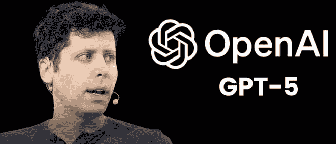
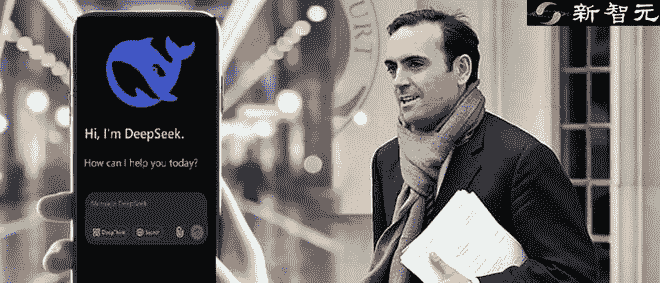

# 02.13-奥特曼自曝：GPT-5要来了，所有人免费！DeepSeek逼急OpenAI，最强路线图曝光

> 来源：[https://agijuejin.feishu.cn/docx/F8kEdcCHVoxZbVxfRh1cIgyqnWe](https://agijuejin.feishu.cn/docx/F8kEdcCHVoxZbVxfRh1cIgyqnWe)

# AGI 掘金日报 - AI 新闻推送 (2025 年 02 月 13 日)

> [欢迎加入 AGI 掘金社群](https://sourl.co/miZUyT)

## ⭐ 今日热点

### 💡 奥特曼自曝：GPT-5要来了，所有人免费！DeepSeek逼急OpenAI，最强路线图曝光

新智元 | [阅读原文](https://www.163.com/dy/article/JO918S670511ABV6.html?spss=dy_author)

奥特曼曝光 OpenAI 路线图，GPT-4.5 数周后发布，将成 GPT 系最后非「思维链」模型，GPT-5 几个月后面世且将打通 o 系和 GPT 系，所有人可免费使用。ChatGPT 多项功能将整合入模型，Deep Research 将对免费用户每月开放 2 次。同一天，OpenAI 发布诸多更新，还更新「模型规范」，并将其开源，鼓励各方参与改进 。

### 💡 百度：文心一言 4 月起全面免费，上线深度搜索功能

IT之家 | [阅读原文](https://www.ithome.com/0/830/536.htm)

2月13日百度官宣，因文心大模型迭代升级及成本下降，文心一言4月1日零时起全面免费，PC端和App端用户均可体验最新模型。即日起上线深度搜索功能，4月1日起免费开放。此功能思考规划和使用外部工具能力强，能提供专家级回复、处理多场景任务、实现多模态输入输出。目前官网可体验该功能，App端即将同步 。

## 🌟 技术突破

### 💡 OpenAI 最新论文：o3 在 IOI 2024 严格规则下拿到 395.64 分达成金牌成就

IT之家 | [阅读原文](https://www.ithome.com/0/830/428.htm)

2月12日，OpenAI发布论文《Competitive Programming with Large Reasoning Models》，展示o1、o1-ioi、o3三个推理模型在竞赛中的成绩，其中o3在IOI 2024严格规则下获395.64分达成金牌成就，在CodeForces上与人类精英选手表现相当。论文还提及中国DeepSeek-R1和Kimi k1.5用思维链学习方法提升综合表现。研究表明强化学习训练可提升模型性能，解锁新应用体验 。

### 💡 被AI追杀，还要解谜逃生！UCSD等发布LLM测试神器，边玩游戏边评估

新智元 | [阅读原文](https://www.163.com/dy/article/JO7AHN050511ABV6.html?spss=dy_author)

UCSD、UC伯克利等机构的GameArena团队开发了实时Roblox游戏「AI Space Escape」，可在娱乐中评估AI推理能力。游戏设计三个“迷你推理游戏”，生成的数据能评估LLM 。团队公开游戏数据等供研究，评估结果展示了不同模型表现。用户研究显示，超70%用户更喜欢此游戏，87%游戏会话完整有用，远胜Chatbot Arena。

### 💡 豆包提出全新稀疏模型架构 UltraMem，推理成本较 MoE 最高可降 83%

IT之家 | [阅读原文](https://www.ithome.com/0/830/311.htm)

2月12日，字节跳动豆包大模型团队提出全新稀疏模型架构UltraMem。它解决了MoE（专家混合架构）推理时高额访存问题，推理速度较MoE提升2 - 6倍，成本最高降83%。研究揭示其Scaling Law，性能超越MoE。训练规模达2000万value的UltraMem模型，在同等资源下兼顾推理速度与性能，为构建数十亿规模value或expert开辟新路径，在参数和激活条件相同下效果超越MoE，访存成本与Dense模型相当 。

### 💡 Meta视频AI王者登场，打爆Sora！体操运动终于不再鬼畜

新智元 | [阅读原文](https://www.163.com/dy/article/JO6S4IAS0511ABV6.html?spss=dy_author)

Meta和特拉维夫大学发布全新框架VideoJAM，攻克AI视频难以捕捉现实动作的传统难题。它通过修改目标函数引入运动先验，由两个模块组成，有新推理机制，无需额外改动即可应用于多种模型。实验显示，VideoJAM在运动连贯性等方面表现卓越，超越Sora等模型，但在远景场景和复杂物理交互上仍有局限，为视频模型发展开辟新方向。

### 💡 清华一作1B暴打405B巨无霸，7B逆袭DeepSeek R1！测试时Scaling封神

新智元 | [阅读原文](https://www.163.com/dy/article/JO6S4AGU0511ABV6.html?spss=dy_author)

清华、哈工大、北邮等多机构联合研究表明，计算最优的测试时Scaling（TTS）策略可增强LLM推理能力。小模型用此策略能超越大模型，如0.5B胜GPT-4o ，7B胜o1和DeepSeek-R1 。研究分析了如何最优扩展测试时计算，发现TTS性能与PRM过程监督能力正相关，且不同规模模型、问题难度、PRM对TTS方法有不同偏好。计算最优TTS较其他方法优势明显。

### 💡 AI太强，验证码全失效？新南威尔士全新设计：GPT傻傻认不出，人类一致好评

新智元 | [阅读原文](https://www.163.com/dy/article/JO6S3L1R0511ABV6.html?spss=dy_author)

随着多模态大模型发展，传统验证码面临「安全性不足」和「用户体验差」的双重困境。新南威尔士大学等机构研究人员提出全新验证码IllusionCAPTCHA，通过融合视觉错觉与诱导式提问，实现对AI攻击的精准防御。其制作分三步，经实验验证，它能有效抵抗大模型识别攻击，人类识别率高达83%（文本错觉）和88%，86.95%用户首次尝试就能通过，为验证码技术提供新思路。

### 💡 景嘉微国产 GPU 完成 DeepSeek R1 系列模型适配

IT之家 | [阅读原文](https://www.ithome.com/0/830/303.htm)

2月12日，景嘉微电子官宣，其JM系列、景宏系列与DeepSeek R1系列成功适配。JM系列完成特定模型适配，景宏系列全面兼容DeepSeek R1全系列模型，支持快速启动使用。此前，摩尔线程也已实现对DeepSeek适配。这推动了DeepSeek在云边端等场景的应用。

## 💫 企业动态

### 💡 长虹 AI TV 电视宣布接入 DeepSeek 满血 R1，支持语音对话

IT之家 | [阅读原文](https://www.ithome.com/0/830/545.htm)

2月13日长虹电视官宣AI TV接入DeepSeek，所有搭载沧海智能体的长虹AI TV已完成终端升级，用户操作简便。此前IT之家报道，海信自研星海大模型接入DeepSeek，海信电视正在进行终端升级发布，预计3 - 5天完成，2025年新品也将融合该模型能力 。

### 💡 OpenAI 奥尔特曼再谈 DeepSeek：表现不错、不惊讶有新对手，想见见团队

IT之家 | [阅读原文](https://www.ithome.com/0/830/490.htm)

当地时间2月13日，OpenAI首席执行官萨姆・奥尔特曼认可中国AI公司DeepSeek技术实力，称其打造聊天机器人时“表现不错”，还计划会面。DeepSeek上月崭露头角，震动行业、引发美科技股暴跌，且研发成本仅是OpenAI一小部分，这引发对美领先AI企业竞争优势的质疑。奥尔特曼称其出现时间意外，但不惊讶有新对手，还多次谈过对DeepSeek看法，如无起诉计划等 。

### 💡 无限延伸你的创意：Adobe Firefly 开放 AI 视频生成，一键搞定 5 秒 1080P 视频

IT之家 | [阅读原文](https://www.ithome.com/0/830/485.htm)

2月12日，Adobe公司宣布向公众免费开放Firefly AI视频生成器，用户输入文本描述或上传图像，就能生成5秒1080p高清视频。Firefly视频模型在多方面表现出色，用户还能控制更多细节。它是多模态创作平台，整合多种生成功能。此外，还推出付费计划，提供更高级的视频和音频功能 。

### 💡 OpenAI 承诺其 AI 模型不审查、不屏蔽观点，保障思想自由

IT之家 | [阅读原文](https://www.ithome.com/0/830/484.htm)

2 月 13 日消息，OpenAI 在更新的模型规范中承诺，其人工智能模型不会回避敏感话题，不做“排斥某些观点”的断言，强调模型不能引导用户追求自身议程，要保障思想自由。此次调整或因多位特朗普亲密盟友指责人工智能助手屏蔽保守派观点，如大卫・萨克斯称 ChatGPT“政治正确”，涉及政治敏感话题时不够真实 。

### 💡 号称“业界首个对知识产权友好、商用安全”的 LLM，Adobe Firefly 文生视频 AI 模型发布

IT之家 | [阅读原文](https://www.ithome.com/0/830/464.htm)

2月12日，Adobe推出号称“业界首个对知识产权友好、商业层面可安全使用”的Firefly文生视频AI模型，可在网页端和Premiere Pro的Generative Extend功能体验（Beta测试）。用户能通过文本或图像创建、优化视频，当前Beta版生成1080p视频，未来将支持4K。此外，Adobe新增订阅计划，Firefly Standard每月9.99美元（约73元），可生成最多20个5秒1080p视频；Firefly Pro每月29.99美元（约219元），可生成最多70个。

### 💡 巴黎峰会欧盟豪掷2000亿加码AI！万斯誓言AI美国优先，Anthropic CEO：AI崛起全新「国度」

新智元 | [阅读原文](https://www.163.com/dy/article/JO7MI4PU0511ABV6.html?spss=dy_author)

巴黎 AI 峰会，美国副总统万斯称美国主导 AI 发展，不接受强监管、拒签宣言，还提及美国投入计划；欧洲「InvestAI」计划获 2000 亿欧元投资。Anthropic CEO 预计 2030 年前 AI 形成新「社会」。图灵奖得主 LeCun 认为智能发展是渐进的，GenAI 将被取代，AI 好处大于风险，或带来新文艺复兴。欧美在 AI 治理上分歧加深 。

### 💡 DeepSeek V3 / R1 满血版上线华为云

IT之家 | [阅读原文](https://www.ithome.com/0/830/426.htm)

2月12日，华为技术有限公司宣布，DeepSeek V3 / R1 671B旗舰模型（满血版）基于华为云昇腾云服务全栈优化适配，能满足业务商用部署需求。昇腾云服务已适配DeepSeek系列模型，并给出使用步骤。此外，华为云还推出基于混合云的DeepSeek本地部署方案，支持相关版本，用户可向导式操作部署到混合云环境。

### 💡 AI 芯片厂商 Cerebras 部署 DeepSeek 服务爆单，降低成本反而扩大市场容量

IT之家 | [阅读原文](https://www.ithome.com/0/830/411.htm)

2月10日报道，AI芯片厂商Cerebras的CEO称，运行DeepSeek-R1大语言模型订单爆单。Cerebras的晶圆级芯片算力强，DeepSeek-R1预训练成本低效果好。Cerebras部署该服务性能比GPU快。用户使用“推理模型”有痛点，Cerebras用蒸馏技术改善体验。Feldman认为它是开源AI重大胜利，能吸引投资。Cerebras从去年8月提供推理服务，客户对不同规模模型各有偏好 。

### 💡 何小鹏回应接入 DeepSeek：不追求最新最热，把智驾做好，5 月推出 MONA M03 Max 车型

IT之家 | [阅读原文](https://www.ithome.com/0/830/396.htm)

2月12日，在周鸿祎直播活动现场，何小鹏连麦回应接入DeepSeek，称小鹏不追求最新最热，要做好智驾。今年5月将推出MONA M03 Max车型，搭载顶尖自动驾驶技术，目标打造2万美元“顶级智驾产品”。他还认为下一个10年，高阶智能驾驶渗透率将从2%提升至50%甚至80% - 90%。此前报道，MONA M03的580km超长续航Max版指导价15.58万元 。

### 💡 顺丰同城宣布已接入 DeepSeek 大模型

IT之家 | [阅读原文](https://www.ithome.com/0/830/357.htm)

2月12日，顺丰同城宣布接入DeepSeek大模型，成物流行业首批接入企业。它将借助其低成本、高性能、高开放度优势，在用户需求分析等全流程提升体验和效率，削减运营成本，构建协同高效生态系统，链接2200万活跃用户、55万活跃商家、100万活跃骑手。此外，顺丰同城还与火山豆包、腾讯混元、百度文心一言等多个大模型厂商合作。

### 💡 华为小艺助手网页端上线人人可用：适配手机 / PC，支持 R1 深度思考

IT之家 | [阅读原文](https://www.ithome.com/0/830/355.htm)

2月12日消息，华为小艺助手App接入DeepSeek，将鸿蒙原生版升级至11.2.10.340版本后可体验DeepSeek-R1智能体。同时，华为小艺智能助手网页端上线，支持所有设备通过浏览器搜索访问（需登录华为账号）。实测该网页版适配手机、PC布局，有AI问答等功能，支持R1深度思考，还能设为默认搜索引擎。

### 💡 海信电视接入 DeepSeek，支持 AI 语音对话

IT之家 | [阅读原文](https://www.ithome.com/0/830/315.htm)

2月12日海信集团官宣，2024年自研的星海大模型接入DeepSeek。接入后，海信电视用户操作更简便，通过语音就能对话体验，且电视能更懂用户需求。预计3 - 5天内，搭载智能体的海信电视完成升级支持DeepSeek，2025年新品也将融合其能力。此外，在智慧生活和智慧城市领域也有诸多应用成果，如智能家电节能等，还搭建了交管问答系统等。

### 💡 消息称百度今年下半年将发布新一代 AI 大模型文心 5.0，提升多模态能力

IT之家 | [阅读原文](https://www.ithome.com/0/830/310.htm)

据外媒消息，百度计划今年下半年发布“文心 5.0” 应对新兴企业挑战，将显著提升多模态能力（能处理多种形式数据）。百度首席执行官李彦宏称 12 个月内基础模型推理成本预计降 90%以上。文心大模型已应用于多个产品，百度文库平台付费用户比 2023 年底增长 60%。目前文心大模型为 4 代，尚未官宣下一代更新计划 。

### 💡 DeepSeek被曝估值1500亿达OpenAI一半？巴黎地铁70岁老人都在聊！

新智元 | [阅读原文](https://www.163.com/dy/article/JO6S78MO0511ABV6.html?spss=dy_author)

外媒Bloomberg曝出DeepSeek估值达1500亿美元，为OpenAI一半，引发热议。此前福布斯估值仅10亿美元。各方对其估值看法不一。DeepSeek在巴黎AI峰会受关注，全球都在讨论。各国因之加紧AI战略，硅谷巨头追加投资。它也让欧洲重燃希望，马克龙宣布巨额投入。此外，有人认为开源是未来，提议发起全球开源AI合作计划。

### 💡 腾讯云：支持开发者将 DeepSeek 接入微信小程序，可实现智能对话、文本生成等

IT之家 | [阅读原文](https://www.ithome.com/0/830/293.htm)

2月12日腾讯云开发官宣上新，开发者基于最新小程序基础库，最少3行代码就能将“满血版”DeepSeek大模型接入小程序，实现智能对话等功能。新用户首月套餐免费，有100万token。云开发AI能力不仅能接入小程序，还支持多种微信生态能力，近期将支持企业微信接入。腾讯云此前已上线相关模型API接口并接入大模型知识引擎，率先实现联网搜索能力。

## ✨ 行业观点

### 💡 “日本 AI 研究第一人”松尾丰评 DeepSeek：技术非常出色，出现这种企业并不惊讶

IT之家 | [阅读原文](https://www.ithome.com/0/830/540.htm)

2月13日日经中文网公布对“日本AI研究第一人”松尾丰的专访。松尾丰称DeepSeek技术出色，性能与OpenAI接近，其发布新模型会发论文且开源。最新模型“R1”强化学习提升推理能力，与OpenAI“o1”推理性能相当。松尾丰认为中国AI水平高可与美国比肩，从论文数量看已超美国，有众多实力企业和优秀工程师，出现DeepSeek这样的企业不意外。此外，DeepSeek让开源势力得到恢复 。

### 💡 雷军：钦佩 DeepSeek 所取得的成就，每个人可能都要学习 AI 知识、使用 AI 工具

IT之家 | [阅读原文](https://www.ithome.com/0/830/496.htm)

2月13日元宵节直播中，小米创办人雷军赞赏国产AI大模型DeepSeek所取得的成就。雷军称已进入AI时代，建议大家学习AI知识、使用AI工具以提高效率和便利生活。此前两会期间，雷军指出我国人工智能人才短缺，建议从义务教育普及素养教育、推进高校相关专业建设、支持企业和机构培育应用型人才；去年乌镇峰会他还表示人工智能要坚持智能向实、向善 。

### 💡 Gartner 预测 AI 重塑销售格局，以人为本方为成功关键

IT之家 | [阅读原文](https://www.ithome.com/0/830/492.htm)

市场调查机构Gartner称，AI普及将深刻影响销售格局。预计到2028年，10%销售人员将用AI节省的时间从事多份工作；到2029年，25%财富500强企业销售组织将有针对神经多样性客户的内容工具。此外，到2028年，约30%新入职销售人员或因依赖AI缺乏社交销售技能。Gartner强调未来销售成功关键是以人为本，首席销售官需应对相关复杂性。

### 💡 被造假视频坑惨，著名影星斯嘉丽・约翰逊呼吁立法限制 AI 使用

IT之家 | [阅读原文](https://www.ithome.com/0/830/489.htm)

因一段AI deepfake造假视频流传，美国著名影星斯嘉丽・约翰逊呼吁政府立法限制AI使用。她强调AI传播仇恨言论风险大，谴责其滥用。斯嘉丽一直对AI发展谨慎，曾起诉相关侵权行为。尽管有议员提法案打击色情deepfake视频，但美国在AI监管方面进展缓慢，如法案被否决、行政令被推翻，美英还拒签国际AI宣言 。

### 💡 如何应对 AI“一本正经的胡说八道”？研究人员希望它会承认“我不知道”

IT之家 | [阅读原文](https://www.ithome.com/0/830/486.htm)

《华尔街日报》探讨“AI 幻觉”现象，AI 虽在某些方面出色，但常犯基本事实错误。研究人员认为这是热门研究方向。AI 因工作原理易产生幻觉，为解决问题，正尝试“检索增强生成”技术。有研究提出让 AI 承认“我不知道”，但平衡策略是难题。此外，美国公众对 AI 信任感下降，2023 年 52% 的美国人对 AI 感到担忧，高于 2021 年的 37%。

### 💡 李飞飞：未来的历史学家会将当下视为“AI 真正的第一个时代”

IT之家 | [阅读原文](https://www.ithome.com/0/830/280.htm)

当地时间周一，斯坦福大学研究员李飞飞在巴黎大皇宫演讲拉开“AI行动峰会”序幕。她认为要建设健康AI生态，让各界参与，防止资源过度集中。还对AI监管方向担忧，呼吁以科学为基础、务实治理，不过多限制研究，推动应用并防范风险。李飞飞称未来历史学家会把当下视为AI“真正的第一个时代”，相信AI能增强赋能人类而非取代。