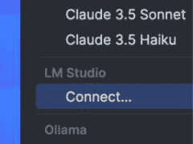

# 02.18-DeepSeek 团队新作：把代码变成思维链，大模型推理各种能力全面提升

> 来源：[https://agijuejin.feishu.cn/docx/CyU0dM0scoMXbOxyfntcylwvnLh](https://agijuejin.feishu.cn/docx/CyU0dM0scoMXbOxyfntcylwvnLh)

# AGI 掘金日报 - AI 新闻推送 (2025 年 02 月 18 日)

> [欢迎加入 AGI 掘金社群](https://sourl.co/miZUyT)

## ⭐ 今日热点

### 💡 DeepSeek 团队新作：把代码变成思维链，大模型推理各种能力全面提升

IT之家 | [阅读原文](https://www.ithome.com/0/831/481.htm)

DeepSeek团队有新研究，用代码训练大模型思考以提升推理能力。团队从多个数据集中收集代码文件，经预处理、收集输入-输出对、合成自然语言思维链等步骤构建数据集CODEI/O，并在此基础上生成质量更高的CODEI/O++。采用两阶段训练策略对多个模型训练测试，结果显示各模型在多领域推理性能提升，如Llama在特定任务上性能提升近150%。该研究展现出新技术在提升大模型推理能力方面的潜力。

## 🌟 技术突破

### 💡 树莓派 Zero“硬核改造”：8 年老设备实现本地运行大语言模型

IT之家 | [阅读原文](https://www.ithome.com/0/831/621.htm)

近年来本地运行大语言模型趋势明显。越南开发者Binh Pham将树莓派Zero改造成能本地运行LLM的小型USB驱动器，得益于llama.cpp和llamafile。但因树莓派Zero硬件性能有限，尤其是内存和CPU架构问题，编译困难，Pham对指令集转换、移除优化才成功。他还优化运行和用户体验，进行基准测试，不过处理速度显示在实际应用中较慢，老旧轻量级硬件运行本地LLM实用价值低 。

### 💡 老友记搬沙发难题终结，60年数学谜题破解！119页论文惊人证明：有最优解

新智元 | [阅读原文](https://www.163.com/dy/article/JOK24C0M0511ABV6.html?spss=dy_author)

困扰数学家60年的「移动沙发难题」被攻克。1966年该难题被提出，多年来数学家不断探索更大面积的沙发形状。如今，首尔延世大学博士后Jineon Baek用119页论文证明，Gerver设计的面积约2.2195的沙发是能通过拐角的最大形状。他开发新方法、定义新函数Q，未借助计算机完成证明，研究仍在同行评审中，此成果获专家高度评价 。

### 💡 OpenAI ChatGPT 在心理治疗领域通过图灵测试，AI 比人类更具同理心

IT之家 | [阅读原文](https://www.ithome.com/0/831/480.htm)

2月16日科技媒体The Decoder报道，最新研究显示OpenAI ChatGPT通过治疗师领域图灵测试。830名参与者区分ChatGPT和人类治疗师回复，识别正确率略高于随机猜测。ChatGPT在治疗联盟等方面得分高于人类专家，回复更详细、有同理心。研究还揭示偏见，被认为是人工智能回复时评分低，反之则高。此前墨尔本大学等研究也发现ChatGPT建议有优势，但多数人仍偏好人类顾问 。

### 💡 LLM推理暴涨，数学逻辑开挂！ DeepSeek等华人团队新大招，Ai2大牛狂点赞

新智元 | [阅读原文](https://www.163.com/dy/article/JOJNC65T0511ABV6.html?spss=dy_author)

DeepSeek等华人团队提出CodeI/O方法，利用代码输入/输出提炼LLM推理模式。该方法转换原始代码文件、收集输入输出对构建训练样本。实验显示，CODEI/O在多推理任务上提升性能，其及CODEI/O++跨模型有效。研究还进行多组实验，明确数据构建、模型、数据量等方面影响，强调两阶段训练必要，展现提升LLM推理能力新进展 。

### 💡 DeepSeek掀低成本革命，中科院系黑马闯入全球TOP 10！破解高精度-低能耗困局

新智元 | [阅读原文](https://www.163.com/dy/article/JOJNC5O90511ABV6.html?spss=dy_author)

2025 年，DeepSeek 凭借深度推理、低成本崛起，进入国际大模型头部梯队。中科闻歌发布的 YAYI-Ultra 大模型在 OpenCompass 榜单中首次闯入全球前十，在多项评测中表现出色，尤其在中文场景优势明显。实测显示它在多方面能力突出，还支持长文本创作。YAYI-Ultra 采用灵活专家配置，已在多领域应用，提升效率、准确率等，部分功能已在官网开放体验 。

### 💡 攻破AI最强守卫，赏金2万刀！Anthropic新方法可阻止95% Claude「越狱」行为

新智元 | [阅读原文](https://www.163.com/dy/article/JOJNBHU40511ABV6.html?spss=dy_author)

Anthropic公布新AI模型防护方法「宪法分类器」，邀网友挑战。实验显示可阻止95%+越狱，代价有限。其通过自然语言规则训练，支持流式预测。团队经一年构建该系统，因担心模型被滥用。红队测试中无人找到通用越狱方法，系统抗攻击能力强。相关推文浏览超100万，网友对方法和赏金有不同看法 。

## 💫 企业动态

### 💡 荣耀全新阿尔法战略定档 3 月 2 日 MWC 2025 全球发布

IT之家 | [阅读原文](https://www.ithome.com/0/831/578.htm)

2月17日荣耀手机官方宣布，全新阿尔法战略3月2日23:30在MWC 2025全球发布，届时还将举行AI技术发布会，荣耀CEO李健或出席。荣耀近年持续布局AI领域，如去年发布MagicOS 9.0系统主打AI功能。赵明曾提到荣耀用AI推动发展，海外销量在24年12月占比突破50%。

### 💡 短短10天，Ilya神秘初创SSI再融10亿美元！仅凭一个主页估值300亿

新智元 | [阅读原文](https://www.163.com/dy/article/JOLRT6VI0511ABV6.html?spss=dy_author)

Ilya离开OpenAI后创立的SSI，成立8个月官网仅一页文字且未产生营收、未推产品。但短短10天又将完成超10亿美元新一轮融资，估值超300亿美元，由Greenoaks Capital Partners领投5亿美元。此前已从五家风投筹10亿美金，较去年9月估值翻6倍。Ilya称公司专注开发安全超级人工智能，投资者因信任他而投资。此外，Ilya还预测了AI未来突破点及超级智能特性 。

### 💡 DeepSeek 冲击之下，大模型六小强如何「回应」？

IT之家 | [阅读原文](https://www.ithome.com/0/831/593.htm)

DeepSeek搅动全球大模型市场，大厂纷纷回应，如腾讯接入其模型、百度免费用文心一言且将开源下一代模型。国内“大模型六小强”虽未正面表态，但有实际行动：零一万物与苏州合作；百川智能发布新模型并应用于医疗；阶跃星辰密集更新模型；智谱华章拓展合作；月之暗面推出新模型；MiniMax升级语音模型。此外，DeepSeek还引发用人思考，众多第三方接入，生态繁荣 。

### 💡 百度搜索灰度测试接入 DeepSeek，将在 2 月 18 日 0 时上线

IT之家 | [阅读原文](https://www.ithome.com/0/831/586.htm)

2月17日消息，百度搜索正灰度测试接入DeepSeek和文心一言深度搜索功能，部分用户已可体验。百度方面预计18日0时上线，用户在百度PC端首页或App端按特定操作，就能切换至DeepSeek R1模型进行对话。此前百度宣布为丰富搜索体验，将全面接入DeepSeek和文心大模型深度搜索功能。

### 💡 一汽丰田借助腾讯云接入 DeepSeek，在智能客服等业务场景应用

IT之家 | [阅读原文](https://www.ithome.com/0/831/567.htm)

2月17日消息，一汽丰田借助腾讯云大模型知识引擎接入DeepSeek，用于智能客服等业务场景。腾讯云大模型知识引擎具RAG能力，基于LLM+RAG框架可解决知识处理等难点。腾讯云是首家支持DeepSeek满血版+联网搜索的云厂商。自今年1月接入腾讯云相关引擎后，一汽丰田智能在线客服机器人独立解决率从37%提升到84%，月均自动解决问题1.7万次，接入DeepSeek后将进一步优化服务 。

### 💡 迅雷宣布为 AI 开发者提供大模型批量下载加速服务，当前可免费使用

IT之家 | [阅读原文](https://www.ithome.com/0/831/557.htm)

2月17日，迅雷宣布为下载AI大模型及数据集文件的用户提供批量下载和下载加速服务，目前免费。若加速效果不明显可向客服反馈。IT之家还附上使用步骤，不过目前仅支持Windows系统，需事先安装迅雷客户端及“迅雷下载支持”扩展，按特定操作即可免费加速下载。该服务旨在解决AI开发者“下载慢、耗时长”的问题。

### 💡 百度文心一言“免费权益卡”上线，支持深度搜索、4.0 Turbo 模型

IT之家 | [阅读原文](https://www.ithome.com/0/831/547.htm)

IT之家2月17日消息，百度2月13日官宣，4月1日零时起文心一言全面免费，PC端和App端用户均可体验最新模型。当日百度还宣布上线文心一言“免费体验卡”，可在官网领取，支持文心大模型4.0 Turbo、深度搜索功能。此外，iOS版百度文小言App升级到4.9.0版本，接入DeepSeek-R1模型，优化拍照解题功能 。

### 💡 培养记者编辑“AI 素养”，消息称《纽约时报》批准编辑室引入多种 AI 工具

IT之家 | [阅读原文](https://www.ithome.com/0/831/544.htm)

2月17日消息，《纽约时报》决定将AI应用于产品和编辑团队，为员工提供AI培训，推出新工具“Echo”。批准一系列AI工具供编辑和产品团队使用，鼓励员工用其生成内容等。编辑指南列出使用场景，同时设置使用限制，强调版权等风险。此外，该公司与OpenAI存在法律斗争 ，指控其版权侵权，微软称其在打压技术创新。

### 💡 韩国加码 AI 竞争，拟为国家计算中心采购 10000 个高性能 GPU

IT之家 | [阅读原文](https://www.ithome.com/0/831/510.htm)

2月17日路透社报道，韩国政府计划今年内采购10000个高性能GPU，通过公私合作在国家AI计算中心启动相关服务，具体细节9月前敲定。行业方面，英伟达占据全球GPU市场约80%份额。同时，OpenAI推进减少对英伟达芯片依赖计划，开发自家芯片。中国初创公司DeepSeek崛起，其AI模型注重优化计算效率，或缩小中美AI处理器差距 。

### 💡 腾讯元宝、🛰️、ima、🐧 浏览器等产品接入 DeepSeek-R1 模型

IT之家 | [阅读原文](https://www.ithome.com/0/831/500.htm)

2月17日，腾讯宣布旗下腾讯元宝、🛰️、ima等多款产品接入混元大模型的同时，还接入DeepSeek - R1模型。腾讯元宝支持免费使用DeepSeek - R1满血版，🛰️灰度测试“AI搜索”接入该模型，ima等多款产品更新后可选用此模型。此外，🐧音乐集成该模型且自研歌曲创作大模型正测试部署Deepseek，还有腾讯AI代码助手等众多产品也已接入。

### 💡 突发！台积电博通欲「瓜分」英特尔，昔日芯片霸主或将陨落？

新智元 | [阅读原文](https://www.163.com/dy/article/JOK259B80511ABV6.html?spss=dy_author)

据 WSJ 报道，博通有意英特尔芯片设计业务，台积电对其工厂感兴趣，目前谈判处于初步非正式阶段。英特尔临时执行董事长为股东创造价值，推进多项业务剥离。交易面临运营难题，特朗普政府或不批准外资运营英特尔美国晶圆厂。英特尔因制造工艺失误、错过 AI 浪潮等陷入困境，甚至面临消失风险 。

### 💡 腾讯文档接入 DeepSeek-R1 满血版，支持实时联网搜索

IT之家 | [阅读原文](https://www.ithome.com/0/831/483.htm)

2月17日，腾讯文档宣布AI文档助手接入DeepSeek-R1模型满血版。用户在AI文档助手中选该模型即可使用，腾讯文档小程序、网页版、移动端（3.9.5及以上版本 ）、桌面端（3.9.5及以上版本）均可体验。选DeepSeek-R1能获更全面答案，混元大模型则回答快速高效。二者结合提供实用创作能力，结果可生成多种文档形式，且接入后支持实时联网搜索全网信息源。

### 💡 腾讯元宝上线混元「深度思考模型」Thinker（T1），支持联网搜索

IT之家 | [阅读原文](https://www.ithome.com/0/831/482.htm)

2月17日，腾讯计算机系统有限公司宣布，旗下腾讯元宝继接入「满血版」DeepSeek-R1 模型后，又上线混元最新「深度思考模型」Thinker(T1)。腾讯元宝成为「AI 聚合体」，用户可自由切换模型免费使用。其还具备全面支持联网搜索、支持🛰️上传文件解析等特性。此外，腾讯旗下部分产品已官宣接入 DeepSeek 。

### 💡 JetBrains 旗下 AI Assistant 应用获更新，支持开发者接入本地 DeepSeek 等大语言模型

IT之家 | [阅读原文](https://www.ithome.com/0/831/476.htm)

2月17日消息，JetBrains更新旗下“AI Assistant”应用，改进LM Studio功能。LM Studio允许开发者下载部署管理开源模型并对接开发工具，此次更新后可直接运行本地离线模型如DeepSeek 。此外，还新增了最新云端模型，包括Anthropic的Claude 3.5 Sonnet等及OpenAI的o1等模型，降低开发者对部分云服务的依赖 。

### 💡 AI 机器人亮相 NBA 赛场，成库里投篮搭档

IT之家 | [阅读原文](https://www.ithome.com/0/831/430.htm)

2月17日消息，NBA在全明星活动展示一系列AI机器人，由亚当・西尔弗首次介绍，勇士队已在训练中使用。“自动化篮球引擎”（A.B.E.）能当投篮搭档；“运动与拦截模块化接口协调”（M.I.M.I.C.）可模拟攻防并提供反馈；“运动学接口工具”（K.I.T.）在场外帮助球员。库里、史蒂夫・科尔体验过。不过机器人能否提升球员表现和幸福感有待检验。

### 💡 字节跳动 AI 中文 IDE“Trae”已支持 Windows 系统，内置 GPT-4o 免费使用

IT之家 | [阅读原文](https://www.ithome.com/0/831/410.htm)

字节跳动于今年 1 月发布面向开发者的 AI 中文 IDE 工具 Trae，最初只有 Mac 版。现该工具已上线 Windows 版，支持 Windows 10 和 11 系统，由旗下新加坡公司 SPRING PTE 提供服务，具备 AI 问答等功能，可助程序员完成开发任务。工具支持简中或英文，还内置 GPT - 4o、Claude - 3.5 - Sonnet 模型供免费使用 。

## ✨ 行业观点

### 💡 AI教父Hinton怒批万斯，对AI无知恐葬送全人类！

新智元 | [阅读原文](https://www.163.com/dy/article/JOKBM4UH0511ABV6.html?spss=dy_author)

在巴黎 AI 行动峰会上，美国副总统万斯称美国要维持 AI 领域主导地位，还说欧洲监管扼杀创新。AI「教父」Hinton 猛烈抨击，认为万斯对 AI 危险性一无所知，监管不会扼杀 AI，而美政府与科技巨头联盟忽视安全。Hinton 多年警告 AI 缺乏监管的危险，指出其短期会引发网络攻击、操控新闻等，长期或控制一切。此外，Hinton 同意马斯克观点，认为 OpenAI 应保持非营利性质。

### 💡 美国银行证券分析师：DeepSeek 或将加速中国车企开发自动驾驶技术

IT之家 | [阅读原文](https://www.ithome.com/0/831/497.htm)

美国银行证券分析师称，DeepSeek开发逻辑与自动驾驶相似，能提升自动驾驶解决方案公司多模态能力，减少复杂场景计算能力投入。一些大规模车企已将其纳入自动驾驶模型，小企业可能跟进，以低成本快速训练模型。此外，阿里巴巴或加大云服务中AI技术投资。蔡崇信曾表示，DeepSeek降低了大语言模型训练和推理成本。

### 💡 AI时代如何避免被淘汰？吴恩达：成为职场「10倍专业人士」

新智元 | [阅读原文](https://www.163.com/dy/article/JOJNAM7Q0511ABV6.html?spss=dy_author)

人工智能科学家吴恩达指出，AI浪潮将催生「10倍专业人士」。昔日职场法则被打乱，在信息处理和知识运用领域，AI突破了工作价值创造的天花板。「10倍专业人士」以不同方式做事，如结合人类洞察力与AI高效性优化营销等。2023年研究显示AI辅助销售有提升。养成「10倍专业人士」需重构流程、熟悉AI原理等，吴恩达鼓励大家保持学习，利用工具把握主动权 。