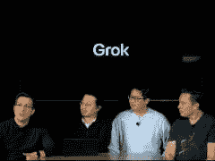
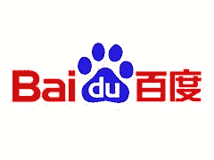
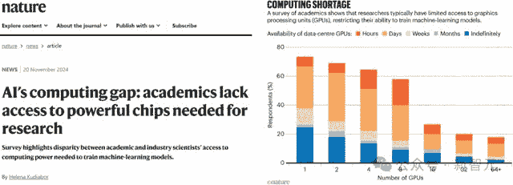
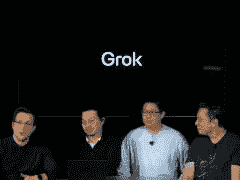

# 02.19-xAI 发布 Grok 3 聊天机器人，马斯克称其为“地球上最聪明的人工智能”

> 来源：[https://agijuejin.feishu.cn/docx/Uk1Xd1k10oKnEFxCRtKcPu0gnXg](https://agijuejin.feishu.cn/docx/Uk1Xd1k10oKnEFxCRtKcPu0gnXg)

# AGI 掘金日报 - AI 新闻推送 (2025 年 02 月 19 日)

> [欢迎加入 AGI 掘金社群](https://sourl.co/miZUyT)

## ⭐ 今日热点

### 💡 xAI 发布 Grok 3 聊天机器人，马斯克称其为“地球上最聪明的人工智能”

IT之家 | [阅读原文](https://www.ithome.com/0/831/717.htm)

2 月 18 日，马斯克旗下 xAI 发布 Grok 3 聊天机器人。马斯克称其能力较 Grok 2 提升“一个数量级”，在多项测试中成绩优于竞品，是“地球上最聪明的人工智能”。Grok 3 开发周期缩短，得益于 Colossus 超级计算机，使用 10 万个英伟达 H100 GPU 等。软件层面也有优化。目前推理模型处于测试阶段，推出迷你版，还有新功能“DeepSearch”。原计划的语音模式未上线，预计一周后推出。此次发布正值马斯克与 OpenAI 竞争升级 。

## 🌟 技术突破

### 💡 上海瑞金医院与华为共同发布“瑞智病理大模型 RuiPath”，常用问题准确率达 90% 以上

IT之家 | [阅读原文](https://www.ithome.com/0/831/876.htm)

2月18日，瑞金医院与华为在医疗人工智能与精准诊疗发展论坛上，共同发布瑞智病理大模型RuiPath。该模型癌种覆盖广，达中国每年全癌种发病人数90%的常见癌种及罕见病，数据模态丰富、维度广泛、标签完备。它能提前精准识别病灶，将医生诊断模式升级，大幅提升效率与质量。知识深度上，“研读”大量书籍和切片，回答准确率超90%，单切片AI计算时间为秒级。

### 💡 DeepSeek 再放降本大招：NSA 官宣发布，加速推理降低成本，并且不牺牲性能

IT之家 | [阅读原文](https://www.ithome.com/0/831/795.htm)

2月18日，DeepSeek官宣推出NSA（Native Sparse Attention），这是用于超快速长上下文训练与推理的稀疏注意力机制。其核心组件有动态分层稀疏策略、粗粒度token压缩、细粒度token选择。官方称该机制可优化硬件设计，加速推理并降低预训练成本，且不牺牲性能，在一些任务上表现与全注意力模型相当或更优。还附上了论文链接：https://arxiv.org/abs/2502.11089 。

### 💡 AI看照片，几秒就能地理定位！因太危险被公司主动关闭，正向警方推销

新智元 | [阅读原文](https://www.163.com/dy/article/JOMHHVTG0511ABV6.html?spss=dy_author)

初创AI公司graylark发布「GeoSpy」系列产品，这是革命性照片地理定位系统。照片地理定位通过分析图像视觉内容确定拍摄地点，技术不断进步。GeoSpy支持近似定位，GeoSpy Pro借助Superbolt可精准定位并呈现3D实景。Superbolt用大规模数据集训练模型，具有稳健性等优势。该产品曾面向公众开放，因隐私问题现只对政府等专业平台服务，强调技术需负责任发展。

### 💡 微软开放3.1T token高质量数据！通用/代码/数学/问答，全领域超越开源

新智元 | [阅读原文](https://www.163.com/dy/article/JOMHF1V10511ABV6.html?spss=dy_author)

大型语言模型发展需海量优质数据。微软的RedStone是构建指定领域数据的处理管道，构建了RedStone-Web等多个数据集。其中RedStone-Web获3.1T token高质量通用预训练数据。通过多层过滤系统构建专有数据，代码开源。实验表明，这些数据集在LLM预训练及后训练中性能优越，能显著提升模型能力，是实用的数据处理管道 。

### 💡 中国首个AI短剧模型开源，4090秒生好莱坞级大片！人人拍短剧时代来临

新智元 | [阅读原文](https://www.163.com/dy/article/JOM6E5UH0511ABV6.html?spss=dy_author)

2月18日，昆仑万维开源中国首个面向AI短剧创作的视频生成模型SkyReels-V1及表情动作可控算法SkyReels-A1。SkyReels-V1能实现影视级人物微表情表演生成等，推理效率高；SkyReels-A1能精准可控生成人物视频。昆仑万维一直坚持开源，其董事长认为AIGC可降电影制作成本。此次开源或推动AI短剧发展，未来还将开源更多成果。

## 💫 企业动态

### 💡 前OpenAI CTO另立门户，2/3 ChatGPT骨干被挖！北大校友Lilian Weng加盟

新智元 | [阅读原文](https://www.163.com/dy/article/JOODKRE70511ABV6.html?spss=dy_author)

OpenAI前CTO Mira Murati离职近5个月后，创立「思考机器实验室」，任CEO。该实验室约2/3员工来自OpenAI，包括多名骨干，目标是将人类价值观编码到AI模型中，让其更安全可靠。其研究由研究与产品团队共同设计，会共享代码等。此前已有不少前OpenAI员工创立新公司，且都吸引人才并筹集资金 。

### 💡 网易云音乐接入 DeepSeek-R1 大模型，用于歌曲智能推荐等领域

IT之家 | [阅读原文](https://www.ithome.com/0/831/903.htm)

2月18日，网易云音乐宣布“音乐播客生成工具”与“对谈播客生成工具”完成国产开源大模型DeepSeek-R1全能力接入。网易云音乐将基于该模型，结合自有AI技术，在多领域探索，为创作者和用户提供更优质服务。此前，QQ音乐本月早些时候已集成满血版DeepSeek-R1 ，集成后AI助手音乐问答更精准，用户能获更好交互体验。

### 💡 被质疑 AI 合成画面，宇树科技官方发布人形机器人干扰环境跳舞实拍视频

IT之家 | [阅读原文](https://www.ithome.com/0/831/874.htm)

2月18日，宇树科技创始人王兴兴社媒账号发布的宇树机器人G1跳舞视频曾被标记“疑似使用AI生成技术”，后官方多平台发布干扰环境下机器人跳舞实拍视频，目前已去除AI提醒字样。此外，宇树科技CEO王兴兴称，今年年底前AI人形机器人将达新量级，明年或后年服务业、工业领域可推行，家用因安全性要求高，普及稍慢。

### 💡 荣耀手机 YOYO 助理灰度更新“深度思考”功能

IT之家 | [阅读原文](https://www.ithome.com/0/831/869.htm)

2月18日消息，荣耀手机本月先后安卓首发上线DeepSeek-R1模型、DeepSeek-R1联网版，适配部分机型。同时，YOYO助理正灰度更新“深度思考”功能（需特定版本），用户可在对话框处点击YOYO头像启用或关闭。IT之家实测，开启该功能后展示思考过程，答案更精准及时，但获取速度变慢；关闭后答案不完善且信息滞后。

### 💡 一加手机陆续安排接入 DeepSeek 满血版

IT之家 | [阅读原文](https://www.ithome.com/0/831/865.htm)

2月8日，OPPO ColorOS设计总监陈希宣布月底将全面接入DeepSeek模型。2月18日，一加中国区总裁李杰确认一加品牌机型正陆续接入“满血版”DeepSeek，未公布具体机型，预计搭载ColorOS 15的机型支持。截至发文，华为、荣耀等众多手机厂商已宣布接入或即将接入，小米曾测试DeepSeek - R1模型（已下线）。

### 💡 李彦宏：文心大模型 4.5 将开源，是百度有史以来最强大的大模型

IT之家 | [阅读原文](https://www.ithome.com/0/831/863.htm)

在百度 2024 年 Q4 及全年财报电话会上，李彦宏透露文心大模型 4.5 将开源，这是百度最强的大模型。开源源于对技术的信心，能扩大其影响力。百度 2 月 14 日已官宣未来几个月推 4.5 系列，6 月 30 日起开源。此外，4 月 1 日零时起文心一言全面免费；即日起上线深度搜索功能，4 月 1 日起也免费开放 。

### 💡 深圳回应 AI 公务员上岗 ：仅辅助政务，不能单独决策

IT之家 | [阅读原文](https://www.ithome.com/0/831/843.htm)

近日，深圳福田区推出基于DeepSeek开发的“AI数智员工”，上线政务大模型2.0版。区政务服务和数据管理局副局长高增称其是辅助政务的工具，非“AI公务员”。去年起福田区梳理应用场景，生成70个数智智能体AI账号。今年切换到DeepSeek，定制个性化智能体满足240个业务场景。已上线70名“数智员工”，覆盖多场景。个性化定制时间大幅缩短，公文处理方面，格式修正准确率超95%，审核时间缩短90%，错误率控制在5%以内。

### 💡 理想同学 App 接入 DeepSeek R1 & V3 模型，支持深度思考、联网搜索功能

IT之家 | [阅读原文](https://www.ithome.com/0/831/830.htm)

2 月 18 日，多位微博用户分享及理想汽车第一产品线总裁汤靖确认，理想同学 App 接入 DeepSeek R1 & V3 模型（内测版 V1.2.0）。该版本可在首页右下方切换模型，支持用户体验深度思考、联网搜索等能力。理想同学 App 去年 12 月上架苹果 App Store，有知识问答、看世界等多种功能。

### 💡 消息称 Kimi 大砍投放预算，DeepSeek 冲击之下月之暗面暂缓“烧钱”投广告

IT之家 | [阅读原文](https://www.ithome.com/0/831/792.htm)

月之暗面旗下的AI产品Kimi，在DeepSeek崛起前话题度高。但DeepSeek开源低成本高性能爆火后，月之暗面大幅收缩Kimi投放预算，暂停安卓渠道投放及第三方广告合作。DeepSeek几十天自然流量达3500万DAU，Kimi“烧钱”一年多日活不足千万。月之暗面内部受刺激，复盘后可能重训基础模型，抓住应用层机会，选定DeepResearch方向。截至发文，月之暗面未置评。

### 💡 DeepSeek算力卡脖子高校AI研究遇瓶颈？华为联合15校给出最强解法

新智元 | [阅读原文](https://www.163.com/dy/article/JOMMAMSC0511ABV6.html?spss=dy_author)

高校AI研究面临算力瓶颈，华为携手15所头部高校打造科教创新中心。华为昇腾系列处理器及配套技术CANN、MindSpore、MindIE等填补国产算力短板。同时，华为通过举办特训营、算子挑战赛、优才计划等提升学生参与热情。北大、东南大学基于昇腾算力取得成果，华为每年投入10亿发展原生生态与人才，推动产学研发展。

### 💡 马斯克首次披露 Grok 3 训练成本：20 万块英伟达 GPU

IT之家 | [阅读原文](https://www.ithome.com/0/831/781.htm)

2月18日，马斯克宣布推出Grok 3，在多领域测试得分超或媲美对手。即日起面向Premium+订阅者推出，有专属网页Grok.com 。马斯克披露其训练成本，累计消耗20万块英伟达GPU，在新建超级计算数据中心“Colossus”完成训练。相比Grok 2只用约2万块GPU，Grok 3训练量是其10倍，计算能力提升使其在推理等方面有质的飞跃。马斯克还有诸多相关计划。

### 💡 腾讯公关总监张军回应“DeepSeek 元宝回答植入广告”：理论上不应该，估计开了联网搜索

IT之家 | [阅读原文](https://www.ithome.com/0/831/779.htm)

2月18日，博主称腾讯元宝接入Deepseek后回答里植入广告。腾讯公关总监张军回应，理论上不应出现，已让技术排查，猜测是开了联网搜索，回答参考了相关公众号避坑内容。此前腾讯宣布旗下多款产品接入混元大模型和DeepSeek-R1模型，腾讯元宝可免费使用DeepSeek-R1满血版模型，混元深度思考模型T1 也上线供测试体验。

### 💡 月之暗面宣布推出新模型 Kimi Latest：始终使用最新模型，名称保持不变

IT之家 | [阅读原文](https://www.ithome.com/0/831/773.htm)

2月18日，月之暗面官宣推出新模型kimi-latest，对标Kimi智能助手当前模型，随产品更新同步升级。其特点包括使用最新Kimi大模型、上下文长度128k、视觉模型支持图片理解等。目前仅支持调用kimi普通版模型，Kimi k1.5长思考模型暂不支持API调用。还给出适用场景建议，如使用大模型聊天应用等可选kimi-latest，意图识别等可选moonshot-v1系列。

### 💡 “每 20 个 80 后就有 1 人去世”系谣言，罪魁祸首可能是 AI

IT之家 | [阅读原文](https://www.ithome.com/0/831/751.htm)

2月18日，“上海网络辟谣”称“每20个80后就有1人去世”为谣言，可能源自AI。多数相关文章伪称数据来自七普。人大教授李婷反驳，介绍两种用普查计算死亡状况的方案，计算表明80后存活状况好于70后，死亡率远低于5.2%。李婷教授溯源发现，假数据最初可能来自与AI的对话，虽标注数据有局限，仍被加夸张标题传播 。

### 💡 用户对 DeepSeek 的热情远超预期，腾讯紧急调用元宝支持微信搜索

IT之家 | [阅读原文](https://www.ithome.com/0/831/750.htm)

2月18日消息，微信搜索开启AI搜索灰度测试并引入DeepSeek模型，用户使用热情超预期。腾讯紧急协调部署，调用元宝支持微信搜索，未参与灰度测试的用户搜索时或见“下载元宝(体验DeepSeek - R1)”提示。元宝可免费使用多种模型，腾讯称未来将优化产品和模型性能，提升AI使用体验。

### 💡 DeepSeek-R1 深度推理、1699 元，有道 SpaceOne 全面屏答疑词典笔发布

IT之家 | [阅读原文](https://www.ithome.com/0/831/744.htm)

2月18日，有道发布SpaceOne全面屏答疑词典笔，号称国内首款AI原生学习硬件，内置AI家教“小P老师”，接入DeepSeek-R1深度推理，讲题更细致。该笔有隐藏式滑动笔头、800万像素摄像头、eSIM卡支持4G流量等，还搭载护眼屏，内置电池和64GB存储。现已在京东开售，首发价1699元。

### 💡 xAI Grok 2 将在 Grok 3 正式可用后开源，Grok 3 后续也将开源

IT之家 | [阅读原文](https://www.ithome.com/0/831/725.htm)

2月18日，马斯克的xAI正式发布Grok 3，在多方面测试得分超或媲美Gemini等对手。Grok 3当天向Premium + 订阅者推出，已有专属网页Grok.com供用户体验。马斯克称，Grok 2将在Grok 3正式可用后开源，Grok 3几个月后也会开源。关键词为xAI和Grok模型。

### 💡 xAI 推出名为 Deepsearch 的 Grok 3 智能搜索引擎

IT之家 | [阅读原文](https://www.ithome.com/0/831/722.htm)

2月18日消息，xAI推出名为Deepsearch的Grok 3智能搜索引擎。目前深度求索DeepSeek、OpenAI ChatGPT等均布局AI搜索引擎，AI联网搜索成热门业务领域。OpenAI去年10月向付费用户提供搜索引擎功能，12月向所有用户开放，如今用户无需账户即可使用该功能。

### 💡 OpenAI 要开源新模型？CEO 奥尔特曼公开征求意见

IT之家 | [阅读原文](https://www.ithome.com/0/831/712.htm)

当地时间2月17日，OpenAI首席执行官萨姆・奥尔特曼在X平台就下一个开源项目方向征询意见，提出“o3 - mini级模型”和“手机大小模型”两种可能。此前他曾反思开源立场，称公司内部在讨论公开部分AI模型技术的可能性，还承认此前开源策略或有误。OpenAI曾因竞争和安全担忧转向专有模型开发，如今受DeepSeek等开源技术冲击，或重新审视开源策略，可能即将开源新大模型。

### 💡 OpenAI 联合创始人 Sutskever 的 AI 初创公司估值飙升至 300 亿美元，目标打造安全超级智能

IT之家 | [阅读原文](https://www.ithome.com/0/831/701.htm)

2月18日彭博社消息，OpenAI联合创始人伊利亚・苏斯科弗为其初创公司Safe Superintelligence（SSI）筹集超10亿美元，估值超300亿美元 ，将跻身全球最有价值私人科技公司。Greenoaks Capital Partners领投5亿美元。SSI此前估值50亿美元，曾获知名投资机构支持。苏斯科弗2024年离开OpenAI后创立SSI，专注开发安全人工智能系统，尚无收入和售产品计划。苏斯科弗曾在OpenAI相关事件中扮演关键角色 。

### 💡 深圳大学与腾讯云达成合作，推出 DeepSeek 人工智能通识课

IT之家 | [阅读原文](https://www.ithome.com/0/831/697.htm)

2月18日消息，深圳大学大数据系统计算技术国家工程实验室与腾讯云合作，推出基于DeepSeek的人工智能通识课，深大学生本学期可选课。课程涵盖AI基础知识等，有实际应用案例与实验，还探讨技术伦理。腾讯云多款产品接入DeepSeek助力教学。此外，深大智算中心推进DeepSeek本地化部署，提供计算资源与稳定实验环境 。