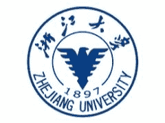
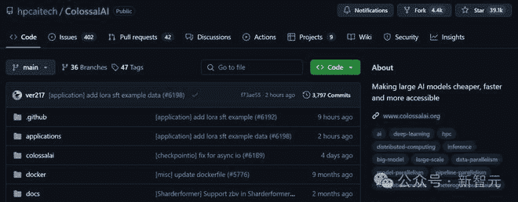
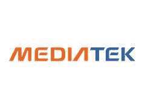
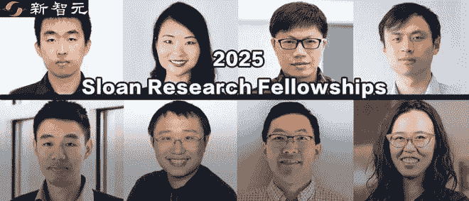
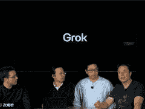

# 02.20-DeepSeek 清华原版宝典：工作、学习、生活、科研中的难题，轻松搞定

> 来源：[https://agijuejin.feishu.cn/docx/CjcxdKNEwo8k9jxtGmuc3FoEni9](https://agijuejin.feishu.cn/docx/CjcxdKNEwo8k9jxtGmuc3FoEni9)

# AGI 掘金日报 - AI 新闻推送 (2025 年 02 月 20 日)

> [欢迎加入 AGI 掘金社群](https://sourl.co/miZUyT)

# ⭐ 今日热点

### 💡 开局一张图、后续游戏画面全靠 AI 编，微软首发生成式 AI 工具 Muse 登上《自然》

IT之家 | [阅读原文](https://www.ithome.com/0/832/186.htm)

2月20日凌晨微软发布首个为游戏创意设计的生成式AI模型Muse。它由微软多团队合作开发，基于《Bleeding Edge》游戏数据训练，在超10亿张图片和手柄动作（相当于超7年人类连续游戏时长）上训练。给定游戏截图，它能生成后续画面，用手柄控制角色也能生成对应内容。微软还向社区发布其开源权重、演示器和样本数据。

### 💡 DeepSeek 清华原版宝典：工作、学习、生活、科研中的难题，轻松搞定

IT之家 | [阅读原文](https://www.ithome.com/0/832/133.htm)

继上次分享两部秘籍后，又拿到两部清华大学的 DeepSeek 宝典并分享。即使对 AI 和 LLM 大语言模型了解不多，也能用 DeepSeek 解决工作、学习、生活、社交和科研难题。工作上可用框架复制等策略；学习中能让其解读数学公式；生活里可借助它处理琐事；社交中能应对催婚等问题；科研方面可完成数据采集等操作，还有类似 Deep Research 功能的开源项目值得期待。

## 🌟 技术突破

### 💡 浙大满血版 DeepSeek 上线免费使用：无惧系统繁忙，全国 829 所 CARSI 联盟高校开放共享

IT之家 | [阅读原文](https://www.ithome.com/0/832/002.htm)

2月14日，浙江大学发布深度融合智能体“浙大先生”，本地化部署DeepSeek V3、R1模型。它依托“西湖之光”算力联盟，联合各方建设本地及云端算力资源。2月20日起，面向全国829所CARSI联盟高校开放，师生用校园账号登录可免费使用满血版DeepSeek，打破IP限制。“浙大先生”接入多种应用体，连接校内数据库，支持自主开发智能体。

### 💡 一句话，满足两个广告商！谷歌最新「Token拍卖模型」，多LLM联合创作广告词

新智元 | [阅读原文](https://www.163.com/dy/article/JOOO1KL60511ABV6.html?spss=dy_author)

谷歌研究人员提出「token 拍卖模型」，解决多 LLM 协作难题。模型以 token 为单位逐个拍卖，LLM 竞拍决定文本输出，分布聚合函数与支付函数完成扩展序列和确定费用任务。研究强调支付单调性和一致聚合，采用「第二价格」支付机制促真实出价，并提出两种聚合函数。实验验证模型有效，可合理体现各方利益诉求，在广告等领域应用前景广阔。

### 💡 DeepSeek满血微调秘籍来了，全网首发打破低价内卷！解锁升级版全家桶

新智元 | [阅读原文](https://www.163.com/dy/article/JOONDR6U0511ABV6.html?spss=dy_author)

DeepSeek V3/R1火爆但陷入低价免费内卷。已获近4万GitHub Star的Colossal-AI发布开源大模型后训练工具箱。介绍了低成本微调6710亿参数的DeepSeek V3/R1的步骤，包括数据集、模型权重准备及使用方法，用LoRA降低硬件要求。还展示通过强化学习微调蒸馏版DeepSeek，提供验证模板与启动脚本，致力于帮用户低成本构建私有模型，开源地址：https://github.com/hpcaitech/ColossalAI 。

## 💫 企业动态

### 💡 谷歌推出“AI 实验室助理”：能推理分析、提出假设、优化方案

IT之家 | [阅读原文](https://www.ithome.com/0/832/213.htm)

2月20日谷歌推出“AI实验室助理”，可作生物医学科学家“虚拟合作者”。该工具由斯坦福大学等科学家测试，借助推理能力助科学家分析文献、提出假设。在肝纤维化实验中表现积极，还能优化解决方案。谷歌称这为增强和加速科学家工作提供前景方向。参与项目科学家表示，它起辅助作用，不会取代研究人员，谷歌科学家维维克・纳塔拉詹称预计将促进科学合作 。

### 💡 谷歌推出全新工具“职业梦想家”：用 AI 帮你找到理想工作

IT之家 | [阅读原文](https://www.ithome.com/0/832/211.htm)

2月20日，谷歌推出实验性AI工具“职业梦想家（Career Dreamer）”。该工具通过AI技术分析用户经历、教育背景等，能帮用户塑造职业故事，创建“职业身份声明”；探索职业可能性，推荐匹配职业路径；还能借助Gemini技术起草简历或求职信。目前该工具已向公众开放，感兴趣可到官网体验 ，助力求职者找到理想工作。

### 💡 口袋 AI 设备 Rabbit R1 变身“智能体”：控制设备帮你搜索、整理食谱

IT之家 | [阅读原文](https://www.ithome.com/0/832/202.htm)

去年上半年多款AI“赋能”小玩意儿入市，命运不同，Humane AI Pin已失败，Rabbit仍在发展。Rabbit公司展示“通用安卓智能体”，可控制平板应用程序，基于“通用网页智能体”LAM Playground完成。演示中通过笔记本输入指令转化为安卓平板操作，能完成多种任务。不过Rabbit AI智能体仍在开发，Rabbit R1未实现创始人当时展示的功能。公司承诺未来几周分享“跨平台多代理系统”详情 。

### 💡 DeepSeek 被曝首次考虑进行外部融资，巨头阿里巴巴有意参投

IT之家 | [阅读原文](https://www.ithome.com/0/832/189.htm)

2月20日消息，AI明星创企深度求索（DeepSeek）被曝首次考虑外部融资，阿里巴巴、中投公司等有意参与。因其AI模型大受欢迎，需增加资源满足需求，促成内部讨论引入投资者。此外，其高管还在探讨是否从“专注研究”转向“建立盈利业务”。截至发文，深度求索、阿里巴巴、中投公司均未回应 。

### 💡 威迈尔 VMR 机器人控制器 MC600 发布，支持 CAN、RS485、RS232 及千兆网口

IT之家 | [阅读原文](https://www.ithome.com/0/832/167.htm)

2月19日，威迈尔发布VMR-MC600机器人控制器，面向轮式移动机器人开发，适配多种轮式底盘移动机器人。它提供多种通讯接口，支持多种运动模式、多品牌电机驱动器。适配“真SLAM”技术，可自主定位规划路径。通过相关认证，防护等级高，提供对接算法，轨迹精度±5mm。还可选配低代码平台模块，方便完成软件配置启用机器人。

### 💡 昆仑万维旗下 Opera 接入 DeepSeek R1 模型，支持本地个性化部署

IT之家 | [阅读原文](https://www.ithome.com/0/832/156.htm)

2月19日，昆仑万维宣布Opera团队在Opera Developer中接入DeepSeek R1系列模型，支持本地个性化部署。2024年Opera将把内置本地大语言模型引入浏览器，提供超50种LLM访问权限。Opera Developer利用Ollama框架支持该模型部署，用户能本地运行。还附上昆仑万维给出的用户访问模型的具体步骤。

### 💡 联发科推出两款多模态轻量级 AI 模型：主打繁体中文处理能力、基于 Meta Llama 3.2 打造而成

IT之家 | [阅读原文](https://www.ithome.com/0/832/136.htm)

2月19日，联发科创新基地发布两款支持繁体中文的轻量级多模态模型：可在手机运行的Llama-Breeze2-3B和适用于轻薄本的Llama-Breeze2-8B。它们基于Meta Llama 3.2打造，主打繁体中文处理，支持多模态输入与函数调用。对比显示，Llama-Breeze2-3B在繁体中文处理上更优。此外，联发科还基于Llama-Breeze2-3B开发安卓AI助理App，推出AI文字转语音模型BreezyVoice 。

### 💡 腾讯元宝：混元 T1 深度思考模型面向所有用户不限量开放使用

IT之家 | [阅读原文](https://www.ithome.com/0/832/122.htm)

2月19日，腾讯元宝官方宣布旗下深度思考模型“混元 T1”面向所有用户不限量开放使用，混元 + DeepSeek 两大模型免费不限量。腾讯混元 T1 和 DeepSeek-R1 是推理模型，适合复杂任务。腾讯元宝成「AI 聚合体」，用户能自由切换模型免费使用。此前腾讯元宝已让 DeepSeek R1 模型联网、满血上线，腾讯部分产品也已接入 DeepSeek。

### 💡 理想同学 App 接入 DeepSeek R1 满血版

IT之家 | [阅读原文](https://www.ithome.com/0/832/113.htm)

2月19日，理想汽车宣布旗下人工智能助手理想同学App全面接入DeepSeek R1&V3 671B满血版，还支持与理想自研MindGPT大模型双向切换。接入后能提供更好的复杂逻辑推理等能力。实测该App已升级到V1.2.0版本，底部输入框有多种功能。两款模型思考过程展示不同，DeepSeek还支持深度思考功能。

### 💡 韩国将建全球最大 AI 数据中心：约“星际之门”三倍规模

IT之家 | [阅读原文](https://www.ithome.com/0/832/022.htm)

据《首尔经济日报》2月19日报道，韩国正建全球最大AI数据中心，电力容量3GW，预计投资350亿美元，规模是美国“星际之门”得州数据中心三倍。由“斯托克农场路”投资集团主导，计划今年初开工，2028年建成，但因供应链和英伟达芯片供应问题可能推迟。投资集团联合创始人之一布莱恩・具称，韩国有能力运营面向全球市场的大型数据中心。

### 💡 OpenAI掀「百万美金」编程大战！Claude 3.5 Sonnet狂赚40万拿下第一

新智元 | [阅读原文](https://www.163.com/dy/article/JOOSEC5G0511ABV6.html?spss=dy_author)

OpenAI发布SWE-Lancer编码基准测试，让AI模型挑战价值100万美元的真实外包任务。结果Anthropic的Claude 3.5 Sonnet狂赚40万夺冠，超越OpenAI自家的GPT-4o和o1。SWE-Lancer含两种任务类型，能全面真实评估AI编码能力。实验发现所有模型报酬远低于潜在总报酬，在IC SWE任务上表现较差；增加尝试次数、计算资源能提升通过率；有效使用工具是关键；AI智能体定位问题快但常找不出根本原因。

### 💡 「诺奖风向标」2025斯隆奖公布，清华姚班大神霸榜！8位华人计算机科学家入选

新智元 | [阅读原文](https://www.163.com/dy/article/JOOSCV1H0511ABV6.html?spss=dy_author)

2025年「诺奖风向标」斯隆研究奖公布，126位来自七大科学领域的科学家获奖，计算机领域有22位学者入选，其中华人学者占8席。每位获奖者可得7.5万美元奖金。该奖自1955年设立，已有58位获奖者获诺奖。文中还列举了计算机科学等领域的获奖华人及其他学者名单，Sloan基金会主席称这些学者将塑造研究领域未来 。

### 💡 《流浪地球 2》神预言：人工智能首次用于辅助 2025 年空军招飞定选

IT之家 | [阅读原文](https://www.ithome.com/0/831/996.htm)

2025年2月19日消息，2025年度空军招飞定选工作在广州启动。今年招飞使用可穿戴式动态心电监测和人工智能面试辅助决策等新技术，使选拔模式升级。值得一提的是，2023年电影《流浪地球 2》曾有AI面试空间站人员的情节，如今科幻情节正逐步变为现实 。

### 💡 号称“地球上最聪明的人工智能”，马斯克的 Grok 3 竟答不对 9.11 和 9.9 哪个大

IT之家 | [阅读原文](https://www.ithome.com/0/831/994.htm)

2月19日，马斯克及其xAI团队发布Grok 3，马斯克称其为“地球上最聪明的人工智能”，还宣称在基准测试中超越主流模型，将用于火星任务计算等。但实际测试表现不佳，回答不出简单数学问题，分析游戏也出错。虽官方PPT显示其在大模型竞技场领先，实际与其他模型差距仅1%到2%。Grok 3用超20万张H100芯片，训练两亿小时，性能却与用少量芯片的DeepSeek V3相差不大。马斯克称当前是测试版，完整版将在未来几个月推出 。

### 💡 奥特曼押注惨败，爆火Ai Pin已死！ChatGPT版iPhone终结，惠普1.16亿美元接盘

新智元 | [阅读原文](https://www.163.com/dy/article/JOONGQA70511ABV6.html?spss=dy_author)

曾获奥特曼投资、号称要革iPhone命的爆火AI硬件Ai Pin夭折，其所属的Humane公司以1.16亿美元被惠普收购。Ai Pin由前苹果夫妻高管创立，内置GPT大模型，有诸多功能，但退货量超销量，截至2024年8月用户持有量仅7000台，累计销售额刚破900万美元。惠普将收购其核心AI技术、人才及超300项专利，Humane团队将在惠普组建新部门负责AI技术整合，交易本月底完成。

## ✨ 行业观点

### 💡 英伟达CEO老黄预言：未来，每个人都自己的AI导师！

新智元 | [阅读原文](https://www.163.com/dy/article/JOONEL150511ABV6.html?spss=dy_author)

英伟达CEO黄仁勋预言未来每人都应有AI导师。他认为其来临会降低学习门槛、提升生产力，是主流学习工具；AI不会取代人类，而是改变工作方式、提升效率，还能解放创造力。不过，人们对AI仍有担忧，如约40%熟悉ChatGPT的美国工人、62%的Z世代担心工作被取代，但AI也成年轻人职业发展“催化剂”。AI是威胁还是机遇，关键看我们如何应对。