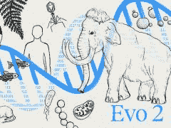
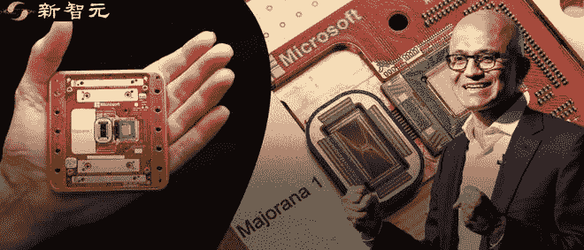
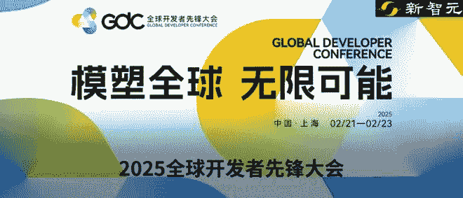

# 02.21-世界首个「AI CUDA工程师」诞生！AI自己写代码优化CUDA内核，性能狂飙100倍

> 来源：[https://agijuejin.feishu.cn/docx/EAUYde2fkoapB8xc35fcZTFmnEe](https://agijuejin.feishu.cn/docx/EAUYde2fkoapB8xc35fcZTFmnEe)

# AGI 掘金日报 - AI 新闻推送 (2025 年 02 月 21 日)

> [欢迎加入 AGI 掘金社群](https://sourl.co/miZUyT)

## ⭐ 今日热点

### 💡 世界首个「AI CUDA工程师」诞生！AI自己写代码优化CUDA内核，性能狂飙100倍

新智元 | [阅读原文](https://www.163.com/dy/article/JORSIMFK0511ABV6.html?spss=dy_author)

由Llion Jones创立的Sakana AI推出世界首个「AI CUDA工程师」，能将PyTorch代码自动转换为高度优化的CUDA内核，速度比PyTorch原生实现快10 - 100倍，比生产中广泛使用的CUDA内核快最高5倍。还发布含17000多个已验证CUDA内核的数据集。它通过多种技术实现优化，研究人员认为这是AI优化开端，能加快大模型训练和运行速度 。

## 🌟 技术突破

### 💡 Figure AI 人形机器人多模态能力升级：“听懂”语音指令轻松将食物放进冰箱

IT之家 | [阅读原文](https://www.ithome.com/0/832/489.htm)

2月21日，机器人初创公司Figure AI推出Helix新型人工智能系统。它结合两个关键模块，能让机器人通过语音命令执行复杂动作，可同时控制35个自由度，仅需500小时训练数据，靠嵌入式GPU运行，商业应用可行。首席执行官Brett Adcock称其对家用机器人规模化至关重要。此外，Figure AI结束与OpenAI合作，专注自研模型，而OpenAI重启机器人团队组建 。

### 💡 微软Muse秒生游戏登Nature，10亿级画面练出最强AI！千亿游戏市场重洗牌

新智元 | [阅读原文](https://www.163.com/dy/article/JORSVIHJ0511ABV6.html?spss=dy_author)

微软公布全球首个世界与人类行动模型Muse，可秒生游戏画面、预测玩家操作。它基于超10亿张《Bleeding Edge》游戏画面训练，核心是深度理解3D游戏世界。Muse能将游戏开发周期从数月缩至几分钟，或颠覆千亿游戏市场。微软团队分享其开发过程，包括数据收集、跨学科合作等，还开源相关资源，为生成性AI在创意领域应用提供思路。

### 💡 英伟达与美国机构发布生物学领域最大 AI 模型 Evo 2：机器可用核苷酸语言“思考”

IT之家 | [阅读原文](https://www.ithome.com/0/832/314.htm)

2月19日，美国弧形研究所、英伟达和斯坦福大学等合作发布生物学领域最大AI模型Evo 2。它基于超9.3万亿个核苷酸数据训练，能让机器用核苷酸语言“读写”“思考”。Evo 2功能多样，如预测乳腺癌相关基因突变准确率超90%，助新药研发。为避风险，其数据集排除特定病原体并限制查询。全球科研人员可通过网页或下载源代码等使用，相关研究预印本已发表。

### 💡 全国首个罕见病领域 AI 大模型“协和・太初”发布，可进一步缩短确诊时间

IT之家 | [阅读原文](https://www.ithome.com/0/832/294.htm)

2月20日，北京协和医院与中科院自动化所共同研发国内首个罕见病领域AI大模型“协和・太初”，并开放患者初诊咨询和预约功能。其基于我国知识库和基因检测数据，符合中国人群特点，能缩短确诊时间。团队创新技术路径，采用极小样本冷启动。后续将支持医生端服务功能，接入线上诊疗服务并推广至全国协作网医院。该模型有三大核心优势。

### 💡 「开源类脑芯片」二代发布！支持反向传播突触学习规则和并行神经元计算

新智元 | [阅读原文](https://www.163.com/dy/article/JORFUTPT0511ABV6.html?spss=dy_author)

中科院计算所赵地研究团队于2025年1月在《Journal of Supercomputing》开源「开源类脑芯片」二代（Polaris 23） 。其基于RISC-V架构，支持脉冲神经网络等。芯片包括神经形态处理单元等两部分，设计多发射、并行执行等架构提升处理能力。与ODIN处理器对比，神经元带宽提高约300倍，能效提升，在MNIST数据集准确率达91%。团队还在研究三代芯片 。

### 💡 微软20年精炼，全球首个拓扑量子芯片出炉！巴掌大芯片碾压全球超算

新智元 | [阅读原文](https://www.163.com/dy/article/JOR95CIM0511ABV6.html?spss=dy_author)

微软发布全球首个拓扑架构量子芯片Majorana 1，这是其20年研究成果。芯片未来将容纳百万量子比特，具有高容错、抗干扰等优势。与AI结合可有新应用。新架构为集成百万量子比特提供路径，微软已集成8个拓扑量子比特，并在构建容错原型机。拓扑导体是关键，解决了量子比特相关难题，降低了测量错误率。此突破让实用量子计算更近一步，将助力多领域发展 。

## 💫 企业动态

### 💡 OpenAI 周活跃用户达 4 亿，高管称用户“口口相传”发现其价值

IT之家 | [阅读原文](https://www.ithome.com/0/832/480.htm)

2 月 21 日消息，截至本月 OpenAI 周活跃用户达 4 亿，比去年 12 月增长 33% 。首席运营官布拉德・莱特凯普称，ChatGPT 靠口碑吸引用户，其有用且被熟悉，用户找到契合场景后就会使用。企业业务方面，付费企业用户达 200 万，较去年 9 月几乎翻番。过去六个月开发者流量翻番，o3 模型使用量增长五倍。他认为企业业务虽在建设，但 AI 将如云计算般成企业必备工具。

### 💡 阿里将推出基于 Qwen2.5-MAX 的深度推理模型

IT之家 | [阅读原文](https://www.ithome.com/0/832/433.htm)

2月20日，阿里集团CEO吴泳铭在财报会上称，阿里将发布基于千问Qwen2.5-MAX的深度推理模型。1月29日阿里云公布全新的通义千问Qwen 2.5-Max超大规模MoE模型，在多个基准测试中超越对手。Qwen2.5-Max在Chatbot Arena大模型盲测中排全球第七，是中国非推理类大模型冠军，在数学、编程等单项能力上排名第一 ，硬提示方面排名第二。

### 💡 一加 13 手机确认将接入 DeepSeek 模型

IT之家 | [阅读原文](https://www.ithome.com/0/832/394.htm)

2月20日消息，一加中国区总裁李杰18日发文确认，一加品牌机型正陆续接入“满血版”DeepSeek模型，其中一加13将接入。目前暂未公布其他支持机型。此前，OPPO ColorOS设计总监陈希宣布月底ColorOS全面接入。另外，华为、荣耀等众多手机厂商均已宣布接入或即将接入，小米也曾测试DeepSeek-R1 模型（已下线） 。

### 💡 突发，Grok-3免费上线！答对9.11和9.9谁大，1分攻克MIT积分难题

新智元 | [阅读原文](https://www.163.com/dy/article/JORG35HE0511ABV6.html?spss=dy_author)

Grok-3 免费上线，有 DeepSearch 和 Think 两大模式。它由大量 GPU 训练，号称人人可用。但刚上线就遭 OpenAI 研究员“打假”，被指评测作弊，xAI 工程师称用了相同方法。实测中，Grok-3 对某些问题回答受提问方式和模式影响。网友发现其有对代码友好等优点，能快速做游戏、创建 3D 模型，也有生成倒立人物有问题等缺点。此外，它在 MIT 积分赛表现出色，未来或推高级语音模式。

### 💡 2025最强开发者盛宴倒计时，MIT顶级大神亲授秘籍！百亿招标等你拿

新智元 | [阅读原文](https://www.163.com/dy/article/JORFUJG50511ABV6.html?spss=dy_author)

2025全球开发者先锋大会2月21 - 23日在上海徐汇举办。中国首位AGI安全大佬朱小虎现场授课。大会携超百亿AI项目招标，涵盖智能制造、文旅、金融等多个行业。如智能制造的风电运维项目、文旅的红色文创项目等，各项目有具体招标需求和验收指标。这是技术人才交流、参与项目的好机会，能促进场景与技术企业对接 。

### 💡 马斯克旗下 xAI 宣布 Grok 3 免费开放，直到服务器不堪重负为止

IT之家 | [阅读原文](https://www.ithome.com/0/832/280.htm)

2月20日，马斯克旗下xAI公司宣布，“世界最智能AI”系统Grok 3现免费向公众服务（至服务器不堪重负）。所有用户能免费使用其推理和深度搜索模式，此前需订阅特定服务。X Premium+ 和SuperGrok订阅用户有更多特权。此外，开发者很快可通过API访问Grok 3部分版本。Grok 3被马斯克称为“地球上最聪明的人工智能”，在复杂任务上表现优于ChatGPT等竞品。