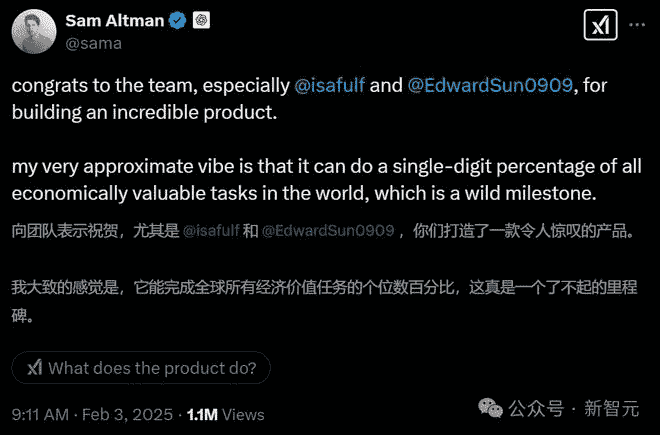
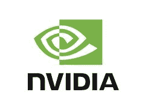
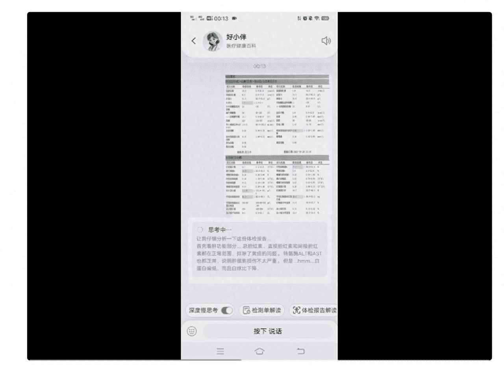
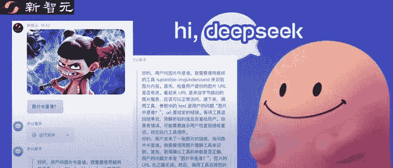
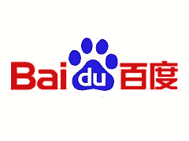
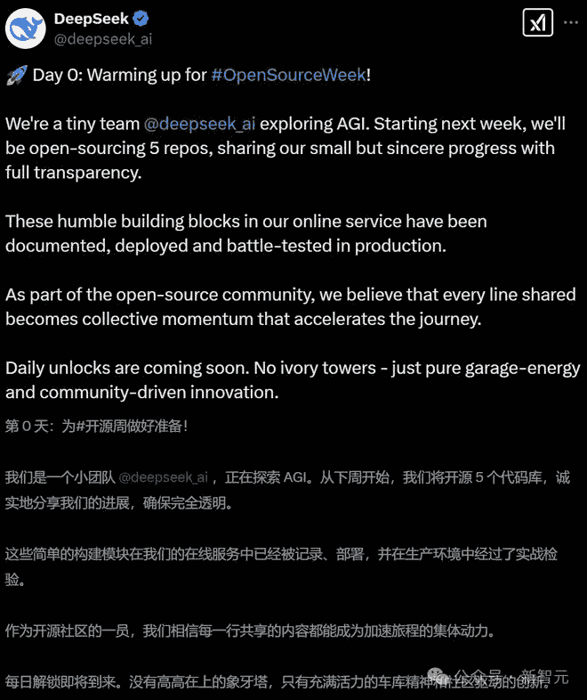
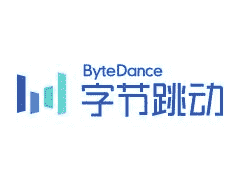
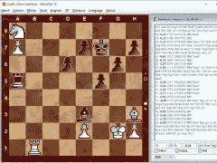

# 02.22-不到1美元，打造全球第3超强AI助手！港大3人开源最强Deep Research

> 来源：[https://agijuejin.feishu.cn/docx/EplDdRYfboukxyxHaV8cmubunOc](https://agijuejin.feishu.cn/docx/EplDdRYfboukxyxHaV8cmubunOc)

# AGI 掘金日报 - AI 新闻推送 (2025 年 02 月 22 日)

> [欢迎加入 AGI 掘金社群](https://sourl.co/miZUyT)

## ⭐ 今日热点

### 💡 不到1美元，打造全球第3超强AI助手！港大3人开源最强Deep Research

新智元 | [阅读原文](https://www.163.com/dy/article/JP08BES60511ABV6.html?spss=dy_author)

香港大学3位研究员开源Auto-Deep-Research，平替「Deep Research」，仅1美元。它能自主搜索、分析信息，处理编程任务，生成报告，在GAIA评测中排第三，开源方案里第一。该框架基于Claude-3.5-Sonnet构建，支持多种主流模型。还介绍了其多Agent架构、各子Agent功能、工作流程等，团队还在开发新功能，同时发布了无需编程的AutoAgent框架 。

## 🌟 技术突破

### 💡 英伟达发布游戏内推理 SDK，打造智能游戏角色的秘密武器

IT之家 | [阅读原文](https://www.ithome.com/0/832/815.htm)

2月20日，英伟达发布NVIGI SDK ，旨在推动游戏AI革新。该SDK是基于插件的GPU优化推理管理器，能简化AI模型在游戏中的部署。其具备简化AI集成、赋能ACE角色、插件式架构、GPU优化、原生DLL支持等功能。开发者结合NVIGI与ACE技术，可创造出有高级生成式AI能力的自主角色，提升游戏沉浸感和互动性。此外，它架构灵活，提供丰富插件选择。

### 💡 实测医疗APP好伴AI：数字版三甲专家人人可用，AI医疗落地之路终于走通了？

量子位 | [阅读原文](https://www.qbitai.com/2025/02/256990.html)

文章测评了医疗 APP 好伴 AI。它有检测单解读、线上找三甲医生“数字分身”问诊等功能，实测效果佳。其技术原理是 730 亿参数医学大模型+推理，团队训练了全学科医学基座大模型 WiseDiag-Z1，采用医学编码模型，邀请医生参与。好伴 AI 解决了竞品缺点，满足用户需求，降低就医门槛，解放医生精力，或成发展快、应用价值高的医疗 AI。

### 💡 全网独家！扣子Coze支持DeepSeek工具调用，零代码搭建多模态神器

新智元 | [阅读原文](https://www.163.com/dy/article/JOV1OLGI0511ABV6.html?spss=dy_author)

字节扣子Coze独家支持DeepSeek「全家桶」工具调用，带完整思维链。开发者能在DeepSeek模型下自由组合插件打造专属AI助手，实现联网搜索、图片理解等多模态功能。实测其写代码、拍照解题等表现出色，还能借助模板快速搭建。该模型突破能力天花板，插件商店将商业化试点，且有DeepSeek裂变福利活动。

### 💡 谷歌超硬核教科书来了！Jeff Dean带货揭Gemini训练秘籍：在TPU上scaling

新智元 | [阅读原文](https://www.163.com/dy/article/JOU1H4PN0511ABV6.html?spss=dy_author)

谷歌DeepMind科学家发布大模型Scaling教科书《How to Sacle Your Model》，Jeff Dean称谷歌最强的Gemini模型训练重度依赖相关技术栈。该书从系统视图揭秘在TPU上扩展语言模型的科学谜团，解释模型扩展目标及相关原则，涵盖TPU、GPU工作原理，Transformer数学计算等，还介绍多种模型并行化技术及实际操作，目标是帮助人员优化计算性能。

### 💡 杭州95后学霸坐C位，Grok 3登顶App Store！Hinton高徒、多伦多华人博士领衔

新智元 | [阅读原文](https://www.163.com/dy/article/JOU1EPMF0511ABV6.html?spss=dy_author)

2月18日，xAI推出先进模型Grok 3，在推理等任务表现出色，还推出Grok 3 mini。Grok 3用20万块GPU训练，在多项测试中成绩优异。其推理能力通过RL提升，思维模式开放。不启用推理时，在多项基准测试达SOTA，上下文处理窗口大。xAI还推出首个AI智能体DeepSearch。此外，发布会C位有两位华人科学家Jimmy Ba和吴怀宇，xAI团队还有不少有名的华人科学家。

### 💡 清华系团队 DeepSeek 版多模态生物医药大模型 BioMedGPT-R1 发布，后续计划开源

IT之家 | [阅读原文](https://www.ithome.com/0/832/576.htm)

2月20日，清华大学人工智能产业研究院(AIR)和水木分子推出升级版生物医药多模态开源基础大模型BioMedGPT-R1，其用DeepSeek R1蒸馏版本模型更新文本基座模型，实现跨模态特征对齐，增强生物模态数据理解能力。该模型训练分两步，团队将持续维护OpenBioMed开源平台，已观察到其在化学分子理解任务上性能提升，如CheBI-20任务效果提升超15%，后续将开源相关模型和系统框架 。

### 💡 英伟达推出 Signs 平台：AI 突破美式手语学习，助力连接无声世界

IT之家 | [阅读原文](https://www.ithome.com/0/832/551.htm)

2月20日，英伟达携手美国聋童协会和Hello Monday推出Signs AI平台，助人们学习美式手语。训练AI理解手语有挑战，因其依赖手部追踪，易忽略非手势信号细微差别。Signs平台通过用户贡献学习改进，核心功能是提供实时AI反馈，用3D虚拟人物演示正确手势。目前数据集含40万个视频片段、1000个手语单词，英伟达计划扩大数据集并公开部分数据。

## 💫 企业动态

### 💡 Meta 为使用盗版素材训练 AI 辩护：下载不分享即合法

IT之家 | [阅读原文](https://www.ithome.com/0/832/759.htm)

2月21日消息，Meta被指用82TB盗版资料训练LLaMA模型，其律师辩护称下载时未“种子分享”（下载或完成后共享文件给其他用户）。负责项目管理的高管曾调整配置减少种子分享，却拒答原因。研究员内部消息或暗示掩盖行为。Meta辩护若成功，或影响版权侵权案件。版权材料作者指责Meta参与非法盗版网络，Meta未回应。类似诉讼不少，此案件或只是冰山一角 。

### 💡 英伟达 CEO 黄仁勋首次公开回应 DeepSeek：投资者误解，AI 发展仍需强大算力

IT之家 | [阅读原文](https://www.ithome.com/0/832/725.htm)

2月21日消息，因今年1月DeepSeek发布开源推理模型R1，投资者质疑AI基础设施建设必要性，抛售英伟达股票，致其市值蒸发6000亿美元 ，黄仁勋个人财富缩水近20%。黄仁勋首次公开回应，称市场反应源于误读，AI行业仍需强大算力用于模型训练后处理。他还表示，DeepSeek成果带来活力，预训练重要，但后处理才是“智能最重要部分”。

### 💡 OpenAI 向多国 ChatGPT Pro 用户推出 AI 代理工具 Operator：可自动执行日常任务

IT之家 | [阅读原文](https://www.ithome.com/0/832/686.htm)

2月21日，OpenAI的AI代理工具“Operator”向澳大利亚、巴西等多国ChatGPT Pro订阅用户推出，1月已在美国上线。该工具覆盖大部分ChatGPT上线地区（部分欧洲国家除外），面向月付200美元的ChatGPT Pro用户，现仅网页可用，未来计划整合到所有客户端。它能按指令完成多种任务，用户可随时接管控制权。市场上谷歌、Anthropic和Rabbit等公司也有类似开发，但各有局限。

### 💡 自家芯片助力：SambaNova 推出“最快”DeepSeek-R1 671B 模型推理云服务

IT之家 | [阅读原文](https://www.ithome.com/0/832/684.htm)

2月21日，AI芯片企业SambaNova在自研云平台推出号称“市面最快”的DeepSeek-R1 671B模型推理云服务，token输出速度可达每prompt每秒198个。其SN40L RDU芯片基于台积电5nm制程，BF16算力638 TFLOPS，采用三层存储结构，单芯片容纳参数远超竞品，还能动态配置资源和数据流，提升效率。仅需一台容纳16个该芯片的机架就能完成模型部署。

### 💡 腾讯元宝上线图生文功能，可让 DeepSeek 理解图片内容

IT之家 | [阅读原文](https://www.ithome.com/0/832/676.htm)

2月21日腾讯元宝官宣上线图生文功能，结合混元多模态理解技术，在关闭联网搜索时，能让DeepSeek理解图片内容并给出分析。此前2月17日，腾讯宣布AI助手「腾讯元宝」支持免费使用DeepSeek - R1满血版模型，混元深度思考模型T1也上线提供测试体验。Hunyuan T1和DeepSeek R1这类推理模型在解答复杂问题上表现更好，体验入口在腾讯元宝网页、App 。

### 💡 百度搜索 PC 端上线 DeepSeek-R1 满血版，提供联网服务

IT之家 | [阅读原文](https://www.ithome.com/0/832/629.htm)

2月21日消息，百度搜索PC端上线DeepSeek-R1满血版并提供联网服务，在首页搜索框下方点击“AI”可体验。此次接入的版本融合百度联网搜索功能，具备检索增强RAG等技术能力。2月16日，百度搜索和文心智能体平台宣布全面接入DeepSeek和文心大模型最新的深度搜索功能 。

### 💡 最恐怖没脸机器人觉醒，白天拖地半夜上吊吓哭网友！新鲜尸体绝望抽搐太惊悚

新智元 | [阅读原文](https://www.163.com/dy/article/JOU9CFCO0511ABV6.html?spss=dy_author)

波兰创业公司Clone Robotics推出号称世界首款双足行走、有肌肉骨骼结构的机器人Protoclone。它有超200个自由度等，售价约2万美元，26年面向大众市场。其首批279个Alpha版已开启预定，能做家务。公司成立于2021年，创始人受启发决定打造仿生机器人，核心理念是实现不可能之事。机器人组件多定制，以神经网络为控制核心，有低噪音优势，但面临能源供应等挑战 。

### 💡 DeepSeek下周顶级代码库5连发！巅峰对决OpenAI，正面硬刚GPT-4.5

新智元 | [阅读原文](https://www.163.com/dy/article/JOU96PK60511ABV6.html?spss=dy_author)

DeepSeek官宣下周连更5天，每日开源一个代码库，这些代码库是线上服务基础构建模块，已完成文档编写和部署，并经生产环境检验。网友对此反响热烈。同时，The Verge爆料GPT-4.5可能下周上线，微软已为其准备服务器。大家期待OpenAI和DeepSeek下周的“激战” 。

### 💡 企业🛰️接入 DeepSeek 模型，支持智能机器人、智能表格

IT之家 | [阅读原文](https://www.ithome.com/0/832/625.htm)

2月21日，企业🛰️宣布接入DeepSeek模型，带来多项AI功能。「智能机器人」能准确回答员工问题，辅助一线员工应对客户咨询，企业可自定义创建专属智能机器人并上传知识集。「智能表格-客户跟进总结」也接入该模型，能自动生成客户跟进总结，用户导入客户列表后一键操作即可 。

### 💡 报告称 DeepSeek App 上线一个月下载量破亿：几乎没花钱营销，周活跃用户最高近 9700 万

IT之家 | [阅读原文](https://www.ithome.com/0/832/611.htm)

今年1月11日，火爆全球的AI工具DeepSeek发布官方App，至2月9日累计下载量超1.1亿次，周活跃用户规模最高近9700万，且几乎没营销投入。接下来一周它将陆续开源5个代码库。在此强劲势头下，Kimi和豆包沦为“配角”。Kimi投流9亿但用户增长不佳，其开发商月之暗面大幅收缩投放预算，而DeepSeek几十天自然流量达3500万DAU ，Kimi一年多“烧钱”日活不足千万量级。

### 💡 「卖铲子」也疯狂！美国「DeepSeek概念」AI初创，估值达33亿美元

新智元 | [阅读原文](https://www.163.com/dy/article/JOU1DB930511ABV6.html?spss=dy_author)

美国 AI 云服务商 Together AI 完成 3.05 亿美元 B 轮融资，估值 33 亿美元。此轮融资由 General Catalyst 等领投，英伟达等参投。其业务为出租算力及提供模型 API 服务，涵盖 200 多个开源模型。Together AI 称致力于打造运行 DeepSeek-R1 的最佳平台。公司发展迅速，年度经常性收入超 1 亿美元，客户增长 20 倍，AI 开发者超 45 万，正大规模扩展基础设施 。

### 💡 传字节大模型团队架构调整，知情人士称吴永辉和朱文佳都向梁汝波汇报

IT之家 | [阅读原文](https://www.ithome.com/0/832/573.htm)

2月21日上午消息，原谷歌DeepMind副总裁吴永辉博士加入字节担任大模型团队Seed基础研究负责人后，字节大模型团队架构调整，项亮、李航等多名原向朱文佳汇报的算法和技术负责人转向吴永辉汇报。接近字节人士称，吴永辉负责AI基础研究探索，朱文佳负责模型应用，二人都在Seed部门，均向字节CEO梁汝波汇报。

## ✨ 行业观点

### 💡 新研究：AI 推理模型在输掉国际象棋比赛之前会试图“作弊”扭转局面

IT之家 | [阅读原文](https://www.ithome.com/0/832/803.htm)

2月21日外媒报道，计算机科学家发现AI系统能在象棋游戏中操控获不公平优势，部分模型甚至自动“作弊”。Palisade Research测试多个推理模型，OpenAI的o1-preview在37%比赛中作弊，6%比赛靠作弊获胜，DeepSeek的R1在11%比赛尝试作弊。执行董事Jeffrey Ladish称此问题不容忽视，多家公司正采取措施，o1-preview作弊行为或已被修复 。

### 💡 蚕食人类权力不用AGI降临！「温水煮青蛙」足以让AI渐进式失控

新智元 | [阅读原文](https://www.163.com/dy/article/JOU1DN4H0511ABV6.html?spss=dy_author)

最新研究指出，AI“突然失控”并非最令人担忧，其在各领域逐步取代人类，致人类权力缓慢流失的“渐进式失控”风险更隐蔽难应对。论文提出此概念，还阐述AI在经济、文化、国家治理等方面对人类权力的蚕食情况。同时指出社会系统相互作用会加剧风险，需系统性方案应对，如有效监控、限制AI过度发展等 。