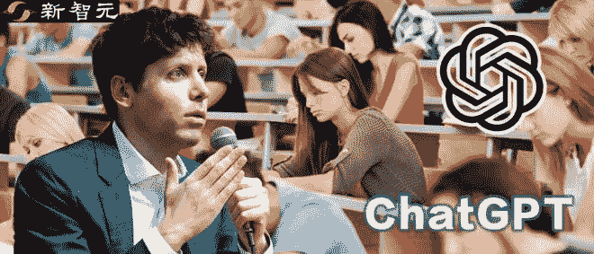
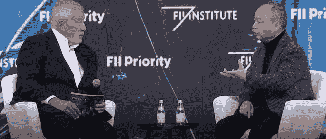

# 02.24-龙芯 DeepSeek 大模型推理一体机发布：自主指令系统架构 3C5000 处理器、配太初元碁 T100 加速卡

> 来源：[https://agijuejin.feishu.cn/docx/WUsVdIS72oaNGexRsStcSg1VnHe](https://agijuejin.feishu.cn/docx/WUsVdIS72oaNGexRsStcSg1VnHe)

# AGI 掘金日报 - AI 新闻推送 (2025 年 02 月 24 日)

> [欢迎加入 AGI 掘金社群](https://sourl.co/miZUyT)

## ⭐ 今日热点

### 💡 龙芯 DeepSeek 大模型推理一体机发布：自主指令系统架构 3C5000 处理器、配太初元碁 T100 加速卡

IT之家 | [阅读原文](https://www.ithome.com/0/832/987.htm)

2月23日，龙芯中科发布基于DeepSeek大模型的软硬全栈推理一体机。该一体机基于龙芯自主指令系统架构LoongArch 3C5000处理器，搭载太初元碁T100加速卡，支持DeepSeek全系及其他主流大模型，可按需灵活配置1 - 4张加速卡，能满足多种大模型行业应用场景需求，从芯片底层保障信息安全 。

## 🌟 技术突破

### 💡 DeepSeek-R1 成 Hugging Face 最受欢迎大模型，力压近 150 万个“对手”

IT之家 | [阅读原文](https://www.ithome.com/0/833/079.htm)

2 月 24 日，AI 大模型社区 Hugging Face 联合创始人宣布，DeepSeek-R1 在该平台超 150 万个模型中脱颖而出，获超 10000 个赞成最受欢迎大模型。上月末，Hugging Face 宣布 Open-R1 项目，欲填补 DeepSeek R1 未开源组件空白。因 DeepSeek R1 高效，可作创新基础模型。此外，Hugging Face 计划建立的合成数据集将兼顾多领域 。

### 💡 Grok 3冲击诺奖级突破，成证明「黎曼猜想」关键！AI与数学家打出终极组合拳

新智元 | [阅读原文](https://www.163.com/dy/article/JP3JAGL60511ABV6.html?spss=dy_author)

Grok 3表现出色，在数学基准测试中刷新成绩。风投机构创始人认为其或为破解黎曼猜想关键，因具备暴力计算和人机合作优势，马斯克预测两年内或实现。Grok 3在聊天机器人竞技场领先 ，大量用户从ChatGPT转向它。此外，文中介绍了黎曼猜想相关知识，该猜想受关注已久，至今未被证明 。

## 💫 企业动态

### 💡 谷歌 AI 视频生成模型 Veo 2 使用费用公布：每分钟 30 美元

IT之家 | [阅读原文](https://www.ithome.com/0/833/080.htm)

2月24日消息，谷歌在定价页面公布新一代AI视频生成模型Veo 2使用费用，每秒50美分，每分钟30美元，每小时1800美元。谷歌DeepMind研究员乔恩・巴伦将其与《复仇者联盟4》成本对比。用户实际未必用完购买时长，且Veo 2擅长生成两分钟以上片段。同时，OpenAI向ChatGPT Pro订阅用户（每月200美元）开放Sora视频生成模型。

### 💡 美国多个学区用上“AI 心理健康助手”，应对真人心理辅导员匮乏

IT之家 | [阅读原文](https://www.ithome.com/0/833/074.htm)

据《华尔街日报》22日报道，Sonar Mental Health公司开发的AI辅助“心理健康伴侣”Sonny，作为“AI心理健康助手”在全美超4500所公立初高中广泛应用，涉及九个学区，多为贫困或乡村地区。因真人心理辅导员匮乏，学校推广这一混合模式。Sonar首席执行官认为这能及早发现青少年心理问题。AI提供回复建议，人类可编辑，有情况会通知相关人员，AI还能提醒跟进并指导沟通 。

### 💡 微软 CEO 纳德拉：Xbox 将借助生成式 AI 技术开发多款电子游戏

IT之家 | [阅读原文](https://www.ithome.com/0/833/069.htm)

2月24日，VGC报道微软首席执行官萨蒂亚・纳德拉称，计划将新推出的生成式AI模型“Muse”应用于多个电子游戏，逐步推出AI参与制作的作品。Muse能生成游戏视觉效果等，微软已展示其通过训练数据生成游戏画面。纳德拉认为这一技术能实现利用游戏数据生成多样且可自定义的内容，很快会有AI生成游戏供试玩。此外，行业内对生成式AI看法不一，有人担心失业和剽窃，也有人认为能创造就业，应与AI合作 。

### 💡 海外用户也有份，传音 Infinix AI 接入 DeepSeek-R1 满血版

IT之家 | [阅读原文](https://www.ithome.com/0/833/058.htm)

2月21日，传音控股旗下Infinix品牌宣布接入DeepSeek-R1满血版，2月26日起，XOS 14.5及以上版本的Infinix机型可升级使用，3月发布的全新NOTE系列也将接入。Infinix将其与Folax语音助手深度结合，用户能畅享AI功能。此外，Infinix正部署新战略，3月下旬将举办AI春季发布会展示全新AI技术体系。此前Infinix已宣布3月3日推Note 50系列手机。

### 💡 国产 AI 大模型加速迭代，厂商迈向开源、集聚化

IT之家 | [阅读原文](https://www.ithome.com/0/833/049.htm)

2月23日，2025全球开发者先锋大会在上海举行，多家厂商展示AI大模型落地应用，还亮出自家最新AI模型，如商汤科技LazyLLM开源框架等。目前国内头部人工智能企业聚焦“开源”，以共享技术成果、降低算力成本。艾瑞咨询研究院数据显示，到2028年，中国人工智能产业规模有望达8110亿元，新兴产业潜力巨大 。

### 💡 苹果被曝计划将谷歌 Gemini 与 Apple Intelligence 集成

IT之家 | [阅读原文](https://www.ithome.com/0/833/039.htm)

2 月 23 日消息，据 9to5mac 网站报道，苹果软件高管曾表示希望将苹果智能与其他人工智能模型集成，包括谷歌 Gemini 模型。代码挖掘者发现苹果智能系统内为第三方模型新增“谷歌”和“OpenAI”选项，虽不确定 iOS 18.4 后续版本会集成 Gemini，但不久后可能实现，也许在 iOS 18 后续更新或 iOS 19 中，预计 iOS 19 推出自主 Siri 对话模型。此外，三星与谷歌在 1 月 23 日宣布升级 Gemini AI 助手 。

### 💡 全球顶级AI大咖空降上海，千亿资本百万年薪引爆人才争夺战！机器人上街遛狗

新智元 | [阅读原文](https://www.163.com/dy/article/JP385I1J0511ABV6.html?spss=dy_author)

2 月 21 - 23 日，2025 全球开发者先锋大会（GDC）在上海举行。众多开发者社区参与，沈向洋等大咖云集。会上展示多项成果，探讨大模型产业生态。大会推动大模型与多行业对接，有千岗直招、百万招标等活动。多企业举办讲坛，多个开发者社区开展工作坊。上海以「模塑申城」推进 AI 产业布局，力争建成世界级产业生态 。

### 💡 超1/3美国大学生用ChatGPT，用户数激增破4亿！AI重塑教育职场

新智元 | [阅读原文](https://www.163.com/dy/article/JP384LMA0511ABV6.html?spss=dy_author)

OpenAI报告显示，美国超1/3大学生用ChatGPT写论文等，18 - 24岁人群使用情况因州而异，犹他州和纽约州积极推动AI教育。超70%企业雇主青睐有AI技能的求职者，AI在多领域广泛应用，能显著提升工作效率。培育AI人才需普及认知、推广使用、完善政策。此外，OpenAI用户数突破4亿，付费企业用户超200万，开发者调用量翻倍 ，马斯克收购提议被拒。

### 💡 孙正义患DeepSeek焦虑症？首谈5000亿星际之门，每年算力暴增1000倍

新智元 | [阅读原文](https://www.163.com/dy/article/JP384IA80511ABV6.html?spss=dy_author)

针对DeepSeek冲击，英伟达黄仁勋称未来算力仍关键。孙正义在Future Investment大会回应‘DeepSeek焦虑症’说法，其斥资5000亿美元打造的‘星际之门’每年算力将提升1000倍。他认为AGI是指数级发展，未来10年超级智能对全球GDP影响至少5%即9万亿美元 。他全力押注AI，认为不应限制青少年使用AI。孙正义认为自己既是梦想家也是赌徒，愿保持挑战精神。

### 💡 马斯克宣布 Grok 3 语音模式早期测试版已上线

IT之家 | [阅读原文](https://www.ithome.com/0/832/978.htm)

2月23日，马斯克在社交平台X宣布，Grok 3语音模式早期测试版在Grok应用程序上线。他表示虽为早期版本可能有问题，但体验很棒。Grok 3语音模式可让用户通过自然语言与人工智能对话，有两种声音、不同个性等功能。2月20日，xAI宣布Grok 3免费向公众服务（直到服务器不堪重负），此前需订阅特定服务才能使用，且X Premium+和SuperGrok订阅用户有优先使用语音模式等更多特权。

### 💡 从微软转向软银，消息称 OpenAI 未来 75% 算力将来自“星际之门”项目

IT之家 | [阅读原文](https://www.ithome.com/0/832/976.htm)

据The Information 2月23日报道，OpenAI未来五年将对计算资源来源进行重大调整，到2030年，预计75%数据中心容量来自软银支持的“星际之门”项目，这将大幅减少对微软依赖，不过转变非一蹴而就，未来几年仍会增加在微软数据中心的支出。此外，OpenAI成本预计大幅增长，2027年预计烧钱约200亿美元，远高于2024年的50亿美元，2030年运行模型成本将超训练模型支出 。

## ✨ 行业观点

### 💡 超 2000 名文化界人士呼吁英国政府：不要将我们的作品白送给 AI 富豪

IT之家 | [阅读原文](https://www.ithome.com/0/833/083.htm)

当地时间2月23日，超2000位文化界人士联合致信英国政府，指责其《AI机会行动计划》中一条款试图废除版权和知识产权法律。签署人认为政府不应将创作成果送予AI，剥夺创作者收入与创造力。儿童书籍作家等指出大型科技公司想以AI替代人类工作。此外，活动家认为AI无创新能力，创作者强调这不是“反技术”，但政府若接受游说，创意产业财富将流入科技行业 。

### 💡 清华大学第五部 DeepSeek 秘籍出炉！（附全集下载）

IT之家 | [阅读原文](https://www.ithome.com/0/833/035.htm)

清华大学沈阳团队新 DeepSeek 攻略分享 AI 幻觉问题。AI 幻觉指模型生成与事实不符等内容，分事实性和忠实性幻觉。产生原因包括数据偏差等。普通用户可通过开启联网搜索、限定知识边界、交叉验证等减缓其影响。AI 幻觉在需确定性结果时不利，但在创意领域或有价值，现阶段无法杜绝，使用大语言模型要有自己的判断。文末提供获取原版秘籍方式。