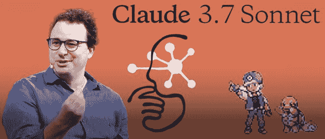
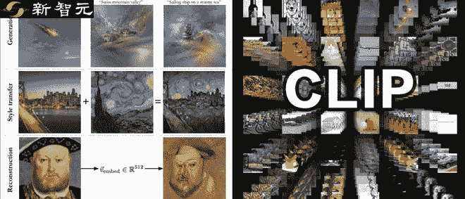
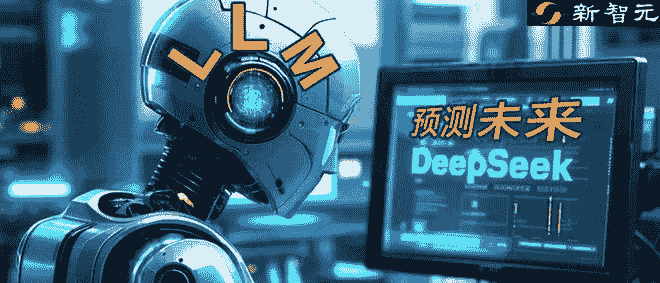
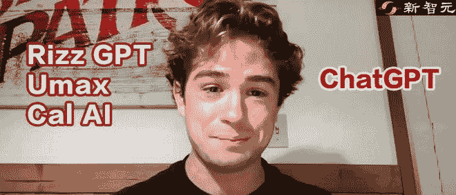
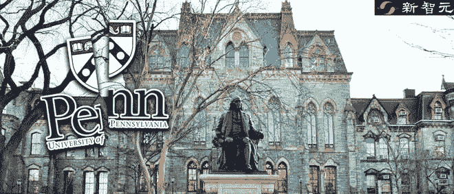

# 02.25-刚刚，全球首个混合推理模型Claude 3.7降世！最强编程大脑暴击DeepSeek R1

> 来源：[https://agijuejin.feishu.cn/docx/UL9oduc86ok0HCx3zTDcEKYBnfd](https://agijuejin.feishu.cn/docx/UL9oduc86ok0HCx3zTDcEKYBnfd)

# AGI 掘金日报 - AI 新闻推送 (2025 年 02 月 25 日)

> [欢迎加入 AGI 掘金社群](https://sourl.co/miZUyT)

## ⭐ 今日热点

### 💡 刚刚，全球首个混合推理模型Claude 3.7降世！最强编程大脑暴击DeepSeek R1

新智元 | [阅读原文](https://www.163.com/dy/article/JP7QM7VH0511ABV6.html?spss=dy_author)

Anthropic推出首个混合推理模型Claude 3.7 Sonnet，所有人可免费使用。该模型能即时响应或展示思考过程，API用户可控制思考时间。在多项基准测试中性能显著提升，数学、编码能力比上一代暴涨10%以上。同时，首款智能体编程工具Claude Code问世，早期测试中可大幅减少开发时间和工作量。Claude 3.7 Sonnet还具备新特性，在一些任务中有突破，且价格与前代相同 。

## 🌟 技术突破

### 💡 南大钱超 AI 团队攻克百亿晶体管难题，斩获 EDA 顶会 2025 最佳论文

IT之家 | [阅读原文](https://www.ithome.com/0/833/170.htm)

南大钱超教授团队在 DATE 2025 发表的芯片设计优化论文获最佳论文奖。团队攻克百亿晶体管难题，提出全新时序驱动布局方法。新方法在时序分析中 6 倍加速，关键时序指标 TNS 和 WNS 分别提升 50% 和 30%。与先进算法对比，在 TNS 指标上有大幅提升，获审稿人高度评价。LAMDA 组长期研究，设计多个领先算法，部分技术在华为落地，正进一步合作缓解先进制造工艺局限。

### 💡 不用GAN不用扩散，无需训练解锁AI生图新境界！判别模型成神秘第三极

新智元 | [阅读原文](https://www.163.com/dy/article/JP5O1FE70511ABV6.html?spss=dy_author)

研究「直接上升合成」（DAS）颠覆传统认知，揭示判别模型有生成能力。其关键创新是多分辨率优化，能避免退化高频解，使生成图像语义连贯。实现细节包括数据增强、独特位移处理、模型集成等。实验验证，DAS在生成一致性、可控修改等多方面性能佳，在生成国旗、图像修复、风格迁移等任务中表现出色，无需针对特定任务专门训练或改架构。

### 💡 单提示生成「主体一致」图像，且无需训练！已斩获ICLR 2025 Spotlight

新智元 | [阅读原文](https://www.163.com/dy/article/JP5NVLOH0511ABV6.html?spss=dy_author)

南开大学、中科院等机构研究人员提出「1Prompt1Story」无训练文本到图像生成方法。它整合提示为长句，结合奇异值重加权（SVR）和身份保持交叉注意力（IPCA）技术，解决图像人物身份不一致问题。该方法核心步骤为提示整合、SVR（突出重点抑制干扰）、IPCA（强化身份排除干扰）。实验表明，它在文本-图像对齐和身份一致性间取得良好平衡，优于多种现有方法 。

### 💡 南大钱超团队攻克百亿晶体管难题，斩获EDA顶会2025最佳论文！AI学院本硕博生联手

新智元 | [阅读原文](https://www.163.com/dy/article/JP5NUQCQ0511ABV6.html?spss=dy_author)

南大钱超教授团队在DATE 2025发表的芯片设计优化论文获最佳论文奖，一作、四作、五作是南大AI学院本硕博生，论文与华为合作完成。该团队提出全新时序驱动布局方法，在时序分析中实现6倍加速，关键时序指标显著提升。在竞赛数据集对比中领先。DATE投稿超1200篇，录用率约25%，获奖率0.3%。LAMDA组长期研究演化算法，针对芯片设计难题设计多个领先算法，部分技术在华为落地 。

## 💫 企业动态

### 💡 官方承认系统「作弊」，世界首个「AI CUDA工程师」翻车？o3-mini 11秒发现bug

新智元 | [阅读原文](https://www.163.com/dy/article/JP7QLHF60511ABV6.html?spss=dy_author)

这些新闻内容多样，有AI领域进展，如Anthropic发布首个双思维模型、微软AI模型MatterGen能生成新材料、众擎机器人完成前空翻等；还有生活趣事如各类翻车事件、房车侧翻等；同时包含招聘信息，如春招首周AI工程师求职增速居首。

### 💡 LLM自学成才变身「预言家」！预测未来能力大幅提升

新智元 | [阅读原文](https://www.163.com/dy/article/JP7QLBSO0511ABV6.html?spss=dy_author)

这些新闻包含多领域内容。技术上，港科大学者研发液晶弹性体，Anthropic发布双思维模型等；企业方面，微软AI模型能生成新材料，格力专卖店改名；还有诸多热点事件，如特朗普政策、俄乌冲突、联合国提案等，以及一些民生、娱乐、医疗相关消息，像上海商品调价限购、《你好，星期六》节目、血小板增多难题等。

### 💡 LeCun力荐！进化算法淘汰77%低质数据：RIP方法让模型性能狂飙60%

新智元 | [阅读原文](https://www.163.com/dy/article/JP7QIV960511ABV6.html?spss=dy_author)

这些资讯包含多方面内容。技术突破上，Sakana AI推出NAMMs降低内存成本，华为诺亚推出ESA架构，微软AI模型能生成新材料等；还有如DeepSeek相关秘籍等AI进展。综合资讯涉及生活故事、历史探秘、体育事件、国际政治等。如北漂女孩谈娱乐圈经历，俄乌冲突、朝鲜谴责制裁会议等。此外还有能源数据发布、委员政策建议等社会民生内容。

### 💡 消息称拼多多已组建多个大模型小组团队，内部进行赛马 PK

IT之家 | [阅读原文](https://www.ithome.com/0/833/274.htm)

2月24日消息，全球科技巨头发力AI，拼多多也加入。其已组建电商推荐大模型团队，负责人曾是百度凤巢核心成员，年薪丰厚。拼多多去年从百度招一批人做大模型项目，产品应用于比价、推荐等领域。内部多个大模型小组团队进行赛马PK。此外，拼多多2024年第三季度总营收993.544亿元，同比增长44%；净利润249.807亿元，同比增长61% 。

### 💡 不懂编程本科毕业生手搓三个APP，用ChatGPT两年狂赚千万美金！

新智元 | [阅读原文](https://www.163.com/dy/article/JP68HBKK0511ABV6.html?spss=dy_author)

不懂编程的美国小哥Blake Anderson，借助ChatGPT在两年内开发3款爆款APP，年收入破千万美金。他从小有创业基因，受室友启发开发首款应用。开发中研究提示工程优化AI回复，靠实践与反复试错打造爆款。选合伙人无固定公式，发现新风口推出Umax，Cal AI势头正猛。他认为跳出科技圈独立思考、探索新领域有机会。

### 💡 时隔 20 年，百度 App 回归经典标语“百度一下，你就知道”

IT之家 | [阅读原文](https://www.ithome.com/0/833/245.htm)

2月24日，百度发布百度App大升级，整合文心大模型和DeepSeek大模型能力，时隔20年重归经典标语“百度一下，你就知道”。百度App更新到15.0版本，全量上线「AI搜索」入口。用户在对话框提问用「文心一言深度搜索版」可体验问答等能力，点击「DeepSeek-R1满血版」能使用DeepSeek。此外，新版百度App还有支持14种家乡话等更多AI功能 。

### 💡 博士offer一夜变废纸！陶哲轩抗议LeCun建议欧洲抄底，川普新政搞崩学术圈

新智元 | [阅读原文](https://www.163.com/dy/article/JP60PU6E0511ABV6.html?spss=dy_author)

特朗普和马斯克削减科研经费举措在全美学术圈引发风暴。2月7日，美国国立卫生研究院（NIH）将拨给大学研究经费的间接成本费率上限设为15%（目前50%-70%），许多科研项目或停摆。陶哲轩发联名信抗议，John Carlos Baez建议科学家离开美国。宾大因经费削减撤销10份研究生offer、大幅降低录取人数。LeCun警告此举或摧毁美国公共研究资助体系，建议欧洲抄底美国科学家。已有NIH资助的研究者也陷入迷茫 。

### 💡 利用 AI 生成“小姐姐”照片视频实施“流水化”诈骗，上海破获一起“恋爱交友”电诈案件

IT之家 | [阅读原文](https://www.ithome.com/0/833/181.htm)

上海闵行警方破获一起“恋爱交友”电诈案，捣毁10人诈骗团伙，涉案200余万元。2024年嫌疑人杨某组织团伙，用AI生成“小姐姐”照片视频在短视频平台引流，以“恋爱话术”“剧本”对近千名男性“流水化”诈骗。2025年1月警方多地收网，查获多部手机、手机卡等。目前4人被批捕，6人被采取强制措施，案件在进一步侦办。

### 💡 8分钟，Grok 3破解美国本科生最难数赛题！马斯克要用100万GPU反超「星际之门」？

新智元 | [阅读原文](https://www.163.com/dy/article/JP5O09FL0511ABV6.html?spss=dy_author)

马斯克旗下xAI扩张，上周发布的Grok 3模型性能强悍，如8分钟解普特南竞赛难题、助计算机博士快速写代码，大量用户转投。马斯克计划将含20万个GPU的集群扩容至100万个。同时，xAI在亚特兰大悄然建数据中心，与X共同部署约12,000个英伟达GPU。此外，特朗普官宣「星际之门计划」，砸5000亿美金重塑美国AI领导地位，OpenAI等牵头，规模巨大，xAI未参与 。

### 💡 YY 语音公司接入 DeepSeek 上线“YYDS”

IT之家 | [阅读原文](https://www.ithome.com/0/833/165.htm)

2月24日，YY语音公司接入DeepSeek，推出“YY-DeepSeek R1-满血版（YYDS）”，旗下YY直播、YY语音等产品已上线入口。YYDS顺应用户需求，支持DeepSeek V3联网等，解决了卡顿等问题。未来，YY还将与DeepSeek深度结合，推出智能体社区 ，打造相关组件。YY是知名语音社交、视频直播企业，有多款产品 。

### 💡 马斯克的 xAI Grok 启用新 Logo，灵感来自黑洞

IT之家 | [阅读原文](https://www.ithome.com/0/833/152.htm)

2月24日消息，埃隆・马斯克的xAI公司启用Grok AI助手新Logo。该Logo由设计师Jon Vio制作，用于Grok官方X账号和网站页面，灵感源于黑洞，基于奇点概念，汲取黑洞神秘与力量。马斯克的X账号头像也换成此Logo，彩色版本由设计师Dogan Ural打造 。