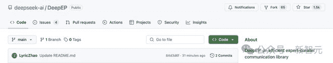

# AGI 掘金日报 - AI 新闻推送 (2025 年 02 月 26 日)

> 来源：[https://agijuejin.feishu.cn/docx/UWHZdldPfop91Cx1nJFcbHEnntd](https://agijuejin.feishu.cn/docx/UWHZdldPfop91Cx1nJFcbHEnntd)

> [欢迎加入 AGI 掘金社群](https://sourl.co/miZUyT)

## ⭐ 今日热点

### 💡 DeepSeek 开源进度 3/5：深度学习利器 DeepGEMM

IT之家 | [阅读原文](https://www.ithome.com/0/833/664.htm)

2月26日，DeepSeek“开源周”进度到3/5，开源深度学习利器DeepGEMM。它支持稠密和混合专家模型 (MoE) 的 FP8 矩阵乘法，在Hopper GPU上性能高达1350+ FP8 TFLOPS。该库基于CUDA编写，用即时编译技术，核心代码约300行，设计简洁。在多种矩阵形状下性能佳，虽某些形状表现待提升。目前仅支持NVIDIA Hopper张量核心，附开源链接`https://github.com/deepseek-ai/DeepGEMM`。

### 💡 香港推出首个人工智能大模型 HKGAI V1：基于 DeepSeek 本地化训练，支持粤语

IT之家 | [阅读原文](https://www.ithome.com/0/833/588.htm)

2月25日，由“InnoHK创新香港研发平台”资助的香港生成式人工智能研发中心发布香港首个人工智能大模型HKGAI V1。它基于DeepSeek全参数微调并本地化训练，构建了后训练技术体系，注入香港本地知识。支持两文三语，背后有香港最大本地知识库。该模型将开源，目前香港特区约70个部门试用其辅助办公应用系统，展现了香港人工智能发展成果及与内地的协同创新能力。

## 🌟 技术突破

### 💡 全国首个 AI 心脏大模型“观心”测试版明日发布

IT之家 | [阅读原文](https://www.ithome.com/0/833/620.htm)

据第一财经2月25日消息，2月26日，复旦大学附属中山医院将联合上海科学智能研究院发布全国首个AI心脏大模型“观心”测试版。

### 💡 微软开源多模态 AI Agent“Magma”：购物时可自动下单，还能推测视频人物行为

IT之家 | [阅读原文](https://www.ithome.com/0/833/652.htm)

北京时间2月26日凌晨，微软官网开源多模态AI Agent基础模型Magma。与传统Agent不同，它有跨数字、物理世界的多模态能力，能处理多种数据，还有心理预测功能，可推测视频中人物或物体意图及行为。用户能用它自动下电商订单等。Magma能帮AI助手或机器人理解环境并行动，是VLA基础模型之一，能从海量数据学习知识以应对复杂任务和环境 。

### 💡 全国首个，深圳两会首次启用 AI 同传“零延时”跨语言沟通

IT之家 | [阅读原文](https://www.ithome.com/0/833/537.htm)

2025年2月25日，深圳两会首次启用全国首个政务级AI大模型同声传译软件InnAIO AI翻译大模型。该软件由深圳科技企业来画孵化，在深圳市七届人大六次会议开幕会上为外国领事官员提供同传服务。它以98.6%政策术语翻译准确率、0.5秒级实时响应等指标，构建起“数字桥梁”，实现“零延时”跨语言沟通 。

### 💡 360联合北大震撼发布！5%参数量逼近Deepseek-R1满血性能

新智元 | [阅读原文](https://www.163.com/dy/article/JP8EDT4H0511ABV6.html?spss=dy_author)

2025年2月24日，360与北大联合研发的中等量级推理模型Tiny-R1-32B-Preview亮相。其仅5%参数量逼近DeepSeek-R1性能。在数学、编程、科学领域表现出色，推理成本大幅降低。团队采用「分治-融合」策略实现技术革新。模型仓库已公开，即将公开完整技术报告等。研发团队称站在巨人肩膀上，未来将推动AI普惠化并回馈开源社区。

### 💡 刚刚，DeepSeek开源DeepEP通信库，千亿MoE训推颠覆级创新！FP8狂飙，带飞GPU

新智元 | [阅读原文](https://www.163.com/dy/article/JP87HPPE0511ABV6.html?spss=dy_author)

2月25日，DeepSeek 开源 DeepEP 通信库，专为 MoE 和 EP 设计，支持 FP8，具有低延迟、超高速训练推理等特点。开源一小时 GitHub 星标冲破 1.5k 。还意外发现英伟达特殊指令，特定硬件上可提升性能。提供多种内核，测试表明性能出色。介绍了环境要求、安装、网络配置等内容，并给出模型训练、推理解码示例代码，或改变 AI 领域沟通方式。

## 💫 企业动态

### 💡 豪掷 2000 亿美元，消息称 Meta 正洽谈 AI 数据中心园区新项目

IT之家 | [阅读原文](https://www.ithome.com/0/833/674.htm)

2月26日外媒称，Meta正商讨建设新数据中心园区支持AI项目，预计投资超2000亿美元，高层已考察多地。自ChatGPT发布，AI投资持续增长。上个月，Meta CEO扎克伯格称今年计划最高投入650亿美元扩展AI基础设施。微软2025财年计划投资约800亿美元开发数据中心，亚马逊2025年支出预计超2024年的750亿美元 。

### 💡 OpenAI Deep Research 功能向 ChatGPT Plus 用户开放，每月可查询 10 次

IT之家 | [阅读原文](https://www.ithome.com/0/833/658.htm)

2 月 26 日，OpenAI 兑现承诺，向 ChatGPT Plus、Team、Edu 和 Enterprise 用户开放 Deep Research 功能，Plus 用户每月可查询 10 次。此前需订阅每月 200 美元（约 1451 元人民币）的 Pro 计划才能体验。Pro 订阅用户查询限额从每月 100 次提至 120 次。该功能还有多项改进，如 ChatGPT 可在回答中嵌入图像等。用户点击图标使用，生成答案需 5 到 30 分钟，因计算密集，免费用户暂无法体验。

### 💡 零跑 B10 汽车内置 DeepSeek + 通义千问模型，3 月 10 日预售

IT之家 | [阅读原文](https://www.ithome.com/0/833/656.htm)

IT之家2月26日消息，零跑B10汽车3月10日开启预售，号称15万级首搭激光雷达城区智驾。该车同级唯一搭载高通8295芯片，AI算力达30TOPS，内置DeepSeek + 通义千问模型，用户可选择服务优先级，一个模型无法回答时另一个继续。此外，它搭载多模态感知技术，支持AI语音大模型与应用生态融合。内饰以“悦动几何”为理念，得房率达87.4%。

### 💡 武汉发布 AI 新举措：单个项目最高可获得 2000 万元资金支持

IT之家 | [阅读原文](https://www.ithome.com/0/833/654.htm)

2月26日消息，武汉发布促进人工智能产业发展政策措施。今年开展“人工智能 +”行动，推动20多个行业大模型赋能应用。武汉还将遴选垂直行业模型，对牵头研发单位最高补助1000万元；选示范应用场景，最高支持100万元；对特定获批单位奖励100万元。针对关键核心技术，单个项目最高支持2000万元，重点研发计划中项目最高支持100万元，助力打造人工智能高地。

### 💡 谷歌推出 Gemini Code Assist 个人版编程工具，免费可用

IT之家 | [阅读原文](https://www.ithome.com/0/833/648.htm)

当地时间2月25日，谷歌推出面向个人开发者的免费版Gemini Code Assist编程工具。谷歌产品管理高级总监称能让用户更方便学习等。该工具由Gemini 2.0驱动，可生成代码块等。每月最多180000次代码补全，远超其他流行免费编程助手。可安装在多个开发环境，兼容公共编程语言，支持38种语言，最多处理128000个聊天输入tokens 。免费版无高级功能，有特殊需求需付费。

### 💡 消息称字节跳动 AI 视频生成产品“即梦”考虑接入 DeepSeek

IT之家 | [阅读原文](https://www.ithome.com/0/833/640.htm)

2月26日消息，据“晚点LatePost”报道，字节跳动AI视频生成产品“即梦”（剪映旗下AI创作平台）正考虑接入DeepSeek 。DeepSeek爆火带来新玩法。春节前后即梦用户数增长迅猛，去年12月底周活约76万，2月中旬接近200万，一个半月涨近3倍。此外，即梦有新移动端负责人曹大鹏（原零一万物PopAI产品负责人），向剪映负责人张楠汇报 。曹大鹏曾因零一万物业务方向调整而离职 。

### 💡 幻方量化相关人士回应“DeepSeek-R2 模型提前发布”：以官方消息为准

IT之家 | [阅读原文](https://www.ithome.com/0/833/637.htm)

2 月 25 日晚，幻方量化相关人士对“DeepSeek 新一代 AI 模型 R2 提前发布”消息回应以官方消息为准。幻方量化 2023 年 7 月成立深度求索 AI 公司，今年 1 月发布 DeepSeek-R1 模型。路透社称 R2 原计划 5 月发布现加速提前，新模型或能生成更好代码、用多语言推理。此外，DeepSeek 于 2 月 21 日宣布陆续开源 5 个代码库，目前进度已至 2/5 。

### 💡 阿里万相视频生成大模型宣布开源：8.2GB 显存就能跑，测试超越 Sora

IT之家 | [阅读原文](https://www.ithome.com/0/833/618.htm)

2月25日，阿里云宣布旗下视觉生成基座模型万相2.1开源，采用宽松协议，开源两个参数规格的推理代码和权重，支持文生视频和图生视频。14B万相模型在评测中超越多个模型位列榜首，1.3B版本只需8.2GB显存，适用于二次开发等。算法设计有创新，实验在多维度测试中领先。还附上了Github、HuggingFace和魔搭社区的开源地址。

### 💡 AI PC 部署 DeepSeek 端侧大模型，联想小天目标今年达到 L3 级别智能体水平

IT之家 | [阅读原文](https://www.ithome.com/0/833/615.htm)

2月25日，联想集团在YOGA AIPC新品品鉴活动上，宣布成为全球首家在AI PC端侧本地部署和运行DeepSeek大模型的AI终端品牌，推出六款联想YOGA AIPC元启系列新品。通过技术创新，在消费级设备实现70亿参数端侧模型运行。联想moto AI手机等设备的端侧个人大模型将陆续发布。今年5月，天禧AS将首发基于个人云部署的DeepSeek大模型。今年内，联想小天将达L3级别智能体水平，具备专业化、个性化、自动化能力 。

### 💡 “新神登场”，消息称 DeepSeek R2 模型有望 5 月前发布

IT之家 | [阅读原文](https://www.ithome.com/0/833/589.htm)

2月25日路透社消息，三位知情人士透露，DeepSeek正加速推出R2人工智能模型，原计划5月推出，现争取提前。新模型有望生成更好代码，能用英语外语言推理，官方未回应置评请求。此外，DeepSeek于2月21日宣布陆续开源5个代码库，目前进度2/5，在线服务模块已可投入生产环境 。

### 💡 美的首款 DeepSeek 空调：鲜净感空气机 T6 将于 3 月 1 日发布，R1 满血版

IT之家 | [阅读原文](https://www.ithome.com/0/833/565.htm)

2月25日美的官宣，首款DeepSeek空调——鲜净感空气机T6 DeepSeek R1满血版，将于3月1日13:30发布。该空调支持空气智驾，可自适应环境变化，还能智能调节多维空气、实现智慧语音交互。此为立式空调产品，IT之家将持续跟进发布信息。

### 💡 首次实现中文文字生成，消息称阿里通义万相 2.1 视频生成模型今晚开源

IT之家 | [阅读原文](https://www.ithome.com/0/833/538.htm)

2月25日消息，据新浪科技援引知情人士消息，阿里巴巴今晚将全面开源旗下视频生成模型通义万相2.1 。今年1月该模型升级到2.1版本，在视频、图像生成能力上显著提升。视频生成方面，增强时空上下文建模能力，支持无限长1080P视频编解码，首次实现中文文字视频生成功能，登上VBench榜单第一，还支持多种特效和复杂运镜。去年9月它已支持文生视频等多种场景化能力。

### 💡 阿里千问（Qwen）衍生模型数量破 10 万，位居全球开源模型榜首

IT之家 | [阅读原文](https://www.ithome.com/0/833/507.htm)

2月25日消息，Hugging Face数据显示，阿里千问（Qwen）开源大模型衍生模型数量突破10万，位居全球开源模型榜首。自2023年8月起，阿里云相继开源4代全尺寸、全模态模型。阿里巴巴CEO吴泳铭称未来三年将加大投入三大AI领域。此外，阿里在Qwen Chat平台上线“深度思考 (QwQ)”功能，Qwen还计划发布更轻量级、适合本地部署的QwQ-32B模型 。

### 💡 vivo 正式上线满血版 DeepSeek-R1

IT之家 | [阅读原文](https://www.ithome.com/0/833/502.htm)

2月25日，vivo正式上线满血版DeepSeek-R1，宣称“AI体验再升级，蓝心小V更智能高效”。用户将蓝心小V升级至5.2.1.22版本后可体验该模型。升级后的蓝心小V支持深度思考、联网搜索等。在vivo云端算力加持下，支持秒级响应，能无缝融合手机生态。搭载OriginOS 5的机型均支持。2月24日，vivo已为部分机型灰度更新蓝心小V至5.2.1.22版本，新增支持DeepSeek大模型能力 。

### 💡 豆包内测字节跳动自研深度思考模型，并非接入 DeepSeek

IT之家 | [阅读原文](https://www.ithome.com/0/833/503.htm)

2月25日消息，网友发现字节跳动旗下AI助手豆包小范围测试深度思考模型，接入的不是DeepSeek模型。豆包相关负责人回应称，当前测试的是自研深度思考模型的不同实验版本。目前豆包对话页面暂未显示“深度思考”功能入口，部分灰度测试用户询问问题后，豆包答复中会显示思维链 。

### 💡 DeepSeek 重新开放 API 充值

IT之家 | [阅读原文](https://www.ithome.com/0/833/467.htm)

2月25日消息，DeepSeek重新开放API充值。此前因服务器资源紧张，本月初它一度暂停API服务充值。目前“用量信息”页面公告显示，deepseek - chat模型优惠期结束，调用价格变更为每百万输入tokens 2元，每百万输出tokens 8元 。

### 💡 中国信通院启动生成式 AI 产品和服务“个人信息和用户权益保护”专项评估

IT之家 | [阅读原文](https://www.ithome.com/0/833/461.htm)

2月25日，中国信通院启动生成式AI产品和服务“个人信息和用户权益保护”首轮评估，对象为面向普通用户的相关产品服务提供者。评估分3个等级，含32方面能力、114项具体要求。本月早些时候，中国信通院还联合40余家企业发布一系列生成式人工智能个人信息保护技术要求标准，涵盖总则、隐私声明告知等多个部分 。

### 💡 Perplexity 官宣“Comet”浏览器，主打“AI 智能体搜索”

IT之家 | [阅读原文](https://www.ithome.com/0/833/458.htm)

2月25日消息，人工智能搜索引擎Perplexity AI进军浏览器市场，将推出名为“Comet”的浏览器，主打“AI智能体搜索” ，致力于打造更好搜索体验。2月24日其在X平台官宣开发并开启注册，具体上线时间和功能细节未公布。Comet将面临Chrome等老牌及众多第三方浏览器竞争，不过Perplexity AI称其人工智能技术带来的搜索体验比部分已结合人工智能的浏览器更佳。

### 💡 何小鹏：小鹏有信心成为中国最早量产 L3 机器人的公司之一

IT之家 | [阅读原文](https://www.ithome.com/0/833/437.htm)

2月22日，小鹏汽车董事长何小鹏在小鹏X9海外发运仪式上称，虽行业机器人多处于L2阶段，但小鹏有信心成为中国最早量产L3机器人的公司之一。其技术架构会复用到机器人上，智驾与人形机器人同源。何小鹏还曾谈到，通用人形机器人到L4才能走进千家万户，L2到L3是巨大跨越。小鹏已推出两代人形机器人，Iron已在工厂工作，今年还将开放工厂参观。

### 💡 微软急刹车，被曝撤掉大波数据中心租赁！DeepSeek冲击，算力泡沫要破？

新智元 | [阅读原文](https://www.163.com/dy/article/JP87H5B90511ABV6.html?spss=dy_author)

DeepSeek开源MoE模型内核库，支持FP8专为Hopper GPU设计。一个月内微软市值暴跌3171亿美元，还取消部分AI数据中心租赁，总计「数百兆瓦」。TD Cowen称微软或担忧过度建设算力，且OpenAI工作负载有转移。微软预计本财年在AI数据中心花费800亿美元，CEO称会调整建设规划。此前微软在数据中心预租赁激进，2024年二季度占超大规模预租赁的59% ，近期其预租赁余额未增，在多国放缓。

### 💡 阿里 Qwen Chat 平台上线“深度思考”功能：基于 QwQ-Max-Preview 推理模型，支持联网搜索

IT之家 | [阅读原文](https://www.ithome.com/0/833/420.htm)

2月25日，阿里Qwen团队在Qwen Chat平台上线“深度思考 (QwQ)”功能，基于QwQ-Max-Preview推理模型，此模型基于Qwen2.5-Max ，擅长数学理解等，还支持联网搜索，目前处于预览阶段且在优化。Qwen团队透露，QwQ-Max正式版即将推出，将同步上线安卓和iOS应用，并开放QwQ-Max和Qwen2.5-Max权重。此外，还计划发布更轻量级的QwQ-32B模型用于本地设备部署。
