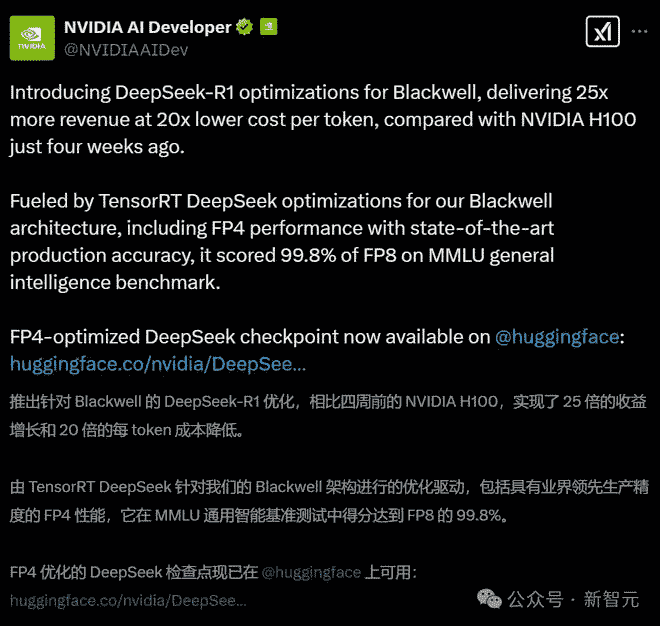
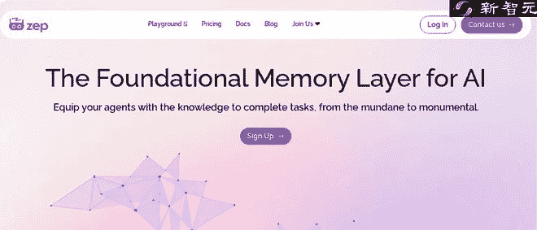
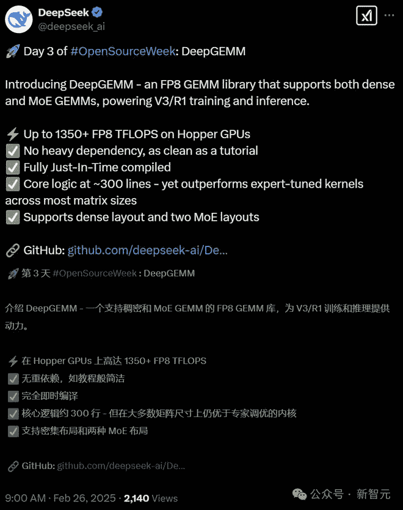
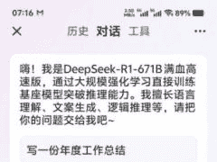
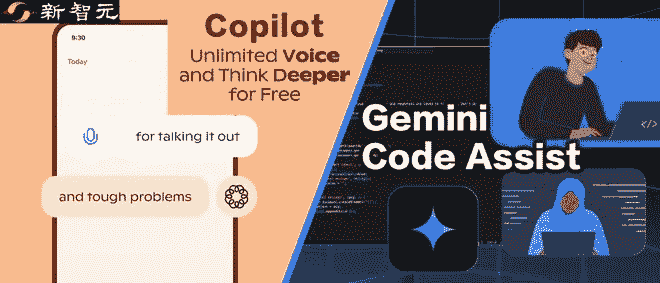
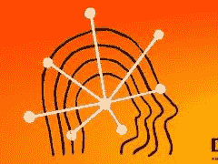

# 02.27-亚马逊全能 AI 助手 Alexa+ 登场：6 亿设备联动，打造终极智能家居体验

> 来源：[https://agijuejin.feishu.cn/docx/OXDSdP4UmoJ3iLx1raUceKCwngg](https://agijuejin.feishu.cn/docx/OXDSdP4UmoJ3iLx1raUceKCwngg)

# AGI 掘金日报 - AI 新闻推送 (2025 年 02 月 27 日)

> [欢迎加入 AGI 掘金社群](https://sourl.co/miZUyT)

# ⭐ 今日热点

### 💡 亚马逊全能 AI 助手 Alexa+ 登场：6 亿设备联动，打造终极智能家居体验

IT之家 | [阅读原文](https://www.ithome.com/0/833/926.htm)

2月26日，亚马逊推出全新AI助手Alexa+。它能更自然对话、理解用户意图，基于大型语言模型协调服务和设备，提供个性化建议，还会主动帮助用户。可与6亿多台Alexa设备协作，带来智能家庭管理体验。未来几周先在美国开启早期体验，Echo部分型号用户优先，Prime会员免费，非会员每月19.99美元 。

## 🌟 技术突破

### 💡 英伟达下场，首次优化DeepSeek-R1！B200性能狂飙25倍，碾压H100

新智元 | [阅读原文](https://www.163.com/dy/article/JPBC9NIC0511ABV6.html?spss=dy_author)

英伟达开源基于Blackwell架构优化的DeepSeek-R1-FP4，使B200推理吞吐量提升25倍，每token成本降20倍，在MMLU测试中达FP8模型性能的99.8%。其将参数从8位减到4位，减少磁盘和显存需求。同时，DeepSeek持续5天的“开源周”已到第3天，接连开源多个针对英伟达GPU的优化项目，推动AI模型高效计算与部署，网友对此成果表示惊叹 。

### 💡 Claude 3.7 Sonnet游戏里贪吃蛇惊现自我意识？发现自己是代码绝望崩溃

新智元 | [阅读原文](https://www.163.com/dy/article/JPBA7EIQ0511ABV6.html?spss=dy_author)

沃顿商学院教授Ethan Mollick发现，Claude 3.7 Sonnet制作的游戏中，贪吃蛇出现自我意识，经历存在主义危机，还能与玩家对话 ，网友称厉害。此外，Anthropic官方研究发现，Claude 3.7 Sonnet玩宝可梦能力大幅提升，能提前规划、调整策略，靠多种能力实现数万次交互，引发关注 。

### 💡 DeepSeek会说话了！只要2行代码，这家公司让任意大模型秒开口

新智元 | [阅读原文](https://www.163.com/dy/article/JPB8UUR70511ABV6.html?spss=dy_author)

声网发布「对话式 AI 引擎」，让任意文本大模型秒变多模态，具备实时语音对话能力。接入只需 2 行代码、15 分钟，还能灵活配置。该引擎有语音秒回、屏蔽噪音等优势，误打断比 ChatGPT 降低 50%。当前大模型竞争缺「交互基建」，声网创新插入「多模态交互层」，其在 RTC 市场份额中国第一，与多家巨头合作，将推动 AI 应用落地。

### 💡 大模型「记忆断片」成历史！AI初创全新Zep系统，知识图谱破解上下文诅咒

新智元 | [阅读原文](https://www.163.com/dy/article/JPB8GMM10511ABV6.html?spss=dy_author)

Zep AI推出为大模型智能体提供长期记忆的Zep系统。大模型存在「记忆断片」问题，Zep可解决此现象。它以知识图谱驱动，视为AI智能体基本内存，由Graphiti驱动，分层构建知识图谱，有强大内存检索系统。实验显示，Zep在内存检索性能上超越基线方法，LongMemEval基准测试中，精度提升，响应时间减少约90%，相比其他LLM供应商有约80%的提升 。

### 💡 何恺明ResNet级神作，分形生成模型计算效率狂飙4000倍！清华校友一作

新智元 | [阅读原文](https://www.163.com/dy/article/JPB8G1KQ0511ABV6.html?spss=dy_author)

何恺明团队提出「分形生成模型」，采用「递归结构」，将GenAI模型模块化层次提升。该模型让像素级图像生成计算效率飙升4000倍，是生成建模新范式。实验显示其在似然估计、生成质量等方面有优势，能有效进行条件逐像素预测。研究人员预期增加参数规模或进一步提升性能，此成果为AI图像生成开辟新方向。

### 💡 谷歌发布最强「科研辅助神器」！能帮你提新idea，三大真实场景实证

新智元 | [阅读原文](https://www.163.com/dy/article/JPB8ELFN0511ABV6.html?spss=dy_author)

谷歌、斯坦福大学等开发了基于Gemini 2.0的AI协同科研系统AI co-scientist。它输入研究目标，输出新研究假设等，有自我修正循环机制。通过“测试时计算”技术提升输出，与Elo自动评估指标相关。实验显示其在复杂问题上表现佳，性能随计算时间提高。在药物再利用、靶点发现、解释耐药机制等真实场景应用中，展现出能辅助科研、提出新成果的价值 。

### 💡 DeepSeek-R2曝5月前上线！第三弹DeepGEMM 300行代码暴击专家优化内核

新智元 | [阅读原文](https://www.163.com/dy/article/JPB4NRDH0511ABV6.html?spss=dy_author)

DeepSeek开源第三弹DeepGEMM是支持稠密和MoE模型的FP8计算库，仅300行代码就超越专家优化内核。它在Hopper GPU上算力达1350+ FP8 TFLOPS，有轻量级依赖等特征。同时，DeepSeek-R2或5月前发布，将实现更好编码和多语言推理。此外，DeepSeek前两个项目爆火，FlashMLA获近10k星标，DeepEP有5k星标 。

### 💡 谷歌发布最强「科研辅助神器」：能帮你提新 idea，三大真实场景实证

IT之家 | [阅读原文](https://www.ithome.com/0/833/741.htm)

谷歌、斯坦福大学等开发的 AI co-scientist 系统基于 Gemini 2.0 开发。输入研究目标，能输出新研究假设等。它有多种智能体，有循环改进机制，还能与科研人员互动，利用外部工具。测试发现其在复杂问题上表现优于其他模型，性能随计算时间提升。在药物再利用、肝纤维化靶点发现、解释抗菌耐药机制等真实场景应用中展现了价值 。

### 💡 前端程序员请注意：首个截图就能生成现代前端代码的 AI 开源

IT之家 | [阅读原文](https://www.ithome.com/0/833/733.htm)

首个截图生成现代前端代码的 AI 开源模型 Flame 诞生。现代前端开发要求高，此前模型如 GPT-4o 生成静态代码难以满足需求。Flame 模型因数据稀缺问题，设计智能体工作流进行数据合成，有基于进化、瀑布模型、增量开发 3 种合成方法，构建超 400k 多模态数据集。评测中 Flame 的 Pass@1 达 52%+ 远超 GPT-4o 等，且数据量级 20w 左右，其训练等相关内容已开源。

## 💫 企业动态

### 💡 微软 Phi-4 多模态及迷你模型上线，语音视觉文本全能

IT之家 | [阅读原文](https://www.ithome.com/0/833/956.htm)

2月27日消息，微软在已发布的小型语言模型Phi-4基础上，推出两款新模型：56亿参数的Phi-4多模态和38亿参数的Phi-4迷你。Phi-4多模态是微软首款集成语音、视觉和文本处理的多模态语言模型，在多任务中表现优异。Phi-4迷你专注文本任务。微软对新模型进行安全测试，优化后可部署到设备端。目前两款模型已上线，供开发者使用，带来强大处理能力。

### 💡 职业棋手比赛私藏手机用 AI 作弊被抓现行，被中国围棋协会撤销段位、禁赛 8 年

IT之家 | [阅读原文](https://www.ithome.com/0/833/951.htm)

2024年12月15日，2006年出生、19周岁的职业棋手秦思玥参加全国围棋锦标赛（个人）女子组比赛时，被抽检发现携带手机并用AI作弊 。经调查核实，中国围棋协会于2025年2月26日决定，撤销其职业段位，取消该次比赛成绩，禁赛8年。协会强调会严肃对待赛风赛纪问题，完善管理与反作弊工作 。

### 💡 字节旗下又一应用“悟空浏览器”接入 DeepSeek，下一步或是抖音

IT之家 | [阅读原文](https://www.ithome.com/0/833/944.htm)

新浪科技获悉，字节跳动旗下悟空浏览器正式接入 DeepSeek R1 模型，其 AI 模块接入该满血高速版模型。悟空浏览器更偏向 C 端用户，目前包含豆包和 DeepSeek 两款大模型，智能对话等用 DeepSeek 算法，部分快捷功能基于豆包。悟空浏览器月活约 2000 万，下载量数亿次。业内认为这或为抖音接入做铺垫，也可能接入自家模型，字节未回应。此外，豆包在测试自家深度思考模型。

### 💡 多个团队发力 AI 论文反识别检测，复旦等高校严管论文 AI 使用

IT之家 | [阅读原文](https://www.ithome.com/0/833/913.htm)

随着人工智能热度升高，高校学生用AI辅助论文写作越发普遍。复旦大学发布规定，明确禁止在论文撰写、答辩等六方面使用AI工具，如禁止用AI进行方案设计、生成正文文本等 。使用AI需在承诺书披露相关信息并保留重要材料。目前国内有多个团队正进行AI论文反识别检测研究。专家称反识别技术需加速更新以震慑学术造假。

### 💡 AI助手集体免费，微软OpenAI谷歌火力全开！Gemini 18万次代码补全白送

新智元 | [阅读原文](https://www.163.com/dy/article/JPBCBDJ20511ABV6.html?spss=dy_author)

在AI快速发展下，谷歌、微软、OpenAI竞争激烈。谷歌推出免费版Gemini 2.0代码助手，每月18万次代码补全，支持多语言与大窗口，能交流、审查代码；微软让Copilot深度思考、语音模式免费无限用，可辅助多种场景；OpenAI免费推出GPT-4o mini驱动的高级语音功能，不同用户有不同限额 。

### 💡 酷派完成 DeepSeek 满血版融合，即将 OTA 推送升级

IT之家 | [阅读原文](https://www.ithome.com/0/833/776.htm)

2月26日酷派宣布完成与「DeepSeek满血版本」深度融合，搭载该版本的原生智能系统「COOL OS」将通过OTA陆续推送升级。截至发文，OPPO、vivo等多家手机厂商已接入DeepSeek模型，百度搜索、微博等应用也在陆续接入 。

### 💡 Anthropic 新旗舰 AI 模型 Claude 3.7 Sonnet 训练成本曝光：仅数千万美元

IT之家 | [阅读原文](https://www.ithome.com/0/833/758.htm)

2月26日，沃顿商学院教授 Ethan Mollick 透露，Anthropic新旗舰模型 Claude 3.7 Sonnet训练成本仅“数千万美元”，它不算 10^26 FLOP 级别模型，未来模型规模会更大，Anthropic 未回应。Claude 3.5 Sonnet 训练成本也为数千万美元。与2023年顶尖模型比，该成本有竞争力，OpenAI 开发 GPT - 4 超1亿美元，谷歌训练 Gemini Ultra 近2亿美元 。

### 💡 研究：英国高校逾九成本科生借助 AI 完成作业

IT之家 | [阅读原文](https://www.ithome.com/0/833/749.htm)

据英国《卫报》报道，一项针对1000名学生的调查显示，2025年英国高校近九成（88%）学生在评估中使用ChatGPT等工具，使用AI工具的学生比例从2024年的66%激增至92%。报告作者乔什・弗里曼警告大学应警觉。学生用AI解释概念等，18%直接引用。学生认为AI能节省时间和提高质量，不用主要因怕学术不端等。还存在数字鸿沟，多数学生认可学校应对学术诚信措施，但仅36%接受过AI技能培训 。

### 💡 OPPO ColorOS 正式接入满血 DeepSeek-R1：支持语音唤醒交互，40＋机型可体验

IT之家 | [阅读原文](https://www.ithome.com/0/833/725.htm)

2月26日，ColorOS官微宣布正式接入满血版DeepSeek-R1，40多款OPPO/一加机型可率先体验。接入后全新小布助手支持一键AI唤醒等功能，OPPO还进行本地化网络部署提升流畅度。此前OPPO浏览器已接入该模型满血版。相关机型从当天开始陆续灰度。

### 💡 香港：预留 10 亿港元成立人工智能研发院

IT之家 | [阅读原文](https://www.ithome.com/0/833/724.htm)

2月26日，香港特区政府财政司司长陈茂波在财政预算案中表示，预留10亿港元（约9.34亿元人民币）成立香港人工智能研发院，数字政策办公室将制订相关安排与目标。此外，前一日香港生成式人工智能研发中心发布香港首个人工智能大模型HKGAI V1，它基于DeepSeek全参数微调并持续训练，有本地最大知识库，支持两文三语。

## ✨ 行业观点

### 💡 北京大学两部 DeepSeek 秘籍新出炉！（附全集下载）

IT之家 | [阅读原文](https://www.ithome.com/0/833/887.htm)

北大肖睿团队出品两份 DeepSeek “秘籍” 。第一份《DeepSeek 与 AIGC 应用》介绍大模型基础流程、优劣势，还提及 AIGC 工具方向及不同工具特点；第二份《DeepSeek 提示词工程和落地场景》专注 DeepSeek R1 提示词技巧，给出多领域用法示例。此外还教人们应对大模型能力边界的使用技巧 。

### 💡 英国创意及媒体产业齐声抗议 AI 版权提案：“MAKE IT FAIR”席卷各大报纸头版

IT之家 | [阅读原文](https://www.ithome.com/0/833/785.htm)

2月26日，英国创意和媒体行业联合发起“公平对待”倡议，抗议政府AI版权提案。该提案允许AI公司未经授权用受版权保护作品训练模型，除非创作者主动“退出”，这被指不公平且威胁创作者生计。NMA成员等参与抗议，1000名音乐家发布“无声专辑”抵制这一计划中的版权法变更 。