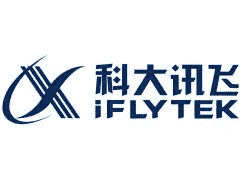
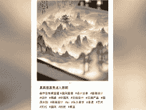

# 03.03-“中国首个 AI IDE”字节跳动 Trae 国内版发布：配置豆包 1.5pro，可切换满血版 DeepSeek

> 来源：[https://agijuejin.feishu.cn/docx/X3bBdokoIoH80dxNYbecQt74nse](https://agijuejin.feishu.cn/docx/X3bBdokoIoH80dxNYbecQt74nse)

# AGI 掘金日报 - AI 新闻推送 (2025 年 03 月 03 日)

> [欢迎加入 AGI 掘金社群](https://sourl.co/miZUyT)

## ⭐ 今日热点

### 💡 “中国首个 AI IDE”字节跳动 Trae 国内版发布：配置豆包 1.5pro，可切换满血版 DeepSeek

IT之家 | [阅读原文](https://www.ithome.com/0/834/902.htm)

3月3日，字节跳动官宣“中国首个AI原生集成开发环境（AI IDE）”Trae国内版上线。此前已在海外发布，国内版配置Doubao-1.5-pro，支持切换满血版DeepSeek R1、V3 模型。定位“智能协作AI IDE”，有代码相关功能，搭载全新Builder模式能通过自然语言生成应用。针对中国场景优化，即将支持模型自定义。官网已上线，提供Mac和Windows版，后续还有Linux版 。

## 🌟 技术突破

### 💡 北京最大单体智算集群亮相：规模突破 10000P，算力可顶 500 万台高性能笔记本

IT之家 | [阅读原文](https://www.ithome.com/0/834/906.htm)

3月3日消息，北京人工智能公共算力平台扩容，智算规模突破10000P，成北京最大、国内领先的超大规模高性能单体智算集群，能支撑大模型训练和推理。北京市经信局数据显示，北京人工智能企业超2400家，核心产业规模超3000亿元。截至今年1月，已建公共智能算力2.2万P，形成环京算力带，建成数据运营平台，汇聚超150个高质量数据集 。

### 💡 全球首例机器人“组团进厂打工”，优必选实现多台、多场景、多任务人形机器人协同实训

IT之家 | [阅读原文](https://www.ithome.com/0/834/898.htm)

3月3日消息，据“北京亦庄”公众号，优必选在极氪5G智慧工厂开展全球首例多台、多场景、多任务的人形机器人协同实训。此次实训旨在探索面向多任务工业场景的通用人形机器人群体作业解决方案，推动人形机器人从单机自主向群体智能进化 。

### 💡 国内首个光子 AI 智能引擎在南京诞生

IT之家 | [阅读原文](https://www.ithome.com/0/834/866.htm)

2025年3月3日消息，南京江北新区南智光电联合伙伴开发出国内首个光子AI智能引擎“OptoChat AI”，计划3月上线且免费开放。它基于顶尖大语言模型，结合超30万项专利文献等，为全球科研产业机构提供支持。南智光电去年4月启动“薄膜铌酸锂 + X”产线，已交付产品，去年底研发该智能引擎。此外，它还是国内首个实现8英寸铌酸锂光子芯片流片的企业，发布了国内首个晶圆级铌酸锂光子芯片PDK。

### 💡 东京测试人形机器人助力养老护理，应对日本老龄化难题

IT之家 | [阅读原文](https://www.ithome.com/0/834/800.htm)

2025 年 3 月 2 日消息，日本东京测试名为 AIREC 的人形机器人，以应对老龄化护理难题。其重约 149 公斤，开发旨在缓解护理人员短缺。早稻田大学教授称未来需机器人提供支持。虽需求迫切，但技术有障碍。2024 年该团队曾提出相关架构，用 Torobo 测试，多种技术助力。AIREC 最早 2030 年或在护理等机构使用，初步定价至少 1000 万日元。此外，我国牵头制定了养老机器人国际标准。

### 💡 腾讯携手创新“无监督前缀微调”技术：训练 tokens 最多减少 95%，提升 AI 推理效率

IT之家 | [阅读原文](https://www.ithome.com/0/834/763.htm)

3月1日，腾讯AILab与香港中文大学提出“无监督前缀微调”（UPFT）方法。该方法基于“前缀自洽性”，聚焦模型输出前8至32个词元训练，采用贝叶斯推理原理。实验显示，可减少95%的训练词元数量，降低时间和内存需求。在多个推理基准测试中表现优异，尤其在复杂推理任务中提升显著，有效提升大型语言模型推理效率 。

### 💡 4499元16G显存，AMD端掉英伟达？RX 9070系显卡出世，4K狂飙直追旗舰

新智元 | [阅读原文](https://www.163.com/dy/article/JPLAV5QM0511ABV6.html?spss=dy_author)

2月28日，AMD发布RDNA 4图形架构及Radeon™ RX 9000系列新显卡9070 XT和9070，专为游戏设计。新显卡高算力、高性价比，引入全新光追+AI加速器，性能提升显著且定价有优势。同时，FSR 4技术抗衡DLSS，RDNA 4架构融入更多AI技术。此前，AMD CEO苏姿丰看好AI发展，认为其未来在推理，AMD将聚焦高性能计算和AI推理 。

### 💡 小模型指导大模型！田渊栋等爆锤蒸馏：新方法更高效、更透明、更可控

新智元 | [阅读原文](https://www.163.com/dy/article/JPL5NDBQ0511ABV6.html?spss=dy_author)

近期AI领域有诸多进展。如DeepSeek效应初现，Grok-3表现出色；浙大、千问发布预训练数据管理器DataMan；Transformer²要做动态调整权重的AI模型；MIT团队用Transformer解决经验贝叶斯问题，速度快100倍；微软AI模型MatterGen能生成新材料；韩国实现18.95倍解码加速。此外，马斯克称5年内AI超越人类总智能，2029年文明终结概率20%，代表委员探讨AI是否会取代医生。

## 💫 企业动态

### 💡 AI学术算命？Gemini 2.0预测谷歌AI大佬职业生涯，准到离谱！

新智元 | [阅读原文](https://www.163.com/dy/article/JPNK75KN0511ABV6.html?spss=dy_author)

这些新闻涵盖多领域。技术突破上，微软有AI模型MatterGen可生成新材料，北京人工智能公共算力平台智算规模突破10000P；企业动态包括荣耀五年投100亿美元发展AI、百度将发布文心大模型4.5；行业观点方面，李彦宏称自动驾驶比人类司机安全十倍、马斯克称特斯拉有望实现1000%利润增长 ，此外还有众多人物观点及各类热点事件。

### 💡 科大讯飞星火 X1 模型升级，数学能力全面对标 DeepSeek R1 和 OpenAI o1

IT之家 | [阅读原文](https://www.ithome.com/0/834/867.htm)

2025年3月3日，科大讯飞宣布星火X1模型升级，并发布星火一体机等新品。升级后，星火X1数学能力全面对标DeepSeek R1和OpenAI o1 ，数学答题效果显著提升，在中小学数学作业相关任务上优势明显。测试集来源广泛，中文来自2023 - 2024年各学段真题等，英文来自相关竞赛集。此外，在升级后的星火X1加持下，讯飞晓医等应用与产品也实现升级。

### 💡 英语客服印度口音太重？全球最大呼叫中心运营商 Teleperformance SE 推出 AI 语音实时优化系统

IT之家 | [阅读原文](https://www.ithome.com/0/834/849.htm)

全球最大呼叫中心运营商Teleperformance SE推出AI语音实时优化系统“口音转换”，结合背景噪音消除功能，已在印度呼叫中心投入使用，服务苹果、TikTok、三星等企业。副首席执行官称该技术能零延迟调整口音，提升客户满意度等。公司今年计划在AI合作上最多投入1亿欧元。技术提供方Sanas旨在减少口音歧视，技术已适用于印、菲口音，还将推广至拉丁美洲。此外，其认为人工智能虽无处不在，但人类参与对提升客户体验仍不可或缺。

### 💡 联想摩托罗拉发布全新“Smart Connect”功能：一句话让 AI 帮你找文件

IT之家 | [阅读原文](https://www.ithome.com/0/834/839.htm)

2025年3月3日消息，MWC 2025期间，联想摩托罗拉的Smart Connect功能重大升级。升级后用户可用自然语言语音指令让AI执行任务，如投屏、找文件等。还加入可自定义仪表盘管理兼容设备。新版将在未来几周陆续推送，Windows用户通过Microsoft Store下载，摩托罗拉和联想设备用户在Google Play商店获取，面向兼容设备及Win10以上PC 。

### 💡 杭州在六小龙之后，又开始投资北京六小虎了

量子位 | [阅读原文](https://www.qbitai.com/2025/03/260666.html)

近日，智谱获超10亿元战略融资，资金用于GLM大模型技术创新与生态发展，也将服务浙江和长三角经济实体。智谱在大模型领域够全、够快、够实力，其GLM架构自主研发，突破技术封锁，迭代速度快且最早开源大模型。它市场表现佳、商业化路径清晰。杭州投资智谱，是基于多重逻辑，有望重塑城市竞争力。此外，智谱提出AGI分级架构，值得关注。

### 💡 消息称软银 CEO 孙正义计划借款 240 亿美元大举投资 AI

IT之家 | [阅读原文](https://www.ithome.com/0/834/798.htm)

据 The Information 报道，软银 CEO 孙正义计划借款 160 亿美元投资 AI，2026 年初或再借 80 亿美元推进战略布局。今年 1 月路透社称软银曾与 OpenAI 进行 250 亿美元投资谈判，还承诺向 Stargate 投资 150 亿美元。Stargate 是软银等成立的合资企业，计划投资 5000 亿美元，旨在助美国在 AI 竞赛中领先。这一系列动作显示软银加速向 AI 领域扩张。

### 💡 清华大学 2025 年将适度扩招本科生，重点培养“AI+”拔尖创新人才

IT之家 | [阅读原文](https://www.ithome.com/0/834/769.htm)

3月2日消息，清华2025年计划有序扩大本科招生规模，新增约150个名额，并成立新本科通识书院，培养人工智能与多学科交叉复合型人才。新书院汇聚优势学科资源，突出人工智能驱动作用。目前清华在人工智能人才培养等方面已取得初步成效，有多项教学实践成果，还在建设相关辅修专业、证书项目，打造特色通识课程。

### 💡 GPT-4.5 性能提升有限、成本却激增 30 倍，OpenAI 面临性价比质疑

IT之家 | [阅读原文](https://www.ithome.com/0/834/760.htm)

3月1日科技媒体报道，OpenAI最新模型GPT-4.5性能提升有限，改进幅度仅6.8 - 13.2个百分点，在专业、日常、创意任务方面优势不突出，但其成本大幅增加，输入成本是GPT-4o的30倍，输出成本是15倍。OpenAI表示该模型并非取代GPT-4o，正评估长期提供的可行性及独特价值。此外，OpenAI或推优化版GPT-4.5 Turbo，不过能否有显著优势存疑。

### 💡 马斯克暴论：5年内AI超越人类总智能，2029年文明终结概率20%！谷歌却在疯狂「玩火」

新智元 | [阅读原文](https://www.163.com/dy/article/JPL5P3660511ABV6.html?spss=dy_author)

这些新闻涵盖多方面。技术突破上，DeepSeek表现突出，训练成本低，在基准测试中有竞争力，微软等也有新成果；企业动态包括人形机器人应用拓展，OpenAI、谷歌等有新举措；行业观点上，李彦宏、马斯克、奥特曼等发表见解，还探讨AI对验证码、工作岗位等影响，以及国产机器人优势、AI能否取代医生等话题。

### 💡 湖北武汉首例“AI 生成图被侵权”著作权纠纷案一审宣判，被告公司需赔偿 4000 元

IT之家 | [阅读原文](https://www.ithome.com/0/834/731.htm)

3月2日消息，湖北武汉首例“AI生成图被侵权”案一审宣判。去年5月王某用AI软件生成图片发布后，次月发现被某科技公司用于广告。法院审理认为被诉图片具独创性表达，判该公司赔偿王某4000元。法官称判断时看关键词参数独创性及创作活动与作品关联性。目前国内法律对AI创作作品保护尚无明确说法，专家建议加快AI版权立法以适配产业发展 。

## ✨ 行业观点

### 💡 Hinton怒斥马斯克「电锯」屠遍美国科学界！3410位大佬联名将其从英国皇家学会除名

新智元 | [阅读原文](https://www.163.com/dy/article/JPNK7FD80511ABV6.html?spss=dy_author)

AI教父Hinton公开叫板马斯克，称其应被英国皇家学会除名，因对美国科学机构造成损害，马斯克回怼。早在2月，1300多名科学家联名表达担忧，目前已有3410人签署。此外，马斯克掌舵政府效率部门后大幅削减开支，已节省约550亿美元，这导致美国科研教育事业受冲击，高校招生、科研机构项目受影响，引发诸多不满 。

### 💡 马斯克：AI 毁灭人类的风险为 20%，未来结果更可能“超级棒”

IT之家 | [阅读原文](https://www.ithome.com/0/834/799.htm)

3月2日马斯克在播客节目分享对AI看法。他认为AI致人类毁灭概率20%，出现好结果概率80%，此前预测该概率在10% - 20% 。预计未来一两年AI超人类智力，2029或2030年超所有人类。其他专家也担忧AI致人类灭绝。马斯克最初涉足AI为创建非营利开源AI，对OpenAI不满后创立xAI并推出Grok，他觉得AI未来要么“超级棒”要么“超级糟糕” 。