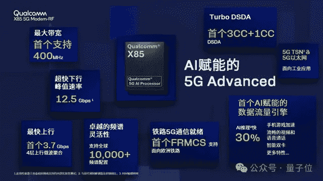
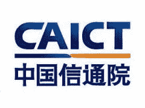
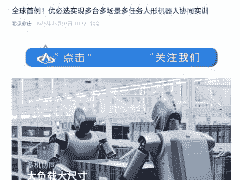
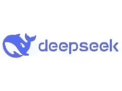
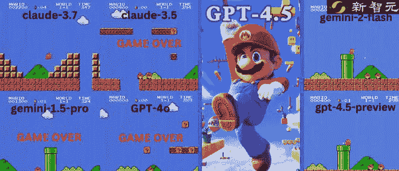

# 03.04-高通最新5G芯片，AI爆了

> 来源：[https://agijuejin.feishu.cn/docx/FNS0d38t8oGeu5xIbxGcgik5nUb](https://agijuejin.feishu.cn/docx/FNS0d38t8oGeu5xIbxGcgik5nUb)

# AGI 掘金日报 - AI 新闻推送 (2025 年 03 月 04 日)

> [欢迎加入 AGI 掘金社群](https://sourl.co/miZUyT)

## ⭐ 今日热点

### 💡 高通最新5G芯片，AI爆了

量子位 | [阅读原文](https://www.qbitai.com/2025/03/261351.html)

在世界移动通信大会（MWC）上，高通发布X85 5G调制解调器及射频，称其为5G AI处理器。X85下行峰值速度达12.5Gbps，有多项行业首创特性，AI推理速度比上一代快30%。此外还推出基于X85的固定无线接入平台至尊版，有诸多AI功能。高通早有“5G+AI”概念，如今二者相互促进，未来连接更重要，安卓用户体验或提升 。

## 🌟 技术突破

### 💡 耶鲁、剑桥等高校联合推出 MindLLM 医疗行业 AI 工具，可将大脑磁共振成像数据转为直观文字信息

IT之家 | [阅读原文](https://www.ithome.com/0/835/098.htm)

2025年3月3日消息，耶鲁大学联合剑桥大学等推出MindLLM医疗AI工具，能将脑部功能性磁共振成像（fMRI）数据转化为文字。它由fMRI编码器和大语言模型组成，采用神经科学注意力机制，引入脑部指令调优方法。在多项基准测试中，MindLLM相对业界模型有显著提升，最高达25.0%。不过目前只能分析静态图像信号，未来有望成实时fMRI解码器，应用于多个领域。相关论文已发布 。

### 💡 南大周志华带队斩获AAAI 2025杰出论文奖！吴恩达亲临现场，3篇上榜

新智元 | [阅读原文](https://www.163.com/dy/article/JPO7MJF50511ABV6.html?spss=dy_author)

AAAI 2025年会于2月25日-3月4日在美国费城举办，共收到12957篇有效投稿，录用率23.4%。今年有3篇杰出论文，周志华团队在神经-符号AI取得新突破，让AI能“反思”错误；多伦多大学解决多智能体系统相关开放问题；波尔多大学等为部分可观察马尔可夫决策过程构建精确算法。此外，AAAI还公布报告，吴恩达现场发表演讲。

### 💡 历时6个月，Hugging Face开源LLM「超大规模实战手册」！200页3万字4000次训练

新智元 | [阅读原文](https://www.163.com/dy/article/JPNR91SG0511ABV6.html?spss=dy_author)

Hugging Face耗时6个月发布「超大规模训练手册」，在512个GPU上做超4000个实验。训练有显存占用、计算效率、通信开销等挑战。手册介绍多种技术，如激活值重计算、梯度累积等减少显存占用；还阐述数据并行、ZeRO、张量并行等并行方法提升效率，探讨不同并行技术组合及调度策略在大规模训练中的应用。

### 💡 中国信通院“智御”个人信息保护大模型宣布接入 DeepSeek

IT之家 | [阅读原文](https://www.ithome.com/0/834/927.htm)

2024 年 2 月中国信通院发布国内首个个人信息保护 AI 大模型“智御”助手。3 月 3 日，“智御”宣布接入 DeepSeek，实现个人信息保护领域综合能力跃升。“智御”面向行业上下游企业提供多类服务，已输出 7200 余条合规优化建议。融合升级后，它借助 DeepSeek 能力，提升语义意图识别等能力，能处理更复杂场景任务，提供更优质服务。

### 💡 北京最大单体智算集群亮相：规模突破 10000P，算力可顶 500 万台高性能笔记本

IT之家 | [阅读原文](https://www.ithome.com/0/834/906.htm)

3月3日消息，北京人工智能公共算力平台扩容，智算规模突破10000P，成北京最大、国内领先的单体智算集群，能支撑大模型训练和推理。北京市经信局数据显示，北京人工智能企业超2400家，核心产业规模超3000亿元，已建公共智能算力2.2万P，建成数据运营平台，汇聚超150个高质量数据集 。

### 💡 全球首例机器人“组团进厂打工”，优必选实现多台、多场景、多任务人形机器人协同实训

IT之家 | [阅读原文](https://www.ithome.com/0/834/898.htm)

3月3日消息，据“北京亦庄”公众号，优必选在极氪5G智慧工厂开展全球首例多台、多场景、多任务的人形机器人协同实训。此次实训旨在探索面向多任务工业场景的通用人形机器人群体作业解决方案，推动人形机器人从单机自主向群体智能进化 。

## 💫 企业动态

### 💡 国内第一波弃用 DeepSeek 的公司：潞晨科技官宣暂停相关 API 访问

IT之家 | [阅读原文](https://www.ithome.com/0/835/150.htm)

潞晨科技成为国内第一波弃用 DeepSeek 的公司，在 DeepSeek 公布线上系统理论成本利润率达 545% 后，宣布暂停其 API 访问服务。创始人尤洋多次提到成本问题，如 DeepSeek 超负荷运行数据、产品掉线、实际训练成本高。多位人士称，第三方 MaaS 厂商难达官方成本，潞晨科技因成本压力暂停服务。目前国内数百家企业接入 DeepSeek，其开源正颠覆众多中小 MaaS 厂商商业模式。

### 💡 估值升至 615 亿美元，Anthropic 完成 35 亿美元 E 轮融资

IT之家 | [阅读原文](https://www.ithome.com/0/835/125.htm)

3月4日，AI模型企业Anthropic完成35亿美元E轮融资，由Lightspeed Venture Partners领导，思科等参与，投后估值达615亿美元。Anthropic称将借此推进下一代AI系统开发，扩大计算能力，深化相关研究并加速国际业务扩张。还计划在Claude 3.7 Sonnet基础上提升大模型编程能力，开发AI协作者系统。

### 💡 直击MWC2025：联想PC再秀新花样，首款外折屏、太阳能笔记本来了

量子位 | [阅读原文](https://www.qbitai.com/2025/03/261362.html)

3月3日在MWC2025上，联想集团发布系列混合式人工智能技术。成果涵盖新设备形态与智能化方案，如多款AI PC 、外折屏ThinkBook Flip AI PC概念机、YOGA太阳能笔记本电脑概念机等。还推出联想AI Now、超级互联Smart Connect 2.0等软件及高性价比边缘推理服务器ThinkEdge SE100。杨元庆称融合能提供卓越方案。联想推动AI普惠、个性化，助力企业转型，引领AI走向更广阔场景 。

### 💡 国行三星 Galaxy S25 系列手机官宣支持 DeepSeek-R1 大模型，进入 AI“智能体中心”即可体验

IT之家 | [阅读原文](https://www.ithome.com/0/835/101.htm)

3月3日，三星中国官宣国行Galaxy S25系列接入DeepSeek-R1大模型。用户将三星生活助手升级至最新版本，或在三星智慧主页、三星Bixby中进入“智能体中心”，就能选深度思考（DeepSeek-R1）智能体，体验多种能力。此外，三星表示Bixby的语聊视界功能近期将上线，届时Bixby能深度推理并提供情绪价值 。

### 💡 国家网络安全通报中心通报：大模型工具 Ollama 存在安全风险

IT之家 | [阅读原文](https://www.ithome.com/0/835/056.htm)

3月3日，国家网络安全通报中心称，开源跨平台大模型工具Ollama默认配置有安全隐患。用其本地部署大模型时，默认开放11434端口且无鉴权机制，存在未授权访问、数据泄露风险，还可能因历史漏洞致模型服务受威胁。大量有隐患服务器暴露，建议用户限制监听范围、配置防火墙、实施认证控制等进行安全加固，遭攻击及时报告。

### 💡 「债台高筑」孙正义，狂借500亿美元砸向OpenAI！马斯克：杠杆率太高了

新智元 | [阅读原文](https://www.163.com/dy/article/JPO7KOJA0511ABV6.html?spss=dy_author)

软银CEO孙正义计划借款投资AI，包括计划借款160亿美元，2026年初或再借80亿美元，还安排185亿美元贷款。加上自有资金，他为投资Stargate及OpenAI至少准备500亿美元，此前承诺向二者共投450亿美元 。这些投资超软银现金储备，增加债务压力，但股东目前满意。孙正义一贯激进借贷投资，虽有成功案例，但也有WeWork等失败教训，此次投资引发对回报的质疑 。此外，Meta也在洽谈借入约350亿美元。

### 💡 深圳：重点支持具身智能机器人核心零部件、AI 芯片、仿生灵巧手等关键核心技术攻关

IT之家 | [阅读原文](https://www.ithome.com/0/834/981.htm)

《深圳市具身智能机器人技术创新与产业发展行动计划（2025 - 2027 年）》印发。到 2027 年，要在多项关键技术取得突破，培育众多高估值、高营收企业，落地大量应用场景，关联产业规模达 1000 亿元以上。计划明确重点任务，包括核心技术攻坚、打造公共服务平台等，还提及保障措施，如组建产业专班、加强人才培养、建设专业化园区等。

### 💡 印尼 DeepFake 深度伪造 AI 视频骗局泛滥，消息称有民众因“总统的脸”中招

IT之家 | [阅读原文](https://www.ithome.com/0/834/974.htm)

随着AI融入生活，多地出现利用DeepFake技术伪造视频诈骗现象。在印尼，总统普拉博沃头像频被盗用制作“深伪”视频。自去年10月其就职以来，至少22个虚假账号冒充他，以提供“援助”为由，骗民众转25万至100万印尼盾（约109.75元至438.99元）“行政费” 。一个账号有7.7万追随者，1月以来上传100个伪造视频，部分账号已被关停。

### 💡 深圳：推出各类创新形态手机产品，率先完成智能手机从“智能工具”向“智能助理”升级

IT之家 | [阅读原文](https://www.ithome.com/0/834/934.htm)

2025年3月3日，深圳印发《深圳市加快推进人工智能终端产业发展行动计划（2025—2026 年）》。提出到2026年产业规模达8000亿以上、力争1万亿等目标。还明确重点品类，如人工智能手机要完成从“智能工具”到“智能助理”升级；计算机、平板电脑等多类产品也有各自发展方向，推动各领域智能化转型 。

### 💡 19岁退学哈佛CS，这个00后两年打造百亿独角兽！月收入5000万，AI招聘官杀疯了

新智元 | [阅读原文](https://www.163.com/dy/article/JPNR3TJ40511ABV6.html?spss=dy_author)

三位00后创立的AI招聘公司Mercor，辍学创业仅24个月，估值达20亿美元，年化收入7500万美元。其因发现AI人才招聘市场商机而创立，获General Catalyst等多轮投资，投资人阵容豪华。它从人工职位匹配发展为技术驱动系统，人才库超46万求职者，匹配候选人超30万，面试超10万次。公司旨在构建公平招聘方式，CEO称AI不会取代人类，而是让人类在特定领域更有价值。

### 💡 Hinton怒斥马斯克「电锯」屠遍美国科学界！3410位大佬联名将其从英国皇家学会除名

新智元 | [阅读原文](https://www.163.com/dy/article/JPNK7FD80511ABV6.html?spss=dy_author)

AI 教父 Hinton 公开叫板马斯克，认为其应被英国皇家学会除名，因对美国科学机构造成损害，马斯克回怼。早在 2 月，1300 多名科学家联名表达担忧，如今已有 3410 人签署。皇家学会今日开会讨论对马斯克的判决。此外，马斯克掌舵相关部门后大力削减开支，节省约 550 亿美元，但这导致美国高校和科研受冲击，NIH 研究资助资金冻结等，影响研究生招生和科研人员发展 。

### 💡 AI学术算命？Gemini 2.0预测谷歌AI大佬职业生涯，准到离谱！

新智元 | [阅读原文](https://www.163.com/dy/article/JPNK75KN0511ABV6.html?spss=dy_author)

这些新闻涵盖多领域。技术上，微软AI模型MatterGen可生成新材料，北京人工智能公共算力平台智算规模突破10000P。企业方面，荣耀将5年投入100亿美元发展AI并展示AI代理订位，百度将发布文心大模型4.5。行业观点上，李彦宏称自动驾驶比人类司机安全十倍等。此外还有人物言论、学术、商业竞争等各类信息。

## ✨ 行业观点

### 💡 科大讯飞董事长刘庆峰 2025 年两会建议：设立 AI 失业保险

IT之家 | [阅读原文](https://www.ithome.com/0/834/946.htm)

2025年两会前夕，全国人大代表、科大讯飞董事长刘庆峰呼吁发展AI新岗位，完善AI失业保障，打造“AI就业友好型社会”。他建议构建全链条监测机制，试点“AI失业保障专项保险”，加强人工智能新职业的规划与管理。目前“AI导致失业”受关注，文中列举了美国科技行业失业率变化等数据，还提及我国人工智能市场规模占比等信息 ，以及全球职场就业机会变革的预测。

### 💡 Claude 3.7硬控马里奥90秒，GPT-4o开局暴毙！Karpathy直呼基准失效，游戏成LLM新战场

新智元 | [阅读原文](https://www.163.com/dy/article/JPNRCFVG0511ABV6.html?spss=dy_author)

AI 大神 Karpathy 质疑现有评估指标，提出评估危机。UCSD Hao AI Lab 用游戏评测 AI 智能体，开源「游戏智能体」。测试结果显示，Claude 3.7 Sonnet 玩超级马里奥表现出色，撑满 90 秒，碾压 OpenAI、Gemini 等；GPT - 4o 开局即败，GPT - 4.5 反应迟缓。Gemini 1.5 Pro 首战不佳，2.0 虽有进步但仍栽坑。此外，在 2048 等游戏测试中，不同模型也各有表现。Anthropic 开发者认为可将游戏变成评估工具，LLM 评估或开辟新路径。