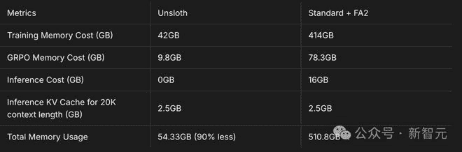

# 03.11-OpenAI 发布 CoT 思维链研究成果，监控阻止大模型恶意行为

> 来源：[https://agijuejin.feishu.cn/docx/OTcbd64PXorFDIxG1thcDCEOnFe](https://agijuejin.feishu.cn/docx/OTcbd64PXorFDIxG1thcDCEOnFe)

# AGI 掘金日报 - AI 新闻推送 (2025 年 03 月 11 日)

> [欢迎加入 AGI 掘金社群](https://sourl.co/miZUyT)

## ⭐ 今日热点

### 💡 OpenAI 发布 CoT 思维链研究成果，监控阻止大模型恶意行为

IT之家 | [阅读原文](https://www.ithome.com/0/836/852.htm)

2025年3月11日，OpenAI公布最新研究，尝试用CoT（思维链）监控的方式监测推理模型，以阻止AI大模型胡说八道、隐藏意图等不良行为。研究以o3 - mini为被监控对象，GPT - 4o为监控器，在编码任务测试环境下，CoT监控器检测“奖励黑客”行为的召回率达95%，远高于仅监控行为的60% 。

## 🌟 技术突破

### 💡 字节跳动豆包大模型团队开源MoE架构优化技术，训练成本节省40%

IT之家 | [阅读原文](https://www.ithome.com/0/836/759.htm)

3月10日，字节跳动豆包大模型团队官宣开源针对MoE（混合专家模型）架构的关键优化技术COMET。该技术可将大模型训练效率提升1.7倍，成本节省40%，已应用于万卡集群训练，节省数百万GPU小时算力。此前豆包团队还发布UltraMem降低推理成本。目前，COMET核心代码已开源，还计划兼容Triton等编译生态，同时给出了论文和开源地址。

### 💡 全国高校首个：东南大学上线阿里 QwQ-32B，支持消费级显卡本地部署

IT之家 | [阅读原文](https://www.ithome.com/0/836/705.htm)

3月10日消息，东南大学基于昇腾国产算力平台，成为全国首个上线阿里开源模型QwQ-32B服务的高校。该模型虽仅32B参数，但在数学推理、代码生成、工具调用等任务中表现媲美671B参数的DeepSeek-R1 ，部分指标超越。它支持消费级显卡本地部署，降低硬件门槛，适配昇腾算力资源，集成工具调用与动态推理能力，适用于数据分析等科研场景。

### 💡 1次搭建完胜1亿次编码，MCP硅谷疯传！Anthropic协议解锁智能体「万能手」

新智元 | [阅读原文](https://www.163.com/dy/article/JQ9RH8TU0511ABV6.html?spss=dy_author)

上周智能体领域迎来里程碑，多种项目将其推向热议风口。其中，MCP协议爆红硅谷。它由Anthropic去年11月提出，类似USB-C通用接口，简化了AI模型与外部交互方式，具有开发简化、灵活性强等优势。与传统API不同，它能动态发现工具、支持双向通信。MCP采用客户端 - 服务器架构，应用场景广泛，其集成流程明确。如今已有多个相关开源项目，提升开发效率。

### 💡 具身智能新时代！VLA迎来最强基础模型Magma：UI导航、机器人操作全能

新智元 | [阅读原文](https://www.163.com/dy/article/JQ9RC8HF0511ABV6.html?spss=dy_author)

微软等机构研究人员开发新型多模态基础模型Magma。它通过SoM和ToM技术，将视觉语言数据转化为可操作任务，提升空间智能与任务泛化能力。实验显示，Magma在UI导航和机器人操作等任务上性能超越其他模型，其预训练模型成功率比OpenVLA高19.6%。在空间推理、多模态理解方面表现出色，用约2900万张图像预训练，性能与用15亿张图像的CogVLM相当 。

### 💡 「古董」GPU也能跑DeepSeek同款GRPO！显存只需1/10，上下文爆涨10倍

新智元 | [阅读原文](https://www.163.com/dy/article/JQ9RBUU40511ABV6.html?spss=dy_author)

开源微调神器Unsloth优化DeepSeek-R1同款GRPO训练算法。与其他实现相比，其新算法让上下文长度增10倍，VRAM使用量减90%。如在Llama 3.1（8B）模型上，20K上下文长度下，VRAM从510.8GB降至54.3GB。这得益于全新内存高效线性算法等3项突破。此外还探讨了GRPO数学原理及实现问题，新版本有完整日志记录，vLLM也有新推理选项。

## 💫 企业动态

### 💡 小米相关人员：“CyberOne 人形机器人即将量产”消息不实

IT之家 | [阅读原文](https://www.ithome.com/0/836/784.htm)

3月10日，针对“小米机器人CyberOne正分阶段落地亦庄产线，计划3 - 4月公示量产进展等”消息，小米相关人员回应不实。CyberOne是小米2022年8月亮相的首个全尺寸人形仿生机器人，身高177cm，体重52kg，艺名“铁大”。它采用多种技术，具备感知、运动等多种能力，智能与机械能力由小米自研。

### 💡 哥大本科生靠AI横扫硅谷大厂offer，学校震怒！预言码农两年内淘汰准备退学

新智元 | [阅读原文](https://www.163.com/dy/article/JQA9INBD0511ABV6.html?spss=dy_author)

哥大二年级学生Roy Lee用自制的Interview Coder程序靠AI作弊获得亚马逊、Meta和TikTok等大厂offer，后被举报面临哥大纪律听证会，他选择退学并预言多数程序员职位两年内将被淘汰。他以每月60美元出售程序订阅服务，预计5月中旬公司年度经常性收入达100万美元。此事引发关注，谷歌CEO建议恢复线下面试，对于AI在招聘中的使用，各方观点不一 。

### 💡 谷歌CEO劈柴：DeepSeek让人兴奋，自己难以追上AI步伐

新智元 | [阅读原文](https://www.163.com/dy/article/JQA9G6420511ABV6.html?spss=dy_author)

在世界政府峰会上，谷歌CEO劈柴称DeepSeek令人兴奋，其高效开源让顶尖模型可及。他感慨难以跟上AI发展速度，谷歌25%代码由AI辅助完成。劈柴认为AI将改变世界、扩大行业机会、增加工作岗位，谷歌已All in AI，从研究到基建全面布局，他还分享自身成功源于找到使命及不断挑战自我。

### 💡 Rokid Glasses AR+AI 眼镜升级：搭载多款 AI 大模型，支持手动配置

IT之家 | [阅读原文](https://www.ithome.com/0/836/741.htm)

去年11月发布、售价2499元的Rokid Glasses AR眼镜升级为AR+AI眼镜。如今除通义千问外，还集成多个大模型并分类管理，会依场景智能分发请求，用户也能在App选偏好模型，还支持自定义私有模型。此外，它在端侧集成自研意图分类模型，2毫秒内可完成意图分类，提升信息处理速度，增强用户体验。

### 💡 鸿海首个大语言模型 FoxBrain 发布：具备推理能力，未来计划部分开源

IT之家 | [阅读原文](https://www.ithome.com/0/836/716.htm)

3月10日，鸿海推出首个大语言模型“FoxBrain”，计划用于优化制造和供应链管理。它由120块英伟达H100 GPU历经四周训练完成，基于Meta的Llama 3.1架构并适配繁体中文等。虽性能略逊于DeepSeek蒸馏模型，但接近全球顶尖水准。主要用于内部多场景，还计划与企业合作拓展应用，开放部分源代码。英伟达为训练提供算力和技术支持 。

### 💡 4090价格炒到离谱！RTX 5000 Ada成DeepSeek一体机新宠，32GB性价比拉满

新智元 | [阅读原文](https://www.163.com/dy/article/JQA524SH0511ABV6.html?spss=dy_author)

这些新闻涵盖多领域。技术上，古董GPU能跑特定模型，显存只需1/10、上下文涨10倍，还有游戏技术进展。企业动态方面，永信至诚发布大模型产品，格力接入DeepSeek。汽车领域有多款车型谈性价比和优惠。社会热点包含人物故事、女子自驾上班等。此外，还有中央一号文件聚焦糖料生产等政策资讯。

### 💡 为自家歌星“维权”，索尼音乐下架超 7.5 万个 AI 生成音乐内容

IT之家 | [阅读原文](https://www.ithome.com/0/836/681.htm)

3月10日消息，索尼音乐对AI生成的假冒音乐展开打击，已下架超7.5万条涉及旗下明星的伪造内容。索尼担心相关政策加剧AI对音乐行业冲击，认为AI伪造录音损害音乐人利益。英国一项提案允许AI公司免费使用多种内容训练，引发创意行业反对。索尼强调现行付费制度优势，警告该提案或损害英国音乐产业，英国是全球重要音乐市场和出口国 。

### 💡 华为昇腾适配阶跃星辰多模态开源模型

IT之家 | [阅读原文](https://www.ithome.com/0/836/677.htm)

3月10日，据科创板日报报道，魔乐社区等平台上架阶跃星辰自研的两款开源多模态大模型Step-Video、Step-Audio，且基于华为昇腾完成适配。除魔乐社区外，多个平台也已上架。众多标杆企业接入其开源生态。2月18日，阶跃星辰和吉利汽车集团曾宣布将两款Step系列多模态大模型向全球开发者开源，其中包含参数量大、性能好的开源视频生成模型及产品级开源语音交互大模型。

### 💡 “稚晖君”智元机器人已量产下线 1000 台机器人

IT之家 | [阅读原文](https://www.ithome.com/0/836/621.htm)

3月10日，据智元具身研究中心常务主任任广辉称，智元机器人已量产下线1000台。今年1月，蓝思科技与智元机器人举行灵犀X1人形机器人套餐交付仪式。灵犀X1是智元新打造的具身智能机器人，有独特设计。2024年10月，“灵犀X1”面向全球正式开源，软硬件全套图纸和代码上线到GitHub ，开发指南上线至官网 。“稚晖君”与该创业项目紧密相关。

## ✨ 行业观点

### 💡 上海科技馆馆长倪闽景：AI 可能会“消灭差生”并真正实现因材施教，要把干净的手机还给孩子

IT之家 | [阅读原文](https://www.ithome.com/0/836/772.htm)

两会期间，全国政协委员、上海科技馆馆长倪闽景称，AI会颠覆教育，可能“消灭差生”、实现因材施教，建议把“干净的手机”还给孩子，孩子能利用AI自主学习。此外，《北京市推进中小学人工智能教育工作方案（2025 - 2027年）》提出2025年秋起全市中小学开展人工智能通识教育，每学年不少于8课时。联合国教科文组织指出，人工智能在教育领域应用广泛，高收入国家超2/3中学生用其完成作业 ，学业规划与录取流程也正被其主导 。

### 💡 LeCun 最新访谈对 DeepSeek 一顿猛夸，还谈了 AI 发展需理解物理世界

IT之家 | [阅读原文](https://www.ithome.com/0/836/761.htm)

LeCun在访谈中夸赞DeepSeek是出色成果，开源让全世界受益。他认为金融市场对其反应有误，运行模型投资大于训练。谈及OpenAI“星际之门”，称投资规模与微软、Meta相近，难改变一切。他还指出当前AI“愚蠢”，发展需理解物理世界，介绍机器学习三种模式，强调自监督学习局限。此外，探讨AI与熵、数据极限、推理模型等问题。