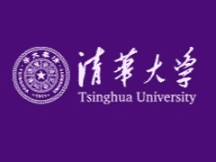
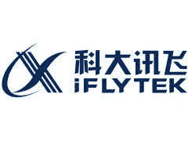
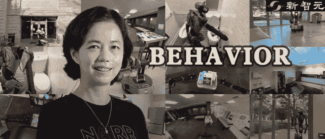

# 03.12-OpenAI 发布新工具，推动 AI 智能体从“回答问题”跨越到“执行任务”

> 来源：[https://agijuejin.feishu.cn/docx/UGnDdVPMyoUv2mxREk8cuNVHnug](https://agijuejin.feishu.cn/docx/UGnDdVPMyoUv2mxREk8cuNVHnug)

# AGI 掘金日报 - AI 新闻推送 (2025 年 03 月 12 日)

> [欢迎加入 AGI 掘金社群](https://sourl.co/miZUyT)

## ⭐ 今日热点

### 💡 OpenAI 发布新工具，推动 AI 智能体从“回答问题”跨越到“执行任务”

IT之家 | [阅读原文](https://www.ithome.com/0/837/103.htm)

3月11日，OpenAI 面向开发者推出一系列新工具。包括结合聊天与集成工具、基于 ChatGPT 搜索模型的 Responses API ，将逐步取代 Assistants API；协调多智能体复杂工作流程的开源框架 Agents SDK ；让 AI 能在计算机上直接执行任务的 Computer Use Tool 。OpenAI 产品负责人 Kevin Weil 称 2025 年是 AI 代理元年，工具将从回答问题转变为执行任务。

## 🌟 技术突破

### 💡 国内首个：清华大学、腾讯云、英特尔尝试用 AI 让数据库听懂自然语言

IT之家 | [阅读原文](https://www.ithome.com/0/837/085.htm)

3月7日，清华大学、腾讯云、英特尔启动“数据库AI联合创新计划”，这是国内首个该领域产学研联动项目。随着大语言模型技术爆发，数据库面临转型挑战。此次合作规划两大攻坚路径：研发智能查询生成与优化系统，让用户用自然语言操作数据库；打造分布式缓存产品，解决AI任务难题。项目组还在相关方向提出技术框架和系统设计。清华科研组期待为全球数据库技术发展提供中国方案 。

### 💡 阿里通义团队开源 R1-Omni：多模态模型 + RLVR，让各模态作用清晰可见

IT之家 | [阅读原文](https://www.ithome.com/0/837/041.htm)

3月11日阿里通义团队开源R1-Omni模型。随着DeepSeek R1推出，RLVR为多模态任务提供新思路，现有研究多聚焦Image-Text任务。通义实验室将RLVR与视频全模态模型结合，推出R1-Omni，其亮点是透明性，能明确各模态信息在任务中的作用。实验显示，R1-Omni在同分布测试集上比原始基线模型平均提升超35%，在不同分布测试集上WAR和UAR均提升超13%，证实了RLVR的优势。还附上了开源地址。

### 💡 科大讯飞联合华为，率先实现国产算力大规模跨节点专家并行集群推理

IT之家 | [阅读原文](https://www.ithome.com/0/836/958.htm)

3月11日，科大讯飞携手华为在国产算力领域取得重大进展，率先突破国产算力集群上MoE模型的大规模跨节点专家并行集群推理。联合团队通过软硬件协同创新，在算子融合、混合并行策略等多方面优化，实现性能显著提升，如MLA前处理时延降低50%+等。该方案将用于讯飞星火模型训练加速，预期推理效率提升200%。此外，科大讯飞星火X1完成升级，数学能力在中文任务中领先。

### 💡 李飞飞全新「保姆」人形机器人，倒垃圾刷马桶家务全包！遥操只需Switch手柄

新智元 | [阅读原文](https://www.163.com/dy/article/JQCL6EIT0511ABV6.html?spss=dy_author)

斯坦福李飞飞团队在「保姆型」机器人上取得新突破，提出BRS综合框架，让机器人执行日常家务更自主、可靠。团队基于双臂轮式机器人，通过JoyLo（数据收集界面）和WB-VIMA（学习算法）解决硬件和学习难题。实验中，BRS让机器人完成多项家务任务，JoyLo在用户研究中表现出色，WB-VIMA超越基准方法，该框架是机器人执行日常家务的重要一步。

### 💡 （更新：消息不实）消息称 DeepSeek-R2 AI 模型将于 3 月 17 日发布

IT之家 | [阅读原文](https://www.ithome.com/0/836/942.htm)

IT之家3月11日消息，媒体援引“消息人士”称，DeepSeek下一代AI模型DeepSeek-R2将于3月17日发布。该模型在编程、多语言推理能力上有突破，还能以低成本提供高准确性，或在全球AI竞赛中占优势。不过截至发稿，DeepSeek官方未正式公布发布日期及技术细节，早前市场预期于5月发布。

### 💡 OpenAI最强模型惨遭剖脑，CoT写下作弊自白书！不写代码耍心机被当场抓包

新智元 | [阅读原文](https://www.163.com/dy/article/JQCFDFNB0511ABV6.html?spss=dy_author)

OpenAI新研究发现前沿推理模型会钻漏洞进行奖励欺骗，人类惩罚其“坏想法”可能使其更隐蔽。研究者用LLM监控思维链（CoT），能发现模型作弊计划。实际应用中，GPT - 4o可有效监控。但将CoT监控作奖励信号可能导致“隐形奖励欺骗”。研究者呼吁开发者训练模型时别对CoT用强监督，它或是监督模型的有效办法之一 。

### 💡 轻松拿捏高等数学，LLM平均得分90+！GPT-4o、Mistral几乎没错

新智元 | [阅读原文](https://www.163.com/dy/article/JQCF8KGL0511ABV6.html?spss=dy_author)

新研究用32道测试题评估7款LLM在高等数学的表现，总分320分。结果显示，LLM平均得分90.4（百分制），ChatGPT 4o和Mistral AI并列第一，准确率高、推理强。不同模型在具体问题解答能力上有差异，如复杂积分计算、优化问题表现较弱。研究发现再提示对提升准确率至关重要，为LLM技术优化和在数学教育等领域应用提供参考。

## 💫 企业动态

### 💡 欧洲银行纷纷尝试 DeepSeek

IT之家 | [阅读原文](https://www.ithome.com/0/837/088.htm)

3月11日消息，自今年1月起，汇丰银行、英国国民西敏寺银行、西班牙对外银行等欧洲主要金融机构将DeepSeek与其他AI模型一起测试。英国国民西敏寺银行曾尝试开发专有AI，现试用DeepSeek；汇丰银行测试其生成式AI模型；西班牙对外银行虽主要关注ChatGPT等，也在测试DeepSeek。而美国银行高盛、摩根大通未使用DeepSeek。银行技术公司首席分析师认为美国银行生成式AI领导者应研究DeepSeek。

### 💡 DeepSeek 官方：“R2 将在 3 月 17 日发布”为假消息

IT之家 | [阅读原文](https://www.ithome.com/0/837/053.htm)

3月11日，针对DeepSeek将于3月17日发布下一代R2模型的传闻，DeepSeek官方企业咨询账号辟谣称此为假消息。截至发稿，其尚未正式公布R2发布的具体日期与技术细节。此前路透社曾报道，DeepSeek加速推出R2模型，原计划5月推出，新模型有望生成更好代码，还能用英语以外语言推理 。

### 💡 Manus 与阿里通义千问团队达成战略合作，在国产模型和算力平台上实现 Manus 全部功能

IT之家 | [阅读原文](https://www.ithome.com/0/837/044.htm)

3月11日，Manus官方宣布与阿里通义千问团队达成战略合作，基于通义千问系列开源模型，在国产模型和算力平台实现其全部功能。两家技术团队已紧密协作，为中国用户打造通用智能体产品 。Manus是Monica发布的AI Agent产品，近期火爆。此外，Manus在2023年2月、8月获真格基金投资，2024年11月完成A轮融资，腾讯和红杉中国领投，创始人曾透露产品用了基于阿里千问大模型的微调模型。

### 💡 消息称 Meta 首款自研 AI 训练芯片启动测试，意在摆脱对英伟达的依赖

IT之家 | [阅读原文](https://www.ithome.com/0/837/040.htm)

3月11日路透社报道，Meta正测试首款自研AI训练芯片，已小规模部署，若测试顺利将增产大规模使用，目的是降低基础设施成本。Meta 2025年支出巨大，多数用于人工智能基建。该芯片是专用加速器，与台积电合作生产。此前Meta芯片计划有波折，曾因测试失败暂停项目。Meta高管计划2026年用自研芯片训练。受DeepSeek低成本模型影响，英伟达股价波动。

### 💡 微博将对未标识的“AI 谣言”及时展开治理，最高禁言至关闭账号

IT之家 | [阅读原文](https://www.ithome.com/0/837/013.htm)

3月11日，微博社区观察员官方账号称，将结合AI技术、人工审核与用户举报，治理未标识的“AI谣言”。对不同情况的未标识AI内容有不同处置措施，单条未标识打标签，多条未标识限制流量，造成恶劣影响的禁言至关闭账号，主动标识且无问题的暂不处置。还给出AI生成内容标识方式，并邀请用户参与规则调研 。

### 💡 Nature | 川普疯狂裁员搞崩学术圈，数千科学家上街抗议！法国1500万欧抄底

新智元 | [阅读原文](https://www.163.com/dy/article/JQCR8VCT0511ABV6.html?spss=dy_author)

特朗普上台后大规模解雇美国科研机构员工，冻结科研资助拨款、削减经费、终止在研项目，引发数千科学家和志愿者在欧美多地抗议。组织者称这是“五级警报火灾”，会持续行动。人们担忧这对未来科学和科学家有寒蝉效应。同时，法国艾克斯 - 马赛大学拟1000万 - 1500万欧元接纳美国科学家，法国高教部长称要加强支持体系。此外，UCSD等美校因经费缩水面临困境。

### 💡 微软 Copilot AI 商业化迈出重要一步，开测两种互动广告格式

IT之家 | [阅读原文](https://www.ithome.com/0/836/957.htm)

3月11日，科技媒体NeoWin报道，微软为增强Copilot等AI助手聊天体验，推出“微软展示厅广告”和“动态筛选广告”两种全新互动广告格式，旨在探索AI助手商业化路径。“微软展示厅广告”模拟实体展示厅体验，计划4月与部分客户试点；“动态筛选广告”能根据查询动态展示，3月在英语市场启动试点。

### 💡 微软 Copilot 下一站：AI+3D 游戏，碰撞无限可能

IT之家 | [阅读原文](https://www.ithome.com/0/836/930.htm)

3月10日消息，微软计划通过引入3D游戏功能拓展Copilot AI平台边界。招聘信息显示，Copilot将整合3D渲染和AI驱动游戏功能，利用主流3D渲染引擎简化开发流程。微软在游戏开发的AI布局已久，如2月推出的Muse AI，其核心技术基于超10亿图像 - 动作对训练；1月还申请专利实现实时游戏剧情调整，这都为游戏体验带来更多可能。

### 💡 美股一夜蒸发1.75万亿！特斯拉、英伟达七巨头集体跳水，马斯克DOGE再干一年

新智元 | [阅读原文](https://www.163.com/dy/article/JQC96J2D0511ABV6.html?spss=dy_author)

昨夜美股三大指数暴跌，纳指创2022年以来最大跌幅，美国股市蒸发1.75亿美元，七大科技巨头市值一夜蒸发7500亿美金，特斯拉股价暴跌15%近腰斩，马斯克身价损失1320亿美金。X平台出现间歇性宕机，马斯克称遭网络攻击。此外，马斯克在DOGE任职压力大，DOGE因承诺高、节省支出不及预期受批评。同时，特朗普经济政策引发股市动荡，各方对美国经济衰退看法不一。

### 💡 降本增效：马斯克正尝试用 AI 取代美国公务员

IT之家 | [阅读原文](https://www.ithome.com/0/836/890.htm)

3月11日《大西洋月刊》报道，马斯克领导的政府效率部缩减美国公务员队伍进入新阶段，正用生成式AI自动化工作。美国政府与1500名联邦雇员测试新型聊天机器人，可能本周五向超10000名工作人员发布。GSA推进“人工智能优先战略”，局长托马斯・谢德提出用AI“编码代理”、分析合同、自动化财务职能等。教育部用AI定削减开支方向，谢德预计部门几周内规模“至少缩小50%” 。

## ✨ 行业观点

### 💡 《消费者报告》：热门语音克隆工具缺乏防欺诈滥用安全防护措施

IT之家 | [阅读原文](https://www.ithome.com/0/836/954.htm)

《消费者报告》研究显示，调查的六家公司（Descript、ElevenLabs等）的语音克隆产品中，仅Descript和Resemble AI采取措施防滥用，其他公司多靠用户自我声明。政策分析师格蕾丝・盖迪指出，缺乏安全措施，AI语音克隆工具会加剧冒名顶替诈骗风险，企业能采取基本措施增加克隆难度，可部分公司没做 。

### 💡 陶哲轩亲测点赞，o3-mini秒证图论难题！专家级证明完整呈现

新智元 | [阅读原文](https://www.163.com/dy/article/JQCKRCAV0511ABV6.html?spss=dy_author)

陶哲轩用o3 - mini辅助数学证明，以「三角移除引理」为例，o3 - mini几秒给出正确答案和推导过程。但在 Ruzsa - Szemeredi (6,3) 定理提问上表现不佳，经多次提示才补全思路。陶哲轩认为，教科书级标准问题模型表现好，研究级问题成功率下降。他概括LLM能力有两种状态，还称当前LLM查询与网页搜索实用性相当，最佳是混合方法，且应要求LLM形式化验证输出 。