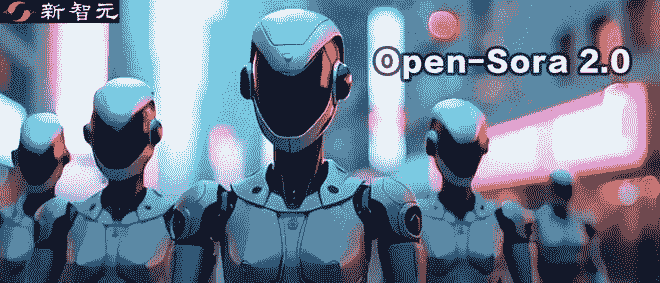
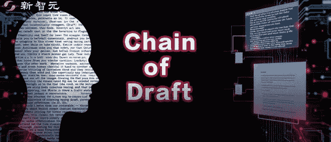
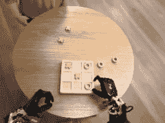

# AGI 掘金日报 - AI 新闻推送 (2025 年 03 月 13 日)

> 来源：[https://agijuejin.feishu.cn/docx/QJL5dLyt3oYmkmxtH6Rc61oqnzh](https://agijuejin.feishu.cn/docx/QJL5dLyt3oYmkmxtH6Rc61oqnzh)

> [欢迎加入 AGI 掘金社群](https://sourl.co/miZUyT)

## ⭐ 今日热点

### 💡 Open-Sora 2.0全面开源，20万复刻百万级大片！11B媲美闭源巨头，224张GPU创奇迹

新智元 | [阅读原文](https://www.163.com/dy/article/JQH9HSVB0511ABV6.html?spss=dy_author)

潞晨科技推出开源视频生成模型Open-Sora 2.0。仅20万美元（224张GPU）就训练出11B参数模型，性能媲美主流闭源模型，在VBench评测中进步显著。团队通过多种技术降低训练成本，还开源全流程代码。其模型架构有创新，在数据筛选、训练方式等方面优化，且高压缩比AE提升推理速度。官方还公布了开源仓库和技术报告，邀大家推动AI视频发展。

## 🌟 技术突破

### 💡 只需7.6% token，性能还更强！华人团队提全新「草稿链」CoD，成本延迟大降

新智元 | [阅读原文](https://www.163.com/dy/article/JQH9D3U10511ABV6.html?spss=dy_author)

来自Zoom的华人团队提出「草稿链」（CoD）技术，灵感源于人类认知。实验表明，在保持准确率前提下，与思维链（CoT）相比，CoD大幅降低推理成本和延迟，使用的token量仅7.6%。如Claude 3.5 Sonnet处理体育问题，输出token降幅92.4%，准确率提升。对月处理100万次推理查询企业，采用该技术每月可节省超3000美元，目前项目已开源。

### 💡 谷歌 DeepMind 推出新 AI 模型，机器人未经训练也能执行现实任务

IT之家 | [阅读原文](https://www.ithome.com/0/837/396.htm)

3月12日晚，谷歌DeepMind推出两款新AI模型。Gemini Robotics是视觉语言行动模型，基于Gemini 2.0，能让机器人理解新情境，在通用性等核心领域有进展，可执行精确操作。Gemini Robotics-ER能“理解复杂动态世界”，对接现有系统开启新功能。研究员称在开发“分层安全策略”，模型能评估动作安全性。此外，谷歌DeepMind还与公司合作，向部分测试者开放模型 。

### 💡 李飞飞团队具身智能新作：500 美元，一切家务机器人帮你干

IT之家 | [阅读原文](https://www.ithome.com/0/837/246.htm)

李飞飞团队带来具身智能成果 BRS，这是解决机器人家庭任务全身操作的框架，核心组件成本不到 500 美元。团队确定机器人做家务需三项能力，选 Galaxea R1 机器人为硬件。BRS 有两项创新：通用低成本遥操作接口 JoyLo 和学习算法 WB-VIMA。实验显示，BRS 能完成多种家庭任务，JoyLo 和 WB-VIMA 表现出色，且相关工作已全部开源 。

### 💡 全球首个“一脑多机”通用具身智能平台“慧思开物”在京发布

IT之家 | [阅读原文](https://www.ithome.com/0/837/243.htm)

2025年3月12日，北京人形机器人创新中心发布全球首个“一脑多能”“一脑多机”通用具身智能平台“慧思开物”。其应用颠覆传统机器人开发模式，填补具身智能通用软件系统空白，推动智能机器人能力跃升。该创新中心2023年11月成立，是国内首家聚焦具身智能机器人的创新中心，其“天工”人形机器人有多项技术突破 。

### 💡 字节跳动豆包文生图技术报告发布：数据处理、预训练、RLHF 全流程公开

IT之家 | [阅读原文](https://www.ithome.com/0/837/209.htm)

3 月 12 日，豆包大模型团队发布文生图技术报告，公开 Seedream 2.0 图像生成模型技术细节。该模型 2024 年 12 月初上线，已服务上亿用户，解决诸多实际问题。团队构建 Bench-240 评测基准，测试显示其英文生成表现佳，中文生成与渲染文字可用率达 78% ，完美响应率 63% 。技术细节涵盖数据预处理、预训练、后训练 RLHF 三个维度，各有创新突破。

## 💫 企业动态

### 💡 奥特曼自曝全新OpenAI写作模型：第一次被AI震撼！网友：AI写的坚决不看

新智元 | [阅读原文](https://www.163.com/dy/article/JQH987SO0511ABV6.html?spss=dy_author)

2025年3月13日凌晨，奥特曼自曝OpenAI在训练创意写作模型，他试用后被其创作的元小说打动。网友对此看法不一，部分人认为AI难以取代人类创意。此外，还有专为创意写作的模型如Muse ，其创始人称AI写作有进步但需指导。如今人们担忧写作这块人类精神自留地是否会被AI侵占 。

### 💡 从聊天机器人到智能玩具：人工智能正在中国蓬勃发展

IT之家 | [阅读原文](https://www.ithome.com/0/837/395.htm)

中国积极推动人工智能产业发展，目标2030年成全球科技强国。政府计划15年投资10万亿，今年1月成立600亿投资基金。目前4500多家企业开发销售相关产品，多地开展人工智能教育。本土公司取得显著成就，如DeepSeek等。但中国AI发展面临隐私质疑等挑战，企业以低成本创新应对，政府推动人形机器人产业发展，中国仍处于“追赶模式” 。

### 💡 理想汽车旗下 AI 助手理想同学网页版上线，接入 DeepSeek R1&V3 满血版

IT之家 | [阅读原文](https://www.ithome.com/0/837/391.htm)

3月12日，理想汽车旗下AI助手理想同学网页版上线，用户可在电脑端使用，与手机App端协同构建跨场景智能服务生态。网页版全面接入DeepSeek R1&V3 671B满血版 ，问答可切换模型、选择是否联网，DeepSeek模型下可开启深度思考。还支持长文本输入、传图问答、打断结果等，有新形象交互功能。此外，理想同学App手机端同步更新，优化长文本输入等。

### 💡 谷歌联合创始人拉里・佩奇押注 AI+3D 打印，探索制造低成本飞机

IT之家 | [阅读原文](https://www.ithome.com/0/837/386.htm)

据《商业内幕》3 月 12 日报道，谷歌联合创始人拉里・佩奇投资初创公司 Dynatomics。该公司由前 Kittyhawk 首席技术官克里斯・安德森领导，吸纳多名航空技术专家，2023 年在加州低调注册。安德森对 3D 打印感兴趣，佩奇也曾鼓励利用 3D 打印降本。Dynatomics 专注探索 AI 与 3D 打印在航空领域的应用，已支付 6 万欧元咨询增材制造电机技术，或成佩奇重启计划的新机会。安德森称飞机制造成本若与汽车相当，航空出行将变革。

### 💡 优必选联合北京人形机器人创新中心发布“天工行者”科研机器人，29.9 万元

IT之家 | [阅读原文](https://www.ithome.com/0/837/384.htm)

3月12日，优必选联合北京人形机器人创新中心发布全尺寸科研教育人形机器人“天工行者”，售价29.9万元，今年Q2交付。它是业内首款30万元以内科研级人形机器人，有6高特性。身高170cm，20个自由度，能10km/h稳定奔跑，搭载通用具身智能平台。关键部位钛合金材质，关节模组高性能可拓展，风道散热。主体可自由拓展，开放多接口，满足科研用户二次开发需求。

### 💡 最高罚 3500 万欧元，西班牙“严打”未标注 AI 生成内容的企业

IT之家 | [阅读原文](https://www.ithome.com/0/837/381.htm)

西班牙政府当地时间3月12日通过法案，要求企业使用AI生成内容必须标注，否则最高罚3500万欧元或全球年营业额7%，旨在遏制“深度伪造”等AI滥用风险。数字化转型部长奥斯卡・洛佩斯称借鉴欧盟规定，对高风险AI系统提透明度要求。西班牙是首批实施欧盟AI监管规则的国家之一。该法案还禁止多种AI滥用行为，不过政府机构出于国家安全可在公共场所进行实时生物识别监控。

### 💡 机械臂模拟人类按摩，德壹发布全球首款端侧大模型 AI 具身理疗机器人

IT之家 | [阅读原文](https://www.ithome.com/0/837/373.htm)

3月12日消息，德壹机器人推出全球首款端侧大模型AI具身理疗机器人“全能王”。它融合AI、中医理疗与具身智能，支持8自由度3D视觉导航。搭载自研“中医AI辨证系统”，能生成个性化理疗方案。依托移远通信方案，无网络也能理解用户指令。配备8自由度机械臂，可模拟复杂按摩手法，适应多场景。安全上采用端侧部署，本地处理数据，降低推理成本。

### 💡 法国出版商和作家协会起诉 Meta，称其“大规模盗窃”版权内容训练 AI 模型

IT之家 | [阅读原文](https://www.ithome.com/0/837/370.htm)

2025年3月12日，法国国家出版联盟等三大协会起诉Meta，指控其未经授权用版权内容训练AI模型，称这是“大规模盗窃”行为。这是法国首次针对AI巨头此类诉讼。在美国，Meta等公司已面临多起类似诉讼，2023年、2024年都有作家起诉Meta，OpenAI在多地也面临类似诉讼 。

### 💡 美“DOGE”政府效率部研发聊天机器人，拟用 AI 重塑公务员工作

IT之家 | [阅读原文](https://www.ithome.com/0/837/351.htm)

据美国《大西洋》杂志3月10日报道，美国政府效率部门（DOGE）主导计划，用生成式AI改革公务员工作。总务管理局（GSA）测试的“GSA Chat”聊天机器人，已在1500名员工中测试，本周五将向全体员工推出，能协助起草邮件、编写代码等。GSA信息技术部门负责人称正推进“AI优先战略” 。该机器人预计覆盖超1万名员工，管理超1000亿美元合同和服务，未来或推广至其他部门，还可能增加功能 。相关测试在进行中。

### 💡 Arm 宣布将 AI 推理性能优化软件库 Kleidi 扩展到车用市场

IT之家 | [阅读原文](https://www.ithome.com/0/837/331.htm)

3月12日，Arm宣布将AI推理性能优化软件库Kleidi扩展到车用市场。Kleidi于2024年推出，此前已应用于移动设备等领域，开发人员无需额外工作就能利用它优化软件性能。通过与Corellium联合开发的虚拟平台，亚马逊AWS用集成Kleidi的Llama.cpp开发新聊天机器人，性能显著提升，响应时间缩至1~3秒，性能提升10倍，还为开发人员节省6周底层软件优化时间。Arm车用事业部副总裁称，当下很多汽车应用已用AI技术，Arm平台是开发者首选 。

### 💡 谷歌推出 Gemma 3：号称可在单块 GPU 上运行的最强 AI 模型

IT之家 | [阅读原文](https://www.ithome.com/0/837/295.htm)

3月12日谷歌推出Gemma 3人工智能模型，是此前Gemma AI模型的升级之作。它专为开发者设计，能在多设备无缝运行，支持超35种语言，可分析文本、图像及短视频。谷歌声称其是“世界上最好的单加速器模型”，性能超越对手且针对特定硬件优化。虽对这类低硬件要求模型有疑虑，但市场兴趣浓厚，其在STEM领域风险低。Gemma 3许可政策未变，谷歌继续推广并推学术计划，给学术人员10000美元积分。

### 💡 独立游戏工作室 Serene Questworks 用 AI 篡改真人语音，配音演员愤而起诉

IT之家 | [阅读原文](https://www.ithome.com/0/837/291.htm)

3月12日外媒VGC报道，独立游戏工作室Serene Questworks被指控计划用AI工具将一名配音演员录音转为多个角色声音，用于《Castle of Secrets》。配音演员Mika Nerida称原本被选中配音，却被AI取代，4000多句台词被换，所有配音演员被辞退。Ian Mitchell证实相关截图，称AI让声音完全变另一个人，目的是省成本。Steam要求开发者提交游戏时须披露是否用生成式AI，否则可能下架。

### 💡 OpenAI 奥尔特曼预告创意文学模型，称其首次被 AI 作品打动

IT之家 | [阅读原文](https://www.ithome.com/0/837/267.htm)

3月12日，OpenAI首席执行官山姆・奥尔特曼在X平台透露公司正开发专注创意写作的全新AI模型。他首次被“AI写出的内容真正打动”，还分享模型按指令创作的关于AI与悲伤的元虚构文学故事。故事主角通过AI“复活”他人声音，体现元虚构特点。科技媒体分析显示该故事类似人类写作，但也提醒AI生成内容可能被诈骗者利用，公众需警惕。

### 💡 文件显示谷歌对 Anthropic 投资超 30 亿美元，后者独立性遭质疑

IT之家 | [阅读原文](https://www.ithome.com/0/837/264.htm)

《纽约时报》法庭文件显示，谷歌持有Anthropic 14%股份，还将通过可转换债券交易再注资7.5亿美元，总投资超30亿美元。虽谷歌无投票权等，但此举引发对Anthropic独立性的质疑，监管机构关注此类交易。此外，亚马逊也拟对Anthropic投资高达80亿美元。谷歌策略似在为未来“下注”，让人思考初创企业与巨头深度绑定下的独立性问题。

### 💡 行业首款，小牛电动 x 高德地图推出 AI 骑行导航动态预警风险功能

IT之家 | [阅读原文](https://www.ithome.com/0/837/249.htm)

3月12日，小牛电动与高德地图合作，推出行业首款AI骑行导航动态预警风险功能。此为纯数据驱动的动态安全预警系统，支持AI弯道会车预警、AI后方来车提醒、AI红绿灯领航。NX Hyper等车型支持该功能，其中部分功能需软件升级，且对应功能实现有一定条件要求，仪表显示界面以实际产品为准 。

## ✨ 行业观点

### 💡 担心成为「AI界奥本海默」！DeepMind、Anthropic CEO同框，26年AGI降临？

新智元 | [阅读原文](https://www.163.com/dy/article/JQH993SG0511ABV6.html?spss=dy_author)

DeepMind创始人Hassabis与Anthropic创始人Dario罕见同框接受访谈。两人对AGI到来时间预测有分歧，Dario认为2026或2027年实现，Hassabis觉得5年内只有50%机会。他们都强调AI威力大，需国际合作与规范。对于是否担心成「AI界奥本海默」，两人均表担忧。此外，Hassabis预计未来一年多智能体出现，Dario关注AI写代码及做研究，若生产率提升则其AGI时间表可信。

### 💡 Anthropic CEO：半年内 AI 将编写 90% 的代码，一年内几乎包揽全部

IT之家 | [阅读原文](https://www.ithome.com/0/837/376.htm)

# AI 对就业与编程工作的影响

随着生成式 AI 等工具涌现，人们担忧工作岗位被取代。米拉・穆拉蒂、黄仁勋认为部分创意、编程工作或受影响；Anthropic 首席执行官称 3 到 6 个月内 AI 或编写 90% 代码，12 个月后几乎包揽全部。微软报告称 AI 创造就业，促使 LinkedIn 会员添加 AI 技能行为增 142 倍。比尔・盖茨等也发表观点，同时 AI 应用面临缺乏人文关怀等挑战。

## 💡 IBM CEO：AI 短期内不会取代程序员

IT之家 | [阅读原文](https://www.ithome.com/0/837/269.htm)

IBM 首席执行官阿尔文德・克里希纳不认同 Anthropic 首席执行官“未来三到六个月内 90% 的代码将由 AI 生成”的说法，认为这一比例更可能是 20% 到 30%，AI 主要提高程序员效率，不会导致大规模裁员。他预计 AI 成本将下降，能耗将降至 1% 以下。他不认为 AI 能推动科学发现，认为量子计算才能实现突破。而 OpenAI CEO 奥尔特曼认为超级智能 AI 可能几年内出现并推动创新。
