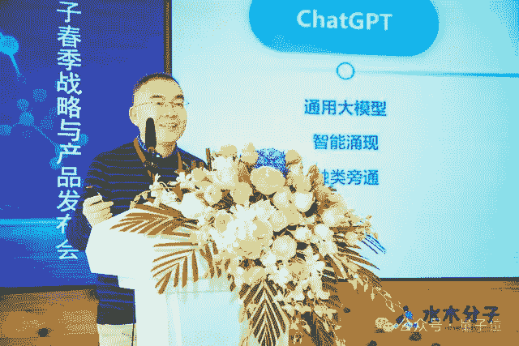

# 03.14-清华率先开源AI制药智能体平台！生物科研进入Autopilot时代

> 来源：[https://agijuejin.feishu.cn/docx/TfB9dkF5koUmSpxs9PucdLnUnTd](https://agijuejin.feishu.cn/docx/TfB9dkF5koUmSpxs9PucdLnUnTd)

# AGI 掘金日报 - AI 新闻推送 (2025 年 03 月 14 日)

> [欢迎加入 AGI 掘金社群](https://sourl.co/miZUyT)

## ⭐ 今日热点

### 💡 清华率先开源AI制药智能体平台！生物科研进入Autopilot时代

量子位 | [阅读原文](https://www.qbitai.com/2025/03/264197.html)

清华AIR和水木分子推出全球首个AI制药智能体开源平台OpenBioMed。其架构可实现定制化应用，Autopilot和Copilot模式组成智能双引擎，能缩短研发周期。水木分子提出ChatDD制药范式，为解决行业痛点打造多个模型与工具。平台开源共享，首席科学家聂再清认为AI在制药领域应是助手 。

## 🌟 技术突破

### 💡 截胡 OpenAI，谷歌全模态模型首次解禁！Gemini 2.0 中文唠嗑式 P 图引动漫游戏圈关注

IT之家 | [阅读原文](https://www.ithome.com/0/837/550.htm)

谷歌抢先OpenAI发布首个全模态图像生成器Gemini 2.0 Flash 。其无需调用其他模型，通过自然语言提示就能生成图像，具有文本与图像结合、对话式编辑等亮点，还克服了渲染长文本难题。开发者可通过Gemini API上手。网友实测功能强大，但也有不足，谷歌团队表示会改进。其在动漫、漫画等领域应用广泛，获不少好评 。

### 💡 潞晨科技推出开源视频生成模型 Open-Sora 2.0，性能接近 OpenAI Sora

IT之家 | [阅读原文](https://www.ithome.com/0/837/516.htm)

3月13日，潞晨科技推出开源视频生成模型Open-Sora 2.0，并全面开源模型权重等。该模型仅用20万美元（约144.9万元人民币）、224张GPU就训练出商业级11B参数视频生成大模型，性能直追腾讯混元等。从Open-Sora1.2升级到2.0后，与OpenAI Sora闭源模型的性能差距从4.52%缩减至0.69%，几乎全面追平 。还给出了GitHub开源仓库及技术报告链接。

## 💫 企业动态

### 💡 OpenAI 呼吁美国放宽版权限制，自由使用版权保护材料训练 AI 激发创新力

IT之家 | [阅读原文](https://www.ithome.com/0/837/696.htm)

3月13日，OpenAI向美国政府提交AI发展建议书，呼吁放宽版权限制，以便自由使用受版权保护材料训练AI模型，称当前过多法律限制阻碍创新、降低训练数据质量。其提出 “版权战略”，主张符合 “合理使用” 原则。OpenAI还指出，美国各州781多项AI相关法案限制创新，建议政府提供 “法律救济”。但这一建议引发创意工作者不满，《纽约时报》已起诉微软和OpenAI，部分图像生成引擎也面临诉讼 。

### 💡 感谢 DeepSeek，春节后中国 AI 创企融资井喷

IT之家 | [阅读原文](https://www.ithome.com/0/837/692.htm)

DeepSeek取得进展，引发中国AI投资热潮，结束连续三年下滑趋势。Insilico Medicine获1.1亿美元E轮融资后计划E2轮融资。春节假期成投资转折点，资本流向现有公司。政策大力支持，政府拟设基金、增加贷款规模。不过，中美紧张关系仍是国际投资者的顾虑。如邵旭辉指出中国公司海外扩展难，但技术发展不受国界限制。

### 💡 OpenAI 向美国政府提议：企业上交模型，换取州法规豁免

IT之家 | [阅读原文](https://www.ithome.com/0/837/680.htm)

3月13日消息，OpenAI在15页政策建议中向特朗普政府请求，为自愿向联邦政府提供模型的人工智能企业提供保护，免受州法规影响。美国各地有数百项AI相关法案待审议，OpenAI称其或削弱技术进步。该建议是对白宫意见征集的回应。OpenAI还呼吁支持AI基础设施投资、进行版权改革，主张企业获取政府数据。其全球事务副总裁称此举可推动AI发展 。

### 💡 应对医护人员超负荷工作压力，印度最大规模医院 Apollo 引入 AI 系统

IT之家 | [阅读原文](https://www.ithome.com/0/837/679.htm)

印度最大规模医院之一Apollo，为应对医护人员超负荷压力，计划加大AI投入。过去两年其将3.5%数字化预算投AI领域，今年还将增加。目前一些AI工具处于早期，可分析病历等。联席董事总经理希望借此每天为医护节省两到三小时。医院计划四年内增加三分之一病床，部分收入投入AI 。此外，还想借AI降低护士流失率，目前流失率25%，预计2025财年末升至30%。

### 💡 Salesforce CEO 炮轰微软 AI 战略：把 ChatGPT 包装成 Copilot，令客户失望

IT之家 | [阅读原文](https://www.ithome.com/0/837/626.htm)

AI领域竞争激烈，微软、OpenAI等公司潜力巨大。Salesforce首席执行官马克・贝尼奥夫多次批评微软AI，将Copilot比作“大眼夹”，称其没价值，还指微软靠包装ChatGPT且缺数据。他介绍Salesforce在AI研发超十年，Agentforce表现出色，助力实现百亿季度营收。贝尼奥夫还提及招聘困境。微软首席传播官等回应称其批评多为营销，不懂微软战略，且超10万家组织用Copilot Studio创建AI代理。

### 💡 北京市中小学将打造首批 11 个 AI 应用场景

IT之家 | [阅读原文](https://www.ithome.com/0/837/561.htm)

北京市教委出台《北京市推进中小学人工智能教育工作方案（2025—2027 年）》。今年将在中小学重点打造首批 11 个 AI 应用场景，涵盖“AI 助教”“AI 助学”等多种类型。教育应用场景升级后，将以“京娃”形象存在，有首批 7 个智能体。2025 年秋季起，全市中小学开展人工智能通识教育，每学年不少于 8 课时。还将培养专业名师和骨干教师，对有突出贡献的教师给予支持。

### 💡 智元机器人与阶跃星辰战略合作，共探具身智能与大模型融合

IT之家 | [阅读原文](https://www.ithome.com/0/837/553.htm)

3月12日，智元机器人与阶跃星辰签署战略合作协议。双方将利用各自优势，共同探索具身智能与多模态大模型深度融合，推动技术发展。在新零售等场景开发应用，推进数据标准及评测体系建设，围绕4D世界模型开展研究。智元机器人有多款机器人，量产超1000台通用具身机器人，还发布了启元大模型；阶跃星辰成立于2023年4月，已发布通用大模型矩阵。双方合作能实现优势互补。

### 💡 加速具身智能产业发展，库帕思与智元机器人签署战略合作协议

IT之家 | [阅读原文](https://www.ithome.com/0/837/526.htm)

3月13日，智元机器人与库帕思签署战略合作协议。双方将围绕具身智能，共同构建产业生态体系，推动技术落地形成生态闭环；整合优势资源，联合多方制定行业标准；共同构建行业语料库，促进具身智能深度发展。库帕思是功能性语料服务平台。智元机器人的稚晖君曾从华为离职创业，该公司完成A++++++轮融资，估值超70亿，今年1月第1000台通用具身机器人下线。

## ✨ 行业观点

### 💡 Anthropic CEO 阿莫代伊：未来 AI 或有自我决定权，可拒绝“不爽”的任务

IT之家 | [阅读原文](https://www.ithome.com/0/837/652.htm)

3月13日，据外媒报道，Anthropic首席执行官达里奥・阿莫代伊提出惊人观点，暗示未来高级AI模型或有“按钮”，能在遇到不愉快任务时选择退出。该言论回应数据科学家提问，目前AI福利研究员正研究AI感知及道德保护话题。阿莫代伊解释这是简单偏好框架，若模型常按“放弃”按钮，人们应留意。

### 💡 比尔・盖茨展望 AI 未来：“人手一个”智能体，帮你优先处理最重要的事

IT之家 | [阅读原文](https://www.ithome.com/0/837/637.htm)

3月13日外媒报道，微软联合创始人比尔·盖茨在播客节目中展望AI愿景，称其普及类似计算机问世，最终每人都会有专属AI助手。盖茨还称AI能帮人判断事务，此前他也谈过AI影响。他认为AI虽会取代人类不少工作，但人类决定其应用领域。此外，AI能让医疗建议、辅导普及廉价，解决人员缺乏问题。

### 💡 哥伦比亚大学研究：AI 搜索工具平均准确率仅六成，且自信满满“不认错”

IT之家 | [阅读原文](https://www.ithome.com/0/837/582.htm)

哥伦比亚大学数字新闻研究中心对八款 AI 搜索引擎研究。研究人员用 200 篇新闻报道测试，结果显示：整体 AI 搜索引擎答案 60%不准确，还对错误答案“自信”。如 ChatGPT Search “完全正确”率 28%，“完全错误”率 57%；Grok-3 Search 错误率 94%；微软 Copilot 总体错误率近 70%。这些 AI 开发公司未公开承认问题却收 20 至 200 美元订阅费，付费版有时错误率更高 。