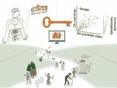
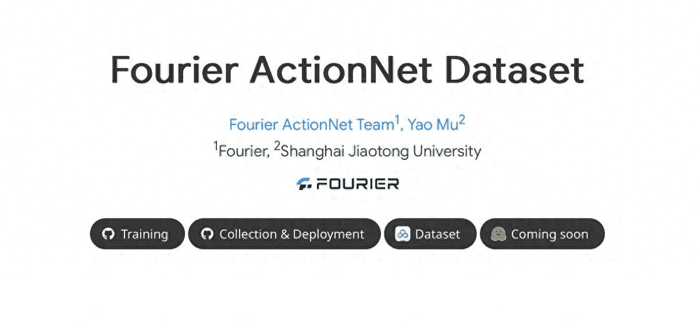
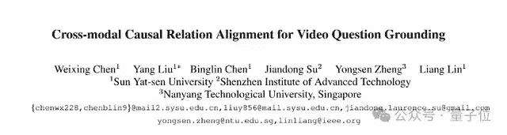
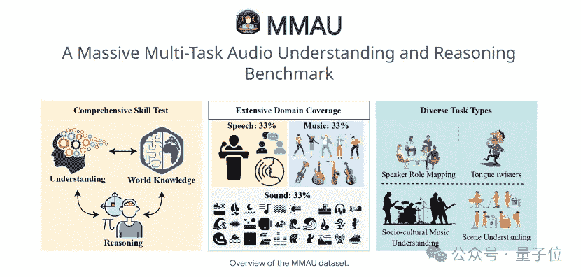

# 03.17-2025年99%代码AI生成！OpenAI高管宣告没有退路，人类将被全面超越

> 来源：[https://agijuejin.feishu.cn/docx/ATa4djgMAoGeilxl4yUcSdHKnKf](https://agijuejin.feishu.cn/docx/ATa4djgMAoGeilxl4yUcSdHKnKf)

# AGI 掘金日报 - AI 新闻推送 (2025 年 03 月 17 日)

> [欢迎加入 AGI 掘金社群](https://sourl.co/miZUyT)

## ⭐ 今日热点

### 💡 2025年99%代码AI生成！OpenAI高管宣告没有退路，人类将被全面超越

新智元 | [阅读原文](https://www.163.com/dy/article/JQRQSVNM0511ABV6.html?spss=dy_author)

OpenAI 首席产品官 Kevin Weil 预测 2025 年底 99%编码将实现 AI 自动化，今年 AI 在编程能力上会永久超越人类。他还分享了模型研发、就业形势等观点。Anthropic 等公司也有类似预测，科技界对 AI 取代程序员岗位看法不一，如 Anthropic CEO 认为未来 AI 将编写大部分代码，IBM CEO 则认为比例在 20 - 30%，AI 对程序员职业影响引发关注 。

## 🌟 技术突破

### 💡 AI 助力，新研究只用 5 滴血就能测出你的真实生理年龄

IT之家 | [阅读原文](https://www.ithome.com/0/838/348.htm)

日本大阪大学科学家借助人工智能，开发出估算生理年龄的新系统。该方法仅需五滴血液，分析 22 种关键类固醇及其相互作用，发表于《科学进展》杂志。研究发现皮质醇翻倍，生理年龄约增 1.5 倍。团队表示这只是开始，未来会扩大数据集完善模型。此研究有望实现健康风险早期检测和定制化干预，推动预防性医疗保健变革 。

### 💡 傅利叶开源全尺寸人形机器人数据集，首批上线超3万条真机数据

量子位 | [阅读原文](https://www.qbitai.com/2025/03/264793.html)

3月17日，傅利叶开源全尺寸人形机器人数据集Fourier ActionNet，首批上线超3万条高质量真机数据，解决采集成本高、标注精度不足等问题，具有多模态等特点。还发布全球首个全流程工具链，降低研发门槛，自带数据质量评估且配套开发工具。其已与多家科研院校及企业合作产出成果，此次开源是战略升级，未来还将开放更多数据模块，诚邀开发者共建开源生态。获取方式：开源链接https://action-net.org/ ，合作邮箱gr_opensource@fftai.com 。

### 💡 CVPR’25跨模态因果对齐，让机器更懂视觉证据丨中大南洋理工等联合开源

量子位 | [阅读原文](https://www.qbitai.com/2025/03/264763.html)

中山大学、新加坡南洋理工大学等团队提出跨模态因果对齐框架（CRA），相关论文被CVPR 2025接收且代码开源。针对现有视频问答模型依赖统计偏差、定位不准问题，CRA通过GSG、CMA、ECI三个核心模块优化全流程。实验显示，CRA在多数据集上性能领先，显著提升时空定位能力与因果推理准确性，为视频问答定位提供可靠方案，或推动自动驾驶等领域可信AI应用 。

### 💡 迁移DeepSeek-R1同款算法，小米让7B模型登顶音频理解推断MMAU榜单

量子位 | [阅读原文](https://www.qbitai.com/2025/03/264756.html)

小米大模型团队受DeepSeek-R1启发，用GRPO算法微调Qwen2-Audio-7B模型，使其在MMAU榜单准确率从49.2%提升到64.5%，超越GPT-4o近10个百分点。实验揭示强化学习在小数据集表现佳、小模型也有强推理能力、显式思维链输出或成瓶颈等结论。目前模型距人类专家82.23%的水平有差距，团队将继续探索，还开源了相关代码和参数等。

### 💡 0行代码打造3D游戏，氛围编码席卷全网！开发30分爆赚28万

新智元 | [阅读原文](https://www.163.com/dy/article/JQPNFN5D0511ABV6.html?spss=dy_author)

「vibe coding」（氛围编程）正成为3D游戏开发新风潮。它借助AI工具，无需编写代码。如资深软件工程师Grégory D'Angelo 0行代码完成精美3D游戏，还有开发者半小时开发出3D游戏并盈利28万。其核心理念是通过自然语言描述想法，AI生成代码，能加速开发、定制游戏、提升体验，但可能让用户依赖工具，引发维护问题 。

### 💡 谷歌重磅推出全新Scaling Law，抢救Transformer！3万亿美元AI面临岔路

新智元 | [阅读原文](https://www.163.com/dy/article/JQP4I0FM0511ABV6.html?spss=dy_author)

谷歌三大团队推出全新DiLoCo的Scaling Law，在分布式训练大模型上取得突破。新训练方法DiLoCo相比传统「数据并行」训练更稳健、优越、高效、强大，无惧模型规模，还解决了通信瓶颈。实验表明，DiLoCo在多方面表现出色，如评估损失更低、对批大小稳定性更强等。此外，随着「推理模型」兴起，AI发展面临新选择，Chinchilla策略的可持续性受到质疑 。

### 💡 想纠正LMM犯错？没用！NUS华人团队：最强o1反馈修正率不到50%

新智元 | [阅读原文](https://www.163.com/dy/article/JQP4HBQJ0511ABV6.html?spss=dy_author)

新加坡国立大学华人团队提出InterFeedback框架及InterFeedback-Bench基准测试，评估LMM交互智能。用两个数据集测试10种LMM，发现先进LMM纠错率不到50%，交互式过程能提升多数LMM性能，但模型在利用反馈提升性能上有困难，准确率不能全面反映模型能力，反馈质量很关键。人工评估闭源模型时，不同模型从人类反馈中获益情况不同 。

## 💫 企业动态

### 💡 谷歌 Gemini 2.0 Flash 模型拥有强大图片去水印功能，或触犯版权红线

IT之家 | [阅读原文](https://www.ithome.com/0/838/290.htm)

3月17日消息，谷歌推出的Gemini 2.0 Flash模型引发争议。其图像生成功能强大且免费，但缺乏必要限制，不仅能生成含版权角色图像，还能出色去除水印并填补空白。该功能虽标记为“实验性”“非生产用途”，处理特定水印有困难，但仍可能触版权红线。如Anthropic的Claude 3.7 Sonnet等模型拒绝去水印，Claude称去水印不道德且可能违法。截至发稿，谷歌未回应。

### 💡 一手实测文心X1/4.5：又强又全面！歪果网友疯求英文版

量子位 | [阅读原文](https://www.qbitai.com/2025/03/264808.html)

文心一言两周年，百度上新文心大模型 4.5 和 X1 并免费开放。文心 X1 是首个自主运用工具的深度思考模型，文心 4.5 是新一代原生多模态基础大模型。实测表现出色，X1 逻辑推理、工具调用强，4.5 多模态全能。还透露技术细节，新模型有百度 RAG、iRAG 加持。2024 年文心大模型日均调用量增长 33 倍，百度坚持研发投入。模型 API 价格有优势，后续还将开源及发布新模型。

### 💡 低调平头哥，吹响先进存力商业化号角

量子位 | [阅读原文](https://www.qbitai.com/2025/03/264807.html)

在 MemoryS 2025 存储峰会上，平头哥半导体产品总监周冠锋呼吁提升先进存力。平头哥自研的 SSD 主控芯片镇岳 510 已商业化落地，在阿里云 EBS 上线，还助力多家厂商产品升级。镇岳 510 在芯片架构和算法全面创新，性能出色且节能。平头哥借助阿里资源，把握行业节奏，欲突破存力瓶颈，将先进存力推向更多行业 。

### 💡 “AI 作弊”助程序员线上面试蒙混过关，谷歌等大厂考虑恢复面对面形式

IT之家 | [阅读原文](https://www.ithome.com/0/838/239.htm)

据美国 CNBC 3 月 10 日报道，哥伦比亚大学 21 岁学生 Lee 利用 AI 工具助程序员线上面试作弊，他还创办相关公司。作弊工具依赖生成式 AI 模型提供实时答案，令面试官疲惫。为此，面试官有了“反作弊”方法。不少大厂有行动，谷歌考虑混合或恢复现场面试，德勤、亚马逊等要求候选人面试不使用 AI 助理。

### 💡 央视曝光“张伯礼院士”带货宣传护肤品：实为 AI 伪造

IT之家 | [阅读原文](https://www.ithome.com/0/838/223.htm)

央视报道，AI 深度伪造技术被用于假冒名人，如“AI 张伯礼院士”带货护肤品。张伯礼院士称还有十余条涉其假视频传播，此类行为误导消费者、破坏市场秩序。中华人民共和国民法典规定这属侵权。此外，雷军也曾遇 AI 合成乱象，维权难，呼吁提前立法。此前央视也曾揭露该乱象，专家称网店制作此类视频属侵权，应担责。

### 💡 AI搜索风靡，但高达60%引用出错！付费版甚至更糟

新智元 | [阅读原文](https://www.163.com/dy/article/JQP4HPDU0511ABV6.html?spss=dy_author)

A**I搜索**工具风靡美国，近四分之一美国人已弃用传统搜索引擎。但研究显示，8款有实时搜索功能的AI工具引用新闻出错率达60%，付费版更糟。它们常自信给出错误答案，还存在爬虫乱象，侵犯出版商权益。此外，AI搜索工具常无法正确链接原始来源，影响新闻传播生态。虽不少AI公司与出版商达成合作协议，但引用仍不准确，长此以往将影响新闻行业。

### 💡 香港财政司司长陈茂波：数码港将举行聚焦 AI 的招聘博览，提供逾 2000 个职位

IT之家 | [阅读原文](https://www.ithome.com/0/838/184.htm)

香港财政司司长陈茂波鼓励科技企业参与青年科技人才培育。数码港下周五起一连两日举行聚焦AI的招聘博览，580多家企业及机构提供逾2000个职位，约六成与AI相关。港投公司将与一家聚焦RISC-V技术的科技企业战略合作。此外，科技园公司上月举办主题招聘会，150多家人工智能园区公司参与，提供超1000个创科职位 。

## ✨ 行业观点

### 💡 纽约时报作家被AGI「洗脑」！AI横扫奥数金牌、编写95%代码，人类却毫无准备

新智元 | [阅读原文](https://www.163.com/dy/article/JQPDTIVN0511ABV6.html?spss=dy_author)

NYT 专栏作家 Kevin Roose 称强人工智能即将到来，人类尚未准备好。他提出迈向 AGI 进展的三个论点，并认为现在是为 AGI 做准备的最佳时机。众多 AI 公司高管及独立专家表达类似看法，也有专家存疑。如今 AI 进步显著，在奥赛、编程等方面表现出色。Kevin 认为人类应从现在开始做好应对准备，网友也热议要理性面对 AGI。

### 💡 《地平线》主角演员阿什莉・伯奇呼吁警惕 AI 取代真人：事关游戏的未来

IT之家 | [阅读原文](https://www.ithome.com/0/838/187.htm)

《地平线：零之曙光》主角埃洛伊的配音及动作捕捉演员阿什莉・伯奇，对索尼一项用AI生成埃洛伊配音和表演的实验提出质疑。虽该技术未进入正式开发阶段，且未用其数据，但她仍感不安。她呼吁游戏公司使用AI生成演员形象前要获同意、给报酬并说明用途，担心演员无维权保障，强调若不争取胜利，游戏表演行业将受极大冲击 。