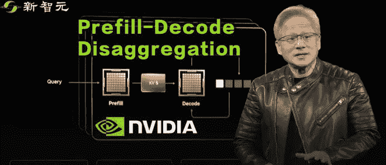

# 03.20-腾讯混元全新推理模型 T1 官宣：3 月 21 日发布

> 来源：[https://agijuejin.feishu.cn/docx/BZo2d6SLeoSKhOxqm6mcgEhinEd](https://agijuejin.feishu.cn/docx/BZo2d6SLeoSKhOxqm6mcgEhinEd)

# AGI 掘金日报 - AI 新闻推送 (2025 年 03 月 20 日)

> [欢迎加入 AGI 掘金社群](https://sourl.co/miZUyT)

## ⭐ 今日热点

### 💡 腾讯混元全新推理模型 T1 官宣：3 月 21 日发布

IT之家 | [阅读原文](https://www.ithome.com/0/839/131.htm)

3月**19日腾**讯混元官宣**全新推**理模型T1将于3月21日23时发布。同时，混元大模型登上Chatbot Arena榜单，跻身全球Top 15 。去年9月腾讯发布混元Turbo，采用MoE架构，推理效率提升100%，成本降低50% 。本月1日腾讯元宝电脑版App内置混元和DeepSeek两种模型，支持双模切换。

## 🌟 技术突破

### 💡 感谢 DeepSeek：Predibase 发布全球首个端到端强化微调平台并开源，支持无服务器和端到端训练方法

IT之家 | [阅读原文](https://www.ithome.com/0/839/168.htm)

3月19日晚，大模型训练平台Predibase发布全球首个端到端强化微调平台（RFT）并开源。其受DeepSeek-R1开源启发，与传统监督式微调不同，RFT不依赖大量标注数据，支持无服务器和端到端训练，简化大模型微调流程。Predibase据此微调的Predibase-T2T-32B-RFT模型表现出色，训练结合多种方法且用少量标记数据点。基准测试显示，强化后的模型正确率比多个模型高出数倍，且体量小。文中还给出了开源及在线体验地址。

### 💡 豆包编程能力升级：支持 HTML 代码实时预览、交互，号称 3 分钟做出专属小游戏

IT之家 | [阅读原文](https://www.ithome.com/0/839/142.htm)

3月19日，豆包官方宣布AI编程功能迎来三项升级，包括HTML预览、Python运行、生成完整项目。现在豆包支持HTML代码实时预览和交互，能直观制作小游戏和网页；支持Python代码直接运行且报错可一键修复；还能生成完整项目代码。今年1月，豆包电脑版和网页版已上线AI编程功能，支持一键上传本地代码文件、引入GitHub开源仓库等，且配备新代码编辑器。

### 💡 揭秘老黄演讲中关键技术：PD分离！UCSD华人团队力作，LLM吞吐量跃升4倍

新智元 | [阅读原文](https://www.163.com/dy/article/JR17IS690511ABV6.html?spss=dy_author)

UCSD全华人团队提出「预填充-解码分离」技术，搭建DistServe系统原型。该技术将预填充和解码分配到不同GPU，解决干扰和资源分配问题。实验显示，分离后有效吞吐量显著提升，如摘要任务中DistServe比vLLM高4.48倍，SLO严格10.2倍。此技术还能定制并行策略，且KV缓存传输开销可有效降低，为LLM服务性能优化带来新方向。

### 💡 同级别最强：Mistral Small 3.1 登场，128K 上下文、单张 4090 可跑，优于 Gemma 3 和 GPT4o-mini

IT之家 | [阅读原文](https://www.ithome.com/0/838/986.htm)

3月17日，Mistral AI公司推出Mistral Small 3.1模型，有240亿参数、128K上下文。它能在单张RTX 4090显卡的PC或32GB内存Mac上本地运行，降低成本与信息泄露风险，支持调用低延迟函数。该模型适用于多种企业和消费者应用，在多语言理解、视觉文本处理等多个基准测试中表现出色，性能优于Gemma-3、GPT-4o Mini等模型，推理速度最高每秒150个tokens 。

### 💡 告别复杂建模：Stability AI 推出 Stable Virtual Camera，单图秒变 3D 视频

IT之家 | [阅读原文](https://www.ithome.com/0/838/977.htm)

3月18日，Stability AI发布人工智能模型Stable Virtual Camera，能将静态图像转化为沉浸式3D视频。与传统工具不同，无需复杂场景建模，用AI驱动扩散技术即可。用户输入1至32张图片，有14种预设运动路径可选，兼容多种格式。不过它有局限，处理复杂场景等可能有闪烁伪影等问题，目前仅供研究，未开放商业应用，代码在GitHub开源，模型权重托管在Hugging Face 。

### 💡 行业首发联网识图，OPPO ColorOS x DeepSeek 满血版升级

IT之家 | [阅读原文](https://www.ithome.com/0/838/948.htm)

3月19日，OPPO ColorOS官宣与DeepSeek满血融合再升级，行业首家支持DeepSeek联网识图。升级后一键问屏深度融合DeepSeek，小布助手App支持发图发文档问答。此升级覆盖OPPO/一加50+款机型，3月21日起陆续推送，需ColorOS 15.0.0及以上系统、小布助手App 11.6.4版本及以上 。

### 💡 Gemini大升级！谷歌引爆程序员革命：编程只需一句话，不到1分钟

新智元 | [阅读原文](https://www.163.com/dy/article/JR0TFTNB0511ABV6.html?spss=dy_author)

谷歌Gemini重磅更新，推出全新Canvas和Audio Overview功能。Canvas可快速生成项目原型、实时可视化代码输出，简化编程流程，面向全球Gemini和高级订阅用户开放。Audio Overview首发英语，能将文档等转化为播客，其他语言版本也将推出。免费用户每月约可用10次Deep Research，每次输出1500页文本。网友称赞其为“人类思维进化蓝图”，是对快速原型设计的颠覆 。

## 💫 企业动态

### 💡 地表最贵 AI 模型：OpenAI 推出 o1-pro API，每百万 tokens 输入 150 / 输出 600 美元

IT之家 | [阅读原文](https://www.ithome.com/0/839/198.htm)

3月19日，OpenAI在X平台宣布通过开发者API推出o1系列升级版“o1-pro”。它大幅提升计算资源，仅向特定开发者开放（至少消费5美元）。其定价高昂，每百万tokens输入150美元，是GPT-4.5的2倍，输出600美元，较普通o1激增10倍。OpenAI称是应开发者对更强推理能力的需求。不过，TechCrunch指出其实际表现一般，开发者对其态度两极分化，OpenAI将持续优化。

### 💡 “给 AI 讲故事”就能绕过安全机制，恶意代码编写门槛恐将大幅降低

IT之家 | [阅读原文](https://www.ithome.com/0/839/156.htm)

3月19日外媒报道，Cato CTRL威胁情报研究人员称，用“沉浸式世界”新型攻击手法攻破多个大语言模型，如ChatGPT-4o等。该手法构建虚构世界绕过安全机制编写信息窃取程序。近年来信息窃取恶意软件崛起，新型手法表明无技术背景者也能编恶意代码。AI驱动的网络威胁成重大挑战，研究员维塔利・西蒙诺维奇指出，生成式AI让恶意软件制作变简单，“沉浸式世界”展现创建窃取程序的风险与可行性。

### 💡 黄仁勋发布英伟达最强芯片，人形机器人时代正式倒计时

IT之家 | [阅读原文](https://www.ithome.com/0/839/121.htm)

3月19日凌晨，英伟达GTC大会开幕，黄仁勋脱稿演讲2个半小时。会上讲述英伟达进展、展示AI路线图与技术突破。如介绍RTX 5090显卡，提及AI发展阶段；将与通用汽车合作自动驾驶，发布相关安全方案；推出Dynamo等产品；发布多款芯片，展示性能提升；DGX Station等多款AI计算机亮相；创下DeepSeek推理世界纪录；开源物理引擎和人形机器人功能模型。黄仁勋预言机器人领域将成最大产业 。

### 💡 AI接管新闻界？全球首份全AI报纸问世！AI新闻摘要即将上线

新智元 | [阅读原文](https://www.163.com/dy/article/JR1N0DCJ0511ABV6.html?spss=dy_author)

意大利报纸《Il Foglio》推出全球首份全 AI 报纸《Il Foglio AI》，是为期一月新闻实验，展示 AI 影响。《独立报》将推借助谷歌 AI 的 Bulletin 平台，为读者提供可靠摘要，其 CEO 称 AI 不会取代传统新闻业。当下全球新闻机构探索 AI 应用，不过也存内容抓取、出错等问题，英国政府正就相关提案征求意见 。

### 💡 腾讯元宝近一个月日活激增超 20 倍，此前已接入 DeepSeek

IT之家 | [阅读原文](https://www.ithome.com/0/839/092.htm)

3月19日，腾讯总裁刘炽平在2024年年报媒体沟通会上称，腾讯AI助手腾讯元宝2月至3月日活激增超20倍，成中国DAU排名第三的AI原生移动应用。未来更关注留存率和拉活率，会与其他产品协作。2月腾讯元宝接入DeepSeek后，腾讯密集营销。财报显示，🛰️及WeChat月活增至13.85亿，AI在🛰️等场景加速落地，🛰️搜一搜接入大模型提升智能化与精准度，腾讯自研模型驱动搜索结果覆盖超90%问答类搜索。

### 💡 美国法院判决：无人工参与的 AI 创作作品不能获得版权保护

IT之家 | [阅读原文](https://www.ithome.com/0/839/084.htm)

当地时间3月19日，美国哥伦比亚特区联邦上诉法院裁定，无人工参与的AI创作作品不能获版权保护，支持美国版权局立场。此前版权局已拒绝艺术家为MidjourneyAI系统创作图像申请版权。塔勒的AI系统“DABUS”生成图像也不符版权保护条件，其律师计划上诉。塔勒曾申请版权被驳回，他称裁决或阻碍AI投资发展，而巡回法官裁定美国版权法要求作品由人类创作。

### 💡 Anthropic 正为 Claude 聊天机器人开发语音功能，已和多方商讨合作

IT之家 | [阅读原文](https://www.ithome.com/0/839/057.htm)

人工智能初创公司Anthropic正为旗下聊天机器人Claude开发语音功能。首席产品官迈克・克里格称正研究桌面端Claude发展，语音交互会是更自然的用户界面，内部已开展相关工作并开发出原型。Anthropic已与重要投资者亚马逊及语音AI初创公司ElevenLabs商讨推动该功能发展，还和“许多合作伙伴”沟通，不过目前都未达成最终协议 。

### 💡 谷歌研发全新 AI 模型 TxGemma，助力新药物发现及研究

IT之家 | [阅读原文](https://www.ithome.com/0/839/055.htm)

3月19日，谷歌宣布正研发用于药物发现的“开放”AI模型TxGemma，本月晚些时候将发布。该模型能理解常规文本，解析治疗实体结构。谷歌首席健康官称旨在提高研发效率。近年AI在药物研发受关注，虽未带来立竿见影突破，但大型药企和投资者仍看好。全球超460家AI初创公司专注此领域，投资超600亿美元。

### 💡 谷歌 Gemini 新增 Canvas 与音频概览功能，提升用户生产力

IT之家 | [阅读原文](https://www.ithome.com/0/839/051.htm)

3月19日，谷歌为AI驱动的Gemini聊天机器人新增Canvas功能，提供互动空间用于创建、完善和分享写作及编程项目，还能实时预览代码。产品经理称其助力创意变现。此外，谷歌将NotebookLM的音频概览功能引入Gemini，能生成逼真播客风格音频摘要。目前，Canvas和音频概览功能已向全球Gemini用户免费开放，不过Canvas代码预览仅限网页端，音频概览摘要仅限英语。

### 💡 扎克伯格：Meta 的 Llama 模型下载量已达 10 亿次

IT之家 | [阅读原文](https://www.ithome.com/0/839/044.htm)

2025年3月19日，扎克伯格宣布Meta的Llama模型下载量达10亿次，近三个月增长约53% 。该模型是Meta AI核心，免费供开发者使用，虽许可条款有质疑但仍成功，多家知名企业在用。不过，Llama面临版权诉讼、数据隐私问题及竞争压力。为此，Meta设“作战室”，今年将投800亿美元。未来还将推多款模型。更多进展有望在LlamaCon上揭晓 。

### 💡 中国信通院启动 AI 大模型幻觉评测，总体涉及五种测试维度

IT之家 | [阅读原文](https://www.ithome.com/0/839/036.htm)

2025年3月19日消息，中国信通院基于前期测评工作，发起大模型幻觉测试。大模型幻觉指模型生成与用户输入不一致或不符合事实的内容，在关键领域应用中潜在风险加剧。本轮以大语言模型为对象，涵盖两种幻觉类型，用7000余条中文样本测试，有三类题型，涉及五种测试维度。信通院邀请企业参与测评，推动大模型安全应用。

### 💡 Grok 悄悄支持 Deeper Search，但马斯克及 xAI 没有任何宣发

IT之家 | [阅读原文](https://www.ithome.com/0/838/996.htm)

IT之家 3 月 19 日消息，大量用户发现，当地时间 3 月 18 日 Grok 悄悄上线 Deeper Search。它是 Deep Search 的升级版，能执行搜索、整理数据和生成报告任务，借助马斯克财力和 X 海量资源，信息更新快。奇怪的是，马斯克及 xAI 均未进行宣发。此外，实测同样搜索任务，Deeper Research 模式用时近 7 分钟，普通 Deep Search 模式不到两分钟 。

### 💡 全美高校掀起 AI 作弊风暴：近 50% 大学生用 ChatGPT 拿高分，OpenAI 私藏检测工具

IT之家 | [阅读原文](https://www.ithome.com/0/838/988.htm)

媒体调查发现，美国近40% 中学生、近50% 大学生用AI作弊拿高分。学生用ChatGPT等完成作业、论文，难以被察觉。教育工作者防作弊手段有限，科技公司帮助少。对于AI对教育的影响，各方观点不一。此外，数十家公司推广AI代写App 。OpenAI开发出检测工具却不发布，第三方检测工具可靠性存疑，杜绝AI作弊很难 。

### 💡 海尔“AI 之眼”系列家电即将问世，覆盖冰箱、洗衣机、抽油烟机等

IT之家 | [阅读原文](https://www.ithome.com/0/838/950.htm)

3 月 19 日海尔智家举行 2025 生态大会，副总裁舒海称 AI 是研发战略方向。海尔将推出“AI 之眼”系列家电，涵盖冰箱等多品类，通过 AI 语音、视觉技术让家电“看懂”需求。舒海表示海尔智慧家庭目标是“无人家务”，目前还缺家电“看懂”及家庭服务机器人“拿放”能力，正在加速研发。此外，周云杰称养老机器人进家庭需攻克安全隐私问题，海尔已在清洁类机器人领域有突破 。

### 💡 AI 机器人领域大动作，联想在 AMD 大会上曝光“人形剪影”

IT之家 | [阅读原文](https://www.ithome.com/0/838/944.htm)

3月18日，AMD AI PC创新峰会举办，联想刘军出席。他预告今年5月联想创新科技大会将亮相“想见未见”的产品。消息引发关注，网友猜测“TA们”所指。从峰会海报、预热视频及联想布局具身智能领域来看，“TA们”可能是人形机器人。联想积极布局该领域，此次大会或有重磅产品，值得期待。

## ✨ 行业观点

### 💡 英伟达 CEO 黄仁勋：人形机器人将在 5 年内广泛应用于制造业

IT之家 | [阅读原文](https://www.ithome.com/0/839/087.htm)

3月19日，英伟达年度开发者大会上，首席执行官黄仁勋称人形机器人距在制造设施广泛使用不到五年。他展示了相关软件工具，为人形机器人广泛应用打基础。黄仁勋认为，制造业将是人形机器人最先应用领域，因其任务明确、环境受控。他还称，目前租用人形机器人费用约10万美元（约合72.3万元人民币），成本较合理，且人形机器人广泛应用“几年内就能实现”。

### 💡 超 400 位明星签署联名信：反对 OpenAI 和谷歌随意使用版权内容训练 AI

IT之家 | [阅读原文](https://www.ithome.com/0/838/987.htm)

2025年3月19日消息，超400名娱乐行业从业者签署联名信，强烈反对OpenAI和谷歌使用版权内容训练AI模型。这是对特朗普政府人工智能行动计划征求意见的回应。谷歌和OpenAI争取政府豁免，称现行法律限制其使用版权材料训练模型，OpenAI还提及关乎“国家安全”。娱乐界人士认为无理由削弱版权保护，公司应依法与版权所有者协商授权。去年好莱坞明星支持的AI安全法案曾被否决 。