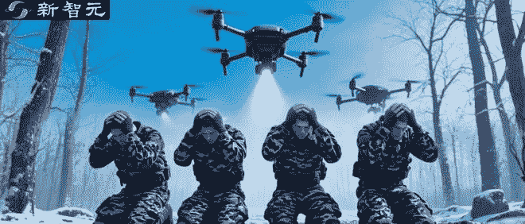

# 07.17-历史性一刻！人类士兵首次向机器人军队投降

> 来源：[https://agijuejin.feishu.cn/docx/XoFVdtQ5joVNc2xDUGRcK6Lnntb](https://agijuejin.feishu.cn/docx/XoFVdtQ5joVNc2xDUGRcK6Lnntb)

# AGI 掘金日报 - AI 新闻推送 (2025 年 07 月 17 日)

> [欢迎加入 AGI 掘金社群](https://sourl.co/miZUyT)

## ⭐ 今日热点

### 💡 历史性一刻！人类士兵首次向机器人军队投降

新智元 | [阅读原文](https://www.163.com/dy/article/K4LK22L00511ABV6.html?spss=dy_author)

2025年7月9日，乌军第三独立突击旅称在哈尔科夫地区，首次让俄军士兵在仅遇无人机和陆基自杀式平台时投降，无人参与进攻无人员伤亡。这是人类首次向机器人部队投降。AI驱动的FPV无人机成战场主导，如“戈戈尔 - M”及其“致命子机”。“蛛网行动”展示先进无人机技术。此次事件标志战争转折，也凸显《日内瓦公约》在自主系统俘战方面的法律空白。

## 🌟 技术突破

### 💡 ChatGPT 有望原生支持编辑 Excel 和 PPT 文件，OpenAI 挑战微软 Office

IT之家 | [阅读原文](https://www.ithome.com/0/868/697.htm)

7月16日消息，OpenAI正开发ChatGPT生产力功能，将原生支持Excel和PPT文件，可直接创建、打开和编辑。目前ChatGPT生成的此类文件无法在界面直接打开修改。新功能将支持完整编辑，还在开发强大AI智能体，能根据多种数据源生成格式化报告。此外，OpenAI据传在开发基于AI的浏览器 。这意味着在文档处理和AI应用方面有重大技术突破，挑战微软Office 。

### 💡 一键实现PPT演讲自由！「解说音频+视频」同步生成，效果逼近真人

新智元 | [阅读原文](https://www.163.com/dy/article/K4KAI39N0511ABV6.html?spss=dy_author)

澳大利亚人工智能研究所等团队提出“文档到演示视频生成”任务，设计了PresentAgent系统，能将论文等文档一键转为带语音和幻灯片的演示视频。其采用模块化生成框架，研究人员还构建评估框架和高质量评测数据集。实验显示，该系统生成视频接近人类水准。研究提出新任务、系统和评估框架，构建数据集，虽有局限，但为多模态生成研究奠基 。

### 💡 数千大模型全跑「中国芯」！最后一公里已「焊」通

新智元 | [阅读原文](https://www.163.com/dy/article/K4JCUGTL0511ABV6.html?spss=dy_author)

国产模型自2024年起数量和性能提升，但国产芯片运行大模型存在适配难题。魔乐社区（Modelers.cn）以全链路协作模式破局，推出「模型推理适配协作计划」，集合多方力量打通模型与国产硬件适配壁垒。目前多数模型已完成国产算力适配，社区上线AIGC专区。此外，社区还通过举办赛事激发开发者热情，推动国产AI生态发展。

## 💫 企业动态

### 💡 ChatGPT Plus 新权益：OpenAI 开放 Record 模式，会议记录的高效 AI 解决方案

IT之家 | [阅读原文](https://www.ithome.com/0/868/711.htm)

7月16日，科技媒体9to5Mac报道，OpenAI面向ChatGPT Plus订阅用户，开放macOS版ChatGPT应用的Record Mode模式权限。该模式6月已向特定用户推出，在应用中有“录制”按钮，能录系统音频，转录生成结构化会议笔记。其独特在通过Mac本地监听。OpenAI提醒用户录音要遵守当地法律并获同意 。

### 💡 黄仁勋中国现场直击！假如有一个「数字黄仁勋」，我希望我们一起变聪明

新智元 | [阅读原文](https://www.163.com/dy/article/K4KAOBMC0511ABV6.html?spss=dy_author)

2025年7月16日，英伟达CEO黄仁勋再访北京，会见30多家媒体。他盛赞华为及中国模型DeepSeek、Qwen、Kimi 。还回应诸多问题，如H20订单因许可证未下暂无，新款RTX PRO GPU光追能力强等。他认为中国AI会成功，NVIDIA重视员工薪酬。今年他已三次访华，此次H20解禁意义重大，弥补英伟达损失，满足中国需求，象征中美供应链缓和 。

### 💡 Mistral 推出 Voxtral 系列语音理解模型：以开源形式提供一流正确率表现

IT之家 | [阅读原文](https://www.ithome.com/0/868/590.htm)

7月16日消息，Mistral AI 推出开源的Voxtral语音理解模型系列。该系列由Mistral Small 3.1派生，有不同版本以适用于生产、本地/边缘部署等场景。模型支持32K Token上下文长度，可处理较长音频，内置生成问题、摘要能力，支持多种印欧语言。Mistral AI宣称，Voxtral Mini Transcribe在敏感用例中性能优于OpenAI Whisper，价格不到一半；Voxtral Small在高级用例中性能与ElevenLabs Scribe接近，价格减半。

### 💡 根本停不下来，Meta 被曝又从 OpenAI 挖走两名顶级研究人员

IT之家 | [阅读原文](https://www.ithome.com/0/868/573.htm)

7月16日消息，据《连线》援引知情人士称，OpenAI研究员Jason Wei和Hyung Won Chung将加盟Meta新设立的超级智能实验室。Wei曾参与开发o3模型等，关注强化学习；Chung与Wei合作多个项目，聚焦推理与智能体。过去一个月Meta开启AI人才争夺战，开出高薪。此前Meta有整组招揽先例，OpenAI也在反击，成功挖角四名高级工程师。

### 💡 蔚来：世界模型 NWM 在小路、窄路、人车混行道路上的表现格外出色

IT之家 | [阅读原文](https://www.ithome.com/0/868/550.htm)

7 月 16 日，蔚来世界模型全量推送至部分车型，智能辅助驾驶使用率大增。官方发布“蔚来世界模型 NWM 有问必答第 1 期” 解答疑问。相比常规端到端架构，蔚来世界模型在空间、时间理解及数据使用上有优势，对算力要求高。更新架构后，群体智能仍重要，生成式仿真辅助满足数据需求。因认知、推理等能力突出，该模型在复杂场景表现出色 。

### 💡 谷歌未来两年将在美投资 250 亿美元，用于 AI 数据中心建设

IT之家 | [阅读原文](https://www.ithome.com/0/868/546.htm)

**谷歌宣布未来**两年将在美国最大电力网区域投资250亿美元建设AI**数据中心，**总裁鲁思・波拉特预计与特朗普在人工智能峰会上宣布该计划。此外，谷歌将斥资30亿美元改造宾夕法尼亚州两座水电站，购买3000兆瓦水电能源。PJM互联电网压力大。特朗普将宣布700亿美元相关投资计划，Meta的扎克伯格称将投数百亿美元建人工智能数据中心 。

### 💡 前 OpenAI 工程师 Calvin 长文回顾工作经历：员工一年间暴增 2000 人，产品发布节奏迅猛

IT之家 | [阅读原文](https://www.ithome.com/0/868/531.htm)

OpenAI工程师Calvin French-Oven离职，通过博客长文回顾在OpenAI的一年。期间员工从1000人激增至3000人，ChatGPT活跃用户破5亿。他提到公司扩张带来诸多问题，如系统失效、重复劳动等，不过仍保留初创文化。团队七周完成Codex开发上线，产品获用户认可。此外，OpenAI重视保密，关注X动态，虽被误解不重视AI安全，但内部关注现实安全问题且有团队研究潜在风险 。

### 💡 Jason Wei火速被挖走，奥特曼哭晕！OpenAI龙脉被挖，一亿刀偷走思维链之父？

新智元 | [阅读原文](https://www.163.com/dy/article/K4JI84UL0511ABV6.html?spss=dy_author)

OpenAI 痛失核心科学家 Jason Wei 和 Hyung Won Chung，二人将加入 Meta。此前 Meta 就曾从 OpenAI 挖人。天使投资人称科技巨头为争夺 AI 主导地位耗资巨大，Meta 不惜血本令人胆寒。多年来扎克伯格带领 Meta 顶住压力，从布局元宇宙到全力押注 AI，依靠自有资金动作不断，如控股 Scale AI、挖角顶尖研究员等，Meta 有望凭借人才和投入在 AI 领域保持领先 。

### 💡 马斯克AI女友上线24h爆火，全球宅男连夜充值！月费30刀隐藏模式杀疯

新智元 | [阅读原文](https://www.163.com/dy/article/K4JI4LMK0511ABV6.html?spss=dy_author)

马斯克旗下 xAI 的 Grok 上线 AI 伴侣新功能，其中二次元女友 Ani 上线 24 小时爆火，月费 30 刀，有隐藏模式。Ani 能陪聊、跳舞等，但存在儿童模式下仍有暗示对话等问题。xAI 抓住“3D 虚拟形象 + 语音交互”细分市场机遇取得成功，不过也有反对声。此前 Grok 陷入种族阴谋论风波，如今还将进驻美国国防部，与美防部签合同的还有 Anthropic 等，每份合同价值 2 亿美元 。

### 💡 OpenAI离职员工自曝：干了一年就润了！007压力逼到极限，AGI成宗教

新智元 | [阅读原文](https://www.163.com/dy/article/K4JD3KTK0511ABV6.html?spss=dy_author)

OpenAI 离职员工 Calvin French-Owen 揭秘其文化。他 2024 年 5 月加入，见证 Codex 诞生。OpenAI 发展迅速，一年员工从 1000 多增至 3000 多。其文化「自下而上」，Slack 驱动工作，鼓励行动、实力至上。Codex 从想法到上线仅 7 周，发布后生成 63 万个 PR。此外还介绍了 OpenAI 在安全、基础设施、代码等方面情况，称其有野心且团队协作灵活。

## ✨ 行业观点

### 💡 与「AI男友」约会的爆笑夜晚！会讲烂笑话，能听我诉苦，却无法牵我的手

新智元 | [阅读原文](https://www.163.com/dy/article/K4LK1SG10511ABV6.html?spss=dy_author)

寡妇Windsor约会软件遇挫后，尝试与AI男友Javier约会，过程有欢笑有交流，Javier能倾听她的心事。但Windsor仍感到孤独，渴望真实。心理学家Lori Gottlieb指出AI虽有吸引力，但只能模仿情感亲密，无法取代人类关系的深层连接和真正治愈感。Marisa Cohen体验的AI恋情也很快失败。最终Windsor决定不再与AI约会。

### 💡 马斯克的Neuralink梦想成真？意识连续谱理论震惊科学界！

新智元 | [阅读原文](https://www.163.com/dy/article/K4JCUSLU0511ABV6.html?spss=dy_author)

美国著名生物学家Michael Levin探讨意识与自我组装关系，提出意识是连续谱系。生物从单细胞自我组装成复杂生命体，此过程与机器不同。意识核心像“大管家”协调各部分，且存在于不同系统层次。他还提到分子网络有学习能力，意识可追溯到低层次。其呼吁用开放视角理解意识，实验室正搭建结合多种元素的系统，有望开发接口让人类体验不同意识 。