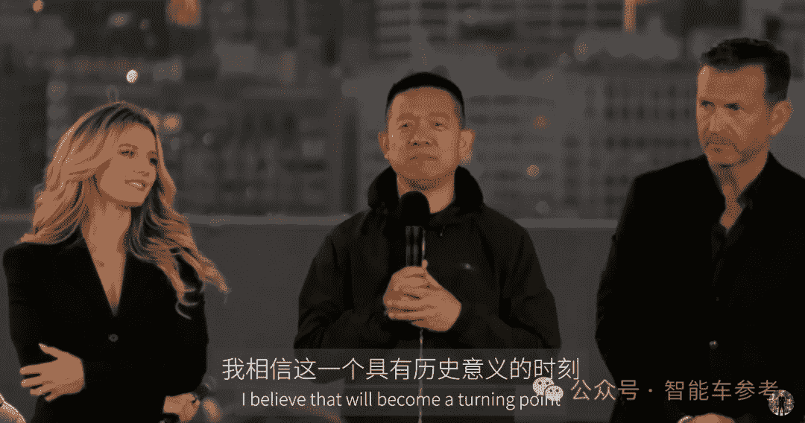
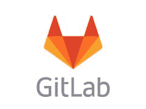
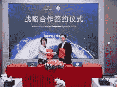

# 07.23-阿里云通义千问 Qwen3-Coder 宣布开源：480B 参数、原生支持 256K 上下文，可与 Claude Sonnet4 媲美

> 来源：[https://agijuejin.feishu.cn/docx/IddVdmnHeoGBKzxnyKwcIcvknNh](https://agijuejin.feishu.cn/docx/IddVdmnHeoGBKzxnyKwcIcvknNh)

# AGI 掘金日报 - AI 新闻推送 (2025 年 07 月 23 日)

> [欢迎加入 AGI 掘金社群](https://sourl.co/miZUyT)

## ⭐ 今日热点

### 💡 阿里云通义千问 Qwen3-Coder 宣布开源：480B 参数、原生支持 256K 上下文，可与 Claude Sonnet4 媲美

IT之家 | [阅读原文](https://www.ithome.com/0/870/027.htm)

7月23日，阿里云通义团队宣布Qwen3-Coder开源，号称“面向世界的智能编程引擎”。它是该团队最具Agent能力的代码模型，在多项任务上达开源模型SOTA效果，可与Claude Sonnet4媲美。率先开源的Qwen3-Coder-480B-A35B-Instruct是MoE模型，有480B参数等。团队还开源Qwen Code工具，其API可与其他工具协同。该模型已在魔搭社区等平台开源，后续将接入通义灵码 。

## 🌟 技术突破

### 💡 AMD 联手 Stability 推首款 BF16 精度 SD 3.0 Medium 模型，针对 XDNA 2 NPU 优化

IT之家 | [阅读原文](https://www.ithome.com/0/869/933.htm)

7月21日，AMD与Stability AI合作推出世界首款采用BF16精度格式的Stable Diffusion 3 Medium图片生成开源模型 。该模型针对AMD锐龙AI 300等系列处理器的XDNA 2架构NPU优化，在内存要求不高的笔记本上也能高质量本地生成图片。XDNA 2 NPU平台还支持超分辨率。兼容AMD平台用户三步即可实现该模型本地部署。

### 💡 继 OpenAI 之后，谷歌宣布其 Gemini AI 在国际数学奥林匹克竞赛测试中获金牌水平成绩

IT之家 | [阅读原文](https://www.ithome.com/0/869/902.htm)

2025年IMO测试中，继OpenAI实验性推理语言模型获金牌级别成绩后，谷歌升级版Gemini Deep Think解决六道题中的五道，达到金牌水平。它采用改进推理模式，如并行思维技术。谷歌利用强化学习技术等增强其能力，还提供语料库和提示词。未来，该模型将先供受信任测试者试用，后续向谷歌AI Ultra订阅用户开放 。

## 💫 企业动态

### 💡 贾跃亭骗倒美国：新MPV被爆贴牌国产车，1小时订单破万，刚拿到7亿融资就收警告函了

量子位 | [阅读原文](https://www.qbitai.com/2025/07/311614.html)

贾跃亭的法拉第未来（FF）为第二品牌Faraday X的首款MPV“Super One”举办发布会，直播1小时订单破万。新车疑似贴牌魏牌高山9。FF刚获1.05亿美元融资，却收到SEC欺诈调查警告。FF一季度营收低、亏损高、负债多。其造车历程波折，FF 91交付量少，此次新车订单虽多，但年底交付存疑，未来走向不明 。

### 💡 利用 AI Agent 充当传统软件开发团队角色，GitLab Duo 平台开启公测

IT之家 | [阅读原文](https://www.ithome.com/0/869/991.htm)

7月22日，GitLab旗下AI协作平台GitLab Duo开启公测。该平台用AI Agent“虚拟化”传统软件开发团队角色，覆盖软件开发生命周期三大阶段，开发者可通过IDE与AI Agent互动。亮点是引入“Flows”形成自动化工作流。GitLab还预告后续将引入“知识图谱”提升AI Agent性能，推出“AI Catalog”社区计划拓展应用生态 。

### 💡 进度过半：OpenAI 与甲骨文 Oracle 宣布 4.5GW 规模“星际之门”项目新合作

IT之家 | [阅读原文](https://www.ithome.com/0/869/973.htm)

当地时间7月22日，OpenAI与甲骨文Oracle宣布在“星际之门”项目框架下，在美国额外开发4.5GW电力容量规模的AI数据中心，投资将创造超10万个就业机会。“星际之门”首个数据中心部分设施已投运，新数据中心将使芯片超200万颗，电力容量超最初10GW承诺一半。OpenAI预计项目有望超额达成原计划目标。

### 💡 分析师：台积电二季度 AI 业务营收达 100 亿美元，英伟达是最大功臣

IT之家 | [阅读原文](https://www.ithome.com/0/869/972.htm)

据台湾地区分析师称，2025年二季度台积电总营收317亿美元，同比增长61%，其中约100亿美元来自AI芯片 。若趋势延续，2025年AI业务销售额或翻倍，2026年继续高速增长。董事长魏哲家称，约30%年营收增长预期基于AI驱动需求。目前英伟达是台积电AI芯片主要客户，重要性日增，而苹果是3纳米最大用户。此外，台积电预计今年内启动2纳米制程大规模生产。

### 💡 9岁女孩靠AI「万能钥匙」赚到第一桶金！OpenAI新CEO的六大野心

新智元 | [阅读原文](https://www.163.com/dy/article/K53B7LQ50511ABV6.html?spss=dy_author)

Fidji Simo将于8月18日任OpenAI应用CEO，管理至少三分之一业务。其备忘录展示愿景，AI能打破资源壁垒。在知识领域，可让知识民主化；健康方面，助患者成为健康主人；创意上，拉近想象与现实距离；财富自由上，降低创业门槛；时间方面，帮人们掌握时间；支持领域，提供全天候陪伴支持。还列举诸多关键数据，如使用AI导师学习效率是传统两倍等 。

### 💡 惠普与阿里云签署合作备忘录，探索通义大模型在 PC 端侧落地

IT之家 | [阅读原文](https://www.ithome.com/0/869/930.htm)

7月22日消息，阿里云与惠普签署合作备忘录，围绕通义大模型合作。在惠普AI助手惠小微/小惠中集成模型能力，基于通义千问3B版本在硬件层优化，提升响应效率与体验。惠普自2019年起用阿里云产品，2020年共建客服机器人，此次将AI能力延伸至终端。此外，通义千问已开源超300个模型，全球累计下载量超4亿次、衍生模型超14万个，阿里云是中国最大、亚太第一的云服务商 。

### 💡 给 AI“补补课”：微软砸资源抢救欧洲小语种

IT之家 | [阅读原文](https://www.ithome.com/0/869/916.htm)

7月22日微软在巴黎公布两项举措，延续升级“欧洲数字承诺”。因网络内容英语主导致欧洲语言训练数据失衡，如开源模型Llama 3.1在希腊语、拉脱维亚语得分远低于英语。微软将在斯特拉斯堡开发整理多语言数据集，扩充10种小语种数据，还发布提案征集令。今秋扩展“Culture AI”为巴黎圣母院打造数字孪生。微软借这些举措守护欧洲遗产，为其企业与公民赋能，且以“支持性”角色输出开放资源 。