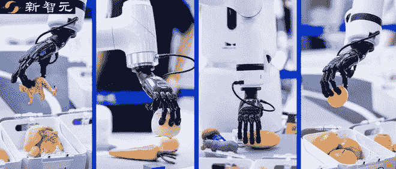

# 07.28-商汤科技发布“悟能”具身智能平台，让机器人像人一样和现实世界交互

> 来源：[https://agijuejin.feishu.cn/docx/AYwnd09qOo18zJxwFw3cwfFOnwd](https://agijuejin.feishu.cn/docx/AYwnd09qOo18zJxwFw3cwfFOnwd)

# AGI 掘金日报 - AI 新闻推送 (2025 年 07 月 28 日)

> [欢迎加入 AGI 掘金社群](https://sourl.co/miZUyT)

## ⭐ 今日热点

### 💡 商汤科技发布“悟能”具身智能平台，让机器人像人一样和现实世界交互

IT之家 | [阅读原文](https://www.ithome.com/0/871/035.htm)

7月27日，在2025世界人工智能大会的商汤大模型论坛上，商汤科技发布日日新V6.5大模型及“悟能”具身智能平台。日日新V6.5大模型推理升级，多模态性能提升同时成本大幅下降。“悟能”平台以商汤具身世界模型为核心，依托大装置提供算力支持，为机器人等提供感知、导航及交互能力，能生成多视角视频，助机器实现与真实世界的交互 。

## 🌟 技术突破

### 💡 Nature子刊 | 上交突破极限，端到端无人机高速避障，可微分物理实现

新智元 | [阅读原文](https://www.163.com/dy/article/K5GDQOKV0511ABV6.html?spss=dy_author)

上海交通大学团队在《Nature Machine Intelligence》发表成果，提出融合无人机物理建模与深度学习的端到端方法。该方法用极简模型与超小神经网络，实现轻量、可部署、可协同的无人机集群自主导航。单机导航成功率达90%，速度高达20米/秒；多机协同展示自组织行为。此方法训练高效、成本低，对比主流范式优势明显，还探究了可解释性，带来关于小模型等启发，团队还有后续研究成果 。

### 💡 90后养老就靠它？清华系机器人WAIC炫技，叠衣取货秀翻全场

新智元 | [阅读原文](https://www.163.com/dy/article/K5GDLDNT0511ABV6.html?spss=dy_author)

世界人工智能WAIC大会上，梅卡曼德机器人展示多种技能，如叠衣服、分拣物品等。其靠自研Mech-GPT多模态大模型和「眼脑手」系统，实现眼脑手一体化。该公司产品实用场景广泛，已在工业场景大规模落地。这家清华系公司成立9年，连续五年市占率第一，创始人认为未来十年机器人将进入家庭 。

### 💡 城市多灾种早期预警智能体“妈祖”走出国门，在 35 个国家和地区试用

IT之家 | [阅读原文](https://www.ithome.com/0/871/078.htm)

7 月 26 日，在 2025 年世界人工智能大会上，城市多灾种早期预警智能体“妈祖”发布。它构建全球早期预警服务网络，已在 35 个国家和地区试用。其命名源于妈祖精神与早期预警价值契合。“妈祖”功能包括灾害评估分析、监测预警（利用风云卫星等）、预警发布、形成各国气象灾害预案制度标准。它以云端系统为核心，可提供定制化技术方案，分享中国早期预警成果。

### 💡 AI 预测点球方向准确率超人类守门员，高达 52%

IT之家 | [阅读原文](https://www.ithome.com/0/871/032.htm)

西班牙拉斯帕尔马斯大学研究人员用深度学习模型预测点球方向。他们从转播比赛收集1010次点球视频，640段用于分析，输入22个模型。最佳模型预测准确率达52%，高于人类守门员的46%；排除正中方向后，模型准确率提升至64%，高出近10个百分点。项目负责人很惊讶，希望成果助守门员训练，未来将探索提前预测点球方向概率及程度 。

### 💡 业界首个，腾讯混元 3D 世界模型正式发布并开源

IT之家 | [阅读原文](https://www.ithome.com/0/871/009.htm)

7月27日，腾讯在2025世界人工智能大会论坛上发布并开源业界首个混元 3D 世界模型 1.0。它融合多种技术，支持文字图片输入，能快速生成高质量 3D 场景，简化游戏开发者构建流程，普通用户也能借此生成沉浸式空间。其核心算法可解构 3D 世界，输出标准化资产。该模型在关键维度超越当前领先开源模型，还公布了多个项目地址。

## 💫 企业动态

### 💡 国产机器人走向全球，智元拟进军海外市场

IT之家 | [阅读原文](https://www.ithome.com/0/871/126.htm)

7月28日消息，智元机器人具身业务总裁姚卯青称，已在北美、欧洲等多地与合作伙伴就海外市场本地化、全球化展开部署。联合创始人彭志辉（稚晖君）发布“智元灵渠OS”开源计划，今年四季度逐步开源。姚卯青还发布“Genie Envisioner”开源平台。此外，灵犀X2机器人预计2025年下半年规模化出货，2026年底预计出货量达数千台。

### 💡 游船侧翻、交通事故？央视通报多起 AI 炮制假新闻

IT之家 | [阅读原文](https://www.ithome.com/0/871/113.htm)

随着 AI 技术发展，部分不法分子利用其制造虚假信息扰乱社会秩序。央视网公开一批 AI 假新闻典例，如“三层游船倒扣江中 30 人坠江”假新闻，发布者为提升账号关注度编造谣言，已被处罚；云南大理也查处一起利用 AI 编造交通事故的谣言案，发布者为博眼球制作传播视频。警方提示，AI 易生成逼真假视频，需加强监管，提高群众辨别力。

### 💡 金山办公发布原生 Office 智能体 WPS 灵犀，用户只需通过自然语言即可完成文档创作

IT之家 | [阅读原文](https://www.ithome.com/0/871/098.htm)

7月27**日世界****人工智**能大会上，金山办公发布WPS AI 3.0版本——WPS灵犀，这是原生Office办公智能体，通过自然语言等可完成多种办公功能，同时WPS知识库亮相。金山办公今年3月提出“All in AI”战略，计划5年用AI改造产品线。WPS AI此前月活近2000万，应用于文字生成等场景。2024年财报显示，公司营收51.21亿元，同比增长12%；净利润16.45亿元，同比增长25% 。

### 💡 消息称特斯拉第三代机器人即将进入中国 C 端市场，预计明年实现量产

IT之家 | [阅读原文](https://www.ithome.com/0/871/076.htm)

7月27日消息，特斯拉第三代机器人已在美国工厂实测，预计2025年面向中国C端市场推出，2026年量产，5年内年产100万台。特斯拉Optimus人形机器人项目自2021年亮相已完成两代迭代，第二代有多项突破。2025年启动第三代研发，马斯克称其协调性等将突破。量产方面，2025年生产零部件1 - 1.2万台，2026年量产10万台，2027年年产50万台。中国人形机器人市场规模预计2030年突破千亿元，全球2035年有望达1.12万亿元 。

### 💡 快手可灵 AI 全球用户超 4500 万，发布灵动画布等全新功能

IT之家 | [阅读原文](https://www.ithome.com/0/871/054.htm)

7月27日WAIC期间，快手可灵AI在“生成式AI应用元年”论坛发布新功能灵动画布和升级的多图参考。灵动画布带来一站式创作体验，多图参考功能提升。可灵AI全球创作者超4500万，产品迭代30余次，累计生成超2亿视频和4亿图片。4月可灵2.0发布后，B端商家增长，全球超两万客户及开发者接入API，覆盖149个国家和地区 。

### 💡 马斯克：特斯拉 Optimus 人形机器人量产版将采用全新 V3 设计，非常精致

IT之家 | [阅读原文](https://www.ithome.com/0/871/050.htm)

2025年7月27日消息，马斯克在财报电话会议透露，特斯拉Optimus人形机器人量产版将采用全新V3设计，与内部使用的V2版本有显著不同。Optimus项目自2021年亮相后历经多次迭代，V2已具良好运动能力。此前计划2025年生产首批机器人，外界猜测改进V2后量产。马斯克对V3充满信心，称已找到正确方向，虽还会优化但无需根本性改变。虽未透露V3外观，推测或延续简洁类人概念设计，且长远看Optimus可能成特斯拉最重要产品。

### 💡 京东推出附身智能品牌 JoyInside，为机器人、玩具等注入高情商交互能力

IT之家 | [阅读原文](https://www.ithome.com/0/871/042.htm)

2025世界人工智能大会期间，京东将旗下大模型品牌升级为JoyAI，覆盖3B到750B全尺寸模型，多模态交互，推理效率提30%、训练成本降70%。还推出附身智能品牌JoyInside，为机器人等注入高情商交互能力，已与十余家头部品牌合作。此外，京东云开源企业级智能体JoyAgent，融合优势，特性突出，上线GitHub三天获超1000星标。

### 💡 宇树科技王兴兴回应“跳舞、拳击没用”：应该去看看行业，这是大家都在做的，不只我们

IT之家 | [阅读原文](https://www.ithome.com/0/871/022.htm)

7月**27日消息，在2**025世界人工智能大会上，宇树科技创始人王兴兴出席。针对质疑**，他称相关开**发行业普遍在做。他还表示人形机器人行业增长快，今年上半年全国智能机器人行业平均增速可达50%到100%，去年起每天至少一款新机器人发布。宇树科技7月25日发布双足人形机器人新品Unitree R1，售价3.99万元起，有26个关节，集成语音和图像多模态大模型。未来1到3年机器人有望落地复合化工业场景，3到10年投放至生活场景，但要解决电池续航等问题 。

### 💡 我国大模型数量居全球首位，达到 1509 个、占比达 40%

IT之家 | [阅读原文](https://www.ithome.com/0/871/021.htm)

今年我国基础大模型迭代加快且在多行业落地。全球已发布大模型 3755 个，我国企业贡献 1509 个，占比 40%，数量居首。我国人工智能影响力提升，346 款生成式 AI 服务完成备案，DeepSeek 日活超 3000 万。生成式 AI 技术渗透，6 月用户用其回答问题比例 80.9%。2024 年产业规模破 7000 亿，年增速 20%以上，产品多方面突破并构建智能应用生态。

### 💡 马斯克擎天柱解决不了无「手」难题？跑酷炫技竟不会遛狗，机器人陷泥潭

新智元 | [阅读原文](https://www.163.com/dy/article/K5FN0NKJ0511ABV6.html?spss=dy_author)

英伟达AI大佬Jim Fan称机器人存在迷你版「莫拉维克悖论」，当前炫技表演有问题。马斯克称人形机器人是特斯拉未来，2025年目标生产至少5000台Optimus，但目前仅数百台。特斯拉二季度收入下滑，急需爆款。同时，Optimus面临手部技术难题，研发成本高，内部有人员变动和诉讼。马斯克对其寄予厚望，然而特斯拉股价已跌24% 。

### 💡 阿里国际 AI 解决方案日均调用量达 10 亿次，核心技术均已开源

IT之家 | [阅读原文](https://www.ithome.com/0/871/012.htm)

2025世界人工智能大会上，阿里国际跨境电商AI解决方案Marco获SAIL之星奖。Marco由阿里国际团队研发，支持多语言、覆盖电商多场景，能解决商家诸多问题且成本低。阿里国际旗下电商平台均接入AI方案，过去一年商家常用图文翻译等功能，在欧洲部分语种翻译提升了消费者满意度，SEO场景下AI贡献占近4成。外部AI调用量增长23倍，日调用量破10亿次。此外，其AI核心技术已开源 。

## ✨ 行业观点

### 💡 谁是Adam？NeurIPS 2025审稿爆年度最大笑话！Hinton也曾被拒稿

新智元 | [阅读原文](https://www.163.com/dy/article/K5GDAI540511ABV6.html?spss=dy_author)

NeurIPS 2025评审结果出炉，出现诸多离谱现象。如审稿建议中现「Who's Adam」，还有审稿提示词没删净、疑似AI总结做评审决定等。近年来论文评审质量下降，原因包括论文产出大增、优秀人员专注模型开发创业等。此外，存在作者用LLM大量产出论文问题。同时文章还给出作者Rebuttal阶段的策略建议 。

### 💡 万亿美元新大陆！谁将主宰「人机共生」智能体经济时代？

新智元 | [阅读原文](https://www.163.com/dy/article/K5G7A0IO0511ABV6.html?spss=dy_author)

AI 迈向多智能体协同时代，智能体经济兴起。它以人机共生等为特征，将创造万亿美元级市场，依赖数字身份等三大要素及信任系统。其发展关键在于 Agent 工厂与 Agent 市场，前者标准化生产智能体，后者促进其能力流通。通付盾的“大群空间”致力于成为连接二者的“操作系统”与赋能中心 ，推动智能体经济发展。

### 💡 宇树科技王兴兴：我也经常偷懒，很多代码都是让 AI 帮忙写好

IT之家 | [阅读原文](https://www.ithome.com/0/871/036.htm)

在 2025 世界人工智能大会上，宇树科技创始人王兴兴称，现在 AI 性能好，生成代码成功率达百分之九十几，他常让 AI 帮忙写代码，去年尝试时成功率低，今年上半年已大幅提升。王兴兴还表示，宇树科技目标是用机器人解放人类生产力；他相信通用 AI 与通用机器人会成未来主流，人形机器人虽火热，但行业尚处早期，需多些耐心。