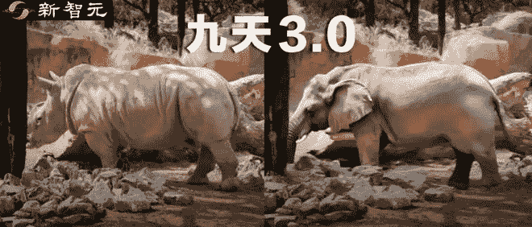
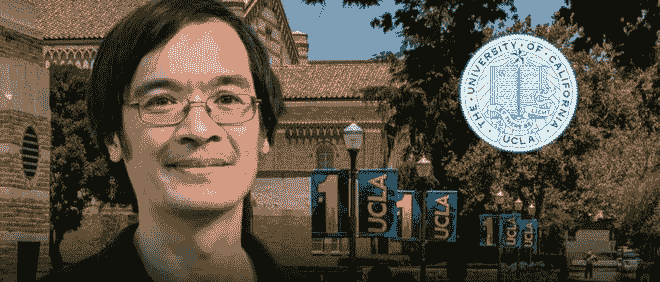

# 08.04-OpenAI 奥尔特曼“秀肌肉”：GPT-5 实测具备高效整合网络信息能力

> 来源：[https://agijuejin.feishu.cn/docx/AnN6dJwrPoL0WSxVRbucNuIgntg](https://agijuejin.feishu.cn/docx/AnN6dJwrPoL0WSxVRbucNuIgntg)

# AGI 掘金日报 - AI 新闻推送 (2025 年 08 月 04 日)

> [欢迎加入 AGI 掘金社群](https://sourl.co/miZUyT)

## ⭐ 今日热点

### 💡 OpenAI 奥尔特曼“秀肌肉”：GPT-5 实测具备高效整合网络信息能力

IT之家 | [阅读原文](https://www.ithome.com/0/872/795.htm)

8月4日凌晨，OpenAI CEO奥尔特曼在X上晒出疑似GPT-5截图，这是其首次公开亮相之一。面对对手压力，OpenAI有推出新旗舰模型的迫切需求。截图显示，GPT-5能高效整合网络信息，评价《Pantheon》在“烂番茄”获“100%影评人好评”，评价准确。外界预计，GPT-5将比前代更强大，还延续了ChatGPT对破折号的偏爱 。

## 🌟 技术突破

### 💡 马斯克：实时 AI 视频渲染技术有望 3 到 6 个月实现

IT之家 | [阅读原文](https://www.ithome.com/0/872/709.htm)

2025年8月3日马斯克在X上称，10天内6秒视频渲染时间从60秒大幅缩至15秒，本周或能控制在12秒以内且视觉质量不受影响，同时音频轨道在升级。他认为实时AI视频渲染技术有望3到6个月实现。Grok已推出人工智能文本转视频生成器Grok Imagine ，处于测试阶段，用户输入文字描述可转化为带音效视频片段，速度快，获马斯克称赞。

### 💡 九天大模型大变身：性能狂飙35%！还能一键P大象

新智元 | [阅读原文](https://www.163.com/dy/article/K61PIKU30511ABV6.html?spss=dy_author)

7月26日，中国移动在2025世界人工智能大会发布「九天」基础大模型3.0。其端到端技术全面升级，性能提升35%，智能体调用效率提升21%。在架构、数据等多方面创新，适配多款国产芯片。还推出多个专项大模型，在多项测评中超越其他模型。多模态大模型生成可控性增强，图理解和视频理解性能提升。8月6日将开展技术直播，开源部分模型及评测体系。

### 💡 马斯克再放大招！Grok AI短视频爆火，一夜全网刷屏

新智元 | [阅读原文](https://www.163.com/dy/article/K61PHPJ80511ABV6.html?spss=dy_author)

8月3日凌晨马斯克更新Grok App，向Grok Heavy用户推出Imagine功能，Grok iOS App也升级。该功能可30秒一键生成AI短视频，生成速度快，视频迅速爆火。马斯克称其仍处早期测试阶段，会不断改进，并号召网友分享提示。不少行业人士盛赞，如Shopify、戴尔CEO等。此外，马斯克透露Grok Imagine是AI版Vine，原版Vine将回归，而谷歌也刚开放Veo 3 。

## 💫 企业动态

### 💡 达美航空重申：不会用 AI 为乘客提供个性化票价

IT之家 | [阅读原文](https://www.ithome.com/0/872/790.htm)

达美航空此前计划与Fetcherr合作，在2025年底前于国内航线网络20% 部署AI收益管理技术，因引发美国国会议员批评和公众质疑，重申不会用AI为乘客提供个性化票价，称票价制定不涉及个人信息。参议员肯定其承诺，但仍关切数据收集情况。美国航空首席执行官也警告AI设票价可能破坏消费者信任。航空业动态票价已三十多年，主要由需求、成本和竞争决定。

### 💡 马斯克：虽没给出“离谱”的薪酬，多名 Meta 工程师正加入 xAI

IT之家 | [阅读原文](https://www.ithome.com/0/872/789.htm)

科技行业人才竞争激烈，马斯克称虽 xAI 初始薪酬未“离谱”，但多名 Meta 高级工程师正加入，且 xAI 长远估值有望超 Meta，还有为顶尖人才大幅加薪传统。此前 Meta 曾接触超 100 名 OpenAI 员工，成功招募至少 10 人，还推出超级智能实验室、拨款 140 亿美元。OpenAI 首席执行官称 Meta 曾以 1 亿美元挖人遭否认，Anthropic 员工更看重使命而非薪酬。

### 💡 豪拒15亿美金天价Offer，硅谷最狂AI巨星身份曝光！小扎、奥特曼抢破头

新智元 | [阅读原文](https://www.163.com/dy/article/K6274T1O0511ABV6.html?spss=dy_author)

硅谷AI人才争夺战激烈，Meta 小扎为挖 Andrew Tulloch 开出 4 年 10 亿美元、6 年 15 亿美元薪酬包，还联系 Thinking Machines Lab 约 50 名员工中的十几人，均被拒。Tulloch 履历出色，曾参与 GPT 相关研发。小扎接触超 100 名 OpenAI 员工，仅招入 10 人。科技四巨头今年已花 3440 亿美金投入 AI 竞赛。各方押注 AGI 突破，目前 OpenAI 和谷歌领先 。

### 💡 弹尽粮绝！陶哲轩自曝遭资金断供，美顶尖数学圣殿IPAM命悬一线

新智元 | [阅读原文](https://www.163.com/dy/article/K61JBVBJ0511ABV6.html?spss=dy_author)

美国政府以种族偏见为由，通过NSF、NIH等机构切断UCLA联邦科研资助。菲尔兹奖得主陶哲轩个人经费暂停，团队“断粮”，NSF资助的六大研究所之一IPAM也命悬一线，经费仅能维持数月。陶哲轩愤怒发声，认为此举鲁莽无规则。UCLA校长称这是重大损失。IPAM成就显著，曾催生“压缩感知”等技术。按计划陶哲轩今年将接任IPAM特别项目主任，网友对此事热议 。