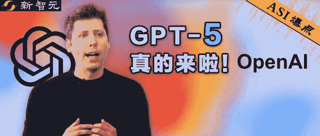
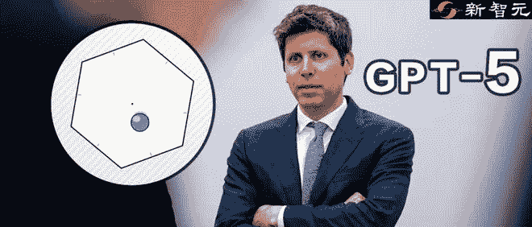
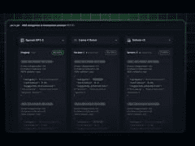
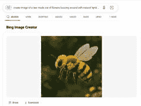
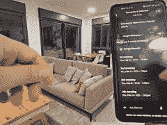

# 08.08-GPT-5，AI的「登月时刻」来了！奥特曼现场发布，三位一体博士级智能体

> 来源：[https://agijuejin.feishu.cn/docx/QodxdyL18oXtYHxToY7cOD9hnKb](https://agijuejin.feishu.cn/docx/QodxdyL18oXtYHxToY7cOD9hnKb)

# AGI 掘金日报 - AI 新闻推送 (2025 年 08 月 08 日)

> [欢迎加入 AGI 掘金社群](https://sourl.co/miZUyT)

## ⭐ 今日热点

### 💡 GPT-5，AI的「登月时刻」来了！奥特曼现场发布，三位一体博士级智能体

新智元 | [阅读原文](https://www.163.com/dy/article/K6DLQ7620511ABV6.html?spss=dy_author)

2025年8月8日，GPT-5正式发布，奥特曼称其实现智能范式跃迁，将博士级推理能力带给所有用户。这是融合模型，准确性大幅提升，告别幻觉。编程、写作能力进步显著，语音模式更自然智能，还可个性化定制，介入医疗。API有三款新推理模型，价格有竞争力。GPT-5标志AI竞争从模型发布转向「智能发布」，发布会后微软纳德拉支持遭马斯克嘲讽 。

## 🌟 技术突破

### 💡 OpenAI 的“iPhone 时刻”：奥尔特曼称 GPT-5 是全球最佳写作、编程 AI 模型，免费 ChatGPT 用户也能体验

IT之家 | [阅读原文](https://www.ithome.com/0/873/830.htm)

8月8日，OpenAI发布迄今最智能、快捷、实用的GPT-5模型。首席执行官山姆·奥尔特曼将其亮相比作初代iPhone。该模型在推理、准确性和速度上显著改进，是最佳写作、编码和医疗模型，能自动切换推理，理解多种格式。它免费供ChatGPT用户体验，免费用户超上限切至GPT-5 Mini，付费用户可体验完整版本。此外，奥尔特曼就直播图表问题回应称搞砸了，官网博客图表正确 。

### 💡 刚刚，GPT-5内测抢先泄露！推理强到离谱，智商被曝140超越人类天才

新智元 | [阅读原文](https://www.163.com/dy/article/K6C9S1GQ0511ABV6.html?spss=dy_author)

GPT-5即将于周五凌晨推出，其内测情况抢先泄露。基准测试显示，它在SimpleBench上得分达90%，智商逼近140，超越人类高中生。网友通过Copilot对其进行实测，在多个任务中表现出色。此外，OpenAI发布了开源模型gpt-oss，多项基准测试登顶。该模型在不同硬件上有不同运行速度，OpenAI此举或为卷死对手、豪赌未来 。

### 💡 刚刚，📕开源了首个多模态大模型dots.vlm1，性能直追SOTA！

新智元 | [阅读原文](https://www.163.com/dy/article/K6C7ISQ70511ABV6.html?spss=dy_author)

📕开源首个多模态大模型dots.vlm1，性能逼近SOTA。该模型基于自研视觉编码器和大语言模型构建，在视觉理解、推理任务上表现出色，实测能解决多种难题。其技术架构含三个核心组件，经三阶段训练。📕加大技术自研力度，此前已开源多款模型。多模态成通向AGI必经之路，VLM需求增长，📕此举或为更好理解用户内容，实现精准推荐。

### 💡 一夜颠覆Sora神话，H200单卡5秒出片！全华人团队开源AI引爆视频圈

新智元 | [阅读原文](https://www.163.com/dy/article/K6C79PG60511ABV6.html?spss=dy_author)

UCSD、UC伯克利、MBZUAI三大机构联合发布FastWan系视频生成模型，核心采用「稀疏蒸馏」训练方案。该方案结合稀疏注意力训练与步骤蒸馏，让视频去噪速度提升70倍。在单张H200上，5秒可生成5秒视频；升级版在单张H200上16秒可生成720P的5秒视频。模型权重、训练方案和数据集全部开源，实现AI实时视频生成，是稀疏注意力领域重大突破。

## 💫 企业动态

### 💡 OpenAI 迄今最智能 AI 模型：“六边形战士”GPT-5 登场，准确性、速度、推理能力等全面突破

IT之家 | [阅读原文](https://www.ithome.com/0/873/829.htm)

8月8日凌晨1点，OpenAI在发布会上推出GPT-5模型。首席执行官山姆・奥尔特曼称其是迈向通用人工智能的重要一步，和它交流如同与人类专家交流。GPT-5在多个基准上达新水平，关键在于提高可靠性和准确说明事实。当天起面向免费、Plus及Pro订阅用户推出，免费用户有配额限制。演示中，GPT-5响应速度快，编程演示表现佳，几分钟内输出超200行代码 。

### 💡 动嘴就能修图：消息称谷歌 Pixel 10 系列手机将支持“对话式照片编辑”，基于 Gemini AI

IT之家 | [阅读原文](https://www.ithome.com/0/873/771.htm)

8月7日消息，外媒称谷歌将为Pixel 10系列手机带来Gemini AI驱动的“对话式照片编辑”模式，用户能用文字或语音指令如换背景等完成修图，类似ChatGPT输入提示词操作。该功能初期独占Pixel 10全系列，后续或推至旧款。此外，谷歌还计划为该系列升级摄影功能，新增“相机教练”。有观点认为谷歌在将软件更新重心转向摄影领域，以软件补硬件短板 。

### 💡 全员百万富翁：消息称 OpenAI 为防 Meta 挖角，2 年内为每名员工提供 150 万美元奖金

IT之家 | [阅读原文](https://www.ithome.com/0/873/757.htm)

8月7日消息，Hyperbolic AI CEO金雨辰称，OpenAI CEO萨姆・奥尔特曼宣布2年内为每名员工提供150万美元奖金，以防止Meta挖角，此为“扎克伯格挖角效应”。目前Meta已开出每年2000万美元高薪吸引AI员工。金雨辰还提到英伟达78%员工是百万富翁，而OpenAI百万富翁比例达100%。此前奥尔特曼曾欢迎Meta的挑战。

### 💡 日本首案：报业巨头《读卖新闻》起诉 Perplexity AI 侵犯版权，索赔 21 亿日元

IT之家 | [阅读原文](https://www.ithome.com/0/873/765.htm)

8月7日，日本报业巨头《读卖新闻》向东京地方法院起诉美国生成式AI搜索企业Perplexity AI侵犯版权，索赔约21.68亿日元（约合1.06亿元人民币），这是日本大型新闻机构首次此类起诉。《读卖新闻》称Perplexity AI复制其文章信息，侵犯复制和公开传播权，还减少其网站访问量致收入减少，要求禁止复制并删除已复制内容 。

### 💡 消息称百度计划 8 月底前发布 AI 推理新模型，未来几个月推文心 5.0

IT之家 | [阅读原文](https://www.ithome.com/0/873/721.htm)

据《华尔街日报》8月7日报道，百度计划在2025年8月底前推出能处理更复杂任务的新推理模型，以增强竞争力。未来几个月还将推出核心基础模型的更新版本文心5.0（Ernie 5.0）。今年3月百度发布文心大模型4.5及X1，4.5是首个原生多模态大模型，多项测试优于GPT4.5且价格低；X1对标DeepSeek - R1 ，支持多模态等且价格约为一半。

### 💡 科技让爱有回声：高德地图 AI 自制导航语音功能开放，用户再次听到已故父亲的“唠叨”

IT之家 | [阅读原文](https://www.ithome.com/0/873/695.htm)

8月7日消息，高德地图今年5月20日开放AI自制导航语音功能。有用户希望用已故亲人语音制作语音包，高德地图与用户建联，通过影像资料和AI技术帮其合成语音包，并发布“爱的回声”短片分享故事。此外，8月4日高德地图宣布全面AI化，推出全球首个AI原生地图应用及智能体“小高老师”，重塑出行交互方式 。

### 💡 四种变体可选：OpenAI 最强模型 GPT-5 宣传文案遭偷跑，增强代码质量 / 用户体验

IT之家 | [阅读原文](https://www.ithome.com/0/873/685.htm)

IT之家8月7日消息，外媒报道OpenAI将在太平洋时间周四上午10点（北京时间周五凌晨1点）举办发布会暗示推GPT-5。微软GitHub仓库意外泄露GPT-5宣传文案，称其明天发布后立即上市，会是最先进模型，在多方面显著增强，有四种变体。发稿时博客已删。Neowin认为GPT-5将通过ChatGPT或微软Copilot提供，在Copilot有独家“智能模式”。

### 💡 打开必应就能生图，微软 Bing Image Creator 免费接入 GPT-4o

IT之家 | [阅读原文](https://www.ithome.com/0/873/682.htm)

8月7日，微软宣布Bing Image Creator免费接入OpenAI的GPT-4o图像生成模型。今年早些时候，OpenAI将图像生成功能整合进GPT-4o。该模型理解用户提示和还原文字内容能力强，画面细腻但出图比DALL-E 3稍慢。Bing Image Creator将保留旧版DALL-E 3和新版GPT-4o供用户选择。平台免费，每月有15次快速生成额度，超出后可用积分换快速生成，也能不限次数标准速度生成。更新后可通过多种方式访问 。

### 💡 ChatGPT 连接器漏洞曝光：无需用户交互，可“毒化文档”窃取敏感数据

IT之家 | [阅读原文](https://www.ithome.com/0/873/668.htm)

8月6日《连线》报道，安全研究人员在OpenAI的连接器中发现新漏洞。在黑客大会上，Michael Bargury和Tamir Ishay Sharbat揭示此漏洞，攻击者可借此通过间接提示注入攻击，无需用户交互就能从Google Drive提取敏感信息，如演示中提取开发者密钥。Bargury称只需用户邮件并共享文档即可完成攻击。OpenAI今年初将Connectors作为ChatGPT测试功能推出，列出至少17种关联服务。Bargury曾报告，OpenAI已采取缓解措施，且攻击一次只能提取有限数据。OpenAI尚未回应评论请求。

### 💡 金融圈天价抢AI人才？交大高金硬核EMBA上线，扫码申请最高全额奖学金

新智元 | [阅读原文](https://www.163.com/dy/article/K6BVCRGJ0511ABV6.html?spss=dy_author)

上海交通大学上海高级金融学院2026级EMBA课程全新升级，推出「金融×AI」「金融×法律」方向，深度整合多学科资源，打造跨界人才。课程将AI融入金融业务场景，提升管理者实战能力。同时，学院推出「科技强国人才培养专项计划」，为优秀科创人才提供全额或半额奖学金，构建三位一体赋能体系。此外，交大高金还与人工智能学院战略合作，在课题研究、课程合作等方面展开合作 。

### 💡 研究人员入侵谷歌 Gemini，实现远程操控智能家居

IT之家 | [阅读原文](https://www.ithome.com/0/873/651.htm)

8 月 7 日消息，黑帽网络安全大会上研究人员展示攻击谷歌 Gemini 的成果，通过在谷歌日历邀请中注入间接提示词，能远程操控与之连接的智能家居设备。研究人员今年 2 月已告知谷歌。谷歌 Workspace 安全产品管理总监安迪・温称，此类攻击现实中“极为罕见”，但因大语言模型复杂性增加，防范困难。谷歌重视此漏洞，正加快开发阻止攻击的工具 。

### 💡 微软将 OpenAI 最小开源模型 gpt-oss-20b 引入 Windows，本地也能跑

IT之家 | [阅读原文](https://www.ithome.com/0/873/645.htm)

当地时间8月6日，微软通过Windows AI Foundry平台向Win11用户提供OpenAI的免费开源大模型gpt-oss-20b，用户可在本地调用AI功能等。gpt-oss-20b轻量，适合特定任务，在多种Win硬件高效运行。它需16GB显存，支持“思维链式”任务，但仅支持文本，“幻觉”比例达53%。微软未来将引入macOS等更多设备，该模型也在Azure AI Foundry、AWS平台上线 。