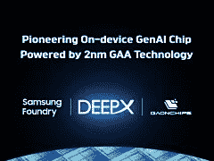

# 08.14-韩企 DEEPX 联手三星打造全球首款 2nm 端侧生成式 AI 芯片，2027 年量产

> 来源：[https://agijuejin.feishu.cn/docx/GPuudUWITobzXIxwkT7cTY9xnjg](https://agijuejin.feishu.cn/docx/GPuudUWITobzXIxwkT7cTY9xnjg)

# AGI 掘金日报 - AI 新闻推送 (2025 年 08 月 14 日)

> [欢迎加入 AGI 掘金社群](https://sourl.co/miZUyT)

## ⭐ 今日热点

### 💡 韩企 DEEPX 联手三星打造全球首款 2nm 端侧生成式 AI 芯片，2027 年量产

IT之家 | [阅读原文](https://www.ithome.com/0/875/025.htm)

韩国边缘 AI 芯片企业 DEEPX 携手三星晶圆代工及 GAONCHIPS，将共同打造全球首款 2nm 端侧生成式 AI 芯片 DX-M2 。三星 2nm 工艺较上代 5nm 实现能效翻倍。DEEPX 目标是以 5W 功耗在 20B 参数模型下实现每秒 20 - 30 Token 推理输出。已有 DX-M2 原型，计划 2026 年上半年试产，2027 年大规模量产，且已在该芯片上验证运行百度文心开源模型。

## 🌟 技术突破

### 💡 Figure 人形机器人首秀灵巧手叠衣服：神经网络架构不变，只增加数据集就搞定

IT之家 | [阅读原文](https://www.ithome.com/0/875/142.htm)

Figure人形机器人首秀灵巧手叠衣服。在神经网络架构不变、仅增加数据集的情况下，原本用于物流场景的机器人习得新技能。完成任务展现三项成果：多指手人形机器人自主叠衣；相同架构仅数据变；实现自然多模态交互。其Helix架构是关键，由两个系统组成，此前包裹分拣任务还针对性改进该架构。未来团队计划提升机器人灵活性、速度和泛化能力 。

### 💡 推理性能超传统 10 倍，群联发布 aiDAPTIV+ 英特尔 AI PC 笔记本方案

IT之家 | [阅读原文](https://www.ithome.com/0/875/101.htm)

8月12日，群联及其子公司发布结合aiDAPTIV+技术和英特尔移动端处理器平台的AI PC解决方案。aiDAPTIV+将闪存纳入AI系统存储池。在该技术加持下，英特尔酷睿Ultra处理器笔记本AI推理性能比传统核显运行提升超10倍，降低边缘AI导入门槛与成本。群联创始人潘健成称，希望让人们以可负担方式拥有地端AI运算能力，未来将推动技术落地普及。

### 💡 准确率 60%：AI + 雷达传感器组合，3 米内可转录手机通话内容

IT之家 | [阅读原文](https://www.ithome.com/0/875/090.htm)

8月8日，美国宾夕法尼亚州立大学计算机科学团队发明“无线窃听”新技术，结合AI与毫米波雷达传感器，能在3米内转录手机通话内容，准确率约60%。该技术利用雷达探测手机振动，用“低秩适应”微调模型1%参数处理信号，转录词汇量达一万。相比2022年成果，实用性提升。目前技术仅限学术研究，研究者旨在警示远程窃听可能性，提醒敏感通话提高警惕。

### 💡 AMD 发保姆级教程：教你如何在 Win11 上运行最强文生图 AI 工具 ComfyUI

IT之家 | [阅读原文](https://www.ithome.com/0/875/073.htm)

8月13日，@AMD中国发布在Win11系统上，通过Linux子系统（WSL）用ROCm运行ComfyUI的教程。ROCm是AMD的开源GPU计算软件平台，ComfyUI是文生图可视化构建工具。用户需具备兼容显卡、特定版本软件等条件，按5大步骤操作，就能用WSL和ROCm运行ComfyUI，流畅运行大型模型，支持创意AI应用。

## 💫 企业动态

### 💡 腾讯高管解读 Q2 财报：会继续加大 AI 投资

IT之家 | [阅读原文](https://www.ithome.com/0/875/164.htm)

8 月 13 日晚腾讯发布 2025 年 Q2 财报，营收 1845 亿元，同比增 15% 。高管在电话会议回应提问：广告收入有增长空间，得益于 AI 精准定向等；AI 对移动互联网生态影响小，未来或探索广告变现；看好中国长线运营游戏，3A 级买断制游戏与之互补；AI 投入会加大，要把握节奏；《广告法》“新规”影响不大；云业务不依赖 GPU，广告注重延长增长周期。

### 💡 OpenAI女CEO太狠了！智商148，GPT-5才是真印钞机

新智元 | [阅读原文](https://www.163.com/dy/article/K6S0L1QH0511ABV6.html?spss=dy_author)

GPT-5发布，智商高达148，在多个测试中表现亮眼，获英伟达认可。OpenAI为其增加15倍算力，动用超20万块GPU服务7亿用户。此次更新旨在让免费用户“间接付费” ，通过“路由器”功能，可分流请求降低成本、提升性能。上线首日，推理模型日活用户飙升。奥特曼对广告变现态度转变，未来ChatGPT有望成“超级应用”，通过成交抽佣等变现 。

### 💡 因 AI 企业从存档抓取数据，Reddit 禁止互联网档案馆对非首页索引

IT之家 | [阅读原文](https://www.ithome.com/0/875/041.htm)

8月11日，Reddit禁止互联网档案馆对其非首页多数页面索引存档。原因是一些AI企业违反平台政策，通过互联网档案馆存档页面抓取数据。Reddit允许企业付费抓取数据，此举绕过了规定。互联网档案馆旗下网页时光机总监称与Reddit有长期合作，正就此事展开讨论 。

### 💡 接近 DeepSeek 人士确认：R2 模型本月内并无发布计划

IT之家 | [阅读原文](https://www.ithome.com/0/874/997.htm)

近日市场传深度求索DeepSeek-R2大模型将于8月15日至30日发布，接近DeepSeek人士称此消息不实，8月并无发布计划。今年年初也曾有R2于3月17日发布的消息，官方否认。路透社曾报道其在加速推出，有望生成更好代码、用多种语言推理。6月消息称团队在推进开发，但CEO梁文锋对模型能力不满意，仍在提升性能。DeepSeek官方未公布R2发布日期及技术细节 。

### 💡 美国宣战，AI行动计划打响第一枪！「AI+材料」成最新核武器

新智元 | [阅读原文](https://www.163.com/dy/article/K6RAN3NL0511ABV6.html?spss=dy_author)

2025年美国白宫发布《美国AI行动计划》，将「AI+材料」提升至国家级战略高度。计划涉及投资AI赋能科学、构建科学数据集等五大重点领域，有望解决传统材料科学难题，推动多领域突破。其核心依赖「数据-算法-算力」协同。这警醒中国，应利用自身优势，加速建设材料数据库、突破AI算法，推动AI与材料研发制造融合，抢占「AI+材料」制高点。

## ✨ 行业观点

### 💡 TrendForce：边缘 AI 叙事降温，预计多数消费电子产品今年出货大致持平

IT之家 | [阅读原文](https://www.ithome.com/0/875/150.htm)

TrendForce集邦咨询称，边缘AI话题降温，尚处营销阶段，消费级电子产品增长乏力，今年智能手机、笔电出货或与去年持平或仅增1 - 2%，电视出货降1.1%，可穿戴设备缩2.8%。但云端AI带动AI服务器出货增超20%，2026年增长将放缓。今年电子产业链提前拉货，下半年需求被“透支”，2026年产业增长更趋缓。

### 💡 商汤科技林达华：AI 下一阶段突破必然要超越语言，回归世界交互

IT之家 | [阅读原文](https://www.ithome.com/0/875/119.htm)

8月12日，商汤科技林达华发布文章阐述多模态智能相关思考。他提到，AI核心目标是构建智能，智能核心是与外界自主交互能力。语言非智能本源，单靠语言模型无法构建真正AGI 。大语言模型是迈向AGI重要一步，但AI下一阶段突破需超越语言，回归与世界交互。多模态信息感知处理能力是AGI核心要求，也是从语言模型迈向AGI必由之路。

### 💡 马斯克删除xAI「研究员」职位引爆网络！LeCun怒批：如此暴力将扼杀创新

新智元 | [阅读原文](https://www.163.com/dy/article/K6RGNODR0511ABV6.html?spss=dy_author)

7月30日马斯克宣布xAI删除「研究员」头衔，称其是学术界“虚荣遗产”，该话题获3000万人次观看。AI先驱LeCun强烈反驳，强调研究与工程在多方面有别，混淆会扼杀创新。这场争论反映在AI实验室的融合、专家、废除主义三种组织模式上。贝尔实验室、施乐PARC的历史模式也成为争论背景，两人观点分歧，目前难分对错 。