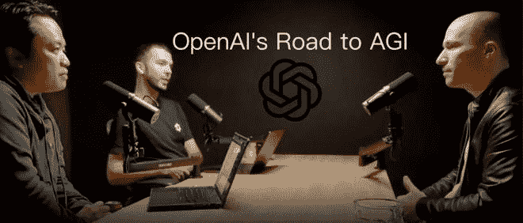
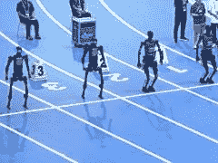
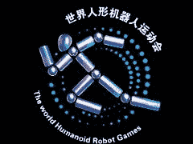
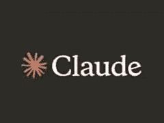
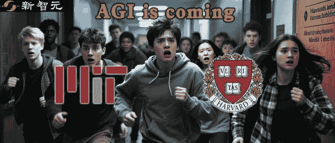
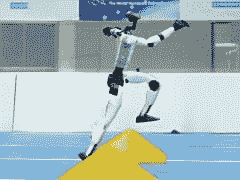

# 08.18-GPT-5首次会推理，OpenAI联创曝AGI秘诀！超临界学习吞噬算力，2045金钱无用？

> 来源：[https://agijuejin.feishu.cn/docx/DjCbdHTltoqfv6xUmyGclzmRn1e](https://agijuejin.feishu.cn/docx/DjCbdHTltoqfv6xUmyGclzmRn1e)

# AGI 掘金日报 - AI 新闻推送 (2025 年 08 月 18 日)

> [欢迎加入 AGI 掘金社群](https://sourl.co/miZUyT)

## ⭐ 今日热点

### 💡 GPT-5首次会推理，OpenAI联创曝AGI秘诀！超临界学习吞噬算力，2045金钱无用？

新智元 | [阅读原文](https://www.163.com/dy/article/K76G0VM80511ABV6.html?spss=dy_author)

OpenAI 联创 Greg Brockman 在访谈中称，GPT-5 是首个「混合模型」，是分水岭，学会了「推理」，在高智力任务上有质变，成为科研合作者。模型从静态训练迈向动态推理，走向「边推理边训练」，会出现「超临界学习」。他还提出开发者最佳工程实践，指出算力是瓶颈，未来算力分配是核心议题，2045 年 AI 或带来巨变，现在仍是入 AI 最佳时机 。

## 🌟 技术突破

### 💡 人形机器人史上首个百米“飞人”诞生：具身天工 Ultra 夺得 100 米短跑项目冠军

IT之家 | [阅读原文](https://www.ithome.com/0/875/991.htm)

2025年8月17日，在国家速滑馆举行的世界人形机器人运动会上，北京天工队的“具身天工Ultra”机器人，由北京人形机器人创新中心研发。它以21.50秒获100米短跑冠军，是首个百米“飞人”。它还是赛场唯一用全自主导航系统、无需人工遥控的选手。此外，还获1500米第二名、半程马拉松冠军。其身高180cm、体重52kg，能适应多种地形，平均时速10km/h，最高12km/h 。

### 💡 刚刚！谷歌内部揭秘Genie 3：Sora后最强AI爆款，开启世界模型新时代

新智元 | [阅读原文](https://www.163.com/dy/article/K75PUR3I0511ABV6.html?spss=dy_author)

谷歌DeepMind揭秘Genie 3，这是最先进世界模型之一。它由Veo 2和Genie 2合作完成，能实时生成互动世界，有特殊记忆等突破。Genie 3还涌现出符合人类直觉的行为，物理效果惊艳。团队表示会开放模型，真实感和交互性是未来关键，其能为机器人提供数据。虽有进展，但距准确模拟现实世界仍有差距 。

### 💡 硬核拆解！从GPT-2到gpt-oss，揭秘大模型进化关键密码

新智元 | [阅读原文](https://www.163.com/dy/article/K75PPLCK0511ABV6.html?spss=dy_author)

8月5日，OpenAI推出开源权重大语言模型gpt-oss-120b、gpt-oss-20b。Sebastian Raschka博士解析从GPT-2到gpt-oss的LLM架构演进，包括移除Dropout、RoPE替代绝对位置编码等。还对比gpt-oss与Qwen3，涉及宽度深度权衡等。gpt-oss训练耗时约210万H100GPU小时，是推理型模型，可调节推理强度，MXFP4优化使其能在单卡运行，基准测试与GPT-5接近 。

## 💫 企业动态

### 💡 甲骨文与谷歌云扩大合作，向客户提供 Gemini AI 模型服务

IT之家 | [阅读原文](https://www.ithome.com/0/876/027.htm)

8月17日消息，甲骨文与谷歌云扩大合作。客户可通过甲骨文云基础设施生成式AI服务使用谷歌的Gemini 2.5模型，用于多类任务。甲骨文还计划让谷歌全系列Gemini模型在OCI生成式AI服务可用，未来将使其成为甲骨文Fusion云应用可选功能。客户可用现有积分使用。谷歌云首席执行官称这便于甲骨文客户部署AI代理。Gemini模型因准确响应等优势，在企业级应用出色。

### 💡 相约北京，第二届世界人形机器人运动会将于明年 8 月举办

IT之家 | [阅读原文](https://www.ithome.com/0/876/019.htm)

8月17日下午，首届世界人形机器人运动会在“冰丝带”举行闭幕式。会上，四家单位共同发起成立世界人形机器人运动联合会，还宣布明年8月举办第二届。2025世界人形机器人运动会是全球首个该类综合性竞技赛事，为期三天，有来自五个大洲、16个国家的280支队伍，带着127个品牌的500余台机器人，围绕26个赛项展开角逐 。

### 💡 黄仁勋子女逆袭上位！4万亿「皇储」成长史首曝：一个学烘培，一个开酒吧

新智元 | [阅读原文](https://www.163.com/dy/article/K768P09H0511ABV6.html?spss=dy_author)

英伟达创始人黄仁勋的子女Madison和Spencer，于2020年和2022年相继加入公司，未涉足芯片核心业务，而是探索数字孪生、机器人技术等新兴领域。Madison今年三月晋升为高级总监，年薪达100万美元。黄仁勋认为这些业务是未来新增长引擎。此外，英伟达还有不少高管子女任职。在科技行业家族传承较少的情况下，黄氏兄妹的加入成“异类” 。

### 💡 宇树机器人运动会夺冠背后：大约筹备一个月，原不打算参赛

IT之家 | [阅读原文](https://www.ithome.com/0/875/980.htm)

2025世界人形机器人运动会在北京举行，宇树科技市场部陈经理称，参赛筹备约一个月，起初因作为硬件厂商与客户竞争不合适而不打算参赛，后因之前马拉松舆论决定参赛。8月15日，宇树科技在运动会上表现出色，赢得多项冠军并创造世界纪录。此外，宇树科技创始人王兴兴透露，明年会参加北京亦庄半程马拉松，届时机器人选手将全自主奔跑。

### 💡 OpenAI 奥尔特曼：未来公司 CEO 或是 AI

IT之家 | [阅读原文](https://www.ithome.com/0/875/972.htm)

OpenAI 首席执行官萨姆·奥尔特曼在采访中谈及多个话题：回应 GPT-5 发布批评，虽有失误但 API 流量 48 小时翻倍，ChatGPT 日活创新高，用户量一年约增长三倍，周日活超 7 亿；称行业处于 AI 泡沫，但 AI 极具变革性；计划资助脑机接口公司竞争；暗示收购 Chrome 兴趣；称与乔纳森·艾维合作的 AI 硬件值得期待；谈了 AGI 定义和自己的 CEO 任期，还提到 GPU 不足需大量投入。

### 💡 Anthropic 宣布为 Claude 赋予“结束聊天”能力，以应对极少数用户不怀好意的情况

IT之家 | [阅读原文](https://www.ithome.com/0/875/970.htm)

8月16日，人工智能公司Anthropic为Claude Opus 4与Claude Opus 4.1 推出新功能，在极少数针对持续性有害或辱骂性互动时，模型可主动结束对话，目的是保护AI模型本身。在部署前测试中，Claude有“回避伤害”倾向。该功能仅在两类极端情境启用，多数用户正常使用遇不到。此功能是持续实验，未来会优化，用户可反馈意见。

### 💡 「我怕活不到毕业」！AI引爆美国退学潮，18岁PPT式创业震惊YC之父

新智元 | [阅读原文](https://www.163.com/dy/article/K75PPHEB0511ABV6.html?spss=dy_author)

2025 年，美国哈佛、MIT 等高校掀起辍学潮。一方面，学生因 “AI 从不等人，晚一步错过风口” 而退学创业；另一方面，因担心 AGI 带来生存威胁，投身 AI 安全领域。如 Alice Blair 等多名学生退学。此外，超半数学生担心 AGI 影响就业，有预测称其将致失业率飙升。不过，也有像 Yann LeCun 等专家反驳相关观点，高校也采取措施留人 。

### 💡 宇树科技 100 米障碍赛再摘金牌，G1 人形机器人夺冠成绩 33.71 秒

IT之家 | [阅读原文](https://www.ithome.com/0/875/944.htm)

8月17日宇树科技官方宣布，在首届世界人形机器人运动会上，继首日宇树H1人形机器人在1500米、400米夺冠后，第二日宇树G1人形机器人在100米障碍赛中以33.71秒的成绩再夺金牌。此前报道还提及首日宇树科技在田径赛中创造世界纪录。宇树科技在此次运动会上成绩出色。

## ✨ 行业观点

### 💡 OpenAI 奥尔特曼：希望通用人工智能未来能促进生育率增长

IT之家 | [阅读原文](https://www.ithome.com/0/876/052.htm)

据《商业内幕》16 日报道，OpenAI CEO 奥尔特曼称有孩子体验“令人惊叹”，认为 AGI（通用人工智能，具备与人类相当推理能力，仍停留在理论阶段）或许能促进生育。当前世界人口增长放缓，他觉得低生育趋势是“真正的问题”，希望“后 AGI 时代”家庭和社区建设成核心价值。此外，马斯克也热衷生育，称出生率下滑是文明最大威胁 。