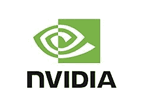

# 08.26-Perplexity 应对“版权争议”推出 4250 万美元专项基金，成首个提出“直接分成”模式 AI 公司

> 来源：[https://agijuejin.feishu.cn/docx/C4jgd9o5Ior2sexbVVZcjoOinuc](https://agijuejin.feishu.cn/docx/C4jgd9o5Ior2sexbVVZcjoOinuc)

# AGI 掘金日报 - AI 新闻推送 (2025 年 08 月 26 日)

> [欢迎加入 AGI 掘金社群](https://sourl.co/miZUyT)

## ⭐ 今日热点

### 💡 Perplexity 应对“版权争议”推出 4250 万美元专项基金，成首个提出“直接分成”模式 AI 公司

IT之家 | [阅读原文](https://www.ithome.com/0/877/976.htm)

8月25日，Perplexity AI为应对AI版权问题，推出“出版商收入分成计划”，成首个提出“直接分成”模式的AI公司。其CEO透露已拿出4250万美元专项基金，资金源于新订阅服务。此前该公司饱受“AI版权”批评，多家媒体起诉或发律师函。目前尚不知哪些出版商签约，公司正与《时代周刊》等洽谈，此举意在缓和与新闻出版巨头关系、降低法律风险 。

## 🌟 技术突破

### 💡 AI“看图”时的致命盲点，可窃取你的隐私数据

IT之家 | [阅读原文](https://www.ithome.com/0/877/997.htm)

8月25日，Trail of Bits研究人员开发新型AI攻击手法。源于图像缩放攻击理论，在高分辨率图片藏恶意提示词，借AI系统降采样算法显现，被大语言模型当指令执行，可窃取用户数据。已在多平台测试有效，还发布开源工具Anamorpher（测试版）。研究人员利用此漏洞在特定模式下提取Google日历数据并发送至指定邮箱 。

### 💡 苹果创新“清单法”：用 AI 大模型当“老师”，教小模型更精准执行复杂指令

IT之家 | [阅读原文](https://www.ithome.com/0/877/986.htm)

8月25日，科技媒体报道苹果研究人员提出“基于清单反馈的强化学习”（RLCF）方法，用任务清单替代传统人类评分提升大语言模型执行复杂指令能力。在强指令跟随模型测试中，RLCF在各评测基准均有提升，如FollowBench硬性满意率提升4个百分点等。清单由更大模型生成数据集，打分作为小模型训练奖励信号。不过该方法有局限，依赖强模型且不能替代安全性评估，对其他任务适用性待验证 。

### 💡 硅基流动上线 DeepSeek-V3.1，上下文升至 160K

IT之家 | [阅读原文](https://www.ithome.com/0/877/958.htm)

8月25日，硅基流动上线深度求索团队开源的DeepSeek-V3.1。其总参数671B，激活参数37B，采用混合推理架构，思考效率更高，在工具使用等方面表现提升，在多领域比肩Claude 4 Sonnet等模型。价格上，输入4元/M Tokens，输出12元/M Tokens，比Claude 4 Sonnet便宜。该版本率先支持160K超长上下文，可处理多种复杂场景，如超长文档无损解析、深度对话等。

### 💡 英伟达：NVLink Fusion 互联授权支持 CPU + XPU 双定制芯片

IT之家 | [阅读原文](https://www.ithome.com/0/877/853.htm)

IT之家8月25日消息，英伟达今年5月公布NVLink Fusion半定制化AI基础设施，当时仅提及CPU和XPU AI ASIC一端用第三方定制芯片方案。当地时间8月21日技术博客称，NVLink Fusion高速互联生态自定义空间广阔，支持CPU + XPU双端定制，第三方DPU、网卡等也可加入。此外，还展示了本家CPU到第三方XPU及第三方CPU到英伟达GPU的NVLink Fusion具体实现方式。

### 💡 首款 UCIe-Advanced 互联 NPU 芯片，REBEL-Quad 亮相 Hot Chips

IT之家 | [阅读原文](https://www.ithome.com/0/877/825.htm)

8月25日，韩国AI芯片企业Rebellions在Hot Chips大会发布首款采用UCIe-Advanced先进互联技术的NPU芯片REBEL-Quad。UCIe-Advanced比标准UCIe连接更密集节能。每个芯片含4个单元，单元由NPU计算芯片等组成，单元间及整体芯片对外均有连接端口。芯片基于三星制程，有缓存、内存容量和带宽等参数，标准TDP为600W ，有一定算力水平和PCIe接口。

### 💡 首个GPT-5视频Agent一句话即出整片！全流程代劳，0门槛当导演

新智元 | [阅读原文](https://www.163.com/dy/article/K7Q82SFP0511ABV6.html?spss=dy_author)

全球首个接入GPT-5的视频智能体Video Ocean颠覆创作领域。它能全流程AI自主完成视频创作，用户输入一句话，几分钟内即可生成完整视频。自小范围开放邀请码，在多平台刷屏，10天内14个国家115位创作者排队体验。其创新在于改变创作协作模式，涵盖多模块打造自动化创作生态。还能提升内容产出效率10倍，满足多种商业场景与日常视觉创作需求，操作简单，0门槛创作 。

### 💡 真实场景也能批量造「险」！VLM+扩散模型打造真实域自动驾驶极限测试

新智元 | [阅读原文](https://www.163.com/dy/article/K7Q7L5KP0511ABV6.html?spss=dy_author)

浙江大学与哈工大（深圳）联合推出 SafeMVDrive，这是首个面向真实域的多视角安全关键驾驶视频生成框架。该框架将 VLM 关键车辆选择器与两阶段轨迹生成结合，能在真实域批量制造高保真安全关键视频，用于自动驾驶系统安全性测试，可使模型碰撞率提升 50 倍，兼顾视频真实性质量以及场景危险性，提升了安全关键场景覆盖率和多样性。

## 💫 企业动态

### 💡 哈工大深圳孵化的具身智能公司“若愚科技”拿下亿元级融资，东方精工领投

IT之家 | [阅读原文](https://www.ithome.com/0/877/973.htm)

2025年8月25日消息，哈工大深圳孵化的若愚科技完成新一轮亿元级天使 + 轮融资，由东方精工领投，深圳汉清达跟投。若愚科技2023年成立，此前已获多轮融资。哈工大在多方面给予支持，2024年其联合哈工深获超3000万人才团队项目支持。若愚科技以自研大模型为核心构建智能交互体系，其具身智能机器人大脑已应用于加油机器人，目前试点，预计明年国内外运营。

### 💡 90%打工人「自费买AI上班」，开启To P革命！每月花20刀效率翻倍

新智元 | [阅读原文](https://www.163.com/dy/article/K7R6D7FA0511ABV6.html?spss=dy_author)

面对AI淘汰焦虑，90%员工“偷用”个人AI工具“自费上班”，催生To P（To Professional）赛道。与To B、To C不同，To P用户为提升工作效率自掏腰包。如Cursor增长迅猛，因投入产出比高受青睐。To B决策慢，To C难算账，而To P发展快。未来，To B待专业人士证明价值后或爆发，To C需token成本下降才迎黄金时代。

### 💡 全球高被引第一人，图灵得主Bengio近百万屠榜！Hinton、何恺明冲进TOP 5

新智元 | [阅读原文](https://www.163.com/dy/article/K7QUGMUF0511ABV6.html?spss=dy_author)

AD Scientific Index 2025统计数据显示，深度学习三巨头之一的图灵奖得主Yoshua Bengio以97万+总引用量成全球首位「全领域被引最高」学者。总榜TOP 10中，计算机领域的Geoffrey Hinton、何恺明、Ilya Sutskever上榜。Hinton是深度神经网络「现代开山之祖」；何恺明是ResNets之父；Ilya参与研发AlexNet，推动ChatGPT诞生。计算机榜单TOP 10还有Ross Girshick等科学家。该指数兼顾科学家长期与近期表现，筛查学术不端 。

### 💡 豆包 App 内“短视频关不掉”引热议，客服回应问题确实存在

IT之家 | [阅读原文](https://www.ithome.com/0/877/886.htm)

8 月 25 日，豆包回应“短视频关不掉”问题，部分用户确实无法关闭“相关视频”推送，临时屏蔽次日会恢复默认。此问题引发争议，家长反馈孩子用豆包学习时被推送抖音短视频链接，占用学习时间，且原本设置中的开关选项被移除，用户失去自主选择权。目前豆包已回应，但未给出彻底解决方案 。

### 💡 今年我国人形机器人销量将超万台，同比增长 125%

IT之家 | [阅读原文](https://www.ithome.com/0/877/877.htm)

据央视财经报道，人形机器人正从实验室走向实际应用，行业进入规模化落地元年。业内人士称其**向AI大**模型发展，越来越像人。预计2025年我国人形机器人销量超1万台，同比增长125%，未来产业市场规模可达万亿级。此外，首届世界人形机器人运动会本月闭幕，明年8月将举办第二届，本届有来自16个国家的280支队伍、500余台机器人围绕26个赛项展开角逐 。

## ✨ 行业观点

### 💡 2025临界点：AI智商超越人类，经济规则即将改写

新智元 | [阅读原文](https://www.163.com/dy/article/K7QU5KHL0511ABV6.html?spss=dy_author)

文章指出2025年AI平均智商超110，超越人类。人类经济活动数字化历经互联网、移动互联网阶段，现进入AI经济阶段。AI能参与“收集信息 - 决策 - 行动”全链条。AI经济将带来诸多变革，如全天候自动运行、无劳动力供给限制、可能形成非稀缺经济，还能降低交易成本、减少非理性决策、帮助向历史求解，助力人的全面发展和自我实现，但也面临AI安全和公平共享等挑战。

### 💡 维基百科解析 AI 文字内容“套路”：从语气到格式的常见破绽

IT之家 | [阅读原文](https://www.ithome.com/0/877/834.htm)

8月25日，TechSpot报道，维基百科禁止上传AI生成文章，编辑整理“AI写作迹象清单”。AI文字在语气上夸张，常简单总结或直接发表观点，连接词单一；格式上，大量用列表，标题、加粗使用等怪异；引用方面，可能生成虚构链接、编号，引用正文未出现的“专家”。维基百科称单一迹象难证是AI写作，多种特征集中出现会引警惕，AI难以完全复制人类真实写作。

### 💡 马斯克的好兄弟，卡帕西又双叒出新指南！GPT-5 Pro是AI编程最后防线

新智元 | [阅读原文](https://www.163.com/dy/article/K7Q7INBT0511ABV6.html?spss=dy_author)

大神Andrej Karpathy发布「AI编程指南」，分享「最佳LLM辅助编程」体验。他认为工具为人服务，应整合多个工作流。Cursor补全占日常开发约75%；Claude Code、Codex可实现大块功能，但「品味」欠佳；GPT-5 Pro是攻克顽固bug的最后防线。在“代码后稀缺时代”，可快速生成和丢弃大量代码，编程充满可能，评论区也引发诸多讨论 。