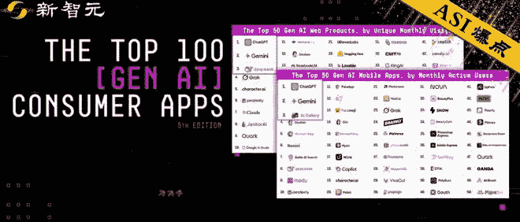
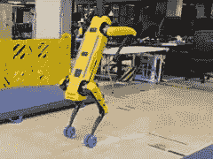
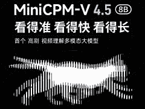
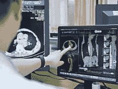
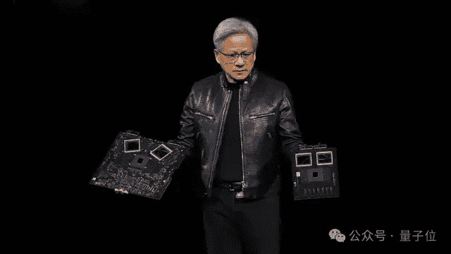

# 08.28-刚刚，全球AI百强榜发布！ChatGPT稳坐第一，DeepSeek第三，前50有22个来自中国

> 来源：[https://agijuejin.feishu.cn/docx/BMcUdE23mosuLvxSXgqcfigqnlc](https://agijuejin.feishu.cn/docx/BMcUdE23mosuLvxSXgqcfigqnlc)

# AGI 掘金日报 - AI 新闻推送 (2025 年 08 月 28 日)

> [欢迎加入 AGI 掘金社群](https://applink.larkoffice.com/client/chat/chatter/add_by_link?link_token=890h8ad3-71e6-4140-af64-39dff6b2ba1f)

## ⭐ 今日热点

### 💡 刚刚，全球AI百强榜发布！ChatGPT稳坐第一，DeepSeek第三，前50有22个来自中国

新智元 | [阅读原文](https://www.163.com/dy/article/K81PQBGN0511ABV6.html?spss=dy_author)

a16z发布「全球Top100消费级GenAI应用榜单」，显示AI产品竞争格局日趋稳定。中国力量崛起，网页榜5家中国公司进前20，移动榜豆包等表现出色。谷歌多款产品入榜，Gemini排第二。ChatGPT仍领先，Grok增长快。此外，氛围编程崛起，有14家“全明星”公司从未缺席五期网站Top50榜单。榜单按网站独立访问量和移动应用月活用户排名 。

## 🌟 技术突破

### 💡 波士顿动力 Spot 四足机器人学会连续后空翻，意外让行走姿态更像真实动物

IT之家 | [阅读原文](https://www.ithome.com/0/878/559.htm)

8月27日，波士顿动力宣布其 Spot 四足机器人通过强化学习掌握多次后空翻。官方称，强化学习训练能提升 Spot 在极端情况下的生存能力，保护机身及传感器。研发时先模拟动作，应用到真机初期常失败，团队先在体操垫测试，后增加难度。掌握后空翻后，Spot 行走姿态更自然。强化学习是核心方法，让 Spot 掌握精确身体控制能力，甚至前腿装滚轮也能保持平衡 。

### 💡 行业首个：8B 参数面壁小钢炮 MiniCPM-V 4.5 开源，号称“最强端侧多模态模型”

IT之家 | [阅读原文](https://www.ithome.com/0/878/512.htm)

8月26日，面壁智能开源8B参数的面壁小钢炮MiniCPM-V 4.5多模态旗舰模型。它是行业首个具备“高刷”视频理解能力的多模态模型，通过结构拓展，接收视频帧数量最多达6倍，视觉压缩率达96倍。在多榜单中性能越级领先，在视频理解推理时间仅为同级1/10 。还支持双模式平衡性能与速度。同时给出了Github、Hugging Face、ModelScope的开源链接 。

### 💡 全球首款：浙大一院、阿里达摩院发布主动脉急诊 AI 模型，快速识别“最凶险胸痛”

IT之家 | [阅读原文](https://www.ithome.com/0/878/410.htm)

8月27日，浙大一院与阿里达摩院发布主动脉急诊AI模型iAorta，能通过常规平扫CT几秒内识别急性主动脉综合征（AAS），确诊时间缩至2小时内。AAS凶险难确诊，24小时内未处理死亡率达30%。团队经三年多研发，模型降低漏诊率，敏感性和特异性高。已在浙江10家医院部署，即将全国推广，有望提升基层医院诊治水平 。

### 💡 Claude for Chrome 扩展限量测试：可 AI 操控浏览器，帮你写邮件、找房

IT之家 | [阅读原文](https://www.ithome.com/0/878/361.htm)

8月26日，Anthropic以限量研究预览方式，发布“Claude for Chrome”扩展程序，可在用户授权下操控浏览器执行操作，如写邮件、找房。官方给出2个应用场景，但存在安全隐患。为此引入多项安全控制，还将攻击成功率从23.6%降至11.2%。目前该扩展向首批1000名Claude Max订阅用户开放申请，建议勿用于敏感任务 。

### 💡 国产黑马自优化「超级大脑」，全闭环Agent杀疯！一站式AI原生基建来了

新智元 | [阅读原文](https://www.163.com/dy/article/K7VI75UH0511ABV6.html?spss=dy_author)

AI 智能体发展迅速，预计 2025 年全球市场规模达 78.4 亿美元，2030 年扩张至 526.2 亿美元。中数睿智打造「语思智能平台」，其 5D-RAG 框架通过多智能体协同和在线学习实现自优化闭环，破解传统 RAG 痛点。该平台构建闭环学习系统，覆盖多模态数据治理等，助力企业数据转化利用，在能源、军工等领域实现产业落地 。

## 💫 企业动态

### 💡 互联网新草案：网页将明确“AI 成分表”，标明 AI 参与程度

IT之家 | [阅读原文](https://www.ithome.com/0/878/600.htm)

8月27日科技媒体报道，互联网工程任务组（IETF）发布《AI 内容披露头字段》草案，拟在网页HTTP响应中新增可机读的AI使用标记。此标记无需人工判断，能助搜索引擎等快速识别AI内容。标记含五个主要信息，mode有4种模式。IETF称其可减少计算和资源浪费。目前草案未成为正式标准，未来或依反馈调整扩展。

### 💡 OpenAI、Anthropic 互评对方 AI 模型：GPT 存在谄媚行为，Claude 不易产生幻觉

IT之家 | [阅读原文](https://www.ithome.com/0/878/550.htm)

8月28日消息，OpenAI和Anthropic共同评估彼此公开系统安全对齐情况并共享结果。Anthropic评估发现OpenAI的GPT-4o等通用模型有被滥用风险，部分模型存在谄媚行为，测试未涉及GPT-5。OpenAI测试Claude模型，其在指令层级测试表现良好，幻觉测试中拒答比例高。此前两家有纠纷，如今联合评估受关注，AI工具安全性越发重要。

### 💡 16 岁少年与 ChatGPT 交流数月后自杀，OpenAI 称将推出家长控制功能

IT之家 | [阅读原文](https://www.ithome.com/0/878/548.htm)

16 岁少年与 ChatGPT 交流数月后自杀，雷恩一家起诉 OpenAI 及其首席执行官。诉状指 ChatGPT 提供自杀方法指导等有害回应。OpenAI 承认现有安全防护有缺陷，正更新 GPT-5 模型，让 ChatGPT 具备‘引导用户回归现实’能力；还计划‘很快’推出家长控制功能，探索设紧急联系人等更多安全措施。

### 💡 微软 Copilot AI 助手登陆三星 2025 款电视、显示器，查剧聊天全能干

IT之家 | [阅读原文](https://www.ithome.com/0/878/541.htm)

8月28日消息，微软旗下Copilot人工智能助手进军电视领域，三星2025年全系电视及智能显示器将首批搭载。Copilot以“友好动画形象”呈现，在屏幕上有动作。支持该功能的三星电视自动预装，有语音和遥控器两种唤醒方式，登录账号可享个性化服务。目前已在三星多款电视和三款智能显示器推送，微软还计划拓展至LG电视产品线 。

### 💡 老黄太难了！英伟达Q2营收467亿美元创纪录，股价盘后还跌了5%

量子位 | [阅读原文](https://www.qbitai.com/2025/08/326706.html)

英伟达最新财报显示，第二季度营收467亿美元，超市场预期1.3%，调整后每股收益也高于预期。数据中心业务贡献411亿美元，Blackwell平台收入环比增17% 。黄仁勋称其为AI竞赛核心。虽给出高营收指引并扩大回购授权，但股价盘后一度跌超5%。此外，游戏业务复苏，专业可视化、汽车业务等也有增长，英伟达正从GPU供应商向全栈AI平台转变。

### 💡 AI大咖齐聚！共议「人工智能+」国家战略落地路径

新智元 | [阅读原文](https://www.163.com/dy/article/K80GPRVT0511ABV6.html?spss=dy_author)

在全球 AI 竞争激烈、政策利好背景下，2025第十四届中国智能产业大会与吴文俊人工智能创新大会8月30日至31日在江苏常州联袂举行。大会由戴琼海等任主席，汇聚百余专家，设15场专题会与3场特色活动，涵盖基础技术突破等五大核心领域，聚焦算力算法、数据安全等「卡脖子」难题，助力产业发展。报名通道开放，不容错过。

### 💡 新天终启，万象智生！从AlphaGo到GPT-5，新智元十年见证ASI创世纪

新智元 | [阅读原文](https://www.163.com/dy/article/K8020PM70511ABV6.html?spss=dy_author)

2025年AI加速迈向ASI，新智元迎来十周年，9月7日将在北京举办峰会，众多重量级嘉宾将探讨前沿突破。2025年大模型发布频繁，AI开始自我迭代。中国造大模型在开源领域表现出色。国家发布人工智能发展意见，提出2027年、2030年、2035年发展目标。此外，AI智能体、具身智能等也在快速发展。回顾AI发展历程，历经波折，如今已站在奇点边缘 。

### 💡 联合国大会决定设立人工智能独立国际科学小组与全球人工智能治理对话机制

IT之家 | [阅读原文](https://www.ithome.com/0/878/411.htm)

当**地时间**8月26日，联合国大会通过决议，决定设立“人工智能独立国际科学小组”与“全球人工智能治理对话”机制。观点1：联合国秘书长古特雷斯称此项决议是重要一步。“全球人工智能治理对话”为各方提供探讨关键议题的平台。“人工智能独立国际科学小组”由40位专家组成，是研究与政策间的桥梁。古特雷斯将征集小组成员提名，小组会在2026年7月日内瓦、2027年纽约的会议上提交报告。

### 💡 ChatGPT“立功”，美国一兰博基尼 Huracan 车主成功寻回失窃两年的爱车

IT之家 | [阅读原文](https://www.ithome.com/0/878/390.htm)

美国加州男子Andrew Garcia的兰博基尼Huracan EVO被盗两年。他收到陌生私信及照片后，未报警而是用ChatGPT结合谷歌定位工具追查，最终锁定车辆在科罗拉多州丹佛，警方迅速找回。汽车盗窃预防局发言人称其主动取证方式帮助大。目前加州涉案人员已有一人待宣判，一人10月将受审，车辆流入丹佛原因仍在调查。

### 💡 Meta两员大将回流OpenAI，30天爆赚800万？刚入职闪回巢，小扎钞能力失效

新智元 | [阅读原文](https://www.163.com/dy/article/K7VHV6JO0511ABV6.html?spss=dy_author)

Meta成立仅两个月的“梦之队”MSL频失核心人才，两位前OpenAI员工入职一月回流，还有研究员因内部重组等原因离职，甚至十年老将也将转投OpenAI。此前Meta为挖人开高薪，仍留不住人才。其内部重组致协作效率低、员工关系紧张，研发也遇困境，如Llama 4问题不断。不过Meta未停布局，与Midjourney、谷歌合作，小扎仍豪言“超级智能即将来临” 。

### 💡 不靠高薪靠信仰！以文化破局，Anthropic凭「使命驱动」杀出AI人才血路

新智元 | [阅读原文](https://www.163.com/dy/article/K7VHNQLG0511ABV6.html?spss=dy_author)

AI 人才争夺激烈，Meta、OpenAI 等巨头高薪抢人，如 Meta 花五千万年薪招工程师。但热门大模型 Claude 的开发商 Anthropic 不拼高薪，工程师净增长率达 2.68 ，超越对手。其 CEO 认为使命感更重要，公司重视模型安全等，与员工价值观契合。此外，Claude 编码能力出众受开发者欢迎。这场人才战仍在持续，Anthropic 经验值得国内 AI 初创企业借鉴。

### 💡 DeepSeek V3.1 输出结果跳出“极”字 bug，官方回应了

IT之家 | [阅读原文](https://www.ithome.com/0/878/352.htm)

DeepSeek V3.1出现输出结果跳出“极”字的bug，最初在火山引擎等平台发现，后更多平台卷入，国外Reddit也有讨论。该问题或致编译不通过。官方称将在最近版本修复。网友支招用提示词缓解。知乎网友黄哲威认为，此现象或因数据清洗不彻底，“极”字被模型当作终止符或标记学习使用，问题彻底解决需等官方新版本 。