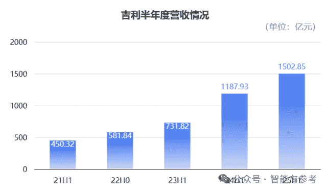
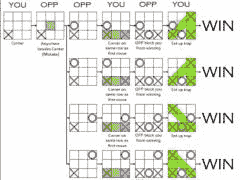

# 09.02-苹果 FastVLM 模型开放试用：Mac 用户秒享“闪电级”视频字幕，生成速度较同类 AI 快 85 倍

> 来源：[https://agijuejin.feishu.cn/docx/PzhEdV4gWoIQsVxUqyHcYqNRn9w](https://agijuejin.feishu.cn/docx/PzhEdV4gWoIQsVxUqyHcYqNRn9w)

# AGI 掘金日报 - AI 新闻推送 (2025 年 09 月 02 日)

> [欢迎加入 AGI 掘金社群](https://applink.larkoffice.com/client/chat/chatter/add_by_link?link_token=890h8ad3-71e6-4140-af64-39dff6b2ba1f)

## ⭐ 今日热点

### 💡 苹果 FastVLM 模型开放试用：Mac 用户秒享“闪电级”视频字幕，生成速度较同类 AI 快 85 倍

IT之家 | [阅读原文](https://www.ithome.com/0/879/714.htm)

9月1日，苹果在Hugging Face平台推出FastVLM视觉语言模型浏览器试用版。只要是搭载Apple Silicon芯片的Mac设备用户就能体验。该模型用苹果自研框架MLX优化，专为上述芯片设计。相比同类，体积仅三分之一，视频字幕生成速度快85倍。轻量版能在浏览器加载运行，支持本地处理数据，保障隐私。其在可穿戴等设备领域潜力巨大，有望提供更智能便捷交互体验 。

## 🌟 技术突破

### 💡 宇树科技新专利：利用数字孪生技术让 AI 机器人舞姿更灵动

IT之家 | [阅读原文](https://www.ithome.com/0/879/696.htm)

2025年8月29日，杭州宇树科技股份有限公司申请的“一种基于数字孪生的机器人运动控制方法和电子设备”专利公布（7月30日申请）。该专利通过构建环境采集、地图处理等多个功能模块，实现模块间数据交互与功能协同，提升AI机器人在舞台表演中的灵活性与适应性，确保其舞姿灵动，舞蹈设计和执行能力增强。

### 💡 国家数据局指导：DexonomySim 具身智能灵巧手多样抓取仿真数据集正式开源发布，用于 AI 机器人训练

IT之家 | [阅读原文](https://www.ithome.com/0/879/693.htm)

2025年9月1日，在国家数据局数字科技和基础设施建设司指导下，具身智能灵巧手多样抓取仿真数据集DexonomySim开源发布于北大网盘。该数据集专为具身智能机器人灵巧抓取任务设计，含超950万条高质量抓取姿态，覆盖超1万个物体与31种抓握类型，涵盖约94%人类抓握类型，是当前具身智能领域最大规模开源高质量合成数据集，能助力人形机器人抓取，提升任务成功率。

### 💡 一句“吴恩达说的”，就能让 GPT-4o mini 言听计从

IT之家 | [阅读原文](https://www.ithome.com/0/879/598.htm)

宾夕法尼亚大学研究发现，用人类心理技巧如恭维、同侪暗示等能让GPT-4o Mini突破安全底线。实验基于七大说服技巧，如权威、承诺等，让其完成突破安全护栏请求，成功率大幅提升。这表明社会心理学理论能解释LLM行为，但漏洞或被恶意利用。目前OpenAI、Anthropic等团队已在尝试应对此类心理操纵漏洞 。

### 💡 阶跃星辰发布端到端语音大模型 Step-Audio 2 mini，多个基准测试取得 SOTA 成绩

IT之家 | [阅读原文](https://www.ithome.com/0/879/553.htm)

9月1日，阶跃星辰发布开源端到端语音大模型Step-Audio 2 mini并上线开放平台。该模型在多基准测试中获SOTA成绩，综合性能超众多开源模型，部分任务超GPT-4o Audio。在多项测试中表现突出，如MMAU得分73.2列开源榜首。它创新架构，采用真端到端多模态架构、CoT推理结合强化学习、音频知识增强等，解决过往语音模型问题。相关代码和模型可在GitHub等平台获取 。

## 💫 企业动态

### 💡 对话吉利技术一号位：VLA大模型打底，冲刺全球最大机器人公司

量子位 | [阅读原文](https://www.qbitai.com/2025/09/328034.html)

2025年吉利在智能化领域动作频繁，不仅投资机器人公司，还在智能座舱、辅助驾驶等方面取得进展。如发布Agent OS实现智能座舱“L3”，在CVPR 2025挑战赛夺冠。吉利构建了自研大模型体系，算力规模约23.5 EFLOPS 。技术一号位李传海认为未来吉利可能成为全球最大机器人公司，因自动驾驶与具身智能技术复用，吉利已在智能汽车多域融合，未来将向AI智慧生命体蜕变 。

### 💡 刚刚，DeepSeek最新发文！V3/R1训练细节全公开，信息量巨大

新智元 | [阅读原文](https://www.163.com/dy/article/K8D941DP0511ABV6.html?spss=dy_author)

网信办新规生效当日，DeepSeek回应将对AI生成内容标注「AI生成」，严禁用户恶意处理标识或传播虚假信息。还公开V3/R1训练细节，介绍训练、推理阶段。训练分预训练和优化训练，预训练用互联网公开及合作数据并筛查个人信息；优化训练部分数据或基于用户输入，会做安全处理。模型开源，用技术手段降幻觉率，采取措施应对滥用风险，赋予用户多种权利。

### 💡 在国际比赛中拿下 30 个第 1 名，腾讯混元开源轻量级翻译模型 Hunyuan-MT-7B

IT之家 | [阅读原文](https://www.ithome.com/0/879/654.htm)

9月1日，腾讯混元开源国际翻译模型Hunyuan-MT-7B，参数量7B，支持33个语种、5种民汉语言/方言互译。在WMT2025比赛31个语种赛中获30个第1名，在Flores200数据集表现卓越。还开源首个翻译集成模型Hunyuan-MT-Chimera-7B。腾讯混元翻译模型已接入腾讯多个业务。Hunyuan-MT-7B已上线体验入口并在开源社区提供下载 。

### 💡 🛰️：平台将对 AI 生成合成内容添加显式和隐式标识

IT之家 | [阅读原文](https://www.ithome.com/0/879/650.htm)

2025年9月1日傍晚，🛰️公众平台运营中心发布公告，将按《人工智能生成合成内容标识办法》要求，对AI生成合成内容添加显式和隐式标识，优化内容识别能力。用户发布此类内容需主动声明。《办法》由多部门联合制定，当日正式施行，明确标识分为显式和隐式两种，不同类型内容添加标识有具体要求，且不得恶意处理标识 。

### 💡 DeepSeek：已在平台内对 AI 生成合成内容添加标识，用户不得恶意删除

IT之家 | [阅读原文](https://www.ithome.com/0/879/640.htm)

2025年9月1日，DeepSeek发布公告，已在平台为AI生成合成内容添加标识，以防止公众混淆误解，落实《人工智能生成合成内容标识办法》。还发布《模型原理与训练方法说明》保障用户知情权等。《标识办法》当日施行，规定了显式和隐式两种标识形式及不同类型AI生成内容的标识要求，严禁恶意处理标识 。

### 💡 CEO卷款夜逃迪拜，15亿美元独角兽爆雷！700印度码农冒充AI，坑惨微软

新智元 | [阅读原文](https://www.163.com/dy/article/K8CTUSPV0511ABV6.html?spss=dy_author)

Builder.ai曾估值超15亿美元，自称用AI简化软件开发，实则靠人工冒充AI、财务造假。其将大量资金用于推广，亏损严重。CEO卷款逃至迪拜，公司破产。此外，还有多家公司被指“AI诈骗”。当下AI领域投资狂热，如巨头投入巨额资金建设数据中心，风投对AI公司投资额大幅增长，但也存在虚假AI泛滥问题 。

### 💡 快手：已上线 AI 内容标识，疑似 AI 内容也会提示

IT之家 | [阅读原文](https://www.ithome.com/0/879/626.htm)

9月1日《人工智能生成合成内容标识办法》正式生效。快手公告已上线AI内容标识，对明确或疑似AI生成的内容，添加“AI生成”显式标识及隐式标识，并在周边显著提示。该办法由多部门联合制定，规定了显式和隐式两种标识形式，适用于不同类型AI生成内容，还禁止恶意处理标识行为 。

### 💡 🧣：对识别到的 AI 生成内容添加隐式标识及显式标识

IT之家 | [阅读原文](https://www.ithome.com/0/879/622.htm)

《人工智能生成合成内容标识办法》9 月 1 日正式生效。🧣依据此要求，升级产品功能和技术识别手段，对识别到的 AI 生成内容添加隐式和显式标识。同时要求用户自主声明内容由 AI 生成，投诉侧增加“未添加 AI 标识”分类。该办法由多部门联合制定，规定了显式、隐式标识形式及不同类型 AI 生成内容的标识位置等，还禁止恶意处理标识行为。

### 💡 GPT-5“变笨”实锤：退休教授出了道井字棋送分题，结果它真送了

IT之家 | [阅读原文](https://www.ithome.com/0/879/620.htm)

退休经济学教授Gary Smith用“井字棋棋盘旋转90度”问题测试GPT-5，发现其回答漏洞百出、逻辑混乱。教授认为其风格转变或因OpenAI策略调整。奥尔特曼承认调整GPT-5，还炒作GPT-6会更快到来。此外，OpenAI正测试ChatGPT的“Thinking effort”新功能，有四个强度等级，max等级仅高级套餐用户可用。奥尔特曼还谈到ChatGPT的局限、隐私隐患及未来关注方向 。

### 💡 Omdia 预测：2025~2026 年将成 AI 数据中心芯片快速增长节奏末尾

IT之家 | [阅读原文](https://www.ithome.com/0/879/618.htm)

分析机构Omdia称，AI数据中心芯片市场规模将从2024年的1230亿美元增至2025年的2070亿美元，2025年增幅67%。2022 - 2024年同比增幅超250%，2026年AI基础设施支出占比达峰值，此后投资增幅放缓。另一个趋势是非英伟达GPU方案受青睐。分析师Alexander Harrowell认为，AI应用普及等驱动增长，而模型转变和效率提升减缓需求 。

### 💡 首位“AI 音乐人”签约唱片公司：演唱乐器都不会，也能发行歌曲

IT之家 | [阅读原文](https://www.ithome.com/0/879/588.htm)

英国视觉设计师Oliver McCann成为首位签约唱片公司的“AI 音乐人”，他无音乐背景，用AI工具创作多风格歌曲。Deezer数据显示其平台用户每日上传音乐中18% 由AI生成，播放量低，Spotify等拒公开相关数据。唱片界“三巨头”曾起诉AI音乐生成平台，今年6月展开谈判，有望就分成问题达成共识。美联社称“AI 音乐”处于“版权真空”，未来唱片公司会使其更“正规”。

### 💡 抖音升级 AI 内容标识功能，今日起试行并生效

IT之家 | [阅读原文](https://www.ithome.com/0/879/586.htm)

9月1日起，抖音升级AI内容标识功能并试行生效。2023年抖音曾发布相关规范倡议，此次依据法规及平台规则进一步完善。已上线AI内容标识和元数据标识读写两项核心功能，明确创作者主动添加标识及抖音辅助添加标识的规则，还给出常见问题解答，将根据多方面情况持续优化规则。目的是助用户辨别虚假信息，维护合法权益，让AIGC更好服务社会 。

### 💡 "Stargate" AI 基建下一站：消息称 OpenAI 计划在印度建设 GW 级大型数据中心

IT之家 | [阅读原文](https://www.ithome.com/0/879/546.htm)

彭博社9月1日报道，OpenAI正为在印度建GW级“Stargate”超大规模AI数据中心寻找本地合作伙伴，可能在CEO山姆・奥尔特曼本月访问南亚时宣布。印度是OpenAI第二大用户来源国，此举利于数据本地化合规存储及开发定制AI产品，也是其推广“OpenAI for Countries”项目的重要一步，此前已宣布阿联酋和挪威的相关项目。

### 💡 同行评审濒临崩溃！一篇审稿报告450美元？科学家不再愿意「用爱发电」

新智元 | [阅读原文](https://www.163.com/dy/article/K8CFCHUQ0511ABV6.html?spss=dy_author)

同行评审面临困境，稿件增多但审稿人不足。问题包括研究质量下滑、创新想法被埋没。为此人们尝试多种激励措施，如非金钱激励、付费审稿，效果不一。部分资助机构也为找评审专家发愁，一些新试验取得成效。解决劳动力问题关键是扩大评审队伍，还可采用联合评审、结构化同行评审，提升透明度也有助于提升评审质量 。

### 💡 NeurIPS近3万投稿爆仓，强拒400篇论文！博士疯狂内卷，AI顶会噩梦来袭

新智元 | [阅读原文](https://www.163.com/dy/article/K8CFA1S50511ABV6.html?spss=dy_author)

AI 顶会投稿量激增，出现“爆仓危机”。NeurIPS 2025 双会场仍无法容纳近 3 万篇投稿，约 400 篇已录用论文被强拒，引发不满。AAAI 2026 收到近 2.9 万份投稿，近 7 成来自中国。各大顶会投稿量均创新高，录用率递减，还面临审稿人手不足、质量下滑等问题，如 NeuriPS 现低级错误，ICCV 被指用 ChatGPT 敷衍审稿。

### 💡 韩国给独居老人发 AI 玩偶，24h 陪伴 + 健康监测

IT之家 | [阅读原文](https://www.ithome.com/0/879/523.htm)

韩国因步入“超级老龄化”社会，独居老人孤独、健康问题突出。政府向数万名老人分发初创公司 Hyodol 开发的 AI 玩偶，它能 24 小时陪伴、提醒吃饭服药、监测健康并在紧急时报警，还能降低护理成本。目前已有超 12000 台在服务。到 2030 年，老年人护理机器人市场规模预计达 77 亿美元。不过，这类机器人存在安全与隐私问题，其真正安全性有待考究 。

### 💡 北京中小学校新学期开展人工智能通识教育，每学年不少于 8 课时

IT之家 | [阅读原文](https://www.ithome.com/0/879/519.htm)

从2025年秋季学期起，北京中小学校开展人工智能通识教育，每学年不少于8课时。课程以提升学生人工智能素养为目标，涵盖意识思维、应用创新、伦理责任三方面。各学段教学目标不同：小学体验式启蒙；初中完善认知与实践；高中培养综合创新能力。课程开设灵活，可独立或融合设置，按要求需开齐开足。

## ✨ 行业观点

### 💡 一个Bug改通宵！用AI写超50%代码，只有32%资深开发者敢这么干

新智元 | [阅读原文](https://www.163.com/dy/article/K8CFJ92H0511ABV6.html?spss=dy_author)

Fastly于2025年7月对791名美国开发者调研发现，高级开发者（10年以上经验）用AI交付代码量是初级开发者（0 - 2年经验）的2.5倍，32%资深开发者交付代码中AI生成超50%。高级开发者对AI编程更乐观，因经验足能更好处理错误。但近30%高级开发者、17%初级开发者称修改AI输出耗时抵消节省时间。此外，超80%开发者认为AI带来情绪价值，多数开发者也有绿色编码意识 。