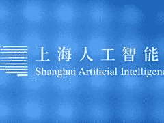
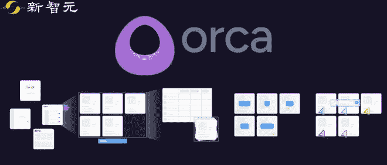

# 09.04-多模态通用感知能力超越 GPT-5，上海 AI 实验室开源书生・万象 3.5 大模型

> 来源：[https://agijuejin.feishu.cn/docx/IlIJdZQAbot1WLxnPhpctS9HnVc](https://agijuejin.feishu.cn/docx/IlIJdZQAbot1WLxnPhpctS9HnVc)

# AGI 掘金日报 - AI 新闻推送 (2025 年 09 月 04 日)

> [欢迎加入 AGI 掘金社群](https://applink.larkoffice.com/client/chat/chatter/add_by_link?link_token=890h8ad3-71e6-4140-af64-39dff6b2ba1f)

## ⭐ 今日热点

### 💡 多模态通用感知能力超越 GPT-5，上海 AI 实验室开源书生・万象 3.5 大模型

IT之家 | [阅读原文](https://www.ithome.com/0/880/206.htm)

9月3日，上海AI实验室开源通用多模态大模型书生・万象3.5 ，有9种尺寸模型，参数10亿 - 2410亿。旗舰模型在多学科推理基准中获高分，多模态通用感知超GPT-5，文本能力领先。与3.0版相比，在多种特色任务提升显著，在GUI交互、具身智能体测试、矢量图形方面表现出色，可跨平台自动化操作。全系列下载量突破2300万次，还公布了开源地址等 。

## 🌟 技术突破

### 💡 大模型“记性差一点”反而更聪明：金鱼损失随机剔除 token，让 AI 不再死记硬背

IT之家 | [阅读原文](https://www.ithome.com/0/880/218.htm)

马里兰大学等团队提出“金鱼损失”新方法。该方法在模型训练时随机剔除部分token，避免模型死记硬背训练数据。与Dropout等方法不同，它用哈希掩码确保掩盖位置一致。实验表明，在极端和标准场景下，LLaMA-2用此方法后记忆化内容显著减少，下游任务性能几乎不受影响，但可能降低计算效率 。

### 💡 UCSD首个智能体浏览器发布！多页面设计，颠覆传统交互

新智元 | [阅读原文](https://www.163.com/dy/article/K8HJCI960511ABV6.html?spss=dy_author)

加州大学圣地亚哥分校推出Orca浏览器，颠覆传统交互。它把网页视为可塑材料，将浏览器变成可塑空间，用户能像指挥家调度智能体。具备大规模查看、管理等功能，用户实验效果积极，激发探索欲、空间布局易用、增强用户控制权与信任感。该项目展示新方向，且原型将开源，促进相关探索 。

### 💡 谷歌nano banana官方最强Prompt模板来了！先收藏再说

新智元 | [阅读原文](https://www.163.com/dy/article/K8HJ2FMB0511ABV6.html?spss=dy_author)

nano banana爆火，网友开发出多种玩法，如生成手办模型、创作创意场景等。谷歌为助大家上手，带来6套官方Prompt模板，覆盖写实、贴纸等多种类型，像写实摄影需考虑机位等元素，还给出各类型示例模板、Prompt及调用API生图的Python代码。有了这些模板，人人都能创作高质量图片。

## 💫 企业动态

### 💡 消息称谷歌正打破 TPU 完全自托管局面，强化与英伟达 AI 芯片竞争

IT之家 | [阅读原文](https://www.ithome.com/0/880/265.htm)

9月4日消息，谷歌自研多年的AI芯片TPU张量处理器，此前一直完全在自家数据中心托管。据外媒报道，谷歌正与租赁英伟达GPU的小型云服务供应商谈判，希望其在数据中心托管TPU芯片，且已与至少一家合作方（Fluidstack）达成协议。这或意味着谷歌AI战略重大转型，挑战英伟达GPU在AI芯片领域的霸权，同时摆脱自建数据中心能力束缚 。

### 💡 浙江首个，温州市人工智能局正式挂牌成立

IT之家 | [阅读原文](https://www.ithome.com/0/880/221.htm)

9月3日，温州市人工智能局正式挂牌成立，这是浙江省首个此类机构。其职责涵盖拟定发展规划、推进基础设施建设等。温州市数据局负责人称将履行职责，放大协同效应，助力温州打造人工智能创新发展先行市。当日，温州全市人工智能创新发展大会发布《温州市“人工智能 + 教育”三年行动计划（2025—2027 年）》，明确课程体系及课时安排，开展教师培训，到2027年中小学、高校人工智能课程有相应覆盖率 。

### 💡 2.5 亿元，优必选再次斩获全球人形机器人最大合同

IT之家 | [阅读原文](https://www.ithome.com/0/880/207.htm)

9月3日，优必选科技获“某国内知名企业”2.5亿元具身智能人形机器人产品及解决方案采购合同，以Walker S2为主，年内交付，这是全球人形机器人最大合同。7月优必选已拿下近亿元订单。截至目前，Walker系列获近4亿元合同。今年7月发布的Walker S2实现全球首创自主换电技术，通过群脑网络2.0等构建AI双循环，实现单机自主和群体协同进化。

### 💡 AI 抢人类饭碗：Salesforce CEO 证实公司裁掉了 4000 个客服

IT之家 | [阅读原文](https://www.ithome.com/0/880/189.htm)

Salesforce首席执行官马克・贝尼奥夫称，公司将客户支持岗位从9000人减至约5000人，因打造了“Agentforce”机器人客服团队，且AI承担工作量最高达50% 。人力资源顾问劳里・鲁蒂曼指出AI影响多行业就业，人们需学新技能。分析师埃德・齐特伦认为部分科技公司借AI裁员，是“不惜一切代价追求增长”心态。

### 💡 即梦 AI 上线火山引擎，面向企业开放 API 服务

IT之家 | [阅读原文](https://www.ithome.com/0/880/149.htm)

9月3日，火山引擎与即梦AI宣布，即梦AI上线火山引擎并面向企业开放API服务，涵盖图片、视频、数字人生成三类多款同源前沿模型。该系列模型基于字节跳动自研模型调优而来，已在产品上大规模验证，适配多种应用场景。此次开放的文生图3.0、3.1及图生图3.0为受C端用户喜爱的线上最新版本 。

### 💡 亚马逊推出 AI 购物新功能 Lens Live，手机对着实物扫扫就能找同款

IT之家 | [阅读原文](https://www.ithome.com/0/880/093.htm)

9月3日，亚马逊推出AI购物新功能Lens Live，是Amazon Lens的升级版本，新增实时交互功能。它与AI助手鲁弗斯联动，提供产品解析。过去一年亚马逊推出多项AI功能。该功能由SageMaker服务支持，契合用户消费习惯。目前已在iOS系统的亚马逊购物App面向美国“数千万”用户上线，后续将覆盖更多美国用户，暂未提及是否推广至全球其他市场。

### 💡 人工智能提出七十载！从百度CTO到NVIDIA副总裁，十年共启ASI新智元

新智元 | [阅读原文](https://www.163.com/dy/article/K8HJ3HU60511ABV6.html?spss=dy_author)

今年是人工智能提出七十周年，新智元十周年峰会9月7日将在北京举行。届时将发布《2025新智元ASI前沿趋势报告》，十位行业领航者将解构AI五阶段路线图，涵盖大模型等多领域。还提到AI发展历程，以及2027年将达ASI临界点。此次峰会展示了AI的多领域进展、应用及未来发展方向，凸显其对人类文明的重大影响 。