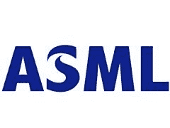
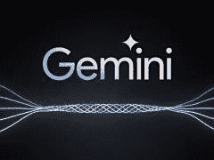

# 09.08-字节跳动即梦图片 4.0 发布：首次支持多模态生图，大白话就能编辑

> 来源：[https://agijuejin.feishu.cn/docx/LqdEdtd3VoT8kOxO3TzcSJrqnfN](https://agijuejin.feishu.cn/docx/LqdEdtd3VoT8kOxO3TzcSJrqnfN)

# AGI 掘金日报 - AI 新闻推送 (2025 年 09 月 08 日)

> [欢迎加入 AGI 掘金社群](https://applink.larkoffice.com/client/chat/chatter/add_by_link?link_token=890h8ad3-71e6-4140-af64-39dff6b2ba1f)

## ⭐ 今日热点

### 💡 字节跳动即梦图片 4.0 发布：首次支持多模态生图，大白话就能编辑

IT之家 | [阅读原文](https://www.ithome.com/0/881/132.htm)

9月5日，字节跳动即梦AI发布即梦图片4.0。它首次支持多模态生图，同一模型实现文生图、图像编辑、组图生成。有精准指令编辑等五大亮点，覆盖多种创作场景。用户用大白话描述需求就能编辑，可多图输入输出。速度快，文生图直出2K用时不到1.8s，最高支持4K分辨率生成。目前正在逐步扩量，未来几天将覆盖全部用户。

## 💫 企业动态

### 💡 傅利叶首款陪伴机器人 GR-3 开启预售：身高 165cm，全身柔肤软包

IT之家 | [阅读原文](https://www.ithome.com/0/881/148.htm)

9月8日，傅利叶首款搭载全感交互系统的陪伴机器人GR-3开启预售，10月正式上市交付。前30名预订客户享八折优惠等福利，首单有独家交付仪式。GR-3身高165cm，全身柔肤软包，55个自由度，搭载全感交互系统，采用“双路径响应机制”。电池续航提升50%，充电时长减半。还推出GR-3C版本，有多种定制化步态 。

### 💡 消息称 ASML 承诺入股法国 AI 企业 Mistral，将成后者最大股东

IT之家 | [阅读原文](https://www.ithome.com/0/881/125.htm)

据路透社9月7日报道，光刻设备巨头ASML在法国AI初创企业Mistral的C轮融资中，将成为领投方及最大股东。Mistral本轮融资前估值100亿欧元（约834.79亿元人民币），计划筹资17亿欧元，ASML将出资13亿欧元，还有望获董事会席位。对Mistral，这笔资金助力欧洲AI自主化；对ASML，其AI技术或助力改进半导体设备性能、开发新设备。

### 💡 消息称阿里云首次出手具身智能，自变量机器人完成近 10 亿元新融资

IT之家 | [阅读原文](https://www.ithome.com/0/881/118.htm)

9月8日消息，具身智能公司自变量机器人完成近10亿元A+轮融资，由阿里云、国科投资领投。这是阿里云首次投资具身智能企业，阿里此前已投多家相关企业。自变量机器人成立于2023年12月，致力于研发具身智能通用大模型实现通用机器人目标。其创始人王潜履历出色。该公司此前已完成7轮融资，总金额超10亿元 。

### 💡 古尔曼：苹果自研 AI 搜索产品计划于明年 3 月随新版 Siri 一同推出

IT之家 | [阅读原文](https://www.ithome.com/0/881/095.htm)

IT之家 9 月 7 日消息，彭博社曾报道苹果组建团队开发自研生成式 AI 搜索产品。马克・古尔曼称，其内部代号‘World Knowledge Answers’的该产品，计划明年 3 月随新版 Siri 推出，未来或整合至 Safari 浏览器与 Spotlight 搜索工具。苹果还在进行‘技术选型测试’，决定 Siri 采用的模型，不过未影响上线时间，苹果正努力在生成式 AI 领域争得一席之地 。

### 💡 谷歌 Gemini AI 会员权益公布：免费用户每月可用 5 次深度搜索、Pro 会籍每天可生成百张图片

IT之家 | [阅读原文](https://www.ithome.com/0/881/039.htm)

9月7日谷歌公布Gemini AI服务使用限制数据。免费用户每日可进行5次Gemini 2.5 Pro对话等 ，每月限5份深度搜索报告。Google AI Pro会员月费19.99美元，每日可进行100次对话等。Google AI Ultra会员月费249.99美元，权益更多。此外，10月6日前（美国IP）学生认证后可免费领1年Google AI Pro服务 。

### 💡 华为全新小艺拟人化实时音视频对话功能适配机型公布，含 Mate XTs 三折叠等

IT之家 | [阅读原文](https://www.ithome.com/0/881/019.htm)

9月7日消息，华为小艺智慧助手8月底推送11.3.7.300版本升级，带来新功能。全新小艺拟人化实时音视频对话功能（“小艺看世界”）适配机型公布，如Pura80系列、Mate 70系列等 。还介绍了不同小艺App版本下该功能入口，进入界面后可摄像头对准对象与小艺交流，小艺能在旅游出行、日常生活等领域提供动植物识别等实时帮助。

## ✨ 行业观点

### 💡 柯洁回应是否再战 AI：如果观众喜欢看就下，下一百盘输一百盘

IT之家 | [阅读原文](https://www.ithome.com/0/881/015.htm)

2017年柯洁曾0:3负于谷歌AlphaGo。多年后在节目中，柯洁回应是否再战AI称，若观众喜欢看就下，即便下一百盘输一百盘。他认为人类棋手数据对AI无价值，没必要和AI竞争，应专注人类比赛。柯洁还谈到曾因与AlphaGo对战落泪，后释然，觉得AlphaGo没对围棋的热爱，人类可贵在有情感思想，且不管谁赢都是围棋的胜利 。