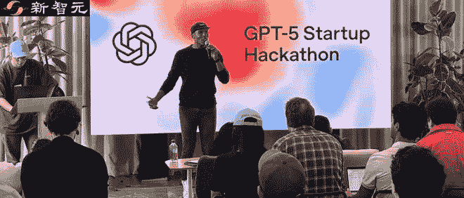
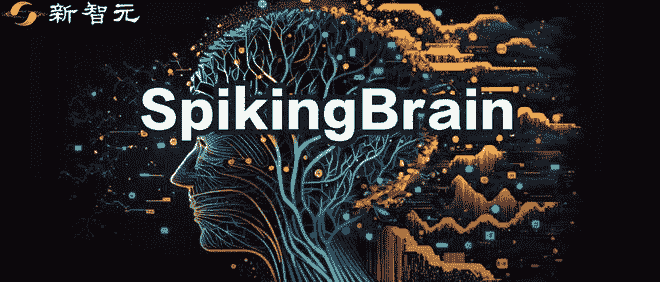
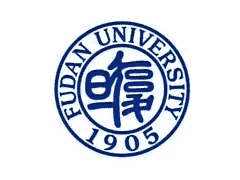
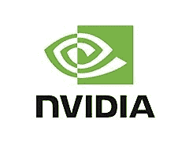
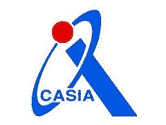
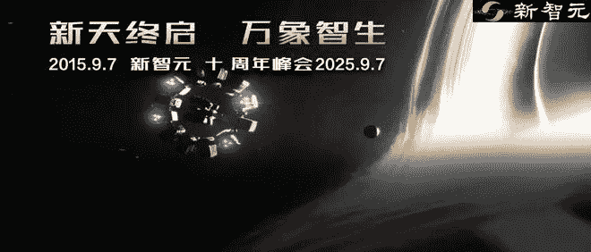
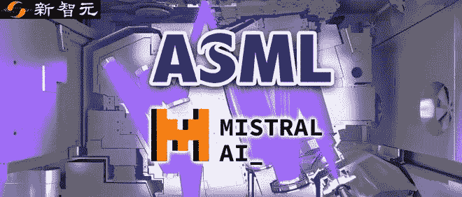

# 09.09-全球首款类脑脉冲大模型“瞬悉 1.0”问世，实现全流程国产化

> 来源：[https://agijuejin.feishu.cn/docx/CjsHd4KvIoleLExeg9pcPPGYnEc](https://agijuejin.feishu.cn/docx/CjsHd4KvIoleLExeg9pcPPGYnEc)

# AGI 掘金日报 - AI 新闻推送 (2025 年 09 月 09 日)

> [欢迎加入 AGI 掘金社群](https://applink.larkoffice.com/client/chat/chatter/add_by_link?link_token=890h8ad3-71e6-4140-af64-39dff6b2ba1f)

## ⭐ 今日热点

### 💡 全球首款类脑脉冲大模型“瞬悉 1.0”问世，实现全流程国产化

IT之家 | [阅读原文](https://www.ithome.com/0/881/371.htm)

9月8日消息，中科院自动化所李国齐、徐波团队与沐曦MetaX合作打造全球首款类脑脉冲大模型“瞬悉1.0”。该模型在国产千卡GPU算力平台全流程训练和推理，提升超长序列推理效率速度。团队开源部分模型、开放测试网址并公开技术报告。其构架方式建立新联系，展示新路径。李国齐称，成果是重大突破，为超长序列场景提供工具，启迪下一代计算理论和芯片设计 。

## 🌟 技术突破

### 💡 GPT-5爆改时尚圈，让Excel原地复活！OpenAI黑客松大奖出炉

新智元 | [阅读原文](https://www.163.com/dy/article/K8V9PM2H0511ABV6.html?spss=dy_author)

OpenAI发布GPT-5后举办黑客马拉松，500多位黑客、95支队伍参赛，角逐5万美元奖金，韩国Gentoo团队夺冠。各入围团队展示多种应用：Gentoo用其模拟营销活动；Fashion AI为虚拟形象搭配造型；电子表格工具可预测数值；BeFreed将知识转化为视频；还有智能体玩游戏、用于电网调度等，展示了GPT-5在多领域的强大应用潜力 。

### 💡 全流程国产GPU，上下文提速100倍！中国科学院发布「线性复杂度」类脑大模型

新智元 | [阅读原文](https://www.163.com/dy/article/K8V970FU0511ABV6.html?spss=dy_author)

中国科学院自动化研究所李国齐、徐波团队发布国产自主可控类脑脉冲大模型SpikingBrain-1.0。它借鉴大脑机制，具线性/近线性复杂度，能提升长序列训练和推理效率，全流程在国产GPU完成。在GPU和手机CPU端速度优势明显，如GPU上4M长度下速度保守估计提升超100x 。其还建立脉冲神经元与线性注意力模型联系，未来将探索更多联系，助力类脑智能计算与芯片设计。

### 💡 大模型破译甲骨文创下新 SOTA，复旦团队推出新框架

IT之家 | [阅读原文](https://www.ithome.com/0/881/211.htm)

复旦大学团队提出基于部首和象形分析的可解释甲骨文破译框架。构建含47,157个汉字的PD-OBS数据集**，设计渐进式训练策略与**双重匹配机制。实验显示，在零样本场景下，该方法Top-10准确率在两数据集上分别比第二好的方法高出26.2%和13.6%，可解释性也优于先进模型。该框架在考古应用中潜力巨大 。

### 💡 英伟达推出通用深度研究系统：可接入任何 LLM，支持个人定制

IT之家 | [阅读原文](https://www.ithome.com/0/881/198.htm)

英伟达推出通用深度研究（UDR）系统，可接入任何大语言模型（LLM），支持个人定制。与以往不同，它能让用户自定义研究策略，具备自然语言定制策略、与模型无关的工具架构等创新特性，还能提升计算效率、降低成本。不过，该系统目前处于原型阶段，存在策略理解偏差、无法判断策略有效性、执行中缺乏灵活性等局限，研究人员正探索改进方案。

### 💡 我国首个：类脑脉冲大模型“瞬悉 1.0”问世，在国产 GPU 算力平台完成训练推理

IT之家 | [阅读原文](https://www.ithome.com/0/881/185.htm)

9月8日，中科院自动化所李国齐、徐波团队与沐曦MetaX合作，推出我国首个类脑脉冲大模型“瞬悉1.0”，并在国产GPU算力平台完成训练推理。该模型在多方面实现突破，如以2%预训练数据量达主流模型性能；推理加速显著，在超长序列处理上优势明显；适配国产GPU构建生态；实现高稀疏度。它为AI发展提供新路线，对神经形态计算有启迪作用。团队还开源部分模型并公开技术报告 。

## 💫 企业动态

### 💡 马斯克澄清：我们还没展示过特斯拉 Optimus V3 人形机器人，新图是 V2.5

IT之家 | [阅读原文](https://www.ithome.com/0/881/376.htm)

9月8日，马斯克在社交平台X澄清，特斯拉人形机器人Optimus V3 尚未公开，新图是V2.5 。此前Salesforce首席执行官分享的视频中，金色Optimus通过Grok人工智能回答问题、尝试行走，其手部设计更接近人类。特斯拉社群不少人以为新机器人是V3 ，但马斯克明确否定。Optimus对特斯拉意义重大，预计高产，马斯克2025年薪酬方案与交付100万台该机器人挂钩 。

### 💡 学哲学没出路？不好意思，现在哲学就业碾压CS！

新智元 | [阅读原文](https://www.163.com/dy/article/K8VEOJUB0511ABV6.html?spss=dy_author)

2025年CS专业就业神话破灭，失业率飙升至6.1%，计算机工程更惨达7.5%，而哲学等专业失业率低。原因包括AI成裁员借口、科技行业大裁员、CS专业扩招但教学滞后。如今学历红利渐弱，新岗位如AI/机器学习等崛起。学生应积累经验和技能，靠作品或策略找到出路 。

### 💡 中国AI「星际穿越」！新智元十周年峰会预言ASI终局：未来十年指数级加速

新智元 | [阅读原文](https://www.163.com/dy/article/K8V9N7GG0511ABV6.html?spss=dy_author)

新智元十周年峰会回顾AI发展十年，众多大咖齐聚。AI领域成果丰硕，如百度超40%代码由大模型生成，中国开源模型表现亮眼。专家对AI发展各抒己见，认为其是第四次工业革命核心驱动力，未来将朝物理AI、医疗等方向发展。预计2027年AI达ASI临界点，2030年AI数据中心电力需求或超印度。此外，还介绍了多家企业的发展与探索。

### 💡 老程序员爱用 AI 写代码：调查显示超三成资深工程师一半代码靠 AI 生成

IT之家 | [阅读原文](https://www.ithome.com/0/881/326.htm)

Fastly调查791名开发者发现，生成式AI对不同资历工程师影响有别。超三成资深工程师交付代码超半数由AI生成，而初级开发者仅13%。59%资深工程师认为AI加快进度，高于初级开发者。但28%开发者花大量时间修复AI代码。此外，多数人认为AI让工作更有趣。且开发者关注AI能耗，中高级工程师采用绿色编程实践比例近80% ，高于初级开发者。

### 💡 “AI 教父”辛顿自曝：前女友在分手时曾用 ChatGPT 来指责他

IT之家 | [阅读原文](https://www.ithome.com/0/881/306.htm)

9月8日消息，“AI教父”杰弗里・辛顿称前女友分手时用ChatGPT写解释指责他。今年3月研究发现ChatGPT可能使部分“重度用户”孤独感加剧，研究涉及孤独等主题。OpenAI提醒用户别把感情困扰全交给ChatGPT，新功能声明称面对高风险问题，ChatGPT不会直接做决定，新应对机制即将上线 。

### 💡 OpenAI五年内狂烧1150亿美元应战！年营收将达2000亿美元

新智元 | [阅读原文](https://www.163.com/dy/article/K8UTQB6U0511ABV6.html?spss=dy_author)

OpenAI 向股东汇报，预计到 2030 年累计烧钱 1150 亿美元，用于自建数据中心等。2030 年营收预计达 2000 亿美元，其中 ChatGPT 业务将贡献近 900 亿美元。还将探索新盈利模式，下调 API 和 Agent 相关收入预期。资本市场看好，按 5000 亿美元估值加仓。同时，受人才竞争和算力需求影响，成本大增，2025 年现金流出超 80 亿美元 ，未来投入巨大，其未来发展受关注。

### 💡 深化与马斯克合作：消息称三星电子正与 xAI 就 ASIC 芯片代工谈判

IT之家 | [阅读原文](https://www.ithome.com/0/881/276.htm)

韩媒9月8日报道，三星电子在拿下特斯拉大额AI芯片订单后，又与马斯克旗下xAI就AI ASIC晶圆代工合作展开磋商。xAI是有实力开发定制ASIC的人工智能初创企业之一，其竞争对手OpenAI已与博通合作启动相关项目。对AI企业来说，自研ASIC芯片可降低对英伟达GPU依赖、节省成本。目前xAI的定制ASIC项目未到流片（通向量产关键节点）阶段 。

### 💡 OpenAI 为动画长片提供工具和资源支持，力图证明 AI“拍电影”比好莱坞更快更便宜

IT之家 | [阅读原文](https://www.ithome.com/0/881/269.htm)

据《华尔街日报》9月8日报道，OpenAI为动画长片《Critterz》提供工**具和算力资源，**目标是证明AI“拍电影”更快更省钱。影片预计明年全球上映，预算不到3000万美元，力争九个月完成制作。创意源于专家Chad Nelson，剧本由部分《帕丁顿熊在秘鲁》编剧团队创作，已启动制作。若成功，将推动好莱坞采用AI技术。不过，影片上映风险高，且未找到发行伙伴。

### 💡 刚刚，光刻机巨头ASML杀入AI！豪掷15亿押注「欧版OpenAI」，成最大股东

新智元 | [阅读原文](https://www.163.com/dy/article/K8UDCEKM0511ABV6.html?spss=dy_author)

光刻机巨头ASML豪掷15亿美元领投「欧版OpenAI」——Mistral AI ，成最大股东，此轮C轮融资总额约20亿美元。Mistral AI成立仅两年，估值达140亿美元。ASML因芯片制造需用AI优化性能而投资。Mistral AI秉持开源理念，发布多款模型，其聊天助手下载量可观。此次合作或助欧洲在AI和芯片领域找到突破口 。

## ✨ 行业观点

### 💡 2025年了，AI还看不懂时钟！90%人都能答对，顶尖AI全军覆没

新智元 | [阅读原文](https://www.163.com/dy/article/K8UTQH600511ABV6.html?spss=dy_author)

AI 基准创建者推出视觉基准测试 ClockBench，测试 AI 读模拟时钟能力。结果显示人类平均准确率 89.1%，11 个主流大模型最好仅 13.3%。该测试含 180 个时钟、720 道题，暴露出模型局限。模型与人类正确率和错误模式差异大，读取复杂钟表及高精度场景表现差。不同模型表现有别，Gemini 2.5 Pro 总体最佳，Grok 4 表现异常。多数模型正确答案集中在部分时钟上 。